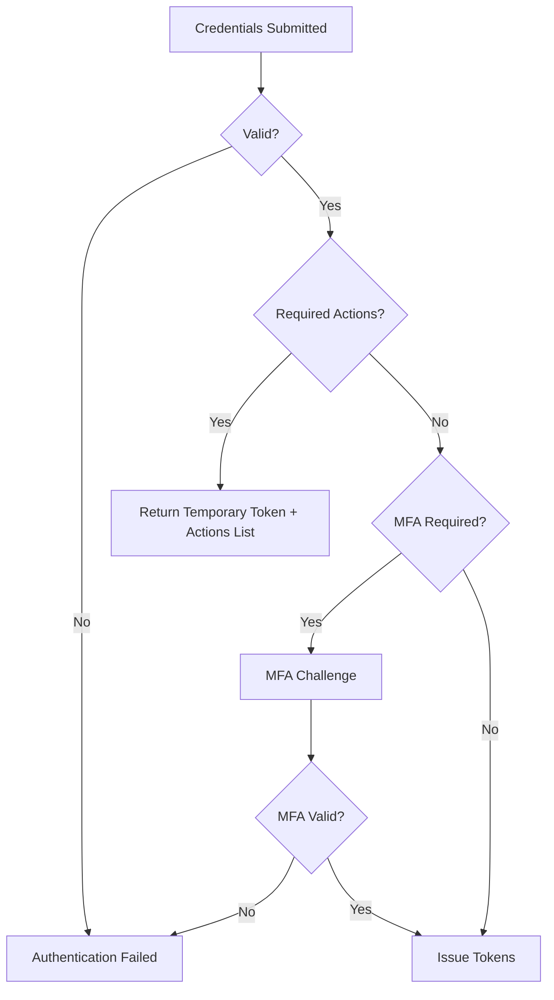

# Authentication

FerrisKey authenticates over two protocols:

| Protocol | Front door | What the application receives |
|---|---|---|
| OAuth 2.0 / OpenID Connect | `/protocol/openid-connect/*` | Access, refresh and ID tokens |
| SAML 2.0 | `/protocol/saml` | One signed XML assertion |

They differ only at the edges. Underneath, both go through the same login, the same MFA, the same lockout and the same audit trail. The [authentication chain](#authentication-chain) below is shared, and it is the part worth understanding first.

Most of this page is about OIDC, because it is the default and the richer surface. [SAML](#saml-20) has its own section.

## OpenID Connect discovery

OpenID Connect applications need to know where the authorization server lives and which endpoints it exposes. FerrisKey publishes that information through the discovery endpoint:

```text
/realms/{realm}/.well-known/openid-configuration
```

For example, if FerrisKey is available at `https://sso.example.com` and your realm is `home`, the discovery endpoint is:

```text
https://sso.example.com/realms/home/.well-known/openid-configuration
```

This endpoint returns a JSON document that OIDC clients can read automatically. It includes:

| Field | What it tells the application |
|---|---|
| `issuer` | The canonical URL for this realm as an identity provider |
| `authorization_endpoint` | Where the browser is sent to start login |
| `token_endpoint` | Where the application exchanges codes for tokens |
| `userinfo_endpoint` | Where the application can fetch profile information |
| `jwks_uri` | Where public signing keys are exposed so tokens can be verified |
| `introspection_endpoint`, `revocation_endpoint` | Where tokens are introspected and revoked |
| `end_session_endpoint` | Where RP-initiated logout goes |
| `device_authorization_endpoint` | Where a browserless device starts the device flow |
| `grant_types_supported` | `authorization_code`, `refresh_token`, `client_credentials`, `password`, the device code grant and the token exchange grant |
| `token_endpoint_auth_methods_supported` | `none`, `client_secret_basic`, `client_secret_post` |
| `code_challenge_methods_supported` | `S256` |
| `scopes_supported` | The client scopes of the realm |
| `backchannel_logout_supported`, `backchannel_logout_session_supported` | Both `true`. See [back-channel logout](/en/discover/core-concepts/backchannel-logout) |
| `authorization_response_iss_parameter_supported` | `true`: every authorization response carries an `iss` parameter (RFC 9207) |
| `registration_endpoint`, `client_id_metadata_document_supported` | Present only when the realm turns on dynamic client registration or client ID metadata documents. See [MCP](/en/discover/core-concepts/mcp) |

Most applications support discovery, so you rarely paste endpoints by hand. Give the application the discovery URL or the issuer, and it reads the rest from FerrisKey.

Clients that look for OAuth 2.0 authorization server metadata (RFC 8414) find it at `/.well-known/oauth-authorization-server/realms/{realm}`. It carries the same endpoints, grants and PKCE methods, without the userinfo, end-session and device authorization endpoints. Behind a `SERVER_ROOT_PATH`, the document is served under that prefix and also at `/.well-known/oauth-authorization-server{root_path}/realms/{realm}`, the form RFC 8414 asks for.

:::callout{variant="warning" title="Only the code flow is implemented"}
`response_types_supported` in the OpenID configuration also lists `none`, `token`, `id_token` and the hybrid combinations such as `code id_token`. None of them exist. The authorization endpoint does not act on `response_type` and always answers with an authorization code, so use `response_type=code`. The RFC 8414 document lists `code` only.
:::

:::callout{variant="info" title="Issuer and discovery are not the same setting"}
When an application asks for the issuer or the authority, give it the realm URL, for example `https://sso.example.com/realms/home`. When it asks for the discovery endpoint or the OpenID configuration URL, give it the full `/.well-known/openid-configuration` address.
:::

:::callout{variant="warning" title="The issuer follows the request"}
FerrisKey builds `issuer`, every endpoint URL and the `iss` claim of the tokens from the `Host` and `X-Forwarded-Proto` headers of the request. Behind a reverse proxy that terminates TLS, forward both, or the issuer comes out as `http://` or as an internal host name and clients that validate it reject your tokens. The OIDC documents do not read `SERVER_PUBLIC_URL`; SAML does.
:::

## Grant types

A grant type is an OAuth2 notion: it names how the client proves who it is acting for. SAML has no equivalent, see [bindings](#saml-20) instead.

### Authorization code

The safest flow for web applications. The user is redirected to FerrisKey, authenticates there, and comes back to the client with a code that the client exchanges for tokens.

The steps:
1. Client redirects the user to `/realms/{realm}/protocol/openid-connect/auth`
2. User authenticates (credentials, MFA if required)
3. FerrisKey redirects back with `code`, `state` and `iss` parameters
4. Client exchanges the code at the token endpoint (server-side)
5. FerrisKey returns access, refresh and ID tokens

Use it for web applications, and for single-page and mobile apps together with PKCE: a public client has no secret, so the code challenge is what binds the code to the client that asked for it.

A code is single use and lives as long as the login attempt that produced it, 10 minutes. Presenting a code a second time, or redeeming it twice at the same moment, is refused with `invalid_grant` and revokes the access and refresh tokens issued under that login's session. The request parameters, `prompt` and `max_age` included, are described in [the authorization request](#the-authorization-request).

### Password (resource owner)

:::callout{variant="danger" title="Deprecated"}
The password grant is deprecated. It is still served, so existing integrations keep working, but do not build anything new on it. OAuth 2.1 removes it, and it cannot work with anything the client does not see, which includes passkeys and any federated login.

For a CLI or another device without a browser, use the [device code grant](#device-code) instead. For a first-party web application, use [authorization code](#authorization-code) with PKCE.
:::

The client collects the credentials itself and posts them to the token endpoint. Simpler, and weaker: the client sees the user's password.

The steps:
1. Client sends `grant_type=password`, `username` and `password` to the token endpoint, together with its own client authentication
2. FerrisKey validates the credentials
3. If the account still owes an authentication step (a required action, an OTP challenge or an MFA enrollment), FerrisKey answers `invalid_grant` and tells the client to use the browser-based authorization code flow. This grant never returns a temporary token
4. Otherwise FerrisKey opens a session and returns the tokens

Only appropriate for an existing integration that has not migrated yet.

:::callout{variant="warning" title="Direct access grants required"}
The client needs `direct_access_grants_enabled` for this flow to work.
:::

### Client credentials

Machine to machine. The client authenticates with its own client id and secret, and no user is involved. The client has to be confidential and have `service_account_enabled`.

The steps:
1. Client sends `grant_type=client_credentials` with its credentials, as an HTTP Basic header or as `client_id` and `client_secret` in the body
2. FerrisKey validates the client credentials
3. Returns an access token for the client's service account

There is no refresh token. An ID token comes back only when `scope` names `openid`, and `offline_access` is refused with `invalid_scope`. No session backs the token, so it has no `sid` claim. These requests are also capped in number, see [the token endpoint](#the-token-endpoint).

Best for backend services, cron jobs, and calls between microservices.

### Refresh token

Renew an expired access token without sending the user back through login.

The steps:
1. Client sends `grant_type=refresh_token` with the refresh token
2. FerrisKey validates the refresh token
3. Returns new access and refresh tokens

Refresh tokens are single use. Each refresh spends the token you sent and returns its successor, and the new tokens stay tied to the same session. If a spent token is presented again, or two requests refresh the same token at the same moment, FerrisKey revokes the whole family (every refresh token descended from that login) and answers `invalid_grant`. The same error comes back once the session behind the token has ended or the user has been disabled.

Best for any flow that issued a refresh token and needs to keep a session alive.

### Device code

```
urn:ietf:params:oauth:grant-type:device_code
```

The flow for anything that cannot host a browser, or cannot be trusted with a password: a CLI, a TV app, a headless box. The device never sees the credential. It asks FerrisKey for a code, tells the user where to type it, and polls until the user has approved it in their own browser, where MFA, passkeys and federated login all work normally.

This is how `ferris-ctl login` connects.

The steps:

1. The device posts to `/realms/{realm}/protocol/openid-connect/auth/device`. A public client passes `client_id` in the form body; a confidential client authenticates with HTTP Basic.
2. FerrisKey returns a device code, a short end-user code, and the verification URI to display.
3. The device shows the user code and the URI, and starts polling the token endpoint with `grant_type=urn:ietf:params:oauth:grant-type:device_code` and the device code.
4. The user opens `/realms/{realm}/device` in any browser, enters the code, and authenticates through the full chain, MFA included.
5. The next poll returns tokens.

While the user has not finished, the poll answers with the RFC 8628 error codes (`authorization_pending`, `slow_down`, `access_denied`, `expired_token`), so a client can tell "not yet" from "refused" and back off accordingly.

| Endpoint | Purpose |
|---|---|
| `POST /realms/{realm_name}/protocol/openid-connect/auth/device` | Start the flow, get the codes |
| `GET /realms/{realm_name}/device` | Page where the user enters the code |
| `POST /realms/{realm_name}/device/verify` | Submit the code |
| `POST /realms/{realm_name}/protocol/openid-connect/token` | Poll for the tokens |

:::callout{variant="warning" title="The client has to allow it"}
The client needs `oauth_device_code_grant_enabled`. Without it the first call is refused.
:::

The flow is also observable: [webhooks](/en/modules/webhooks/triggers) fire `auth.device_flow.initiated`, `auth.device_flow.denied` and `auth.device_flow.expired`.

### Token exchange

```
urn:ietf:params:oauth:grant-type:token-exchange
```

RFC 8693 token exchange lets a backend service trade an access token it holds for a new one with a narrower scope, a different audience, or an `act` claim that names the service as the party acting for the user. The requesting client has to be confidential, enabled, registered by an administrator and have `token_exchange_enabled`. To aim the new token at another client, it also needs a delegation policy for that client, which says whether impersonation and delegation are allowed and caps the scopes. The result is an access token only, with no refresh token and no ID token.

[Token exchange](/en/discover/core-concepts/token-exchange) covers the request, the policies, the claims of the new token and the error codes.

## The authorization request

`GET /realms/{realm}/protocol/openid-connect/auth` starts every browser flow. FerrisKey checks the client, the redirect URI and the PKCE policy, then sends the browser to the login page, or straight back to the application when the browser already holds a valid SSO session.

| Parameter | Description |
|---|---|
| `response_type` | Send `code`. Only the authorization code flow exists: the value is stored but never used |
| `client_id` | An enabled OpenID Connect client of the realm |
| `redirect_uri` | Must match an enabled redirect URI of the client, see [redirect URIs](/en/discover/core-concepts/clients#redirect-uris) |
| `scope` | Space-separated. Default scopes always apply, optional ones only when named |
| `state`, `nonce` | `state` is returned on the redirect, `nonce` is copied into the ID token |
| `code_challenge`, `code_challenge_method` | PKCE. `S256` is the only method discovery advertises, and the only one a public client or a client with `require_pkce` may use |
| `prompt` | `none`, `login` or `consent` |
| `max_age` | Maximum age, in seconds, of the authentication the application accepts |
| `resource` | An RFC 8707 resource indicator. It must be one of the realm's allowed resources and becomes the `aud` of the access token. See [MCP](/en/discover/core-concepts/mcp) |

A successful response redirects to the client with `code`, `state` (when the request had one) and `iss`.

### Prompt and max_age

| Parameter | Effect |
|---|---|
| `prompt=none` | Never shows a page. The browser's SSO session answers the request, or the browser is sent back with an error: `login_required` when there is no usable session, `interaction_required` when the account owes a step such as a required action, `consent_required` when the consent screen would have to appear |
| `prompt=login` | Ignores the SSO session and asks the user to authenticate again |
| `prompt=consent` | Shows the [consent screen](/en/discover/core-concepts/consent) even when a decision is already stored |
| `select_account` | Ignored, like any value FerrisKey does not know |
| `max_age=N` | An SSO session that authenticated more than N seconds ago is not enough, and the user signs in again |
| `max_age=0` | Same as `prompt=login` |

`prompt=none` cannot be combined with another value: the request is sent back with `invalid_request`. When `prompt=login` or an exceeded `max_age` forces a new login, the same user signs back into the session they already had: `sid` stays the same and the session's lifetime restarts. The `auth_time` claim of an ID token is the moment that session last authenticated. ID tokens issued by the authorization code and password grants carry it, those issued by a refresh do not.

### When a request is refused

If the client, the realm or the redirect URI is not valid, FerrisKey does not redirect to the address in the request. The browser lands on the FerrisKey login page with an error message instead. Once the redirect URI is trusted, refusals go back to it as `error`, `state` and `iss` query parameters: `invalid_request`, `invalid_target` (a `resource` the realm does not allow), `login_required`, `interaction_required` and `consent_required`. A request that breaks the client's PKCE policy, or that targets a disabled client, is answered with a JSON error instead of a redirect.

## The token endpoint

`POST /realms/{realm}/protocol/openid-connect/token` takes an `application/x-www-form-urlencoded` body and serves every grant above.

A client authenticates in one of three ways, the ones listed in `token_endpoint_auth_methods_supported`:

| Method | How |
|---|---|
| `none` | A public client sends `client_id` in the body |
| `client_secret_basic` | HTTP Basic, `client_id` as the user name and the secret as the password |
| `client_secret_post` | `client_id` and `client_secret` in the body |

Assertion-based methods such as `private_key_jwt` are not supported. When a request carries both a Basic header and body fields, the header wins. Basic credentials are form-decoded as RFC 6749 requires, so a secret containing `+` or `%` must be percent-encoded before it is base64-encoded.

Errors follow RFC 6749 §5.2: a JSON body with `error` and `error_description`. `invalid_client` is a `401` with `WWW-Authenticate: Basic`; `invalid_request`, `invalid_grant`, `invalid_scope`, `invalid_target`, `unauthorized_client` and `unsupported_grant_type` are `400`. Every response, successful or not, carries `Cache-Control: no-store` and `Pragma: no-cache`.

Two limits protect the endpoint:

- After 10 failed client authentications within a minute from one (IP address, realm, `client_id`), the next requests get `429` with `temporarily_unavailable` and `Retry-After: 60`.
- `client_credentials` requests beyond `SERVER_TOKEN_MAX_IN_FLIGHT` served at once (32 per CPU the process may use, by default) get `503` with `temporarily_unavailable` and `Retry-After: 1`.

Both limits are held in memory by each replica, so a deployment with several replicas enforces them per replica. The failure threshold is not configurable. The client address is the peer of the TCP connection. Set `SERVER_TRUST_FORWARDED_FOR` to read `X-Forwarded-For` instead, and only when a proxy you control is the sole way in. See [Configuration](/en/discover/guides/configuration).

## The OIDC endpoints

These are the integration surface: what an application, a resource server or a gateway talks to. All are relative to `/realms/{realm_name}/protocol/openid-connect`.

| Method | Path | Purpose |
|---|---|---|
| `GET` | `/auth` | Start the authorization code flow |
| `POST` | `/auth/device` | Start the device flow (RFC 8628 §3.1) |
| `POST` | `/token` | Exchange a code, refresh token, device code or credentials for tokens |
| `POST` | `/token/introspect` | Token introspection (RFC 7662) |
| `GET` `POST` | `/userinfo` | `sub`, plus `name`, `given_name`, `family_name` and `preferred_username` with the `profile` scope and `email` and `email_verified` with the `email` scope. The access token must carry `openid` |
| `POST` | `/revoke` | Revoke an access or refresh token (RFC 7009) |
| `GET` `POST` | `/logout` | RP-initiated logout |
| `GET` | `/jwks.json`, `/certs` | The realm's public signing keys |
| `POST` | `/registrations` | Self-service registration, when the realm allows it |

### Introspection

`/token/introspect` takes a form body with `token` and an optional `token_type_hint`, and authenticates the caller with `client_secret_basic` or `client_secret_post`. Any enabled confidential client of the realm that presents its secret can introspect any token of that realm: no role or permission is checked on the caller. A public client is refused, so validate the JWT signature against `/jwks.json` instead, which needs no credential and no round trip. A signature check cannot see a revocation, though: a revoked token still verifies until `exp`.

The answer is a fixed subset of RFC 7662: the claims of an active token, or `{"active": false}` and nothing more. [Tokens](/en/discover/core-concepts/tokens#validating-a-token) lists the fields and the cases that come back inactive, among them revoked tokens, spent refresh tokens, ID tokens and tokens whose session has ended.

### Revocation

`/revoke` authenticates the client like the token endpoint does. A public client sends only its `client_id`. Once the client is authenticated it always answers `200`, whether the token was valid, already revoked or unreadable, so the answer says nothing about the token. It acts only on tokens issued to the calling client (its `azp`): any other token is left alone. Revoking a refresh token revokes that token, not its whole family.

### Logout

`GET` or `POST /logout` ends the user's session. It accepts `id_token_hint`, `post_logout_redirect_uri`, `state` and `client_id`.

FerrisKey finds the session through the `sid` of a valid `id_token_hint`, or failing that through the `FERRISKEY_SSO` cookie. It revokes that session together with every access and refresh token issued under it (SeaWatch records `session_revoked`), clears the FerrisKey cookies, and sends [back-channel logout](/en/discover/core-concepts/backchannel-logout) notices to the clients that took part in the session.

What the browser sees depends on the redirect:

- Without `post_logout_redirect_uri`, the answer is an empty `204`. FerrisKey has no logout page, so the user stays on whichever page made the request.
- With one, the answer is a `307` to that URI with `state` appended. The URI must equal, character for character, an enabled [post-logout redirect](/en/discover/core-concepts/clients#sub-resources) of the client. The client comes from `client_id` or from the `azp` of the `id_token_hint`; with neither, the request is refused. The session is already gone when the URI is checked, so a refused redirect does not leave the user signed in.

The signature and the issuer of an `id_token_hint` must check out, but an expired hint is accepted. An invalid hint is ignored when no redirect is requested, and fails the request when one is.

### Keys

`/jwks.json`, its `/certs` twin and the unannotated `/jwks` alias all return the realm's public keys. They need no authentication and are meant to be public. The answer carries `Cache-Control: public, max-age=300`, so clients and proxies may keep it for five minutes. Discovery advertises `/jwks.json`.

### Registration

`/registrations` creates a user when the realm has `user_registration_enabled` (otherwise it answers `403`). The body takes `email` and `password`, plus `first_name`, `last_name` and an optional `username`; without a username, the user name is the email address, trimmed and lowercased. The `201` response carries a `status`:

| `status` | `data` | When |
|---|---|---|
| `authenticated` | The tokens | Nothing is left to do |
| `redirect` | `url` | The registration happened inside an authorization flow, and `url` resumes it |
| `pending_action` | `message` and `user_id` | The user owes a step, email verification for instance |

:::callout{variant="info" title="Building your own login pages?"}
The endpoints the portal itself drives, the login form, the MFA challenge and the reset flow, are a separate family. See [Login Actions](/en/modules/portal/login-actions).
:::

## SAML 2.0

For applications that speak nothing else, FerrisKey acts as a SAML identity provider: a service provider sends an `AuthnRequest`, the user signs in through the normal FerrisKey login, and FerrisKey posts back a signed assertion.

### Bindings instead of grants

SAML has no grant types. What it has is bindings, which describe how the request travels, and FerrisKey serves both on one path:

| Method | Path | Binding |
|---|---|---|
| `GET` | `/realms/{realm_name}/protocol/saml` | HTTP-Redirect |
| `POST` | `/realms/{realm_name}/protocol/saml` | HTTP-POST |
| `GET` | `/realms/{realm_name}/protocol/saml/continue` | Resume after the user has authenticated |
| `GET` | `/realms/{realm_name}/protocol/saml/descriptor` | IdP metadata to hand to a service provider |

The descriptor is the equivalent of the discovery document: point a service provider at that URL and it learns the entity id, the SSO endpoints and the signing certificate on its own.

### A client speaks one protocol

A client carries a `protocol`, either `openid-connect` (the default) or `saml`, and it is set at creation and cannot be changed afterwards, like the confidential/public choice. An application that migrates from SAML to OIDC gets a new client, not an edited one.

A SAML client has two collections of its own:

```
GET PUT        /realms/{realm_name}/clients/{client_id}/saml-config
GET POST       /realms/{realm_name}/clients/{client_id}/saml-attribute-mappers
DELETE         /realms/{realm_name}/clients/{client_id}/saml-attribute-mappers/{mapper_id}
```

Attribute mappers are SAML's answer to [protocol mappers](/en/modules/aegis/protocol-mappers): they decide which user data lands in the assertion. The two systems are separate. A protocol mapper does not affect an assertion, and an attribute mapper does not affect a JWT.

### What SAML does not get

The OIDC surface has no SAML counterpart, and that is a protocol difference rather than a gap:

- No refresh tokens. The assertion is the whole answer; there is nothing to refresh.
- No `userinfo`, no introspection. Everything the service provider learns is inside the assertion it already holds.
- No device flow, no client credentials. Both are OAuth2 constructs.

### One configuration requirement

The IdP entity id is built from `SERVER_PUBLIC_URL` and the realm name, and it is signed into every assertion, so it must never move. For that reason SAML refuses to guess an origin from the request: without `SERVER_PUBLIC_URL`, the SSO endpoints and the descriptor answer HTTP 500 with "Single sign-on is not configured on this server. Set SERVER_PUBLIC_URL."

:::callout{variant="warning" title="Set SERVER_PUBLIC_URL before enabling SAML"}
Set it to the origin browsers and service providers actually reach, as `scheme://host[:port]`. OIDC does not read it, so a deployment that has run OIDC for months can still have it unset. See [Configuration](/en/discover/guides/configuration).
:::

[SAML 2.0](/en/discover/core-concepts/saml) has the rest: registering a service provider, Name ID formats, the attribute mapper reference, the full flow diagram, and assertion validity.

## Authentication chain

Both protocols run through the same chain. Whether the request arrived as an OIDC authorization request or a SAML `AuthnRequest`, what happens between the user and the credential is identical:



1. Credential validation. The username and password are verified.
2. Required actions. If any are pending (`configure_otp`, `verify_email`, `update_password`, `configure_passkey`), a temporary token comes back instead of the real thing.
3. MFA. If the user has a TOTP credential, the one-time code has to be entered. A passkey signs the user in on its own and is not asked as a second factor after a password.
4. Token issuance. Access, refresh and ID tokens are generated, or, for a SAML request, the assertion is built and signed.

Everything downstream is shared too. [Compass](/en/modules/compass/overview) records SAML executions alongside OIDC ones, with `saml_authn_request` and `saml_assertion` as their own steps, and [SeaWatch](/en/modules/seawatch/overview) logs the same `login_success` and `login_failure` events whichever protocol asked. There is no separate SAML audit trail to go looking for.

## Auth sessions

An auth session tracks a login in progress. It holds:

- The client and realm context
- The redirect URI and OAuth2 parameters (`state`, `nonce`, `scope`, `resource`)
- The PKCE code challenge
- The authorization code (after successful auth)
- WebAuthn challenge data (if applicable)
- The linked Compass flow (if the flow engine is enabled)

Auth sessions are short-lived: an attempt that is not completed within 10 minutes expires on its own.

Do not confuse it with the SSO session. The SSO session is created once the user has authenticated, lives as long as the refresh token lifetime of the client, and is what the `FERRISKEY_SSO` cookie and the `sid` claim of the tokens point to. [Realms](/en/discover/core-concepts/realms#sessions-and-the-sso-cookie) describes its cookie and lifetime.
