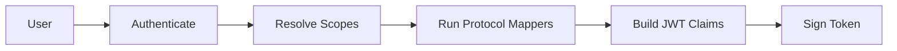

# Client scopes

A client scope decides what ends up inside a token. It groups protocol mappers, which are the rules that pull data off a user or a client and write it into the JWT as claims.

## Scope types

| Type | Behavior |
|---|---|
| Default | Included in every token issued for the client |
| Optional | Included only when the client asks for it in the `scope` parameter |
| None | Not assigned to the client at all |

The same scope can be default for one client and optional for another. That is decided by the client scope mapping, not by the scope itself.

A scope also has a type of its own, default or optional, chosen when you create it. It only matters when a client is created: the new client receives every scope of type default as a default scope, and nothing else. Optional scopes are never attached automatically, so assign them to each client that needs them.

## Scopes seeded by default

Every realm is seeded with a standard set of OIDC scopes.

| Scope | Type | Claims it produces |
|---|---|---|
| `openid` | default | none of its own; marks the request as OIDC |
| `profile` | default | `given_name`, `family_name`, `preferred_username` |
| `email` | default | `email`, `email_verified` |
| `organization` | default | `organizations` |
| `roles` | default | `realm_access.roles` |
| `offline_access` | optional | none of its own |
| `phone` | optional | `phone_number` |
| `address` | optional | `address` |


:::callout{variant="info" title="openid and offline_access carry no mapper"}
Two of the eight seeded scopes write no claim of their own. `openid` marks the request as OIDC and `offline_access` unlocks refresh-token issuance. Both act on the flow, not on the payload. A scope with zero mappers is not necessarily misconfigured.
:::

The five default scopes are attached to every client you create afterwards. `offline_access`, `phone` and `address` exist in the realm but reach a client only when you assign them to it, as optional scopes.

The `organization` scope is the newest, and the only one whose two mappers deliberately target the same claim: the membership mapper contributes each organization's `id`, `name` and `alias`, the role mapper contributes `roles` and `clients.<id>.roles`, and the two deep-merge into one `organizations` object.

## Protocol mappers

A mapper is identified by a `mapper_type` string. FerrisKey keeps the Keycloak names, so configuration written for Keycloak is recognizable here.

| `mapper_type` | What it does |
|---|---|
| `oidc-usermodel-property-mapper` | Maps a built-in user property (username, email, first name) to a claim |
| `oidc-usermodel-attribute-mapper` | Maps a custom user attribute to a claim |
| `oidc-usermodel-realm-role-mapper` | Writes the user's realm roles into the token |
| `oidc-usermodel-client-role-mapper` | Writes the user's client roles into the token |
| `oidc-group-membership-mapper` | Writes the user's group memberships |
| `oidc-organization-membership-mapper` | Writes the user's organization memberships |
| `oidc-organization-detail-mapper` | Writes details of the active organization |
| `oidc-organization-role-mapper` | Writes the user's roles within an organization |
| `oidc-full-name-mapper` | Writes the first and last name, joined by a space, to the `name` claim |
| `oidc-audience-mapper` | Adds the value of `included.client.audience` to the `aud` claim of the access token |
| `oidc-hardcoded-claim-mapper` | Adds a fixed value as a claim |

Each mapper carries a JSON `config`. The keys follow the Keycloak convention:

```json title="Mapping the username into preferred_username"
{
  "user.attribute": "username",
  "claim.name": "preferred_username",
  "access.token.claim": "true",
  "id.token.claim": "true"
}
```

`claim.name` supports dotted paths, so `realm_access.roles` produces a nested object rather than a flat key with a dot in its name.

## Managing scopes

```
GET    /realms/{realm_name}/client-scopes
POST   /realms/{realm_name}/client-scopes
GET    /realms/{realm_name}/client-scopes/{scope_id}
PATCH  /realms/{realm_name}/client-scopes/{scope_id}
DELETE /realms/{realm_name}/client-scopes/{scope_id}
```

Mappers live under their scope:

```
POST   /realms/{realm_name}/client-scopes/{scope_id}/protocol-mappers
PATCH  /realms/{realm_name}/client-scopes/{scope_id}/protocol-mappers/{mapper_id}
DELETE /realms/{realm_name}/client-scopes/{scope_id}/protocol-mappers/{mapper_id}
```

### Assigning a scope to a client

```
GET    /realms/{realm_name}/clients/{client_id}/client-scopes
PUT    /realms/{realm_name}/clients/{client_id}/default-client-scopes/{scope_id}
DELETE /realms/{realm_name}/clients/{client_id}/default-client-scopes/{scope_id}
PUT    /realms/{realm_name}/clients/{client_id}/optional-client-scopes/{scope_id}
DELETE /realms/{realm_name}/clients/{client_id}/optional-client-scopes/{scope_id}
```

A default scope applies to every request from that client. An optional scope applies only when the request names it in its `scope` parameter. A client holds a scope once, as default or as optional, never both. Assigning a scope the client already has fails, so move a scope from one list to the other by unassigning it first and assigning it again.

Reading needs `view_client_scopes` or `manage_client_scopes`, writing needs `manage_client_scopes`, and `manage_realm` grants both.

`POST /realms/{realm_name}/clients/{client_id}/evaluate-scopes` previews the claims a client's current assignment produces for a given user, without a login.

## Optional scopes and consent

An optional scope reaches a token only when the request names it. For a client that requires consent, the user also has a say: the consent screen lists the optional scopes the request asked for, and the token carries only the ones the user approves. A client requires consent when its `consent_required` flag is set, and always when it registered itself. FerrisKey stores the decision per user and client for 30 days, and does not ask again for the same scopes in that time.

The [consent](/en/discover/core-concepts/consent) page covers the screen, the stored decision and `prompt=consent`.

## Scopes for clients that register themselves

A client that registers itself anonymously, by dynamic registration or through a client ID metadata document, can always request `openid`, `profile`, `email` and `roles`. Any other scope is open to it only when the scope has `dynamic_registration_allowed` set, which is `false` on every seeded scope. Set it in the console with **Available to dynamic clients (CIMD, DCR)**, or in the body of `POST /realms/{realm_name}/client-scopes` and `PATCH /realms/{realm_name}/client-scopes/{scope_id}`. The scope list marks such scopes with a **Dynamic clients** badge.

Expose a scope this way only when you would hand its claims to an application you have never reviewed. See [MCP](/en/discover/core-concepts/mcp) for the registration flows.

## How scopes shape a token



1. The user authenticates against a client.
2. FerrisKey resolves which scopes apply: the client's default scopes, plus any optional ones the request asked for.
3. The mappers on each active scope run.
4. Their output becomes JWT claims, alongside the standard ones.
5. The token is signed with the realm's key.

:::callout{variant="info" title="A scope is a claim contract"}
Read a scope as an agreement between the client and the authorization server: grant me `profile`, and I expect the user's name and username to come back in the token.
:::
