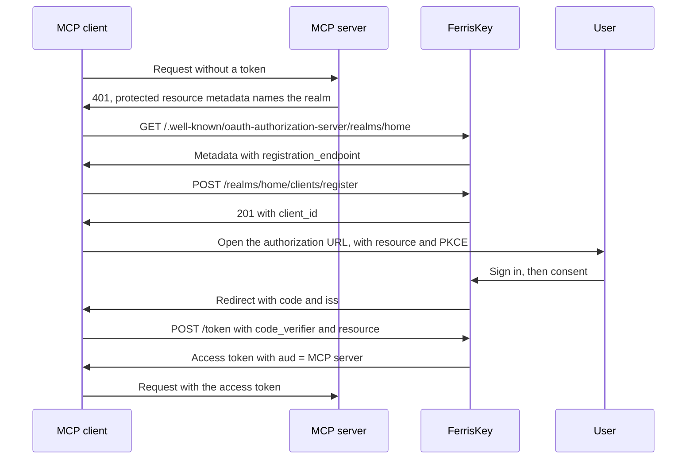

# MCP and dynamic client registration

An MCP server hands sign-in to an authorization server, and a realm can be that server: it publishes RFC 8414 metadata, lets clients it has never heard of register themselves, and issues tokens whose audience is the MCP server.

An MCP client, such as an editor or a desktop assistant, cannot be registered by hand in every realm it will ever talk to. It either registers itself on the fly or identifies itself with a URL, and the pieces below exist for that.

| Piece | Standard | Default | Purpose |
|---|---|---|---|
| Authorization server metadata | RFC 8414 | Always on | Tells a client where the endpoints are and which registration options exist |
| Dynamic client registration (DCR) | RFC 7591 | Off | A client registers itself with one anonymous `POST` |
| Client ID metadata documents (CIMD) | IETF draft | Off | A client uses an `https` URL as its `client_id`, and the URL serves its description |
| Resource indicators | RFC 8707 | No resource allowed | The `resource` parameter sets the audience of the token |

FerrisKey is the authorization server only. The protected resource metadata that points a client at it is published by the MCP server, not by FerrisKey.

## Settings

All of it lives on the realm. In the console, open **Realm Settings**, then the **MCP** tab, titled "MCP / Client registration".

| Console label | API field | Default |
|---|---|---|
| Dynamic Client Registration | `dcr_enabled` | `false` |
| Client ID Metadata Documents | `cimd_enabled` | `false` |
| Allowed metadata document hosts | `cimd_allowed_hosts` | empty |
| Allowed resources | `allowed_resources` | empty |


The same fields go through `PUT /realms/{realm_name}/settings`. Each is optional in the body, and one that you leave out is unchanged.

```json title="PUT /realms/home/settings"
{
  "dcr_enabled": true,
  "cimd_enabled": true,
  "cimd_allowed_hosts": ["client.example.com"],
  "allowed_resources": ["https://mcp.example.com"]
}
```

A client created by either route can only ask for the scopes you have opened to it. On a client scope, switch on **Available to dynamic clients (CIMD, DCR)** (`dynamic_registration_allowed`, default `false`). `openid`, `profile`, `email` and `roles` are always available.

## Authorization server metadata

```text
GET /.well-known/oauth-authorization-server/realms/{realm_name}
```

This is the RFC 8414 path-insertion form for an issuer of `https://sso.example.com/realms/home`. When the API runs under `SERVER_ROOT_PATH`, the same document is also served under `{root_path}/.well-known/oauth-authorization-server/realms/{realm_name}` and at the strict form `/.well-known/oauth-authorization-server{root_path}/realms/{realm_name}`. An unknown realm answers `401`.

```json
{
  "issuer": "https://sso.example.com/realms/home",
  "authorization_endpoint": "https://sso.example.com/realms/home/protocol/openid-connect/auth",
  "token_endpoint": "https://sso.example.com/realms/home/protocol/openid-connect/token",
  "jwks_uri": "https://sso.example.com/realms/home/protocol/openid-connect/jwks.json",
  "revocation_endpoint": "https://sso.example.com/realms/home/protocol/openid-connect/revoke",
  "introspection_endpoint": "https://sso.example.com/realms/home/protocol/openid-connect/token/introspect",
  "scopes_supported": ["address", "email", "offline_access", "openid", "organization", "phone", "profile", "roles"],
  "response_types_supported": ["code"],
  "grant_types_supported": [
    "authorization_code",
    "refresh_token",
    "client_credentials",
    "password",
    "urn:ietf:params:oauth:grant-type:device_code",
    "urn:ietf:params:oauth:grant-type:token-exchange"
  ],
  "code_challenge_methods_supported": ["S256"],
  "token_endpoint_auth_methods_supported": ["none", "client_secret_basic", "client_secret_post"],
  "authorization_response_iss_parameter_supported": true,
  "registration_endpoint": "https://sso.example.com/realms/home/clients/register",
  "client_id_metadata_document_supported": true
}
```

`registration_endpoint` appears only when `dcr_enabled` is on, and `client_id_metadata_document_supported` only when `cimd_enabled` is on. `scopes_supported` lists the realm's client scopes. Authorization responses carry the issuer as `iss` (RFC 9207), which is what `authorization_response_iss_parameter_supported` announces.

## Dynamic client registration

```text
POST /realms/{realm_name}/clients/register
```

The endpoint takes no credentials. The body is a client metadata document:

```json
{
  "client_name": "Reports assistant",
  "redirect_uris": ["http://127.0.0.1:33418/callback"],
  "token_endpoint_auth_method": "none",
  "grant_types": ["authorization_code", "refresh_token"],
  "response_types": ["code"]
}
```

| Field | Rule |
|---|---|
| `redirect_uris` | Required, 1 to 10 entries of at most 2048 bytes. Each is `https`, or `http` on a loopback host (`localhost`, `127.0.0.1`, `::1`). No fragment and no credentials |
| `token_endpoint_auth_method` | `none` (a public client), `client_secret_basic` (the default) or `client_secret_post`. The last two create a confidential client |
| `grant_types` | Defaults to `["authorization_code"]`. Must include it, and may add `refresh_token` |
| `response_types` | Only `code` |
| `scope` | Space-separated. Only `openid`, `profile`, `email`, `roles` and scopes flagged for dynamic clients |
| `client_name` | At most 128 characters. Defaults to "Dynamic client" |

`grant_types` and `response_types` are validated and echoed back; FerrisKey does not store them.

A successful call answers `201` with `Cache-Control: no-store`:

```json
{
  "client_id": "6f0e4c1a-3b5d-4e7f-8a9b-0c1d2e3f4a5b",
  "client_id_issued_at": 1790000000,
  "client_name": "Reports assistant",
  "redirect_uris": ["http://127.0.0.1:33418/callback"],
  "token_endpoint_auth_method": "none",
  "grant_types": ["authorization_code", "refresh_token"],
  "response_types": ["code"],
  "scope": "openid profile email roles"
}
```

A confidential registration also returns `client_secret`, with `client_secret_expires_at` set to `0`.

The client that gets created is enabled, requires consent, and has direct access grants, service account and token exchange all off. A public one has PKCE required. `openid`, `profile`, `email` and `roles` are default scopes. A `scope` in the request adds the extra scopes it names as defaults. Without `scope`, every scope flagged for dynamic clients is attached as an optional scope, which the client can then request by name and the user can approve on the [consent screen](/en/discover/core-concepts/consent). There is no management endpoint (RFC 7592): after registration the client is an ordinary client in the realm that you manage like any other.

### Limits and errors

| Limit | Value |
|---|---|
| Requests per IP address | 10 per minute |
| Registrations per realm | 60 per hour |
| Dynamic clients per realm | 1000 |

Requests count against the first two whether or not they are valid.

| Status | `error` | When |
|---|---|---|
| `400` | `invalid_redirect_uri` | `redirect_uris` is missing, empty or over 10, or an entry breaks the rule above |
| `400` | `invalid_client_metadata` | Any other field is refused, the body is not a metadata document, or the realm already holds 1000 dynamic clients |
| `404` | `not_found` | Registration is off for the realm, or the realm does not exist |
| `429` | `too_many_requests` | A rate limit was hit. The answer carries `Retry-After: 60` |
| `500` | `server_error` | The client could not be stored |

Registration is anonymous by design, so anyone who can reach the endpoint can create clients up to those limits. What protects your users is the consent screen, which every dynamic client goes through on every authorization request and which names the client and the host of its redirect URI. Leave `dcr_enabled` off if you do not need it.

## Client ID metadata documents

With `cimd_enabled` on, a client can skip registration and use an `https` URL as its `client_id`:

```text
https://client.example.com/oauth/client.json
```

The first time FerrisKey sees that `client_id` in an authorization request, it fetches the document, creates a client from it, and keeps it in sync on later requests. The URL has to be at most 255 characters, carry a path other than `/`, and have no fragment and no credentials.

```json
{
  "client_id": "https://client.example.com/oauth/client.json",
  "client_name": "Reports assistant",
  "redirect_uris": ["http://127.0.0.1:33418/callback"],
  "token_endpoint_auth_method": "none"
}
```

| Rule | Detail |
|---|---|
| `client_id` in the document | Must equal the URL it was fetched from |
| `redirect_uris` | 1 to 10 entries, under the same rules as registration. The `redirect_uri` of the authorization request must be one of them |
| `token_endpoint_auth_method` | Absent or `none`. Nothing else is accepted, so these clients are always public |
| Fetch | `GET` with `Accept: application/json`. The answer must be `200`, `application/json` (or `+json`) and at most 5 KiB. Redirects are not followed, and the fetch times out after 5 seconds |
| Network | The host must resolve to a public address. The fetch is pinned to the address it checked |

The client is created public, with PKCE required and consent required. Its name is `client_name`, or the host when the document has none. FerrisKey caches the document for 5 minutes, or for the `max-age` of its `Cache-Control` header up to 24 hours, and does not cache it at all under `no-store` or `no-cache`. A failed fetch is cached for 60 seconds.

:::callout{variant="warning" title="An empty host list accepts every host"}
`cimd_allowed_hosts` holds bare host names, matched exactly and without regard to case. A scheme, a path, a port or a wildcard is refused when you save. With an empty list, **any** host is accepted. Fill the list before you turn `cimd_enabled` on.
:::

Limits: each source address may trigger 30 first-time resolutions per minute, and a realm holds at most 1000 metadata document clients. A refused document makes the authorization request fail with `401` and `Invalid client`, and the reason goes to the server log. A document that does not list the request's `redirect_uri` sends the browser to the login page with an error instead. A `client_id` that is already used by a client registered another way is refused.

`CLIENT_METADATA_ALLOW_PRIVATE_ENDPOINTS` lets FerrisKey fetch documents over `http` from loopback and private addresses. It exists for tests. Do not set it in production.

## Resource indicators

`allowed_resources` lists the resources a client may name in the `resource` parameter (RFC 8707). Each entry is an absolute `https` URL, or `http` on a loopback host, with no fragment. A resource is matched as an exact string.

When a request names a resource, the access token gets that resource as its whole audience: `aud` becomes `["https://mcp.example.com"]`, replacing the audiences the token would otherwise carry. The parameter is read on:

| Where | Behaviour |
|---|---|
| `GET .../auth` | A resource that is not allowed redirects to the client with `error=invalid_target`. An allowed one is remembered with the authorization request |
| `authorization_code` grant | Inherits the resource of the authorization request. A different one is `invalid_target`. If the request named none, an allowed resource may be supplied here |
| `refresh_token` grant | May repeat the resource the refresh token was issued for or leave it out. A different one, or one that has left `allowed_resources`, is `invalid_target` |
| `password` and `client_credentials` grants | Any resource in `allowed_resources` |

A resource that is not allowed is answered `400` with `invalid_target` and "The requested resource is not allowed for this realm." The [token exchange](/en/discover/core-concepts/token-exchange) grant does not take `resource`.

### Resource owners

A resource can have an owner: a confidential client registered by an administrator. The owner counts as a party to any access token whose audience is its resource, which lets an MCP server use [token exchange](/en/discover/core-concepts/token-exchange#the-request) to call downstream APIs as the user. Without ownership, a token whose audience is only the MCP server's URL belongs to the client that obtained it, and the exchange is refused with `unauthorized_client`.

| Method | Endpoint | Description |
|---|---|---|
| `GET` | `/realms/{realm_name}/resource-owners` | List the owners |
| `PUT` | `/realms/{realm_name}/resource-owners` | Replace the whole set |

```json title="PUT /realms/home/resource-owners"
{
  "owners": [
    {
      "uri": "https://mcp.example.com",
      "client_id": "0192f7c4-5e1a-7b3e-9d0c-3a6f1b2c4d5e"
    }
  ]
}
```

`client_id` is the client's UUID. Every `uri` must already be in `allowed_resources` and appear once, and every client must be a confidential, admin-registered client of the realm, otherwise the call answers `400`. Both calls answer `{"data": [...]}` with the same entries. The console sets owners with the picker next to each allowed resource ("No owner" when empty). An owner only matters while its resource stays in `allowed_resources`.

## A worked example

An MCP server at `https://mcp.example.com` trusts the realm `home` on `https://sso.example.com`. You have turned on `dcr_enabled`, added `https://mcp.example.com` to the allowed resources, and flagged a scope named `mcp:tools` as available to dynamic clients.



::::step-group
:::step{title="Find the authorization server"}
The MCP server answers an unauthenticated request with `401` and points at its protected resource metadata, which names `https://sso.example.com/realms/home` as the authorization server. FerrisKey plays no part in that step. The client then reads the realm's metadata from `https://sso.example.com/.well-known/oauth-authorization-server/realms/home` and finds `registration_endpoint`.
:::

:::step{title="Register"}
```bash
curl -X POST https://sso.example.com/realms/home/clients/register \
  -H 'Content-Type: application/json' \
  -d '{
    "client_name": "Reports assistant",
    "redirect_uris": ["http://127.0.0.1:33418/callback"],
    "token_endpoint_auth_method": "none"
  }'
```

The answer holds a `client_id` such as `6f0e4c1a-3b5d-4e7f-8a9b-0c1d2e3f4a5b`. No `scope` was sent, so `mcp:tools` is now an optional scope of that client.
:::

:::step{title="Send the user to authorize"}
The client generates a PKCE verifier and opens the browser on:

```text
https://sso.example.com/realms/home/protocol/openid-connect/auth
  ?response_type=code
  &client_id=6f0e4c1a-3b5d-4e7f-8a9b-0c1d2e3f4a5b
  &redirect_uri=http%3A%2F%2F127.0.0.1%3A33418%2Fcallback
  &scope=openid%20mcp%3Atools
  &state=k3j9x
  &code_challenge=E9Melhoa2OwvFrEMTJguCHaoeK1t8URWbuGJSstw-cM
  &code_challenge_method=S256
  &resource=https%3A%2F%2Fmcp.example.com
```

The user signs in. Because the client registered itself, the consent screen follows, shows "Application served from 127.0.0.1", and lists `mcp:tools` under "Choose what to share".
:::

:::step{title="Receive the code"}
After the user clicks **Allow**, the browser is redirected to the client:

```text
http://127.0.0.1:33418/callback?code=Ab3...&state=k3j9x&iss=https%3A%2F%2Fsso.example.com%2Frealms%2Fhome
```

The client checks `iss` and `state` before it uses the code.
:::

:::step{title="Redeem it"}
```bash
curl -X POST https://sso.example.com/realms/home/protocol/openid-connect/token \
  -d grant_type=authorization_code \
  -d client_id=6f0e4c1a-3b5d-4e7f-8a9b-0c1d2e3f4a5b \
  -d code=Ab3... \
  -d redirect_uri=http://127.0.0.1:33418/callback \
  -d code_verifier=$VERIFIER \
  -d resource=https://mcp.example.com
```

The access token comes back bound to the MCP server. Its payload, abridged:

```json
{
  "iss": "https://sso.example.com/realms/home",
  "sub": "8d1f3c52-0a4e-4d1c-9a57-2f0a1c9e7b11",
  "aud": ["https://mcp.example.com"],
  "azp": "6f0e4c1a-3b5d-4e7f-8a9b-0c1d2e3f4a5b",
  "typ": "Bearer",
  "scope": "openid email mcp:tools profile roles"
}
```
:::

:::step{title="Validate it on the MCP server"}
The MCP server checks the signature against the `jwks_uri`, then `iss`, then that `aud` contains `https://mcp.example.com`, then the scopes it needs. A token issued for another resource fails the `aud` check.
:::
::::

::::card-group{cols=3}
:::card{label="Consent" icon="lucide:user-check" href="/en/discover/core-concepts/consent"}
The screen every dynamic client goes through.
:::
:::card{label="Token exchange" icon="lucide:arrow-left-right" href="/en/discover/core-concepts/token-exchange"}
How an MCP server calls downstream APIs as the user.
:::
:::card{label="Client Scopes" icon="lucide:scan" href="/en/discover/core-concepts/client-scopes"}
Default and optional scopes, and the flag for dynamic clients.
:::
::::
