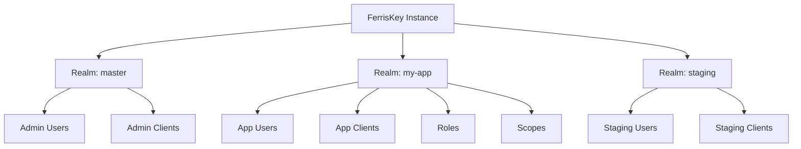

# Realms

A realm is the top-level isolation boundary in FerrisKey. Users, clients, roles, credentials, scopes, and sessions each belong to exactly one realm. Realms make multi-tenancy possible: one FerrisKey deployment can serve many independent organizations.

## What a realm isolates

Each realm is a self-contained identity domain:

| Resource | What it holds |
|---|---|
| Users | Accounts, profiles, and credentials |
| Clients | Applications registered for authentication |
| Roles | Permission bundles and role mappings |
| Credentials | Passwords, TOTP secrets, WebAuthn passkeys |
| Client scopes | Token claim definitions and protocol mappers |
| Sessions | Active user sessions |
| Configuration | Token lifetimes, registration policies, feature toggles |

Nothing leaks between realms. A user in realm A cannot authenticate against a client in realm B.



## The master realm

Every deployment has a `master` realm. It is created on first boot, holds the initial admin user, cannot be deleted, and is where cross-realm administration happens.

:::callout{variant="warning" title="Do not use master for applications"}
Keep `master` for administration. Give each application its own realm.
:::

## Realm settings

Every realm carries its own settings. They control how sign-in behaves, how long tokens live, and which optional features are on. Read them with `GET /realms/{realm_name}` and change them with `PUT /realms/{realm_name}/settings`: a field you leave out keeps its value.

### Sign-in and registration

| Setting | Default | Description |
|---|---|---|
| `user_registration_enabled` | `false` | Allow self-service registration |
| `forgot_password_enabled` | `false` | Enable the password reset flow |
| `remember_me_enabled` | `false` | Show a "Remember me" checkbox on the login page. See [sessions and the SSO cookie](#sessions-and-the-sso-cookie) |
| `magic_link_enabled` | `false` | Enable magic link sign-in by email |
| `magic_link_ttl` | `15` | How long a magic link stays valid, in minutes |
| `passkey_enabled` | `false` | Allow passkey (WebAuthn) sign-in |
| `require_mfa` | `false` | Force every user in the realm to enroll in MFA |
| `login_aliases` | `[username]` | Ordered list of identifiers accepted at login, from `username` and `email`. Must be non-empty and free of duplicates. The first alias that resolves a user wins |
| `edit_username_enabled` | `false` | Let users change their own username |
| `email_verification_enabled` | `false` | Require users to verify their email |
| `email_verification_ttl_hours` | `24` | How long a verification link stays valid |
| `compass_enabled` | `true` | Record authentication flows with Compass |

### Token lifetimes

| Setting | Default | Description |
|---|---|---|
| `default_signing_algorithm` | `RS256` | JWT signing algorithm |
| `access_token_lifetime` | `300` | Access token TTL, in seconds |
| `refresh_token_lifetime` | `86400` | Refresh token TTL, in seconds. Also the lifetime of the SSO session |
| `id_token_lifetime` | `300` | ID token TTL, in seconds |
| `temporary_token_lifetime` | `300` | Temporary token TTL, in seconds, used while required actions are pending |

A client can override each lifetime for itself. See [Tokens](/en/discover/core-concepts/tokens#token-lifetimes).

### Sessions and the SSO cookie

When a user signs in, FerrisKey opens an SSO session and sets the `FERRISKEY_SSO` cookie, which lets the user move between the applications of the realm without signing in again. The cookie is HttpOnly, `SameSite=Lax`, scoped to the path `/`, and marked Secure when the request came in over https.

By default it is a browser-session cookie and disappears when the browser closes. With `remember_me_enabled` on, the login page shows a "Remember me" checkbox. When the user ticks it, the cookie becomes persistent, with a `Max-Age` equal to the remaining lifetime of the session. A session lives as long as the refresh token lifetime of the client the user signed in through: the client's own override, or the realm's `refresh_token_lifetime`. The checkbox appears only while the setting is on, and the server ignores a ticked box otherwise.

Ending the session, by [logout](/en/discover/core-concepts/authentication#logout) or by revocation, also revokes every token issued under it.

### Lockout

After too many failed attempts, an account is locked for a fixed window.

| Setting | Default | Description |
|---|---|---|
| `lockout_threshold` | `10` | Failed attempts before the account locks |
| `lockout_duration_seconds` | `900` | How long the lock lasts |

### Audit privacy

SeaWatch can strip or pseudonymise personal data before an event is stored.

| Setting | Default | Description |
|---|---|---|
| `seawatch_pii_mode` | `off` | One of `off`, `mask`, `pseudonymise` |
| `seawatch_pseudo_key` | unset | HMAC key used when the mode is `pseudonymise` |

### Locales

| Setting | Default | Description |
|---|---|---|
| `default_locale` | `en` | Locale used when the user has expressed no preference. Must be one of `supported_locales` |
| `supported_locales` | `[en]` | Locales the login pages offer. Never empty |

A locale is a language tag of two letters, optionally followed by a two-letter region: `en`, `zh-CN`. A malformed tag, an empty list, or a default that is not in the list is refused with `422`. The console and the login pages are translated into `en` and `zh-CN`.

A user's own choice is stored on the user and set through `PUT /realms/{realm_name}/users/@me/locale`; sending `null` clears it. The locale picks the language of the console and the login pages. It does not touch emails: each email type is sent with the template configured for the realm, whatever the locale.

### Webhook retries

Leave these unset and the realm uses the server defaults.

| Setting | Default | Description |
|---|---|---|
| `webhook_retry_max_attempts` | unset | How many times a failed delivery is retried |
| `webhook_retry_base_delay_ms` | unset | Delay before the first retry, in milliseconds |
| `webhook_retry_max_delay_ms` | unset | Ceiling for a single backoff interval |
| `webhook_retry_max_total_delay_ms` | unset | Ceiling for the whole retry sequence |

### Consent

A consent decision is stored for each user and client, and it stays valid for 30 days. The settings API has no field for that duration. The [consent](/en/discover/core-concepts/consent) page covers when the screen appears.

### Client registration and resources

These settings let applications that you have not registered by hand, such as MCP clients, reach the realm. Each is off or empty by default. The [MCP](/en/discover/core-concepts/mcp) page explains the flows.

| Setting | Default | Description |
|---|---|---|
| `dcr_enabled` | `false` | Let applications register themselves anonymously with `POST /realms/{realm_name}/clients/register`. Discovery then publishes `registration_endpoint`. These clients always require consent |
| `cimd_enabled` | `false` | Accept an `https` URL as a `client_id` and read the client's metadata from it. Discovery then sets `client_id_metadata_document_supported`. These clients always require consent |
| `cimd_allowed_hosts` | `[]` | Host names a client ID URL may point to, as bare names without scheme or path. Empty accepts any host |
| `allowed_resources` | `[]` | The RFC 8707 resource indicators a client may ask an audience for: absolute https URLs, or http on a loopback host, without a fragment. Empty accepts none, and a request with a `resource` fails with `invalid_target` |

### Branding and email templates

| Setting | Default | Description |
|---|---|---|
| `reset_password_template_id` | unset | Template used for password reset emails |
| `magic_link_template_id` | unset | Template used for magic link emails |
| `email_verification_template_id` | unset | Template used for verification emails |

Leave a template id unset and FerrisKey falls back to the built-in default for that email type.

:::callout{variant="info" title="The portal theme is not set here"}
A realm does carry an active portal theme, but it is not a field on this endpoint. Activate one with `POST /realms/{realm_name}/portal/themes/{theme_id}/activate`, described in [Portal](/en/modules/portal/overview).
:::

## Reading settings from the login page

```
GET /realms/{name}/login-settings
```

The login-facing subset of a realm's settings, which is what the portal reads to know which sign-in methods to offer: whether registration is open, whether magic links and passkeys are enabled, which identifiers and locales are accepted, and the theme. It needs no authentication. Use it rather than the full settings read when all you need is to render a login page.

## SMTP configuration

SMTP lives on the realm too, so two realms in the same deployment can send from different providers and different addresses. The [Email & Templates guide](/en/discover/guides/email) covers the fields and the API.
