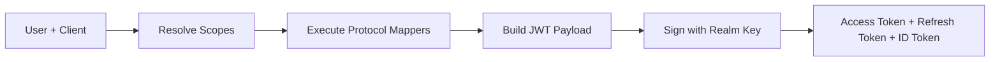

# Tokens

A successful authentication produces JSON Web Tokens. Each type has one job in the OAuth2 and OIDC protocol.

## Token types

| Token | `typ` claim | Purpose | Default lifetime |
|---|---|---|---|
| Access token | `Bearer` | Authorize API requests against a resource server | 300s |
| Refresh token | `Refresh` | Get new access tokens without asking the user again | 86400s |
| ID token | `ID` | Carry the user's identity to the client, per OIDC | 300s |
| Temporary token | `Temporary` | Authorize the completion of required actions, nothing else | 300s |

## JWT structure

Every token is a signed JWT: header, payload, signature. FerrisKey signs with the realm's key using RS256 and publishes the public half at the realm's `jwks.json` endpoint.

### Standard claims

These are the claims of an access token:

| Claim | Description |
|---|---|
| `sub` | Subject, the user's id. For `client_credentials`, the id of the client's service account |
| `aud` | Audience, a list. See [audience](#audience) |
| `azp` | Authorized party, the `client_id` of the client that requested the token |
| `iss` | Issuer, the realm URL, for example `https://sso.example.com/realms/home` |
| `typ` | Token type, `Bearer` for an access token |
| `exp` | Expiration timestamp |
| `iat` | Issued-at timestamp |
| `jti` | Unique token identifier |
| `scope` | Space-separated list of granted scopes |
| `sid` | OIDC session id, the user session this token was issued against |

`sid` is absent for flows that establish no SSO session, `client_credentials` among them. Treat a missing `sid` as "not session-bound", not as an invalid token.

A refresh token carries the same `sub`, `iss`, `aud`, `azp`, `scope` and `sid` with `typ` set to `Refresh`. Treat it as opaque in your application: only FerrisKey needs to read it.

### Audience

The `aud` claim of an access token is a list that depends on how the token was obtained:

| Token | `aud` |
|---|---|
| Regular access token | `["<realm>-realm", "account"]`, for example `["home-realm", "account"]`, plus every value added by an `oidc-audience-mapper` on the client's scopes |
| Requested with an RFC 8707 `resource` | `[resource]` only. See [MCP](/en/discover/core-concepts/mcp) |
| Returned by a [token exchange](/en/discover/core-concepts/token-exchange) with an `audience` | `[audience]` only |

The realm audience is the one FerrisKey's own administration API checks. It accepts a token only when its `aud` contains `<realm>-realm` and its `azp` is an enabled client registered by an administrator. A token narrowed to a resource, exchanged for another audience, or issued to a client that registered itself is refused there. A resource server of your own should require the audience it expects: add it with an `oidc-audience-mapper`, or ask for it with `resource`.

### Identity and mapper claims

Identity claims are not hard-coded into the token. Every one of them, `preferred_username` and `email` included, is written by a protocol mapper attached to a [client scope](/en/discover/core-concepts/client-scopes), and only when that scope is granted. The mappers FerrisKey seeds produce:

| Claim | Source |
|---|---|
| `preferred_username` | `profile` scope |
| `given_name`, `family_name` | `profile` scope |
| `email`, `email_verified` | `email` scope |
| `realm_access.roles` | `roles` scope, through `oidc-usermodel-realm-role-mapper` |
| `organizations` | `organization` scope |

Because mappers are configurable, the exact claim set depends on the scopes assigned to the client.

### ID token claims

An ID token is issued when the granted scope includes `openid`. It differs from the access token in a few claims:

| Claim | Description |
|---|---|
| `aud` | The `client_id` of the client, as a single string rather than a list |
| `azp` | The same `client_id` |
| `nonce` | The `nonce` of the authorization request, when there was one. Absent from ID tokens issued by a refresh |
| `at_hash` | Left half of the SHA-256 of the access token, base64url-encoded |
| `auth_time` | When the session last authenticated. Present on ID tokens issued by the authorization code and password grants, absent on those issued by a refresh |
| `sid` | The session id. RP-initiated logout reads it from an `id_token_hint` |

## Token lifetimes

Lifetimes come from two places:

1. Realm defaults, which apply to every client in the realm.
2. Client overrides, which win when they are set.

| Token | Setting (realm and client) | Realm default |
|---|---|---|
| Access token | `access_token_lifetime` | 300s |
| Refresh token | `refresh_token_lifetime` | 86400s |
| ID token | `id_token_lifetime` | 300s |
| Temporary token | `temporary_token_lifetime` | 300s |

The rule: if the client sets an override, use it, otherwise fall back to the realm. The SSO session of a login lives as long as the refresh token lifetime that applies to the client, so the window in which a user can keep renewing tokens is the window in which the session is alive.

## Refresh tokens are single use

Every refresh returns a new refresh token and spends the old one. Presenting a spent token, or sending the same token twice at once, revokes the whole family of refresh tokens descended from that login and answers `invalid_grant`. A client that retries a refresh after a lost response therefore cannot refresh any more and has to start a new login. Store the new refresh token before using the new access token, and never run two refreshes of the same token in parallel. See [refresh token](/en/discover/core-concepts/authentication#refresh-token).

## Token generation chain



1. The user authenticates to a client
2. Default scopes (plus any requested optional scopes) are resolved
3. Protocol mappers from each scope produce claims
4. Claims are assembled into the JWT payload with standard claims
5. The token is signed using the realm's signing key and algorithm
6. Access, refresh, and (optionally) ID tokens are returned

## Validating a token

A resource server has two ways to decide whether an access token is good.

Locally, it checks the signature against the realm's `jwks.json`, then `iss`, `exp` and the `aud` it expects. This needs no credential and no round trip, but it cannot see a revocation: a revoked token, or a token whose session has ended, still verifies until `exp`. A short access token lifetime bounds that window.

Through introspection, it asks FerrisKey:

```bash
curl -X POST https://sso.example.com/realms/home/protocol/openid-connect/token/introspect \
  -u my-client:my-secret \
  -d "token=eyJhbG..."
```

The caller must be an enabled confidential client of the same realm, authenticating with `client_secret_basic` or `client_secret_post`. FerrisKey checks no role or permission on the caller, so any such client can introspect any token of the realm. Keep those secrets as closely as you keep the tokens.

An active token answers with a fixed subset of RFC 7662:

```json
{
  "active": true,
  "scope": "openid profile email",
  "client_id": "my-client",
  "username": "alice",
  "sub": "8d1f3c52-0a4e-4d1c-9a57-2f0a1c9e7b11",
  "token_type": "Bearer",
  "exp": 1790000300,
  "iat": 1790000000,
  "nbf": 1790000000,
  "aud": "home-realm account",
  "iss": "https://sso.example.com/realms/home",
  "jti": "5b2f8e0c-3f7e-4f64-9a4d-6c1b7d2a9e10",
  "realm": "home"
}
```

`client_id` is the token's `azp`, `aud` is the audience list joined by spaces, and `realm` is the realm name. A field the token does not carry, `username` when there is no `preferred_username` for instance, is left out.

Every other case answers exactly `{"active": false}`: a revoked or expired token, a refresh token that has already been spent, a temporary token, an ID token, a token whose session has ended, and a token the realm did not sign.
