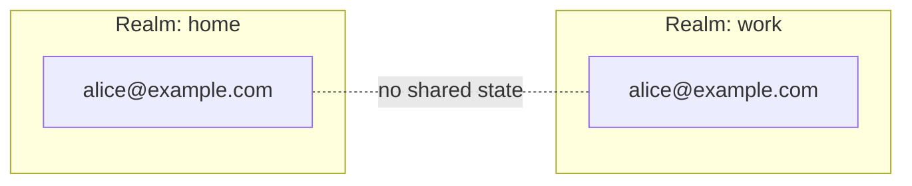
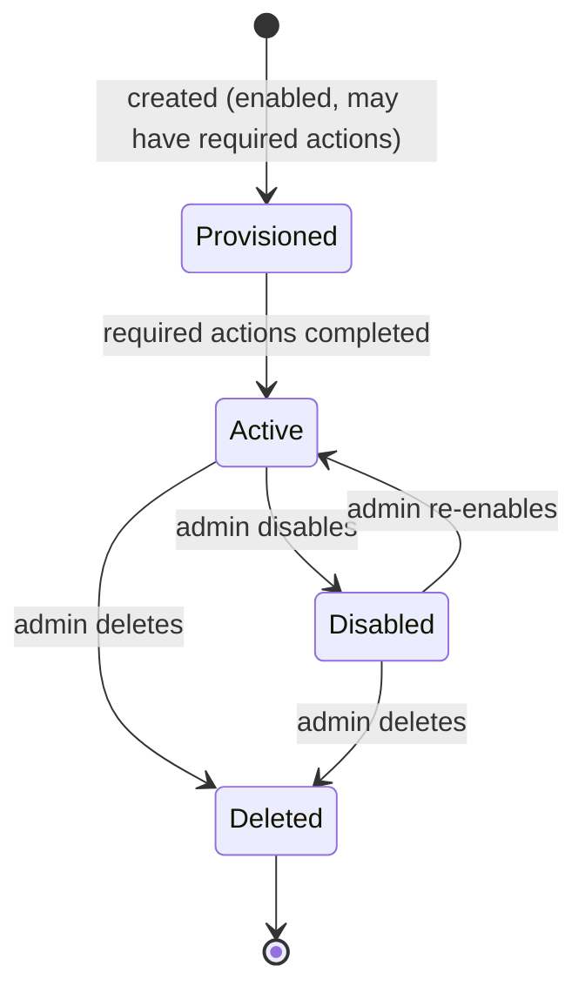
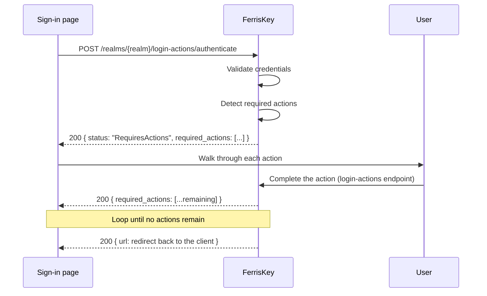

# Users

A user represents an identity within a [realm](/en/discover/core-concepts/realms). Users authenticate through [clients](/en/discover/core-concepts/clients), prove who they are with [credentials](/en/discover/core-concepts/credentials), receive [tokens](/en/discover/core-concepts/tokens), and are authorized through [role](/en/discover/core-concepts/roles) assignments.

Login, token issuance, authorization: at runtime it all resolves back to a user.

## Anatomy of a user

The user record itself is small. It describes who someone is; credentials, roles, and sessions live in related objects.

| Property | Description |
|---|---|
| `id` | Stable identifier (UUID). Used everywhere tokens reference the subject. Generated, unless you supply one when you create the user. |
| `username` | Unique identifier within the realm. The login handle. |
| `email` | Email address. Optional on the record, but without one the user cannot receive a reset link, a magic link or a verification email. |
| `firstname`, `lastname` | Given name and family name. |
| `email_verified` | Whether the email has been confirmed. |
| `enabled` | Whether the account is active. A disabled user cannot authenticate. |
| `required_actions` | What the user still owes before a login completes. |
| `locale` | The language the user chose, or `null` to follow the realm default. See [Localization](/en/discover/guides/localization). |
| `failed_login_attempts`, `locked_until` | Lockout state. See [Lockout](#lockout). |
| `federation_provider_id` | The user federation provider the account comes from, if any. |
| `client_id` | Set only on service account users, where it links them to their owning client. Left out otherwise. |
| `realm_id` | The realm this user belongs to. |
| `created_at`, `updated_at` | Timestamps. |

A representative JSON payload returned by the admin API:

```json
{
  "id": "0199a4f2-3c1e-7b8a-9f00-1a2b3c4d5e6f",
  "realm_id": "0199a4ee-91d0-7c3a-8e21-5b7f0c2d4a18",
  "username": "alice",
  "firstname": "Alice",
  "lastname": "Martin",
  "email": "alice@example.com",
  "email_verified": true,
  "enabled": true,
  "required_actions": [],
  "created_at": "2026-10-30T20:36:41.347264Z",
  "updated_at": "2026-10-30T20:36:41.347264Z",
  "failed_login_attempts": 0,
  "locked_until": null,
  "locale": null,
  "federation_provider_id": null
}
```

<Callout variant="info" title="Identifiers">

Use `id` to reference a user from other resources (role assignments, audit logs, tokens). `username` is a human-facing handle and a realm can let users change their own; `id` never changes.

</Callout>

### Creating a user

```
POST /realms/{realm_name}/users
```

The body takes `username`, plus optional `email`, `email_verified`, `firstname` and `lastname`. A new user has no credential yet: give it a password with [reset-password](#credentials).

The body also takes an optional `id`. Supply one when another system already identifies the person by a UUID and the `sub` claim of their tokens has to match. If any user in any realm already has that id, the request fails with `409` and the reason `user_id_already_exists`. Without an `id`, FerrisKey generates one.

## Realm scoping

Users belong to exactly one realm. The same email address can exist in several realms as entirely separate accounts. There is no cross-realm lookup: authentication always happens inside one realm.



For one identity across several realms, federate it through the [Abyss](/en/modules/abyss/overview) module. Each realm still keeps its own user record, linked to the same external provider.

## User lifecycle

A user moves through a small number of states between creation and deletion.



| State | What it means |
|---|---|
| Provisioned | The account exists but may still have pending [required actions](#required-actions): verify an email, set a permanent password, enroll in MFA. Until those are cleared, authentication only produces a temporary token. |
| Active | Authentication produces full tokens, and role assignments apply. |
| Disabled | `enabled = false`. The account is kept but cannot authenticate. |
| Deleted | The record is removed. |

Disabling a user cuts access at once. FerrisKey ends the user's sessions and revokes their refresh tokens and access tokens, and its own API refuses those access tokens from that moment. An API that only checks the JWT signature offline keeps accepting an access token until it expires, 300 seconds by default. Re-enabling the account lets the user sign in again; it does not bring the revoked sessions back.

Deleting a user, one at a time or in bulk, ends the sessions and revokes the tokens before the record goes.

## Required actions

A required action is something a user has to finish before full authentication is granted. While any are pending, the sign-in answers with the actions still owed instead of redirecting back to the application.

| Action | When it is added | What the user must do |
|---|---|---|
| `verify_email` | The user registered themselves in a realm with email verification on, or an administrator assigned it | Click the link sent by the [Trident](/en/modules/trident/overview) module |
| `update_password` | An administrator reset the password as temporary, or assigned the action | Set a new password |
| `configure_otp` | The realm, or one of the user's roles, requires MFA and the user has no TOTP credential yet. It waits until a temporary password has been replaced | Enroll a TOTP authenticator |
| `configure_passkey` | An administrator assigned it, and the user has at least one credential | Register a WebAuthn passkey |

`configure_otp` is worked out at each sign-in from the realm's `require_mfa` setting and the user's roles. It is never stored on the user, so you cannot clear it by editing the user: enrolling an authenticator, or lifting the requirement, does that.

### How they flow



The sign-in page is the browser-based authorization code flow. The `password` grant on the token endpoint does not walk through these steps: it refuses to issue tokens for an account that still owes one, and tells the client to use the browser flow.

<Callout variant="info" title="Temporary tokens">

The temporary token that comes with a pending action is a short-lived JWT, sent as an HTTP-only cookie limited to `/realms/{realm}/login-actions`. It authorizes the required-action endpoints and nothing else. It cannot reach a protected resource or call userinfo.

</Callout>

<Callout variant="warning" title="Order matters">

Required actions are evaluated in a fixed order, usually `verify_email`, then `update_password`, then the MFA enrollment actions. Read the `required_actions` array in the response rather than hard-coding that order in a client.

</Callout>

## Service account users

When a [client](/en/discover/core-concepts/clients) has `service_account_enabled`, FerrisKey creates a linked service account user. It is an ordinary user record with a few distinguishing traits:

- `username` is derived from the client (`service-account-<client_id>`).
- `client_id` points back to the owning client.
- It has no password, and authenticates only through the `client_credentials` grant.
- It can be assigned roles and permissions like any other user.

It exists so machine to machine calls have a real subject for authorization decisions and audit logs.

### Example

A nightly batch job is represented by a client `batch-runner` with `service_account_enabled = true`. The linked service account user `service-account-batch-runner` is granted the role `billing:read`.

```bash
curl -X POST https://sso.example.com/realms/home/protocol/openid-connect/token \
  -d "grant_type=client_credentials" \
  -d "client_id=batch-runner" \
  -d "client_secret=••••••••"
```

The resulting access token has `sub` set to the service account user's `id`, and carries the `billing:read` role. The billing API can authorize the call exactly as it would for a human user.

See [Authentication, client credentials](/en/discover/core-concepts/authentication#client-credentials) for the full grant.

## Administering a user

The console groups everything about one account behind five tabs: overview, credentials, role mapping, organizations and attributes.


### Listing users

```
GET /realms/{realm_name}/users
```

The list is paginated: `page`, `limit` (1 to 100, 20 by default) and the answer comes back as `{ data, metadata }`. See [Paginated listings](/en/discover/guides/api-listings) for the shared contract.

| Parameter | What it does |
|---|---|
| `search` | Matches anywhere in the username, email, first name or last name, ignoring case |
| `username`, `email`, `firstname`, `lastname` | Matches anywhere in that one field, ignoring case |
| `enabled`, `email_verified` | Exact match on the flag |
| `service_account` | `true` keeps only service account users, `false` keeps only people. Without it both are listed |
| `role_id` | Keeps the users the role is assigned to |
| `ids` | A comma-separated list of at most 100 user ids |
| `not_in_group` | An organization group id: keeps the users who are not members of that group |
| `not_in_organization` | An organization id: keeps the users who are not members of it |
| `created_from`, `created_to` | Bounds on the creation date, RFC 3339 with an offset. `created_from` is inclusive, `created_to` is exclusive |
| `order_by` | `username`, `email`, `firstname`, `lastname`, `enabled`, `created_at` (the default) or `updated_at` |

Filters combine with AND. A parameter that is not in the table, `offset` included, is refused with `400` and the reason `invalid_query`.

### Credentials

```
GET    /realms/{realm_name}/users/{user_id}/credentials
DELETE /realms/{realm_name}/users/{user_id}/credentials/{credential_id}
PUT    /realms/{realm_name}/users/{user_id}/reset-password
POST   /realms/{realm_name}/users/{user_id}/credentials/import
```

A read lists the authentication methods registered on the account (password, authenticator, passkeys), never the secrets. For a password it shows the `algorithm` of the stored hash. The stored password is not displayed anywhere: it can only be replaced.

A reset takes a `value` and a `temporary` flag, which the console presents as a validity:

| Validity | Effect |
|---|---|
| Temporary | The user must change it at their next sign-in. Sets the `update_password` required action |
| Permanent | It stays valid until the user changes it themselves |

The new password has to satisfy the realm's [password policy](/en/discover/core-concepts/password-policy). A reset ends all of the user's sessions and revokes their tokens, so the person signs in again with the new password.

<Callout variant="warning" title="Deleting a credential is quiet">

Deleting a credential is immediate and irreversible. It does not end the user's sessions, and the user is not notified: they discover it at their next sign-in.

</Callout>

`credentials/import` is the migration path for hashes coming from another IAM. See [Export & Import](/en/discover/guides/portability#password-hashes).

### Roles


```
GET    /realms/{realm_name}/users/{user_id}/roles
POST   /realms/{realm_name}/users/{user_id}/roles/{role_id}
DELETE /realms/{realm_name}/users/{user_id}/roles/{role_id}
GET    /realms/{realm_name}/users/{user_id}/permissions
GET    /realms/{realm_name}/users/{user_id}/organizations
```

`permissions` is the resolved set, the union of every role the account holds. It is what to read when you are debugging "why can this user do that". `roles` is the assignment list; `permissions` is the consequence.

### Attributes

```
GET    /realms/{realm_name}/users/{user_id}/attributes
PUT    /realms/{realm_name}/users/{user_id}/attributes
DELETE /realms/{realm_name}/users/{user_id}/attributes/{key}
```

Free-form key-value metadata. Attributes reach tokens only through a [protocol mapper](/en/modules/aegis/protocol-mappers#oidc-usermodel-attribute-mapper) on an active scope: storing one changes nothing on its own.

### Lifecycle operations

```
DELETE /realms/{realm_name}/users/bulk
POST   /realms/{realm_name}/users/{user_id}/unlock
```

`bulk` deletes several accounts in one call, and it reports the batch as a batch: one `user.bulk_deleted` webhook carrying the id list, and one `user_deleted` audit event whose details hold `user_ids`. Neither produces one record per account, so a consumer that counts rows will undercount a bulk delete.

`unlock` clears a lockout before its window expires. See [Lockout](#lockout).

### Identity provider links

```
GET    /realms/{realm_name}/users/{user_id}/identity-provider-links
DELETE /realms/{realm_name}/users/{user_id}/identity-provider-links/{link_id}
```

The external identities [brokered](/en/modules/abyss/providers) onto this account. Deleting a link does not delete the account; the user can no longer sign in through that provider, and removal raises `identity_provider_link_removed` in the audit log.

Required permissions: `view_users` or `manage_users` to read, `manage_users` to write. `manage_realm` grants both.

## Lockout

After too many failed attempts an account locks itself, governed by two realm settings: `lockout_threshold` (default 10 attempts) and `lockout_duration_seconds` (default 900, so fifteen minutes).

The counter goes up on a wrong password and on a wrong one-time code at the MFA challenge, so a guessed OTP is throttled like a guessed password. A successful sign-in resets it. While the account is locked, even a correct password or code is refused.

The user carries the state: `failed_login_attempts` and `locked_until`. A locked account authenticates again on its own once the window passes, or immediately if an administrator calls `unlock`.

Failed attempts are recorded as `login_failure` in [SeaWatch](/en/modules/seawatch/event-types), against the account that was targeted. SeaWatch events carry no IP address, so the source of a spray such as "one IP, forty accounts, nine attempts each" shows up in [Compass](/en/modules/compass/overview) instead, whose flows are searchable by `ip_address`.

## Sessions

A user can hold several sessions at once, one per browser, device, or service holding a valid refresh token.

| Concept | Lifetime | What it represents |
|---|---|---|
| Auth session | Seconds to minutes | An in-progress login (state, nonce, code, MFA challenge). Discarded once tokens are issued. |
| User session | Hours to days | An authenticated session. Backed by a refresh token. |
| Access token | Minutes | Short-lived bearer token derived from a user session. |

Ending a user session revokes its refresh token, and FerrisKey's own API refuses the access tokens issued from it from then on. An API that only checks the signature offline accepts them until they expire. [Tokens](/en/discover/core-concepts/tokens) and [Authentication, auth sessions](/en/discover/core-concepts/authentication#auth-sessions) have the details.

### Listing and revoking

```
GET    /realms/{realm_name}/users/{user_id}/sessions
DELETE /realms/{realm_name}/users/{user_id}/sessions/{session_id}
```

The list is paginated and includes expired sessions. It filters on `search` (IP address or user agent), `ip_address`, `user_agent`, `persistent` and the `created_from` and `created_to` bounds, and sorts on `last_seen_at`, `expires_at` or `created_at`. See [Paginated listings](/en/discover/guides/api-listings).

<Callout variant="info" title="API only">

These two have no screen in the admin console: a user's sessions are reachable through the API only. The user's own [account page](/en/modules/account/overview) does have a sessions tab, so the person can review their own.

</Callout>

Session creation and revocation are both audited, as `session_created` and `session_revoked`.

## Security considerations

Disable rather than delete. Disabling keeps the audit history and the role assignments, and it ends the user's access immediately. Delete only when you are certain the identity will never come back.

To force a password rotation, reset the password as temporary. The next sign-in triggers the `update_password` required action. A password never expires on its own, because the realm's `max_age_days` is not applied; see [Password Policy](/en/discover/core-concepts/password-policy#expiry-is-stored-not-applied).

To force MFA enrollment, set `require_mfa` on the realm. Existing users without a TOTP credential get `configure_otp` on their next sign-in.

To cut a user's access without disabling the account, end their sessions with the `DELETE` above, or reset their password.

Reference users by `id` in logs and external systems. Usernames and emails change; the id does not.

## Related concepts

- [Realms](/en/discover/core-concepts/realms): the boundary a user lives in.
- [Clients](/en/discover/core-concepts/clients): what users authenticate through.
- [Credentials](/en/discover/core-concepts/credentials): how users prove identity.
- [Roles](/en/discover/core-concepts/roles): how users get authorized.
- [Tokens](/en/discover/core-concepts/tokens): what users receive after login.
- [Authentication](/en/discover/core-concepts/authentication): the chain that ties it together.
