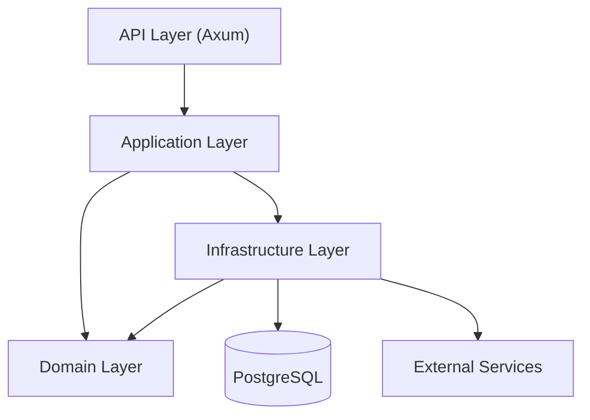

# Architecture

FerrisKey follows a hexagonal architecture, also called ports and adapters. Business logic sits in the middle and knows nothing about HTTP, SQL, or SMTP. Everything else plugs into it. That is what keeps the domain testable and lets infrastructure change without rewriting rules.

## Layers



### Domain layer

Pure business logic, with no dependency on a framework, a database, or a transport. Each domain module is laid out the same way:

- `entities.rs` for the immutable value objects that represent domain concepts
- `ports.rs` for the traits the domain needs someone else to implement
- `services.rs` for the logic that operates on entities through those ports
- `value_objects.rs` for the use case inputs and outputs
- `policies.rs` for authorization rules, where a module has them

### Application layer

Orchestration. `ApplicationService` wires every domain service to a concrete implementation through dependency injection, and is the single place where the object graph is assembled.

### Infrastructure layer

The implementations behind the ports: repositories backed by SeaORM and PostgreSQL, plus the outbound integrations for SMTP, webhook delivery, and identity provider calls. It also holds the in-memory caches in front of the realm, client and session repositories (see [Caching](/en/discover/guides/configuration#caching)) and the sealing of secrets before they reach the database (see [Secrets at rest](/en/discover/guides/secrets-at-rest)).

### API layer

The HTTP surface, built with Axum. Each feature mirrors a domain module and brings its own router, handlers, validators, and error types. OpenAPI documentation is generated from `utoipa` attributes on the handlers and served at `/swagger-ui`, `/redoc`, `/rapidoc`, and `/scalar`.

## Domain modules

```text
core/src/domain/
├── authentication/       # OAuth2 / OIDC flows
├── user/                 # User lifecycle and required actions
├── account/              # Self-service account operations
├── account_security/     # Password, MFA and passkey self-service
├── client/               # OAuth2 clients
├── client_registration/  # Dynamic client registration
├── client_metadata/      # Clients identified by a metadata document URL
├── consent/              # Consent to optional client scopes
├── realm/                # Multi-tenant realms and settings
├── credential/           # Passwords, OTP, WebAuthn
├── password_policy/      # Password strength rules
├── role/                 # Bitwise permissions
├── session/              # User sessions
├── jwt/                  # Token issuance and validation
├── crypto/               # Password hashing
├── saml/                 # SAML 2.0 identity provider
├── trident/              # MFA
├── seawatch/             # Audit logging
├── compass/              # Authentication flow recording
├── abyss/                # Identity provider federation
├── aegis/                # Client scopes and protocol mappers
├── organization/         # B2B tenancy
├── email_template/       # Transactional email templates
├── email_verification/   # Email verification flow
├── portal_theme/         # Login portal theming
├── portal_layouts/       # Login portal layouts
├── webhook/              # Event-driven hooks
├── health/               # Liveness and readiness
├── maintenance/          # Maintenance mode
└── common/               # Shared errors, pagination and rate limiters
```

A module here is either implemented in `core` or re-exported from a crate under `libs/`. `consent/`, for example, is a re-export of `ferriskey-consent`.

## Workspace crates

The workspace is split into focused crates under `libs/`, in two families.

Feature crates hold domain and infrastructure logic for one module:

```text
libs/
├── ferriskey-domain/           # Shared domain types and ports
├── ferriskey-authz/            # RBAC engine, action catalogue and the tenant authorization domain
├── ferriskey-authz-cedar/      # Cedar engine that evaluates tenant authorization policies
├── ferriskey-security/         # Password hashing, JWT primitives and the secret cipher
├── ferriskey-consent/          # Consent to optional client scopes
├── ferriskey-trident/          # MFA
├── ferriskey-abyss/            # Identity provider federation
├── ferriskey-aegis/            # Scopes and protocol mappers
├── ferriskey-compass/          # Authentication flow tracing
├── ferriskey-saml/             # SAML 2.0
├── ferriskey-seawatch/         # Audit events
├── ferriskey-organization/     # Organizations
├── ferriskey-password-policy/  # Password policies
├── ferriskey-portal-theme/     # Portal theming
├── ferriskey-portal-layouts/   # Portal layouts
├── ferriskey-webhook/          # Webhook delivery
├── ferriskey-mail/             # SMTP transport, email templates and email verification
├── ferriskey-migrate/          # Data migration runner
└── maskass/                    # Redaction of sensitive values
```

`maskass` is the one crate without the `ferriskey-` prefix, and it depends on no other FerrisKey crate. Its `Masked<T>` wrapper holds the real value but serializes, prints and debug-prints as `***`, which keeps identity provider client secrets out of API responses and logs. `MaskedWith` adds partial, email and hash masks.

`ferriskey-api-*` crates carry the HTTP layer for the matching feature: its routes, handlers and OpenAPI paths. The `api` crate that builds the `ferriskey-api` binary only composes them into one router and one OpenAPI document, and starts the server. `ferriskey-api-core` holds the shared pieces: CLI arguments, application state, the bearer token middleware, CORS, request context and error conversion.

## Dependency flow

The rule is strict: inner layers never depend on outer layers.

- The domain depends on nothing
- The application depends on the domain, through ports
- The infrastructure implements the domain's ports
- The API depends on the application

That means you can swap PostgreSQL for another store, replace Axum with a different HTTP framework, or run domain tests entirely in memory, without touching a business rule.

## Error propagation

Errors travel outward through automatic conversions:

1. `CoreError` for domain failures: not found, validation, conflict.
2. `ApiError` for the HTTP response, with a status code attached.
3. `From<CoreError> for ApiError` at the boundary, so handlers can use `?` and get the right status for free.
