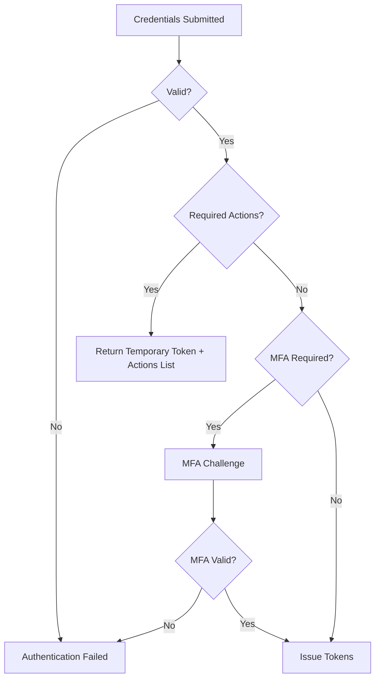

<span id="authentication" />

# 身份认证

FerrisKey 通过两种协议进行身份认证：

| 协议 | 入口 | 应用程序接收到的内容 |
|---|---|---|
| OAuth 2.0 / OpenID Connect | `/protocol/openid-connect/*` | 访问令牌、刷新令牌和 ID 令牌 |
| SAML 2.0 | `/protocol/saml` | 一个签名的 XML 断言 |

它们仅在边缘处有所不同。在底层，两者都经过相同的登录、相同的多因素认证（MFA）、相同的锁定机制和相同的审计跟踪。下面的[认证链](#authentication-chain)是共享的，这是首先值得理解的部分。

本页的大部分内容关于OIDC，因为它是默认且功能更丰富的接口。[SAML](#saml-20)有其独立的章节。

<span id="openid-connect-discovery" />

## OpenID Connect 发现

OpenID Connect 应用需要知道授权服务器的位置以及它公开了哪些端点。FerrisKey 通过发现端点发布该信息：

```text
/realms/{realm}/.well-known/openid-configuration
```

例如，如果FerrisKey可在`https://sso.example.com`访问，并且你的身份域是`home`，则发现端点为：

```text
https://sso.example.com/realms/home/.well-known/openid-configuration
```

该端点返回一个 JSON 文档，OIDC 客户端可以自动读取。它包括：

| 字段 | 它告诉应用程序的信息 |
|---|---|
| `issuer` | 该身份域作为身份提供者的规范 URL |
| `authorization_endpoint` | 浏览器用于开始登录的位置 |
| `token_endpoint` | 应用程序用于交换代码获取令牌的位置 |
| `userinfo_endpoint` | 应用程序可以获取用户资料信息的位置 |
| `jwks_uri` | 公开签名密钥的位置，以便验证令牌 |
| `introspection_endpoint`, `revocation_endpoint` | 用于令牌检查和撤销的位置 |
| `end_session_endpoint` | RP 发起注销的位置 |
| `device_authorization_endpoint` | 当无浏览器设备启动设备流时 |
| `grant_types_supported` | `authorization_code`, `refresh_token`, `client_credentials`, `password`，设备码授权和令牌交换授权 |
| `token_endpoint_auth_methods_supported` | `none`, `client_secret_basic`, `client_secret_post` |
| `code_challenge_methods_supported` | `S256` |
| `scopes_supported` | 身份域的客户端作用域 |
| `backchannel_logout_supported`, `backchannel_logout_session_supported` | 两者都是`true`。参见[后通道注销](/zh-CN/discover/core-concepts/backchannel-logout) |
| `authorization_response_iss_parameter_supported` | `true`：每个授权响应都携带一个 `iss` 参数（RFC 9207） |
| `registration_endpoint`, `client_id_metadata_document_supported` | 仅在身份域启用动态客户端注册或客户端 ID 元数据文档时出现。参见 [MCP](/zh-CN/discover/core-concepts/mcp) |

大多数应用程序支持发现，因此很少需要手动粘贴端点。提供应用程序发现 URL 或签发者，它会从 FerrisKey 读取其余内容。

查找 OAuth 2.0 授权服务器元数据（RFC 8414）的客户端可以在 `/.well-known/oauth-authorization-server/realms/{realm}` 处找到它。它携带相同的端点、授权和 PKCE 方法，但不包括 userinfo、终结会话和设备授权端点。在 `SERVER_ROOT_PATH` 后，文档在该前缀下提供，也在 `/.well-known/oauth-authorization-server{root_path}/realms/{realm}` 提供，这是 RFC 8414 要求的形式。

:::callout{variant="warning" title="只实现了授权码流程"}
在 OpenID 配置中，`response_types_supported` 还列出了 `none`、`token`、`id_token` 以及混合组合，例如 `code id_token`。它们都不存在。授权端点不会对 `response_type` 进行操作，并总是以授权码响应，因此使用 `response_type=code`。RFC 8414 文档仅列出了 `code`。
:::

:::callout{variant="info" title="Issuer 和发现不是相同的设置"}
当应用程序请求签发者或权威机构时，提供它的域 URL，例如 `https://sso.example.com/realms/home`。当它请求发现端点或 OpenID 配置 URL 时，提供完整的 `/.well-known/openid-configuration` 地址。
:::

:::callout{variant="warning" title="签发者遵循请求"}
FerrisKey 构建 `issuer`，每个端点 URL 以及来自 `Host` 和 `X-Forwarded-Proto` 请求头的 `iss` 令牌声明。在终止 TLS 的反向代理后面，转发两者，否则签发者将显示为 `http://` 或内部主机名，验证它的客户端将拒绝你的令牌。OIDC 文档不读取 `SERVER_PUBLIC_URL`；SAML 会。
:::

<span id="grant-types" />

## 授权类型

授权类型是 OAuth2 的概念：它表明客户端如何证明自己代表谁操作。SAML 没有等效概念，参见 [bindings](#saml-20)。

<span id="authorization-code" />

### 授权码

对网页应用程序最安全的流程。用户被重定向到FerrisKey，在那里进行认证，然后带着一个代码返回客户端，客户端用该代码交换令牌。

步骤：
1. 客户端将用户重定向到 `/realms/{realm}/protocol/openid-connect/auth`
2. 用户进行认证（凭据，如果需要则多因素认证）
3. FerrisKey 使用 `code`、`state` 和 `iss` 参数重定向回来
4. 客户端在令牌端点交换授权码（服务器端）
5. FerrisKey返回访问令牌、刷新令牌和ID令牌

将其用于 Web 应用，以及结合 PKCE 的单页和移动应用：公共客户端没有密钥，因此代码挑战就是将代码与请求它的客户端绑定的方式。

验证码是一次性使用的，其有效期与产生该验证码的登录尝试相同，为10分钟。第二次出示验证码，或在同一时刻重复使用验证码，将被拒绝并返回`invalid_grant`，同时撤销在该登录会话下发放的访问令牌和刷新令牌。请求参数，包括`prompt`和`max_age`，描述如下[授权请求](#the-authorization-request)。

<span id="password-resource-owner" />

### 密码（资源所有者）

:::callout{variant="danger" title="已弃用"}
密码授权已被弃用。它仍然可用，因此现有的集成可以继续工作，但不要在其上构建新的内容。OAuth 2.1 将移除它，并且它无法与客户端看不到的任何内容一起工作，包括密码钥匙和任何联合登录。

对于没有浏览器的CLI或其他设备，请改用[设备码授权](#device-code)。对于第一方Web应用程序，请使用带PKCE的[授权码](#authorization-code)。
:::

客户端自行收集凭据并将其提交到令牌端点。更简单，但更弱：客户端可以看到用户的密码。

步骤：
1. 客户端将`grant_type=password`、`username`和`password`发送至令牌端点，同时附上自己的客户端认证信息。
2. FerrisKey 验证凭据
3. 如果账户仍然欠一个身份认证步骤（一个必需的操作、一次性密码挑战或多因素认证注册），FerrisKey 会回答 `invalid_grant` 并告诉客户端使用基于浏览器的授权码流程。此授权从不返回临时令牌。
4. 否则 FerrisKey 将打开会话并返回令牌

仅适用于尚未迁移的现有集成。

:::callout{variant="warning" title="需要直接访问授权"}
客户端需要 `direct_access_grants_enabled` 才能使该流程工作。
:::

<span id="client-credentials" />

### 客户端凭据

机器对机器。客户端使用自己的客户端 ID 和密钥进行身份认证，不涉及用户。客户端必须是密钥的并且拥有 `service_account_enabled`。

步骤：
1. 客户端将 `grant_type=client_credentials` 与其凭据一起发送，作为 HTTP 基本头部，或作为请求体中的 `client_id` 和 `client_secret`。
2. FerrisKey 验证客户端凭据
3. 返回客户端服务账户的访问令牌

没有刷新令牌。只有当 `scope` 调用 `openid` 时，才会返回 ID 令牌，并且当 `offline_access` 被 `invalid_scope` 拒绝时，没有会话支持该令牌，因此它没有 `sid` 声明。这些请求的数量也是有限制的，详见 [令牌端点](#the-token-endpoint)。

最适合后台服务、定时任务和微服务之间的调用。

<span id="refresh-token" />

### 刷新令牌

在不让用户重新登录的情况下更新已过期的访问令牌。

步骤：
1. 客户端使用刷新令牌发送 `grant_type=refresh_token`
2. FerrisKey 验证刷新令牌
3. 返回新的访问令牌和刷新令牌

刷新令牌是一次性使用的。每次刷新都会消耗你发送的令牌并返回它的继承者，新的令牌仍然绑定到同一个会话。如果已使用的令牌再次被使用，或者两个请求在同一时刻刷新同一个令牌，FerrisKey 会撤销整个家族（该登录派生的每一个刷新令牌）并返回 `invalid_grant`。一旦令牌背后的会话结束或用户被禁用，相同的错误会再次返回。

最适合任何发出刷新令牌并需要保持会话活跃的流程。

<span id="device-code" />

### 设备码

```
urn:ietf:params:oauth:grant-type:device_code
```

适用于任何无法托管浏览器或无法信任密码的情况的流程：CLI、电视应用或无头设备。设备从不直接看到凭据。它向FerrisKey请求一个代码，告诉用户在哪里输入，并轮询直到用户在自己的浏览器中批准，该浏览器中多因素认证、通行密钥和联合登录都可以正常工作。

这就是 `ferris-ctl login` 的连接方式。

步骤：

1. 设备向 `/realms/{realm}/protocol/openid-connect/auth/device` 发送请求。公开客户端在表单主体中传递 `client_id`；机密客户端则使用 HTTP Basic 进行认证。
2. FerrisKey 返回一个设备码、一个简短的终端用户代码，以及要显示的验证 URI。
3. 设备显示用户代码和 URI，并开始使用 `grant_type=urn:ietf:params:oauth:grant-type:device_code` 和设备码轮询令牌端点。
4. 用户在任何浏览器中打开 `/realms/{realm}/device`，输入代码，并通过完整流程进行身份认证，包括多因素认证 (MFA)。
5. 下一次轮询返回令牌。

在用户未完成操作时，轮询返回 RFC 8628 错误代码 (`authorization_pending`、`slow_down`、`access_denied`、`expired_token`)，因此客户端可以区分“尚未完成”和“被拒绝”，并相应地退避。

| 端点 | 目的 |
|---|---|
| `POST /realms/{realm_name}/protocol/openid-connect/auth/device` | 启动流程，获取代码 |
| `GET /realms/{realm_name}/device` | 用户输入代码的页面 |
| `POST /realms/{realm_name}/device/verify` | 提交代码 |
| `POST /realms/{realm_name}/protocol/openid-connect/token` | 轮询令牌 |

:::callout{variant="warning" title="客户端必须允许"}
客户端需要 `oauth_device_code_grant_enabled`。没有它，第一次调用会被拒绝。
:::

此流程也可以被观察到：[webhooks](/zh-CN/modules/webhooks/triggers) 会触发 `auth.device_flow.initiated`、`auth.device_flow.denied` 和 `auth.device_flow.expired`。

<span id="token-exchange" />

### 令牌交换

```
urn:ietf:params:oauth:grant-type:token-exchange
```

RFC 8693 令牌交换允许后端服务将其持有的访问令牌兑换为一个具有更窄作用域、不同受众或带有 `act` 声明的新令牌，该声明将服务命名为代表用户行动的方。请求的客户端必须是机密的、已启用的、由管理员注册的，并且具备 `token_exchange_enabled`。若要将新令牌用于另一个客户端，它还需要针对该客户端的委托策略，该策略说明是否允许冒充和委托，并限制作用域。结果仅为访问令牌，不包含刷新令牌和 ID 令牌。

[令牌交换](/zh-CN/discover/core-concepts/token-exchange) 涵盖请求、策略、新令牌的声明及错误代码。

<span id="the-authorization-request" />

## 授权请求

`GET /realms/{realm}/protocol/openid-connect/auth` 启动每一个浏览器流程。FerrisKey 检查客户端、重定向 URI 和 PKCE 策略，然后将浏览器发送到登录页面，或者当浏览器已经持有有效的 SSO 会话时直接返回应用程序。

| 参数 | 说明 |
|---|---|
| `response_type` | 发送 `code`。只存在授权码流程：该值已存储但从未使用。 |
| `client_id` | Realm 的一个启用的 OpenID Connect 客户端 |
| `redirect_uri` | 必须与客户端启用的重定向 URI 匹配，参见 [重定向 URI](/zh-CN/discover/core-concepts/clients#redirect-uris)。 |
| `scope` | 以空格分隔。默认作用域始终适用，只有在指定时才使用可选作用域 |
| `state`, `nonce` | `state` 将在重定向时返回，`nonce` 将被复制到 ID 令牌中。 |
| `code_challenge`, `code_challenge_method` | PKCE。`S256` 是唯一被方法发现广告所宣传的方法，也是公共客户端或具有 `require_pkce` 的客户端可以使用的唯一方法。 |
| `prompt` | `none`, `login` 或 `consent` |
| `max_age` | 应用程序接受的身份认证的最大年龄，以秒为单位 |
| `resource` | 一个 RFC 8707 资源指示符。它必须是该身份域允许的资源之一，并成为访问令牌的 `aud`。参见 [MCP](/zh-CN/discover/core-concepts/mcp) |

成功响应会将 `code`、`state`（当请求中有时）和 `iss` 重定向给客户端。

<span id="prompt-and-max_age" />

### Prompt 和 max_age

| 参数 | 效果 |
|---|---|
| `prompt=none` | 从不显示页面。浏览器的 SSO 会话会响应请求，或者浏览器在无可用会话时返回错误：`login_required`，在账户存在如必需操作等步骤时返回 `interaction_required`，当需要显示同意屏幕时返回 `consent_required` |
| `prompt=login` | 忽略 SSO 会话，要求用户重新进行身份认证 |
| `prompt=consent` | 即使已经存储了决定，也会显示[同意屏幕](/zh-CN/discover/core-concepts/consent) |
| `select_account` | 被忽略，就像任何 FerrisKey 不知道的值一样 |
| `max_age=N` | 一个在 N 秒之前认证的 SSO 会话不足够，用户需要重新登录 |
| `max_age=0` | 与 `prompt=login` 相同 |

`prompt=none` 不能与另一个值组合：请求将随 `invalid_request` 一起返回。当 `prompt=login` 或超出的 `max_age` 强制新的登录时，相同的用户会重新登录到他们已经拥有的会话：`sid` 保持不变，并且会话的有效期重新开始。`auth_time` 对 ID 令牌的声明是该会话最后一次认证的时间。由授权码和密码授权发放的 ID 令牌包含该声明，由刷新发放的则不包含。

<span id="when-a-request-is-refused" />

### 当请求被拒绝时

如果客户端、身份域或重定向 URI 无效，FerrisKey 不会重定向到请求中的地址。浏览器会停留在 FerrisKey 登录页面并显示错误信息。一旦重定向 URI 被信任，被拒绝的请求将以 `error`、`state` 和 `iss` 查询参数方式返回：`invalid_request`、`invalid_target`（一个 `resource`，身份域不允许）、`login_required`、`interaction_required` 和 `consent_required`。违反客户端 PKCE 策略的请求，或针对已禁用客户端的请求，将返回 JSON 错误，而不是重定向。

<span id="the-token-endpoint" />

## 令牌端点

`POST /realms/{realm}/protocol/openid-connect/token` 接受一个 `application/x-www-form-urlencoded` 体，并服务于上述所有授权。

客户端通过三种方式之一进行认证，如 `token_endpoint_auth_methods_supported` 中列出：

| 方法 | 方式 |
|---|---|
| `none` | 一个公共客户端在正文中发送 `client_id` |
| `client_secret_basic` | HTTP 基本认证，`client_id` 作为用户名，secret 作为密码 |
| `client_secret_post` | `client_id` 和 `client_secret` 在正文中 |

基于断言的方法，例如 `private_key_jwt`，不被支持。当请求同时携带 Basic 头和正文字段时，以头部为准。Basic 凭据按照 RFC 6749 的要求进行表单解码，因此包含 `+` 或 `%` 的 secret 必须在进行 base64 编码之前进行百分比编码。

错误遵循 RFC 6749 §5.2：一个包含 `error` 和 `error_description` 的 JSON 主体。`invalid_client` 是一个带有 `WWW-Authenticate: Basic` 的 `401`；`invalid_request`、`invalid_grant`、`invalid_scope`、`invalid_target`、`unauthorized_client` 和 `unsupported_grant_type` 是 `400`。每个响应，无论是否成功，都包含 `Cache-Control: no-store` 和 `Pragma: no-cache`。

保护端点有两个限制：

- 在一分钟内从同一个（IP 地址、身份域、`client_id`）出现 10 次客户端身份认证失败后，下一个请求将得到 `429`，伴随 `temporarily_unavailable` 和 `Retry-After: 60`。
- 超过 `SERVER_TOKEN_MAX_IN_FLIGHT` 的 `client_credentials` 请求会立即处理（默认每个进程使用的 CPU 数量处理 32 个），并得到 `503`，伴随 `temporarily_unavailable` 和 `Retry-After: 1`。

每个副本都会在内存中保存这两个限制，因此具有多个副本的部署会针对每个副本执行这些限制。失败阈值不可配置。客户端地址是TCP连接的对等方。将`SERVER_TRUST_FORWARDED_FOR`设置为读取`X-Forwarded-For`，且仅在您控制的代理是唯一进入方式时。请参见[配置](/zh-CN/discover/guides/configuration)。

<span id="the-oidc-endpoints" />

## OIDC端点

这些是集成接口：应用程序、资源服务器或网关与之通信的内容。所有内容均相对于`/realms/{realm_name}/protocol/openid-connect`。

| 方法 | 路径 | 目的 |
|---|---|---|
| `GET` | `/auth` | 启动授权码流程 |
| `POST` | `/auth/device` | 启动设备流程（RFC 8628 §3.1） |
| `POST` | `/token` | 交换授权码、刷新令牌、设备码或凭据以获取令牌 |
| `POST` | `/token/introspect` | 令牌检查（RFC 7662） |
| `GET` `POST` | `/userinfo` | `sub`，以及`name`、`given_name`、`family_name`和`preferred_username`，使用`profile`作用域；`email`和`email_verified`，使用`email`作用域。访问令牌必须携带`openid` |
| `POST` | `/revoke` | 撤销访问令牌或刷新令牌 (RFC 7009) |
| `GET` `POST` | `/logout` | RP 发起的登出 |
| `GET` | `/jwks.json`, `/certs` | 身份域的公共签名密钥 |
| `POST` | `/registrations` | 自助注册，当身份域允许时 |

<span id="introspection" />

### 内省

`/token/introspect` 使用带有 `token` 的表单体，以及可选的 `token_type_hint`，并使用 `client_secret_basic` 或 `client_secret_post` 对调用者进行身份认证。该身份域中任何启用的机密客户端只要提供其密钥，就可以检查该身份域中任何令牌的内容：调用者不会被检查角色或权限。公共客户端会被拒绝，因此请改为根据 `/jwks.json` 验证 JWT 签名，这不需要凭据也不需要往返请求。然而，签名检查无法检测撤销：被撤销的令牌仍然可以验证，直到 `exp`。

答案是 RFC 7662 的固定子集：活动令牌的声明，或者 `{"active": false}`，仅此而已。[令牌](/zh-CN/discover/core-concepts/tokens#validating-a-token) 列出了字段以及返回非活动状态的情况，其中包括已撤销的令牌、已使用的刷新令牌、ID 令牌以及会话已结束的令牌。

<span id="revocation" />

### 吊销

`/revoke` 像令牌端点一样对客户端进行认证。公共客户端只发送其 `client_id`。一旦客户端通过认证，它总是返回 `200`，无论令牌是有效的、已撤销的还是不可读取的，因此答案不会反映令牌的任何信息。它仅对发给调用客户端的令牌（其 `azp`）执行操作：其他令牌保持不变。撤销刷新令牌只能撤销该令牌本身，而不是令牌的整个系列。

<span id="logout" />

### 注销

`GET` 或 `POST /logout` 会结束用户会话。它接受 `id_token_hint`、`post_logout_redirect_uri`、`state` 和 `client_id`。

FerrisKey 通过有效 `id_token_hint` 的 `sid` 查找会话，如果失败则通过 `FERRISKEY_SSO` cookie 查找。它会撤销该会话以及在该会话下发出的所有访问和刷新令牌（SeaWatch 记录 `session_revoked`），清除 FerrisKey cookie，并向参与会话的客户端发送 [背频道注销](/zh-CN/discover/core-concepts/backchannel-logout) 通知。

浏览器看到的内容取决于重定向：

- 没有 `post_logout_redirect_uri` 时，答案是空的 `204`。FerrisKey 没有注销页面，所以用户会停留在发送请求的页面上。
- 通过一个，答案是一个 `307` 到该 URI，并附加 `state`。URI 必须与客户端启用的 [注销后重定向](/zh-CN/discover/core-concepts/clients#sub-resources) 完全相同，一个字符也不能差。客户端来自 `client_id` 或 `id_token_hint` 的 `azp`；如果都不是，请求会被拒绝。当检查 URI 时，会话已经不存在，因此被拒绝的重定向不会让用户保持登录状态。

`id_token_hint` 的签名和签发者必须验证通过，但过期的提示仍然被接受。当没有请求重定向时，无效提示会被忽略；有请求重定向时，则会导致请求失败。

<span id="keys" />

### 密钥

`/jwks.json`、它的 `/certs` 双胞胎以及未注释的 `/jwks` 别名都返回身份域的公钥。它们不需要认证，并且是公开的。答案携带 `Cache-Control: public, max-age=300`，因此客户端和代理可以保存五分钟。Discovery 会宣传 `/jwks.json`。

<span id="registration" />

### 注册

当身份域具有 `user_registration_enabled` 时，`/registrations` 会创建用户（否则它返回 `403`）。主体需要 `email` 和 `password`，以及 `first_name`、`last_name` 和可选的 `username`；如果没有用户名，则用户名为电子邮件地址，经修剪并小写。`201` 响应携带 `status`：

| `status` | `data` | 当 |
|---|---|---|
| `authenticated` | 令牌 | 没有事情可做 |
| `redirect` | `url` | 注册发生在授权流程内，`url` 会继续该流程 |
| `pending_action` | `message` 和 `user_id` | 用户还欠一个步骤，例如电子邮件验证 |

:::callout{variant="info" title="自己构建登录页面？"}
门户本身驱动的端点，包括登录表单、多因素认证挑战和重置流程，是一个独立的系列。请参见 [登录操作](/zh-CN/modules/portal/login-actions)。
:::

## SAML 2.0

对于没有其他功能的应用程序，FerrisKey 充当 SAML 身份提供者：服务提供者发送 `AuthnRequest`，用户通过正常的 FerrisKey 登录进行登录，然后 FerrisKey 返回签名断言。

<span id="bindings-instead-of-grants" />

### 绑定而不是授权

SAML 没有授权类型。它有的是绑定，描述请求如何传递，而 FerrisKey 在一条路径上同时提供两者：

| 方法 | 路径 | 绑定 |
|---|---|---|
| `GET` | `/realms/{realm_name}/protocol/saml` | HTTP-重定向 |
| `POST` | `/realms/{realm_name}/protocol/saml` | HTTP-POST |
| `GET` | `/realms/{realm_name}/protocol/saml/continue` | 用户认证后恢复 |
| `GET` | `/realms/{realm_name}/protocol/saml/descriptor` | 要交给服务提供商的 IdP 元数据 |

该描述符相当于发现文档：将服务提供商指向该 URL，它就能自行获取实体 ID、SSO 端点和签名证书。

<span id="a-client-speaks-one-protocol" />

### 客户端使用一种协议

客户端携带 `protocol`、`openid-connect`（默认）或 `saml`，在创建时设置，之后无法更改，就像机密/公开选择一样。从 SAML 迁移到 OIDC 的应用程序会获得一个新的客户端，而不是编辑原有客户端。

SAML 客户端有两组自己的集合：

```
GET PUT        /realms/{realm_name}/clients/{client_id}/saml-config
GET POST       /realms/{realm_name}/clients/{client_id}/saml-attribute-mappers
DELETE         /realms/{realm_name}/clients/{client_id}/saml-attribute-mappers/{mapper_id}
```

属性映射器是 SAML 对 [协议映射器](/zh-CN/modules/aegis/protocol-mappers) 的回答：它们决定哪些用户数据会出现在断言中。这两个系统是独立的。协议映射器不会影响断言，属性映射器也不会影响 JWT。

<span id="what-saml-does-not-get" />

### SAML 没有获取的内容

OIDC 表面上没有 SAML 对应项，这是协议上的差异，而不是缺口：

- 没有刷新令牌。断言就是完整的答案；没有什么可以刷新的。
- 没有 `userinfo`，就没有自省。服务提供者了解的一切都在它已经持有的断言中。
- 没有设备流，没有客户端凭据。两者都是 OAuth2 的构造。

<span id="one-configuration-requirement" />

### 一个配置要求

IdP 实体 ID 是由 `SERVER_PUBLIC_URL` 和身份域名称构建的，并且它会签署到每个断言中，因此它绝不能更改。基于这个原因，SAML 拒绝从请求中猜测来源：如果没有 `SERVER_PUBLIC_URL`，SSO 端点和描述符会以 HTTP 500 响应：“此服务器未配置单点登录。请设置 SERVER_PUBLIC_URL。”

:::callout{variant="warning" title="在启用 SAML 之前请设置 SERVER_PUBLIC_URL"}
将其设置为浏览器和服务提供商实际访问的来源，即 `scheme://host[:port]`。OIDC 不会读取它，因此已经运行 OIDC 数月的部署仍然可以未设置它。请参见 [配置](/zh-CN/discover/guides/configuration)。
:::

[SAML 2.0](/zh-CN/discover/core-concepts/saml) 包含以下内容：注册服务提供商、Name ID 格式、属性映射器参考、完整的流程图，以及断言有效性。

<span id="authentication-chain" />

## 认证链

两种协议都运行在相同的链上。无论请求是以 OIDC 授权请求还是 SAML `AuthnRequest` 形式到达，用户与凭据之间发生的事情是相同的：



1. 凭据验证。用户名和密码会被验证。
2. 必需的操作。如果有任何待处理操作（`configure_otp`、`verify_email`、`update_password`、`configure_passkey`），返回的将是一个临时令牌，而非真实令牌。
3. 多因素认证（MFA）。如果用户有TOTP凭据，则必须输入一次性验证码。密码密钥可以自行登录用户，并且在密码之后不会作为第二因素被要求。
4. 令牌签发。生成访问令牌、刷新令牌和ID令牌，或者对于SAML请求，构建并签署断言。

下游的所有内容也都是共享的。[Compass](/zh-CN/modules/compass/overview) 会记录 SAML 执行与 OIDC 执行，并将 `saml_authn_request` 和 `saml_assertion` 作为它们自己的步骤记录，[SeaWatch](/zh-CN/modules/seawatch/overview) 无论使用哪种协议也会记录相同的 `login_success` 和 `login_failure` 事件。没有单独的 SAML 审计追踪可供查找。

<span id="auth-sessions" />

## 认证会话

认证会话跟踪正在进行的登录。它包含：

- 客户端和身份域上下文
- 重定向 URI 和 OAuth2 参数（`state`、`nonce`、`scope`、`resource`）
- PKCE 代码挑战
- 授权码（在成功认证后）
- WebAuthn 挑战数据（如适用）
- 关联的 Compass 流程（如果启用了流程引擎）

认证会话是短暂的：未在10分钟内完成的尝试会自行过期。

不要与 SSO 会话混淆。SSO 会话是在用户通过认证后创建的，持续时间与客户端的刷新令牌有效期一样，并且是 `FERRISKEY_SSO` Cookie 和令牌的 `sid` 声明所指向的内容。[Realms](/zh-CN/discover/core-concepts/realms#sessions-and-the-sso-cookie) 描述了其 Cookie 及有效期。
