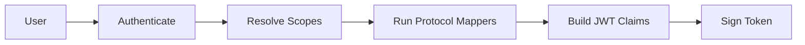

<span id="client-scopes" />

# 客户端作用域

客户端作用域决定令牌中包含的内容。它会分组协议映射器，这些映射器是从用户或客户端提取数据并将其作为声明写入 JWT 的规则。

<span id="scope-types" />

## 作用域类型

| 类型 | 行为 |
|---|---|
| 默认 | 包含在为客户端发出的每个令牌中 |
| 可选 | 仅在客户端在 `scope` 参数中请求时包含 |
| 无 | 根本不分配给客户端 |

同一个作用域可以对于一个客户端是默认的，对于另一个客户端是可选的。这由客户端作用域映射决定，而不是由作用域本身决定。

一个作用域本身也有类型，在创建时选择为默认或可选。它只在客户端创建时才起作用：新客户端会将每个类型为默认的作用域作为默认作用域接收，而不会接收其他作用域。可选作用域从不自动附加，因此需要将它们分配给每个需要它们的客户端。

<span id="scopes-seeded-by-default" />

## 默认种子作用域

每个身份域都预置了一组标准的 OIDC 作用域。

| 作用域 | 类型 | 它产生的声明 |
|---|---|---|
| `openid` | 默认 | 自身没有；将请求标记为 OIDC |
| `profile` | 默认 | `given_name`, `family_name`, `preferred_username` |
| `email` | 默认 | `email`, `email_verified` |
| `organization` | 默认 | `organizations` |
| `roles` | 默认 | `realm_access.roles` |
| `offline_access` | 可选 | 自身没有 |
| `phone` | 可选 | `phone_number` |
| `address` | 可选 | `address` |


:::callout{variant="info" title="openid 和 offline_access 没有映射器"}
八个预设作用域中有两个自身不写入任何声明。`openid` 将请求标记为 OIDC，`offline_access` 解锁刷新令牌的颁发。两者都作用于流程，而非负载。映射器为零的作用域不一定配置错误。
:::

五个默认作用域会附加到之后你创建的每个客户端。`offline_access`、`phone` 和 `address` 存在于身份域中，但只有在你将它们分配给客户端时才能到达客户端，作为可选作用域。

`organization` 作用域是最新的，也是唯一一个其两个映射器故意针对同一声明的作用域：成员映射器贡献每个组织的 `id`、`name` 和 `alias`，角色映射器贡献 `roles` 和 `clients.<id>.roles`，两个映射器深度合并为一个 `organizations` 对象。

<span id="protocol-mappers" />

## 协议映射器

映射器由 `mapper_type` 字符串标识。FerrisKey 保留 Keycloak 名称，因此为 Keycloak 编写的配置在这里也能识别。

| `mapper_type` | 它的功能 |
|---|---|
| `oidc-usermodel-property-mapper` | 将内置用户属性（用户名、电子邮件、名字）映射到声明 |
| `oidc-usermodel-attribute-mapper` | 将自定义用户属性映射到声明 |
| `oidc-usermodel-realm-role-mapper` | 将用户的身份域角色写入令牌 |
| `oidc-usermodel-client-role-mapper` | 将用户的客户端角色写入令牌 |
| `oidc-group-membership-mapper` | 写入用户的组成员资格 |
| `oidc-organization-membership-mapper` | 写入用户的组织成员资格 |
| `oidc-organization-detail-mapper` | 写入活动组织的详细信息 |
| `oidc-organization-role-mapper` | 写入用户在组织中的角色 |
| `oidc-full-name-mapper` | 将名和姓以空格连接后写入 `name` 声明 |
| `oidc-audience-mapper` | 将 `included.client.audience` 的值添加到访问令牌的 `aud` 声明中 |
| `oidc-hardcoded-claim-mapper` | 将固定值作为声明添加 |

每个映射器都携带一个 JSON `config`。键遵循 Keycloak 约定：

```json title="Mapping the username into preferred_username"
{
  "user.attribute": "username",
  "claim.name": "preferred_username",
  "access.token.claim": "true",
  "id.token.claim": "true"
}
```

`claim.name` 支持点分路径，因此 `realm_access.roles` 会生成嵌套对象，而不是名称中带点的扁平键。

<span id="managing-scopes" />

## 管理作用域

```
GET    /realms/{realm_name}/client-scopes
POST   /realms/{realm_name}/client-scopes
GET    /realms/{realm_name}/client-scopes/{scope_id}
PATCH  /realms/{realm_name}/client-scopes/{scope_id}
DELETE /realms/{realm_name}/client-scopes/{scope_id}
```

映射器位于其作用域下：

```
POST   /realms/{realm_name}/client-scopes/{scope_id}/protocol-mappers
PATCH  /realms/{realm_name}/client-scopes/{scope_id}/protocol-mappers/{mapper_id}
DELETE /realms/{realm_name}/client-scopes/{scope_id}/protocol-mappers/{mapper_id}
```

<span id="assigning-a-scope-to-a-client" />

### 为客户端分配作用域

```
GET    /realms/{realm_name}/clients/{client_id}/client-scopes
PUT    /realms/{realm_name}/clients/{client_id}/default-client-scopes/{scope_id}
DELETE /realms/{realm_name}/clients/{client_id}/default-client-scopes/{scope_id}
PUT    /realms/{realm_name}/clients/{client_id}/optional-client-scopes/{scope_id}
DELETE /realms/{realm_name}/clients/{client_id}/optional-client-scopes/{scope_id}
```

默认作用域适用于该客户端的每个请求。可选作用域仅在请求在其 `scope` 参数中指定时适用。客户端持有一次作用域，要么作为默认，要么作为可选，从不同时拥有两者。分配客户端已拥有的作用域会失败，因此通过先取消分配再重新分配，将作用域从一个列表移动到另一个列表。

读取需要 `view_client_scopes` 或 `manage_client_scopes`，写入需要 `manage_client_scopes`，而 `manage_realm` 同时授予两者。

`POST /realms/{realm_name}/clients/{client_id}/evaluate-scopes` 预览客户端当前分配给某个用户的权限，无需登录。

<span id="optional-scopes-and-consent" />

## 可选作用域和同意

只有在请求指定可选作用域时，才会授予令牌该作用域。对于需要用户同意的客户端，用户也可以决定：同意屏幕会列出请求所要求的可选作用域，令牌只会包含用户批准的作用域。客户端在其 `consent_required` 标志设置时需要用户同意，并且在其注册时始终需要同意。FerrisKey 会将每个用户和客户端的决定存储 30 天，在此期间不会再次请求相同的作用域。

[同意](/zh-CN/discover/core-concepts/consent) 页面覆盖屏幕、存储的决定和 `prompt=consent`。

<span id="scopes-for-clients-that-register-themselves" />

## 自注册客户端的权限作用域

通过动态注册、客户端 ID 元数据文档，或者匿名方式自注册的客户端，可以始终请求 `openid`、`profile`、`email` 和 `roles`。其他任何权限作用域仅在该权限作用域设置了 `dynamic_registration_allowed` 时开放，而所有默认权限作用域上都设置了 `false`。可以在控制台中通过 **Available to dynamic clients (CIMD, DCR)** 设置，或者在 `POST /realms/{realm_name}/client-scopes` 和 `PATCH /realms/{realm_name}/client-scopes/{scope_id}` 的请求体中设置。权限作用域列表会用 **Dynamic clients** 徽章标记此类权限作用域。

仅当您打算将其声明交给从未审核过的应用程序时，才以这种方式公开作用域。有关注册流程，请参见 [MCP](/zh-CN/discover/core-concepts/mcp)。

<span id="how-scopes-shape-a-token" />

## 作用域如何塑造令牌



1. 用户针对客户端进行身份认证。
2. FerrisKey 决定哪些作用域适用：客户端的默认作用域，以及请求中要求的任何可选作用域。
3. 每个活动作用域上的映射器运行。
4. 它们的输出成为 JWT 声明，连同标准声明一起。
5. 令牌使用身份域密钥进行签名。

:::callout{variant="info" title="作用域是一种声明合同"}
将 scope 视为客户端与授权服务器之间的协议：授予我 `profile`，并且我期望用户的姓名和用户名会在令牌中返回。
:::
