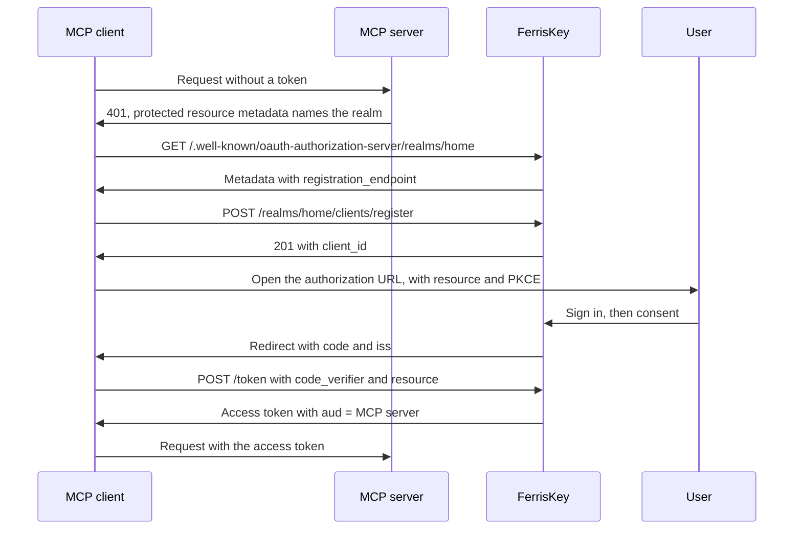

<span id="mcp-and-dynamic-client-registration" />

# MCP 和动态客户端注册

MCP 服务器将登录交给授权服务器，而一个身份域可以是该服务器：它发布 RFC 8414 元数据，让它从未见过的客户端自行注册，并签发其受众为 MCP 服务器的令牌。

MCP 客户端，例如编辑器或桌面助手，无法在它将要连接的每个身份域中手动注册。它要么动态自行注册，要么使用 URL 进行身份标识，以下部分存在正是为此目的。

| 部分 | 标准 | 默认 | 目的 |
|---|---|---|---|
| 授权服务器元数据 | RFC 8414 | 始终开启 | 告诉客户端端点位置及哪些注册选项存在 |
| 动态客户端注册（DCR） | RFC 7591 | 关闭 | 客户端使用一个匿名 `POST` 进行自身注册 |
| 客户端 ID 元数据文档 (CIMD) | IETF 草案 | 关闭 | 客户端使用 `https` URL 作为其 `client_id`，该 URL 提供其描述 |
| 资源指示器 | RFC 8707 | 不允许资源 | `resource` 参数设置令牌的受众 |

FerrisKey 仅是授权服务器。指向客户端的受保护资源元数据由 MCP 服务器发布，而不是由 FerrisKey 发布。

<span id="settings" />

## 设置

所有内容都位于身份域上。在控制台中，打开 **Realm Settings**，然后点击 **MCP** 选项卡，标题为“ MCP / 客户端注册”。

| 控制台标签 | API 字段 | 默认 |
|---|---|---|
| 动态客户端注册 | `dcr_enabled` | `false` |
| 客户端 ID 元数据文档 | `cimd_enabled` | `false` |
| 允许的元数据文档主机 | `cimd_allowed_hosts` | 空 |
| 允许的资源 | `allowed_resources` | 空 |


相同的字段通过 `PUT /realms/{realm_name}/settings` 进行处理。每个字段在主体中都是可选的，省略的字段保持不变。

```json title="PUT /realms/home/settings"
{
  "dcr_enabled": true,
  "cimd_enabled": true,
  "cimd_allowed_hosts": ["client.example.com"],
  "allowed_resources": ["https://mcp.example.com"]
}
```

通过任何方式创建的客户端只能请求您为其打开的作用域。在客户端作用域上，开启 **可用于动态客户端（CIMD、DCR）**（`dynamic_registration_allowed`，默认 `false`）。`openid`、`profile`、`email` 和 `roles` 始终可用。

<span id="authorization-server-metadata" />

## 授权服务器元数据

```text
GET /.well-known/oauth-authorization-server/realms/{realm_name}
```

这是用于 `https://sso.example.com/realms/home` 签发者的 RFC 8414 路径插入形式。当 API 在 `SERVER_ROOT_PATH` 下运行时，相同的文档也会通过 `{root_path}/.well-known/oauth-authorization-server/realms/{realm_name}` 提供，并且在严格形式 `/.well-known/oauth-authorization-server{root_path}/realms/{realm_name}` 下提供。未知域返回 `401`。

```json
{
  "issuer": "https://sso.example.com/realms/home",
  "authorization_endpoint": "https://sso.example.com/realms/home/protocol/openid-connect/auth",
  "token_endpoint": "https://sso.example.com/realms/home/protocol/openid-connect/token",
  "jwks_uri": "https://sso.example.com/realms/home/protocol/openid-connect/jwks.json",
  "revocation_endpoint": "https://sso.example.com/realms/home/protocol/openid-connect/revoke",
  "introspection_endpoint": "https://sso.example.com/realms/home/protocol/openid-connect/token/introspect",
  "scopes_supported": ["address", "email", "offline_access", "openid", "organization", "phone", "profile", "roles"],
  "response_types_supported": ["code"],
  "grant_types_supported": [
    "authorization_code",
    "refresh_token",
    "client_credentials",
    "password",
    "urn:ietf:params:oauth:grant-type:device_code",
    "urn:ietf:params:oauth:grant-type:token-exchange"
  ],
  "code_challenge_methods_supported": ["S256"],
  "token_endpoint_auth_methods_supported": ["none", "client_secret_basic", "client_secret_post"],
  "authorization_response_iss_parameter_supported": true,
  "registration_endpoint": "https://sso.example.com/realms/home/clients/register",
  "client_id_metadata_document_supported": true
}
```

`registration_endpoint`仅在`dcr_enabled`开启时出现，`client_id_metadata_document_supported`仅在`cimd_enabled`开启时出现。`scopes_supported`列出了该身份域的客户端作用域。授权响应中，签发者为`iss`（RFC 9207），这也是`authorization_response_iss_parameter_supported`公告的。

<span id="dynamic-client-registration" />

## 动态客户端注册

```text
POST /realms/{realm_name}/clients/register
```

端点不接受凭据。正文是客户端元数据文档：

```json
{
  "client_name": "Reports assistant",
  "redirect_uris": ["http://127.0.0.1:33418/callback"],
  "token_endpoint_auth_method": "none",
  "grant_types": ["authorization_code", "refresh_token"],
  "response_types": ["code"]
}
```

| 字段 | 统治 |
|---|---|
| `redirect_uris` | 要求，最多1到10条，每条最多2048字节。每个条目`https`，或在环回主机（`localhost`、`127.0.0.1`、`::1`）上进行`http`。无片段，无凭据 |
| `token_endpoint_auth_method` | `none`（公共客户端）、`client_secret_basic`（默认客户端）或`client_secret_post`。后两种则创建机密客户端 |
| `grant_types` | 默认为`["authorization_code"]`。必须包含，且可添加`refresh_token` |
| `response_types` | 只有`code` |
| `scope` | 以空格分隔。仅限 `openid`、`profile`、`email`、`roles` 以及标记为动态客户端的作用域 |
| `client_name` | 最多 128 个字符。默认值为“动态客户端” |

`grant_types` 和 `response_types` 会被验证并返回；FerrisKey 不会存储它们。

成功调用会将 `201` 与 `Cache-Control: no-store` 一起返回：

```json
{
  "client_id": "6f0e4c1a-3b5d-4e7f-8a9b-0c1d2e3f4a5b",
  "client_id_issued_at": 1790000000,
  "client_name": "Reports assistant",
  "redirect_uris": ["http://127.0.0.1:33418/callback"],
  "token_endpoint_auth_method": "none",
  "grant_types": ["authorization_code", "refresh_token"],
  "response_types": ["code"],
  "scope": "openid profile email roles"
}
```

保密注册也会返回 `client_secret`，并将 `client_secret_expires_at` 设置为 `0`。

创建的客户端已启用，需要同意，并且直接访问授权、服务账户和令牌交换均关闭。公共客户端需要 PKCE。`openid`、`profile`、`email` 和 `roles` 是默认作用域。请求中的 `scope` 会将其命名的额外作用域添加为默认作用域。如果没有 `scope`，每个标记为动态客户端的作用域都会作为可选作用域附加，客户端可以按名称请求这些作用域，并且用户可以在 [同意页面](/zh-CN/discover/core-concepts/consent) 上批准。没有管理端点（RFC 7592）：注册后，客户端就是您像管理其他客户端一样管理的普通客户端。

<span id="limits-and-errors" />

### 限制和错误

| 限制 | 值 |
|---|---|
| 每个 IP 地址的请求 | 每分钟 10 次 |
| 每个身份域的注册数量 | 每小时 60 个 |
| 每个身份域的动态客户端 | 1000 |

请求会计入前两个，无论它们是否有效。

| 状态 | `error` | 当 |
|---|---|---|
| `400` | `invalid_redirect_uri` | `redirect_uris` 缺失、为空或超过 10，或某个条目违反上述规则 |
| `400` | `invalid_client_metadata` | 任何其他字段都会被拒绝，主体不是元数据文档，或身份域已经拥有 1000 个动态客户端 |
| `404` | `not_found` | 该身份域已关闭注册，或身份域不存在 |
| `429` | `too_many_requests` | 触及了速率限制。答案包含 `Retry-After: 60` |
| `500` | `server_error` | 无法存储客户端 |

注册本质上是匿名的，因此任何可以访问该端点的人都可以创建客户端，直到达到这些限制。保护用户的是同意屏幕，每个动态客户端在每次授权请求时都会经过，并显示客户端名称及其重定向 URI 的主机。如果不需要，省略 `dcr_enabled`。

<span id="client-id-metadata-documents" />

## 客户端ID元数据文档

启用`cimd_enabled`后，客户端可以跳过注册，并使用`https` URL作为其`client_id`：

```text
https://client.example.com/oauth/client.json
```

第一次FerrisKey在授权请求中看到该`client_id`时，它会获取文档，从中创建一个客户端，并在后续请求中保持同步。URL长度最多为255个字符，必须有除`/`之外的路径，并且不能包含片段和凭据。

```json
{
  "client_id": "https://client.example.com/oauth/client.json",
  "client_name": "Reports assistant",
  "redirect_uris": ["http://127.0.0.1:33418/callback"],
  "token_endpoint_auth_method": "none"
}
```

| 统治 | 详情 |
|---|---|
| 文档中的`client_id` | 必须等于它被获取的URL |
| `redirect_uris` | 1到10个条目，遵循与注册相同的规则。授权请求的`redirect_uri`必须是其中之一 |
| `token_endpoint_auth_method` | 缺失或`none`。不接受其他内容，因此这些客户端始终是公共的 |
| 获取 | `GET` 与 `Accept: application/json`。答案必须是 `200`、`application/json`（或 `+json`），且最多为 5 KiB。不遵循重定向，并且获取操作在 5 秒后超时。 |
| 网络 | 主机必须解析为公共地址。获取操作固定到它检查的地址。 |

客户端创建为公共客户端，要求 PKCE 并要求同意。其名称为 `client_name`，或者在文档没有名称时为主机。FerrisKey 将文档缓存 5 分钟，或根据其 `Cache-Control` 头的 `max-age` 缓存最多 24 小时，并且在 `no-store` 或 `no-cache` 下不会缓存。获取失败将缓存 60 秒。

:::callout{variant="warning" title="空的主机列表接受所有主机"}
`cimd_allowed_hosts` 保存裸主机名，精确匹配且不区分大小写。保存时，会拒绝包含方案、路径、端口或通配符的主机名。列表为空时，**任何**主机都被接受。在启用 `cimd_enabled` 之前请先填写列表。
:::

限制：每个源地址每分钟最多触发 30 次首次解析，并且每个身份域最多持有 1000 个元数据文档客户端。被拒绝的文档会导致授权请求因 `401` 和 `Invalid client` 而失败，并将原因写入服务器日志。如果文档未列出请求的 `redirect_uri`，则浏览器会跳转到登录页面并显示错误。已经被以其他方式注册的客户端使用的 `client_id` 会被拒绝。

`CLIENT_METADATA_ALLOW_PRIVATE_ENDPOINTS` 允许 FerrisKey 通过 `http` 从回环和私有地址获取文档。它用于测试。不要在生产环境中设置。

<span id="resource-indicators" />

## 资源指示器

`allowed_resources` 列出了客户端可能在 `resource` 参数中命名的资源（RFC 8707）。每个条目都是一个绝对的 `https` URL，或者是回送主机上的 `http`，并且不带片段。资源匹配为精确字符串。

当请求命名一个资源时，访问令牌将该资源作为其完整的受众：`aud` 变为 `["https://mcp.example.com"]`，从而替换令牌原本携带的受众。该参数在以下情况被读取：

| 其中 | 行为 |
|---|---|
| `GET .../auth` | 不允许的资源会重定向到客户端并附带 `error=invalid_target`。允许的资源会在授权请求中被记住 |
| `authorization_code` 授权 | 继承授权请求的资源。不同的资源为 `invalid_target`。如果请求未命名任何资源，这里可以提供一个允许的资源 |
| `refresh_token` 授权 | 可以重复该刷新令牌发出的资源，也可以省略该资源。另一个，或者已经离开`allowed_resources`的，是`invalid_target` |
| `password`与`client_credentials`资助 | 任何资源`allowed_resources` |

不允许的资源`400`回答为`invalid_target`，并回答“请求的资源本身份域不允许使用。”[令牌交换](/zh-CN/discover/core-concepts/token-exchange)授予不收取`resource`。

<span id="resource-owners" />

### 资源所有者

资源可以有所有者：由管理员注册的机密客户端。所有者被视为任何访问令牌的当事方，其受众为其资源，这使得MCP服务器可以使用[令牌交换](/zh-CN/discover/core-concepts/token-exchange#the-request)作为用户调用下游API。如果没有所有权，仅为MCP服务器URL的令牌属于获得该令牌的客户端，交换会被拒绝，`unauthorized_client`。

| 方法 | 端点 | 说明 |
|---|---|---|
| `GET` | `/realms/{realm_name}/resource-owners` | 列出所有者 |
| `PUT` | `/realms/{realm_name}/resource-owners` | 替换整个集合 |

```json title="PUT /realms/home/resource-owners"
{
  "owners": [
    {
      "uri": "https://mcp.example.com",
      "client_id": "0192f7c4-5e1a-7b3e-9d0c-3a6f1b2c4d5e"
    }
  ]
}
```

`client_id` 是客户端的 UUID。每个 `uri` 必须已存在于 `allowed_resources` 且只出现一次，并且每个客户端必须是该身份域的机密、管理员注册客户端，否则调用返回 `400`。两个调用都以相同条目返回 `{"data": [...]}`。控制台使用每个允许资源旁的选择器设置所有者（为空时显示“无所有者”）。只有当资源仍在 `allowed_resources` 中时，所有者才重要。

<span id="a-worked-example" />

## 一个工作示例

`https://mcp.example.com` 的 MCP 服务器在 `https://sso.example.com` 上信任 `home` 身份域。您已开启 `dcr_enabled`，将 `https://mcp.example.com` 添加到允许的资源中，并将名为 `mcp:tools` 的作用域标记为对动态客户端可用。



::::step-group
:::step{title="找到授权服务器"}
MCP 服务器用 `401` 回应未经身份认证的请求，并指向其受保护的资源元数据，该元数据将 `https://sso.example.com/realms/home` 指定为授权服务器。FerrisKey 在此步骤中不起作用。然后客户端从 `https://sso.example.com/.well-known/oauth-authorization-server/realms/home` 阅读身份域的元数据，并找到 `registration_endpoint`。
:::

:::step{title="注册"}
```bash
curl -X POST https://sso.example.com/realms/home/clients/register \
  -H 'Content-Type: application/json' \
  -d '{
    "client_name": "Reports assistant",
    "redirect_uris": ["http://127.0.0.1:33418/callback"],
    "token_endpoint_auth_method": "none"
  }'
```

答案包含 `client_id`，例如 `6f0e4c1a-3b5d-4e7f-8a9b-0c1d2e3f4a5b`。没有发送 `scope`，因此 `mcp:tools` 现在是该客户端的可选作用域。
:::

:::step{title="将用户发送以授权"}
客户端生成 PKCE 验证器并在浏览器中打开：

```text
https://sso.example.com/realms/home/protocol/openid-connect/auth
  ?response_type=code
  &client_id=6f0e4c1a-3b5d-4e7f-8a9b-0c1d2e3f4a5b
  &redirect_uri=http%3A%2F%2F127.0.0.1%3A33418%2Fcallback
  &scope=openid%20mcp%3Atools
  &state=k3j9x
  &code_challenge=E9Melhoa2OwvFrEMTJguCHaoeK1t8URWbuGJSstw-cM
  &code_challenge_method=S256
  &resource=https%3A%2F%2Fmcp.example.com
```

用户登录。因为客户端已注册自身，所以随后显示同意屏幕，显示“应用程序来自 127.0.0.1”，并在“选择共享内容”下列出 `mcp:tools`。
:::

:::step{title="接收代码"}
用户点击 **允许** 后，浏览器会重定向到客户端：

```text
http://127.0.0.1:33418/callback?code=Ab3...&state=k3j9x&iss=https%3A%2F%2Fsso.example.com%2Frealms%2Fhome
```

客户端在使用代码前检查 `iss` 和 `state`。
:::

:::step{title="兑换它"}
```bash
curl -X POST https://sso.example.com/realms/home/protocol/openid-connect/token \
  -d grant_type=authorization_code \
  -d client_id=6f0e4c1a-3b5d-4e7f-8a9b-0c1d2e3f4a5b \
  -d code=Ab3... \
  -d redirect_uri=http://127.0.0.1:33418/callback \
  -d code_verifier=$VERIFIER \
  -d resource=https://mcp.example.com
```

访问令牌返回时绑定到 MCP 服务器。其有效负载（简化）：

```json
{
  "iss": "https://sso.example.com/realms/home",
  "sub": "8d1f3c52-0a4e-4d1c-9a57-2f0a1c9e7b11",
  "aud": ["https://mcp.example.com"],
  "azp": "6f0e4c1a-3b5d-4e7f-8a9b-0c1d2e3f4a5b",
  "typ": "Bearer",
  "scope": "openid email mcp:tools profile roles"
}
```
:::

:::step{title="在 MCP 服务器上验证它"}
MCP 服务器将签名分别与 `jwks_uri`、`iss` 进行检查，然后检查 `aud` 是否包含 `https://mcp.example.com`，再检查所需的权限作用域。为其他资源签发的令牌会在 `aud` 检查中失败。
:::
::::

::::card-group{cols=3}
:::card{label="授权同意" icon="lucide:user-check" href="/zh-CN/discover/core-concepts/consent"}
每个动态客户端都会经过的界面。
:::
:::card{label="令牌交换" icon="lucide:arrow-left-right" href="/zh-CN/discover/core-concepts/token-exchange"}
MCP 服务器如何以用户身份调用下游 API。
:::
:::card{label="客户端作用域" icon="lucide:scan" href="/zh-CN/discover/core-concepts/client-scopes"}
默认和可选的权限作用域，以及动态客户端的标志。
:::
::::
