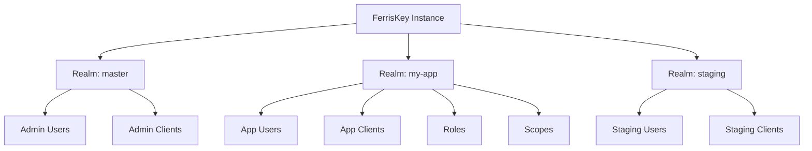

<span id="realms" />

# 身份域

身份域是 FerrisKey 中的顶级隔离边界。用户、客户端、角色、凭据、作用域和会话各自仅属于一个身份域。身份域使多租户成为可能：一个 FerrisKey 部署可以为多个独立的组织提供服务。

<span id="what-a-realm-isolates" />

## 身份域隔离的内容

每个身份域都是一个自包含的身份域：

| 资源 | 它包含的内容 |
|---|---|
| 用户 | 账户、个人资料和凭据 |
| 客户端 | 注册用于身份认证的应用程序 |
| 角色 | 权限包和角色映射 |
| 凭据 | 密码、TOTP 密钥、WebAuthn 密钥 |
| 客户端作用域 | 令牌声明定义和协议映射器 |
| 会话 | 活跃的用户会话 |
| 配置 | 令牌生命周期、注册策略、功能开关 |

不同身份域之间不会泄露信息。身份域A的用户无法针对身份域B的客户端进行身份认证。



<span id="the-master-realm" />

## 主身份域

每个部署都有一个`master`身份域。它在第一次启动时创建，持有初始管理员用户，无法删除，并且是跨身份域管理发生的地方。

:::callout{variant="warning" title="不要将主领域用于应用程序"}
将`master`用于管理。为每个应用程序提供自己的身份域。
:::

<span id="realm-settings" />

## 身份域设置

每个身份域都有自己的设置。它们控制登录的行为、令牌的有效期以及哪些可选功能启用。使用`GET /realms/{realm_name}`读取它们，并使用`PUT /realms/{realm_name}/settings`进行更改：如果字段被省略，其值将保持不变。

<span id="sign-in-and-registration" />

### 登录和注册

| 设置 | 默认 | 说明 |
|---|---|---|
| `user_registration_enabled` | `false` | 允许自助注册 |
| `forgot_password_enabled` | `false` | 启用密码重置流程 |
| `remember_me_enabled` | `false` | 在登录页面显示“记住我”复选框。参见[sessions and the SSO cookie](#sessions-and-the-sso-cookie) |
| `magic_link_enabled` | `false` | 通过电子邮件启用魔法链接登录 |
| `magic_link_ttl` | `15` | 魔法链接有效时间，单位为分钟 |
| `passkey_enabled` | `false` | 允许使用通行密钥（WebAuthn）登录 |
| `require_mfa` | `false` | 强制身份域中的每个用户注册多因素认证（MFA） |
| `login_aliases` | `[username]` | 在登录时接受的标识符的有序列表，来源于 `username` 和 `email`。必须非空且无重复。第一个解析出用户的别名获胜 |
| `edit_username_enabled` | `false` | 允许用户更改自己的用户名 |
| `email_verification_enabled` | `false` | 要求用户验证其电子邮件 |
| `email_verification_ttl_hours` | `24` | 验证链接有效时间 |
| `compass_enabled` | `true` | 使用 Compass 记录认证流程 |

<span id="token-lifetimes" />

### 令牌有效期

| 设置 | 默认 | 说明 |
|---|---|---|
| `default_signing_algorithm` | `RS256` | JWT 签名算法 |
| `access_token_lifetime` | `300` | 访问令牌 TTL，单位为秒 |
| `refresh_token_lifetime` | `86400` | 刷新令牌的 TTL，单位为秒。也是 SSO 会话的生命周期 |
| `id_token_lifetime` | `300` | ID 令牌的 TTL，单位为秒 |
| `temporary_token_lifetime` | `300` | 临时令牌的 TTL，单位为秒，在所需操作挂起时使用 |

客户端可以为自身覆盖每个生命周期。参见 [令牌](/zh-CN/discover/core-concepts/tokens#token-lifetimes)。

<span id="sessions-and-the-sso-cookie" />

### 会话和 SSO cookie

当用户登录时，FerrisKey 会开启 SSO 会话并设置 `FERRISKEY_SSO` cookie，这允许用户在不重新登录的情况下在该身份域的应用程序之间移动。该 cookie 为 HttpOnly，`SameSite=Lax`，作用域为路径 `/`，并在请求通过 https 进入时标记为 Secure。

默认情况下，它是一个浏览器会话 Cookie，会在浏览器关闭时消失。启用 `remember_me_enabled` 后，登录页面会显示一个“记住我”复选框。当用户勾选它时，Cookie 变为持久性，其 `Max-Age` 等于会话的剩余寿命。会话的持续时间取决于用户通过的客户端的刷新令牌有效期：客户端自定义的覆盖值，或者域的 `refresh_token_lifetime`。复选框仅在设置开启时出现，否则服务器会忽略被勾选的复选框。

通过 [注销](/zh-CN/discover/core-concepts/authentication#logout) 或撤销会话，也会撤销在此会话下签发的所有令牌。

<span id="lockout" />

### 锁定

在多次失败尝试后，账户会在固定时间窗口内被锁定。

| 设置 | 默认 | 说明 |
|---|---|---|
| `lockout_threshold` | `10` | 账户锁定前的失败尝试次数 |
| `lockout_duration_seconds` | `900` | 锁定持续时间 |

<span id="audit-privacy" />

### 审计隐私

SeaWatch 可以在事件存储之前剥离或匿名化个人数据。

| 设置 | 默认 | 说明 |
|---|---|---|
| `seawatch_pii_mode` | `off` | `off`、`mask`、`pseudonymise` 之一 |
| `seawatch_pseudo_key` | 未设置 | 在模式为 `pseudonymise` 时使用的 HMAC 密钥 |

<span id="locales" />

### 语言环境

| 设置 | 默认 | 说明 |
|---|---|---|
| `default_locale` | `en` | 当用户未表达偏好时使用的语言环境。必须是 `supported_locales` 之一 |
| `supported_locales` | `[en]` | 登录页面提供的语言环境。绝不会为空 |

语言环境是由两个字母组成的语言标签，也可以后跟两个字母的地区：`en`、`zh-CN`。格式错误的标签、空列表或不在列表中的默认值将被拒绝并显示 `422`。控制台和登录页面会被翻译为 `en` 和 `zh-CN`。

用户自己的选择存储在用户上，并通过 `PUT /realms/{realm_name}/users/@me/locale` 设置；发送 `null` 会清除它。区域设置会选择控制台和登录页面的语言。它不影响电子邮件：每种电子邮件类型都会使用为该身份域配置的模板发送，无论区域设置如何。

<span id="webhook-retries" />

### Webhook 重试

保持这些未设置，身份域将使用服务器默认值。

| 设置 | 默认 | 说明 |
|---|---|---|
| `webhook_retry_max_attempts` | 未设置 | 失败发送的重试次数 |
| `webhook_retry_base_delay_ms` | 未设置 | 第一次重试前的延迟，单位毫秒 |
| `webhook_retry_max_delay_ms` | 未设置 | 单个回退间隔的上限 |
| `webhook_retry_max_total_delay_ms` | 未设置 | 整个重试序列的上限 |

<span id="consent" />

### 授权同意

每个用户和客户端都会存储一个同意决定，并在 30 天内有效。设置 API 没有对应持续时间的字段。[同意](/zh-CN/discover/core-concepts/consent) 页面说明屏幕何时出现。

<span id="client-registration-and-resources" />

### 客户端注册和资源

这些设置允许您未手动注册的应用程序（例如 MCP 客户端）访问身份域。每个设置默认都是关闭或为空。[MCP](/zh-CN/discover/core-concepts/mcp) 页面解释了流程。

| 设置 | 默认 | 说明 |
|---|---|---|
| `dcr_enabled` | `false` | 允许应用程序以匿名方式向 `POST /realms/{realm_name}/clients/register` 自我注册。之后 Discovery 会发布 `registration_endpoint`。这些客户端始终需要用户同意。 |
| `cimd_enabled` | `false` | 接受 `https` URL 作为 `client_id` 并从中读取客户端的元数据。之后 Discovery 会设置 `client_id_metadata_document_supported`。这些客户端始终需要用户同意。 |
| `cimd_allowed_hosts` | `[]` | 客户端 ID URL 可能指向的主机名，作为不带方案或路径的裸名字。为空则接受任何主机。 |
| `allowed_resources` | `[]` | 客户端可以请求受众的 RFC 8707 资源指示器：绝对 https URL，或回环主机上的 http，无片段。为空则不接受任何请求，并且使用 `resource` 的请求将以 `invalid_target` 失败。 |

<span id="branding-and-email-templates" />

### 品牌和电子邮件模板

| 设置 | 默认 | 说明 |
|---|---|---|
| `reset_password_template_id` | 未设置 | 用于密码重置邮件的模板 |
| `magic_link_template_id` | 未设置 | 用于魔法链接邮件的模板 |
| `email_verification_template_id` | 未设置 | 用于验证邮件的模板 |

如果未设置模板ID，FerrisKey会回退到该邮件类型的内置默认模板。

:::callout{variant="info" title="门户主题未在此处设置"}
某个身份域确实拥有一个活动的门户主题，但它不是此端点的字段。使用`POST /realms/{realm_name}/portal/themes/{theme_id}/activate`激活一个，如[Portal](/zh-CN/modules/portal/overview)中所述。
:::

<span id="reading-settings-from-the-login-page" />

## 从登录页面读取设置

```
GET /realms/{name}/login-settings
```

身份域设置中面向登录的子集，门户使用它来确定提供哪些登录方法：是否开放注册、是否启用魔法链接和通行密钥、接受哪些标识符和语言环境，以及主题。它不需要身份认证。当你只需要渲染登录页面时，使用它而不是完整的设置读取。

<span id="smtp-configuration" />

## SMTP 配置

SMTP 也存在于身份域中，因此同一部署中的两个身份域可以从不同的提供者和不同的地址发送邮件。[电子邮件与模板指南](/zh-CN/discover/guides/email)覆盖了字段和 API。
