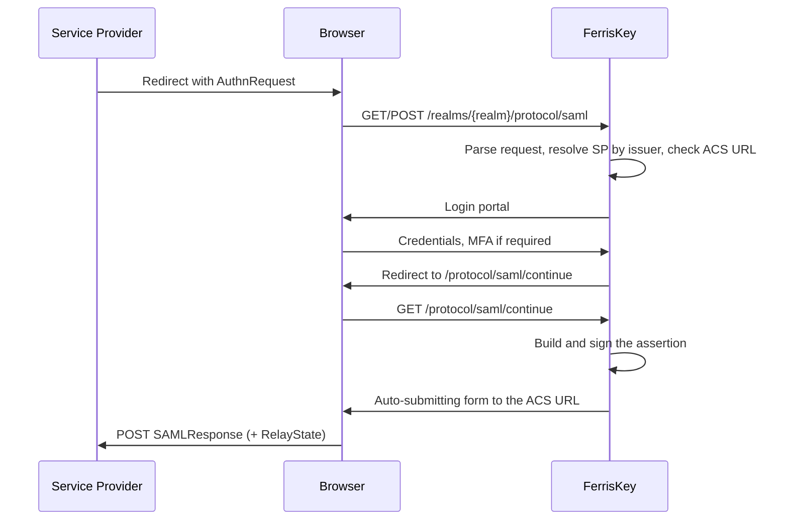

# SAML 2.0

FerrisKey 以身份提供者的身份支持 SAML 2.0。服务提供者向其发送 `AuthnRequest`，用户通过常规的 FerrisKey 登录进行登录，然后 FerrisKey 返回一个已签名的断言。

这就是让一个仅支持SAML的应用程序（而且这样的应用程序很多）进入相同的域、使用相同的用户和相同的审计跟踪的方法。

:::callout{variant="info" title="身份提供者，不是中介"}
本页讨论的是 FerrisKey 作为其他应用信任的 IdP。通过外部 SAML 提供者进行登录是相反的方向，由 [Abyss](/zh-CN/modules/abyss/overview) 中的联合处理，目前尚未发布。
:::

登录本身并不是 SAML 特有的：SAML 请求运行的 [认证链](/zh-CN/discover/core-concepts/authentication#authentication-chain) 与 OIDC 请求相同，具备相同的登录、多因素认证、锁定和审计事件。唯一不同的是前端入口和响应格式。如果你在决定应用程序应该使用哪种协议，该页面也将两种协议并排展示。

<span id="endpoints" />

## 端点

每个端点都是以域为范围的，位于该域的协议路径下。

| 方法 | 端点 | 说明 |
|---|---|---|
| `GET` | `/realms/{realm_name}/protocol/saml` | 通过 HTTP-Redirect 绑定的单点登录（SSO） |
| `POST` | `/realms/{realm_name}/protocol/saml` | 通过 HTTP-POST 绑定的单点登录（SSO） |
| `GET` | `/realms/{realm_name}/protocol/saml/continue` | 在用户完成身份认证后恢复流程 |
| `GET` | `/realms/{realm_name}/protocol/saml/descriptor` | IdP 元数据，用于提供给服务提供者 |

描述符是大多数服务提供者所需的：将它指向该 URL，或者下载它并上传 XML，他们就能自己获取实体 ID、SSO 端点以及签名证书。

<span id="the-entity-id-and-server_public_url" />

## 实体 ID 和 SERVER_PUBLIC_URL

IdP 实体 ID 由 `SERVER_PUBLIC_URL` 和域名构建：

```
https://sso.example.com/realms/home
```

它签署在每个断言中，这意味着它不能更改。请求中的主机名可能每次请求都不同，因此 SAML 从不会从那里获取。

:::callout{variant="warning" title="没有 SERVER_PUBLIC_URL，SAML 无法运行"}
在未设置 `SERVER_PUBLIC_URL` 的情况下，每个格式良好的 SSO 请求和描述符都会返回 HTTP 500 并提示“此服务器未配置单点登录。请设置 SERVER_PUBLIC_URL。” 将其设置为浏览器和服务提供者实际访问的源地址，即 `scheme://host[:port]`。OIDC 不读取此变量，因此仅提供 OIDC 的部署可能没有它。参见 [配置](/zh-CN/discover/guides/configuration)。
:::

<span id="registering-a-service-provider" />

## 注册服务提供者

SAML 服务提供者是携带 SAML 配置的 FerrisKey 客户端。

| 方法 | 端点 | 说明 |
|---|---|---|
| `GET` | `/realms/{realm_name}/clients/{client_id}/saml-config` | 读取客户端的 SAML 配置 |
| `PUT` | `/realms/{realm_name}/clients/{client_id}/saml-config` | 创建或替换它 |

| 字段 | 默认 | 说明 |
|---|---|---|
| `sp_entity_id` | 必填 | 服务提供者的实体 ID。FerrisKey 通过其发布者解析传入请求，因此此值必须完全匹配 |
| `acs_url` | 必填 | 断言消费者服务 URL，用于发布签名响应 |
| `name_id_format` | `emailAddress` | 主体标识符的格式 |
| `sign_assertions` | `true` | 已存储配置。见下文 |
| `sign_documents` | `false` | 已存储配置。见下文 |
| `want_authn_requests_signed` | `false` | 保持 `false`。见下文 |

如果 `AuthnRequest` 指向的 ACS URL 与注册的 URL 不匹配，请求将被拒绝而不是重定向。这是故意为之：请求中未检查的 ACS URL 是附有断言的开放重定向。

FerrisKey 会在每个响应中使用身份域的签名密钥签署断言，无论 `sign_assertions` 如何，它不会签署响应文档。`sign_assertions` 和 `sign_documents` 会被 API 存储并返回，但在 0.10.0 版本中发出断言不会读取它们。描述符会发布签名证书。

:::callout{variant="warning" title="不要设置 want_authn_requests_signed"}
FerrisKey 尚未验证 `AuthnRequest` 的签名。一个其配置将 `want_authn_requests_signed` 设置为 `true` 的服务提供商，因此每个请求都会被拒绝，并返回 HTTP 400 "此单点登录请求被拒绝"。描述符出于相同原因宣传 `WantAuthnRequestsSigned="false"`。
:::

<span id="name-id-formats" />

### 名称 ID 格式

| 值 | URN |
|---|---|
| `emailAddress` | `urn:oasis:names:tc:SAML:1.1:nameid-format:emailAddress` |
| `persistent` | `urn:oasis:names:tc:SAML:2.0:nameid-format:persistent` |
| `transient` | `urn:oasis:names:tc:SAML:2.0:nameid-format:transient` |
| `unspecified` | `urn:oasis:names:tc:SAML:1.1:nameid-format:unspecified` |

编写配置时，短名称和完整 URN 都被接受。主体来自用户：

| 格式 | 主体 |
|---|---|
| `emailAddress` | 电子邮件地址，仅当用户的 `email_verified` 为 `true` 时 |
| `persistent` | 用户的 ID |
| `transient` | 登录会话的 ID，每次登录都会改变 |
| `unspecified` | 用户名 |

用户无法满足的格式会导致流程失败：为没有电子邮件地址或未验证电子邮件地址的用户请求 `emailAddress`，会产生错误而不是空主体。

<span id="attribute-mappers" />

## 属性映射器

除了主题之外，服务提供者通常需要属性。映射器说明哪个用户字段在SAML属性名下被传出。

| 方法 | 端点 | 说明 |
|---|---|---|
| `GET` | `/realms/{realm_name}/clients/{client_id}/saml-attribute-mappers` | 列出客户端的映射器 |
| `POST` | `/realms/{realm_name}/clients/{client_id}/saml-attribute-mappers` | 创建映射器 |
| `DELETE` | `/realms/{realm_name}/clients/{client_id}/saml-attribute-mappers/{mapper_id}` | 删除映射器 |

映射器有一个`name`，一个`name_format`（除非另有说明，否则为`basic`），以及一个`source`。

如果来源没有用户值，则不会传送空值，而是被省略在断言之外。只有当用户的`email_verified`为`true`时，`user:email`才有值。

来源写作带前缀的字符串：

| 来源 | 值 |
|---|---|
| 用户ID | `user:id` |
| 用户名 | `user:username` |
| 电子邮件 | `user:email` |
| 名字 | `user:first_name` |
| 姓氏 | `user:last_name` |
| 自定义用户属性 | `attribute:<key>` |

名称格式：

| 值 | URN |
|---|---|
| `basic` | `urn:oasis:names:tc:SAML:2.0:attrname-format:basic` |
| `uri` | `urn:oasis:names:tc:SAML:2.0:attrname-format:uri` |
| `unspecified` | `urn:oasis:names:tc:SAML:2.0:attrname-format:unspecified` |

```json title="POST .../saml-attribute-mappers"
{
  "name": "email",
  "name_format": "urn:oasis:names:tc:SAML:2.0:attrname-format:basic",
  "source": "user:email"
}
```

<span id="the-flow" />

## 流程



服务提供者发送的`RelayState`会被完整保留并返回，这就是它能够恢复用户访问的页面的方式。

<span id="assertion-validity" />

## 断言效度

| 常数 | 值 |
|---|---|
| 断言寿命 | 300秒 |
| 允许时钟偏移 | 60秒 |

偏斜窗口存在是因为服务提供商的时钟不属于你。如果断言被拒绝为无效或已过期，首先检查双方的NTP。
