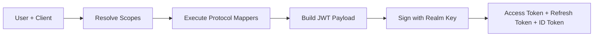

<span id="tokens" />

# 令牌

成功的认证会生成 JSON Web 令牌。每种类型在 OAuth2 和 OIDC 协议中都有其作用。

<span id="token-types" />

## 令牌类型

| 令牌 | `typ` 声明 | 目的 | 默认有效期 |
|---|---|---|---|
| 访问令牌 | `Bearer` | 对资源服务器进行 API 请求授权 | 300秒 |
| 刷新令牌 | `Refresh` | 在不再次询问用户的情况下获取新的访问令牌 | 86400秒 |
| ID 令牌 | `ID` | 根据OIDC，将用户身份传递给客户端 | 300秒 |
| 临时令牌 | `Temporary` | 授权完成所需的操作，仅此而已 | 300秒 |

<span id="jwt-structure" />

## JWT结构

每个令牌都是签名的JWT：头部、负载、签名。FerrisKey使用身份域的密钥通过RS256进行签名，并在身份域的`jwks.json`端点发布公钥部分。

<span id="standard-claims" />

### 标准声明

这些是访问令牌的声明：

| 声明 | 说明 |
|---|---|
| `sub` | 主体，用户的ID。对于`client_credentials`，客户端服务账户的ID |
| `aud` | 受众，一个列表。参见 [audience](#audience) |
| `azp` | 授权方，请求令牌的客户端的`client_id` |
| `iss` | 签发者，身份域URL，例如`https://sso.example.com/realms/home` |
| `typ` | Token类型，`Bearer` 表示访问令牌 |
| `exp` | 过期时间戳 |
| `iat` | 签发时间戳 |
| `jti` | 唯一令牌标识符 |
| `scope` | 以空格分隔的授予权限列表 |
| `sid` | OIDC会话ID，本令牌签发时对应的用户会话 |

`sid` 在未建立 SSO 会话的流程中不存在，其中包括 `client_credentials`。将缺失的 `sid` 视为“非会话绑定”，而非无效令牌。

刷新令牌携带相同的 `sub`、`iss`、`aud`、`azp`、`scope` 和 `sid`，`typ` 设置为 `Refresh`。在应用中将其视为不透明：只有 FerrisKey 需要读取它。

<span id="audience" />

### 受众

访问令牌的 `aud` 声明是一个列表，取决于令牌的获取方式：

| 令牌 | `aud` |
|---|---|
| 常规访问令牌 | `["<realm>-realm", "account"]`，例如 `["home-realm", "account"]`，加上客户端作用域中由 `oidc-audience-mapper` 添加的每个值 |
| 通过 RFC 8707 `resource` 请求 | 仅 `[resource]`。参见 [MCP](/zh-CN/discover/core-concepts/mcp) |
| 由 [令牌交换](/zh-CN/discover/core-concepts/token-exchange) 与 `audience` 返回 | 仅 `[audience]` |

身份域受众是 FerrisKey 自身管理 API 检查的对象。它仅在其 `aud` 包含 `<realm>-realm` 且其 `azp` 是由管理员注册的启用客户端时才接受令牌。针对特定资源缩小的令牌、为其他受众交换的令牌或颁发给自行注册的客户端的令牌将在此被拒绝。您自己的资源服务器应要求其期望的受众：通过 `oidc-audience-mapper` 添加，或通过 `resource` 请求。

<span id="identity-and-mapper-claims" />

### 身份和映射声明

身份声明并未硬编码到令牌中。每一个声明，包括 `preferred_username` 和 `email`，都是由附加到[客户端作用域](/zh-CN/discover/core-concepts/client-scopes)的协议映射器生成的，并且仅在该作用域被授权时生成。映射器 FerrisKey 种子生成：

| 声明 | 来源 |
|---|---|
| `preferred_username` | `profile` 作用域 |
| `given_name`, `family_name` | `profile` 作用域 |
| `email`, `email_verified` | `email` 作用域 |
| `realm_access.roles` | `roles` 作用域，通过 `oidc-usermodel-realm-role-mapper` |
| `organizations` | `organization` 作用域 |

因为映射器是可配置的，所以具体的声明集取决于分配给客户端的作用域。

<span id="id-token-claims" />

### ID 令牌声明

当授予的作用域包括 `openid` 时，会签发 ID 令牌。它在一些声明上与访问令牌不同：

| 声明 | 说明 |
|---|---|
| `aud` | 客户端的 `client_id`，作为单个字符串而不是列表 |
| `azp` | 相同的 `client_id` |
| `nonce` | 授权请求的 `nonce`（如果有）。使用刷新令牌签发的 ID 令牌中不存在 |
| `at_hash` | 访问令牌的 SHA-256 的左半部分，采用 base64url 编码 |
| `auth_time` | 会话上次认证的时间。存在于授权码和密码授权发出的 ID 令牌上，在刷新发出的 ID 令牌上则不存在 |
| `sid` | 会话 ID。RP 发起的登出从 `id_token_hint` 中读取它 |

<span id="token-lifetimes" />

## 令牌有效期

生命周期来自两个来源：

1. 身份域默认值，适用于身份域中的每个客户端。
2. 客户端覆盖设置，被设置时优先。

| 令牌 | 设置（身份域和客户端） | 身份域默认值 |
|---|---|---|
| 访问令牌 | `access_token_lifetime` | 300秒 |
| 刷新令牌 | `refresh_token_lifetime` | 86400秒 |
| ID 令牌 | `id_token_lifetime` | 300秒 |
| 临时令牌 | `temporary_token_lifetime` | 300秒 |

规则：如果客户端设置了覆盖，使用它，否则回退到身份域默认值。登录的 SSO 会话的生命周期与适用于该客户端的刷新令牌生命周期一样长，因此用户可以持续续订令牌的时间窗口，就是会话存活的时间窗口。

<span id="refresh-tokens-are-single-use" />

## 刷新令牌是一次性使用的

每次刷新都会返回一个新的刷新令牌，并使用掉旧的令牌。出示已使用的令牌，或同时发送相同的令牌两次，会撤销从该登录派生的整个刷新令牌系列，并返回 `invalid_grant`。客户端在丢失响应后重试刷新时，因此无法再刷新，只能重新登录。在使用新的访问令牌之前请先存储新的刷新令牌，并且绝不要并行运行同一令牌的两次刷新。参见 [refresh token](/zh-CN/discover/core-concepts/authentication#refresh-token)。

<span id="token-generation-chain" />

## 令牌生成链



1. 用户向客户端进行身份认证
2. 解析默认作用域（加上任何请求的可选作用域）
3. 每个作用域的协议映射器生成声明
4. 将声明组装到带有标准声明的 JWT 有效负载中
5. 该令牌使用身份域的签名密钥和算法进行签名
6. 返回访问令牌、刷新令牌和（可选的）ID令牌

<span id="validating-a-token" />

## 验证令牌

资源服务器有两种方式来决定访问令牌是否有效。

在本地，它会将签名与身份域的 `jwks.json`，然后是 `iss`、`exp` 和它预期的 `aud` 进行检查。这不需要凭据，也不需要往返请求，但无法查看吊销情况：已吊销的令牌，或会话已结束的令牌，在 `exp` 之前仍然可以验证。短期访问令牌的有效期可以限制该时间窗口。

通过内省，它会向 FerrisKey 询问:

```bash
curl -X POST https://sso.example.com/realms/home/protocol/openid-connect/token/introspect \
  -u my-client:my-secret \
  -d "token=eyJhbG..."
```

调用者必须是同一身份域的已启用机密客户端，并使用 `client_secret_basic` 或 `client_secret_post` 进行身份认证。FerrisKey 不会检查调用者的任何角色或权限，因此任何此类客户端都可以自我检查该身份域的任何令牌。请像保管令牌一样严格保管这些密钥。

一个活动的令牌会返回 RFC 7662 的固定子集：

```json
{
  "active": true,
  "scope": "openid profile email",
  "client_id": "my-client",
  "username": "alice",
  "sub": "8d1f3c52-0a4e-4d1c-9a57-2f0a1c9e7b11",
  "token_type": "Bearer",
  "exp": 1790000300,
  "iat": 1790000000,
  "nbf": 1790000000,
  "aud": "home-realm account",
  "iss": "https://sso.example.com/realms/home",
  "jti": "5b2f8e0c-3f7e-4f64-9a4d-6c1b7d2a9e10",
  "realm": "home"
}
```

`client_id` 是令牌的 `azp`，`aud` 是以空格连接的受众列表，`realm` 是身份域名称。令牌不携带的字段，例如当没有 `preferred_username` 时的 `username`，将被省略。

其他所有情况的回答都完全是 `{"active": false}`：被撤销或过期的令牌、已使用的刷新令牌、临时令牌、ID 令牌、会话已结束的令牌，以及身份域未签发的令牌。
