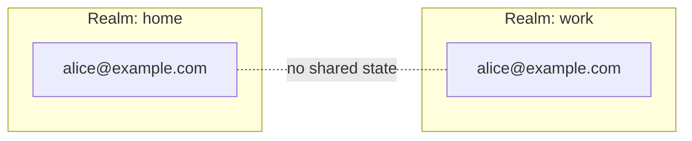
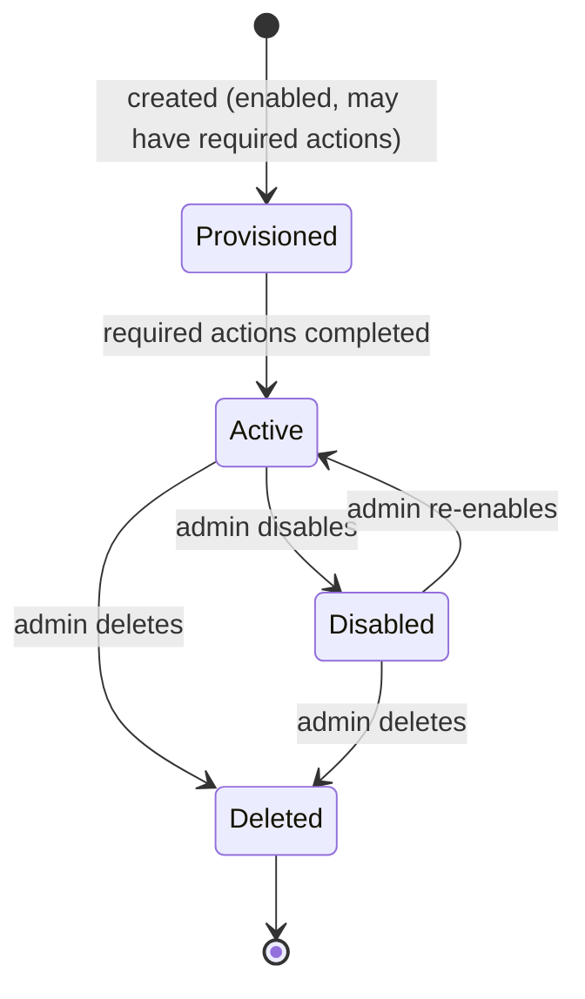
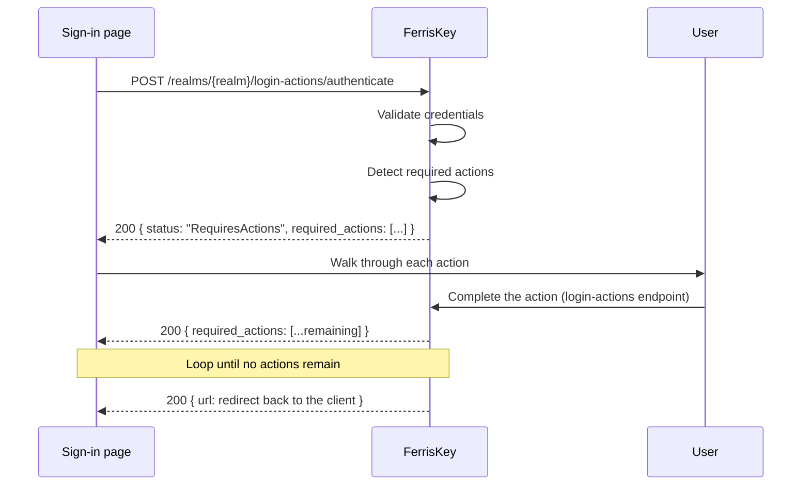

<span id="users" />

# 用户

用户代表一个[身份域](/zh-CN/discover/core-concepts/realms)中的身份。用户通过[客户端](/zh-CN/discover/core-concepts/clients)进行身份认证，通过[凭据](/zh-CN/discover/core-concepts/credentials)证明自己的身份，获取[令牌](/zh-CN/discover/core-concepts/tokens)，并通过[角色](/zh-CN/discover/core-concepts/roles)分配获得授权。

登录、令牌颁发、授权：在运行时，这一切都归结为用户。

<span id="anatomy-of-a-user" />

## 用户结构解析

用户记录本身很小。它描述某人的身份；凭据、角色和会话都存在相关对象中。

| 属性 | 说明 |
|---|---|
| `id` | 稳定标识符（UUID）。在所有令牌引用主体的地方使用。生成的，除非在创建用户时你提供一个。 |
| `username` | 身份域内的唯一标识符。登录名。 |
| `email` | 电子邮件地址。在记录中为可选项，但如果没有电子邮件，用户无法接收重置链接、魔法链接或验证邮件。 |
| `firstname`, `lastname` | 名和姓。 |
| `email_verified` | 电子邮件是否已确认。 |
| `enabled` | 账户是否激活。被禁用的用户无法进行身份认证。 |
| `required_actions` | 用户在登录完成前仍欠的内容。 |
| `locale` | 用户选择的语言，或使用 `null` 以遵循身份域默认设置。参见 [本地化](/zh-CN/discover/guides/localization)。 |
| `failed_login_attempts`, `locked_until` | 锁定状态。参见 [锁定](#lockout)。 |
| `federation_provider_id` | 账户所属的用户联合提供商（如果有）。 |
| `client_id` | 仅在服务账户用户上设置，将其与所属客户端关联。否则不显示。 |
| `realm_id` | 该用户所属的身份域。 |
| `created_at`, `updated_at` | 时间戳。 |

由管理员 API 返回的示例 JSON 负载：

```json
{
  "id": "0199a4f2-3c1e-7b8a-9f00-1a2b3c4d5e6f",
  "realm_id": "0199a4ee-91d0-7c3a-8e21-5b7f0c2d4a18",
  "username": "alice",
  "firstname": "Alice",
  "lastname": "Martin",
  "email": "alice@example.com",
  "email_verified": true,
  "enabled": true,
  "required_actions": [],
  "created_at": "2026-10-30T20:36:41.347264Z",
  "updated_at": "2026-10-30T20:36:41.347264Z",
  "failed_login_attempts": 0,
  "locked_until": null,
  "locale": null,
  "federation_provider_id": null
}
```

<Callout variant="info" title="标识符">

使用 `id` 来引用其他资源中的用户（角色分配、审计日志、令牌）。`username` 是面向用户的标识，身份域可以允许用户自行更改；`id` 永远不会更改。

</Callout>

<span id="creating-a-user" />

### 创建用户

```
POST /realms/{realm_name}/users
```

请求体包含 `username`，可选的还有 `email`、`email_verified`、`firstname` 和 `lastname`。新用户尚无凭据：使用 [reset-password](#credentials) 设置密码。

请求体还可以包含可选的 `id`。当另一个系统已通过 UUID 识别该用户，且其令牌的 `sub` 声明必须匹配时，请提供该值。如果任何身份域中已有用户使用该 id，请求将失败，返回 `409` 和失败原因 `user_id_already_exists`。若未提供 `id`，FerrisKey 将生成一个。

<span id="realm-scoping" />

## 身份域范围

用户属于且仅属于一个身份域。同一个电子邮件地址可以在多个身份域中存在，但作为完全独立的账户。没有跨身份域查询：认证总是在一个身份域内进行。



对于跨多个身份域的同一身份，通过[Abyss](/zh-CN/modules/abyss/overview)模块进行联合。每个身份域仍保留自己的用户记录，并与同一外部提供者关联。

<span id="user-lifecycle" />

## 用户生命周期

用户在创建到删除的过程中，会经历少量状态。



| 状态 | 含义 |
|---|---|
| 已配置 | 账户已存在，但可能仍有待处理的[必需操作](#required-actions)：验证电子邮件、设置永久密码、注册多因素认证。在这些操作完成之前，认证仅会生成临时令牌。 |
| 活跃 | 身份认证会生成完整的令牌，并应用角色分配。 |
| 已禁用 | `enabled = false`。账户被保留，但无法进行身份认证。 |
| 已删除 | 记录已被移除。 |

禁用用户会立即切断访问。FerrisKey 会结束用户会话并撤销他们的刷新令牌和访问令牌，从那时起其自身的 API 会拒绝这些访问令牌。仅离线检查 JWT 签名的 API 会继续接受访问令牌，直到它过期，默认 300 秒。重新启用账户后，用户可以再次登录；但它不会恢复被撤销的会话。

删除用户，无论是单个还是批量，都会在记录消失之前结束会话并撤销令牌。

<span id="required-actions" />

## 所需操作

必需操作是用户在获得完全认证前必须完成的操作。在任何操作待完成时，登录会返回仍需完成的操作，而不是重定向回应用程序。

| 操作 | 何时添加 | 用户必须执行的操作 |
|---|---|---|
| `verify_email` | 用户在启用了电子邮件验证的身份域中注册自己，或者管理员分配了该操作 | 点击由 [Trident](/zh-CN/modules/trident/overview) 模块发送的链接 |
| `update_password` | 管理员将密码重置为临时密码，或分配了该操作 | 设置新密码 |
| `configure_otp` | 该身份域或用户的某个角色要求多因素认证（MFA），且用户尚未拥有 TOTP 凭据。它会等待直到临时密码被替换 | 注册 TOTP 身份认证器 |
| `configure_passkey` | 管理员已分配它，并且用户至少有一个凭据 | 注册 WebAuthn 密钥 |

`configure_otp` 是在每次登录时根据域的 `require_mfa` 设置和用户的角色计算出来的。它从不存储在用户上，因此你不能通过编辑用户来清除它：注册一个验证器或取消要求可以做到这一点。

<span id="how-they-flow" />

### 它们的流程



登录页面是基于浏览器的授权码流程。令牌端点上的 `password` 授权不会经过这些步骤：它拒绝为仍欠一个的账户发放令牌，并告诉客户端使用浏览器流程。

<Callout variant="info" title="临时令牌">

随待处理操作一起提供的临时令牌是一个短期有效的 JWT，以 HTTP-only cookie 形式发送，仅限于 `/realms/{realm}/login-actions`。它授权访问 required-action 端点，除此之外无其他权限。它无法访问受保护资源或调用 userinfo。

</Callout>

<Callout variant="warning" title="顺序很重要">

必需操作按照固定顺序进行评估，通常是 `verify_email`，然后是 `update_password`，再是 MFA 注册操作。在响应中读取 `required_actions` 数组，而不是在客户端中硬编码该顺序。

</Callout>

<span id="service-account-users" />

## 服务账户用户

当一个 [客户端](/zh-CN/discover/core-concepts/clients) 具有 `service_account_enabled` 时，FerrisKey 会创建一个关联的服务账户用户。它是一个普通的用户记录，但具有一些区分特征：

- `username` 来源于客户端 (`service-account-<client_id>`)。
- `client_id` 指向拥有该客户端的来源。
- 它没有密码，只通过 `client_credentials` 授权进行身份认证。
- 它可以像任何其他用户一样被分配角色和权限。

它存在的目的是为了机器对机器的调用可以有一个真实的主体来进行授权决策和审计日志。

<span id="example" />

### 示例

一个夜间批处理作业由客户端 `batch-runner` 和 `service_account_enabled = true` 表示。关联的服务账户用户 `service-account-batch-runner` 被授予 `billing:read` 角色。

```bash
curl -X POST https://sso.example.com/realms/home/protocol/openid-connect/token \
  -d "grant_type=client_credentials" \
  -d "client_id=batch-runner" \
  -d "client_secret=••••••••"
```

生成的访问令牌将 `sub` 设置为服务账户用户的 `id`，并携带 `billing:read` 角色。计费 API 可以像对人类用户一样授权此调用。

有关完整授予，请参见 [身份认证，客户端凭据](/zh-CN/discover/core-concepts/authentication#client-credentials)。

<span id="administering-a-user" />

## 管理用户

控制台将关于一个账户的所有内容分为五个选项卡：概览、凭据、角色映射、组织和属性。


<span id="listing-users" />

### 列出用户

```
GET /realms/{realm_name}/users
```

列表是分页的：`page`、`limit`（1 到 100，默认 20），返回结果为 `{ data, metadata }`。请参见 [分页列表](/zh-CN/discover/guides/api-listings) 了解共享合同。

| 参数 | 它的功能 |
|---|---|
| `search` | 匹配用户名、电子邮件、名字或姓氏中的任意位置，忽略大小写 |
| `username`, `email`, `firstname`, `lastname` | 匹配该字段中任意位置，忽略大小写 |
| `enabled`, `email_verified` | 标志的精确匹配 |
| `service_account` | `true` 仅保留服务账户用户，`false` 仅保留普通用户。未设置时两者都会列出 |
| `role_id` | 保留已分配该角色的用户 |
| `ids` | 最多包含100个用户ID的逗号分隔列表 |
| `not_in_group` | 一个组织组ID：保留那些不是该组成员的用户 |
| `not_in_organization` | 一个组织ID：保留那些不是其成员的用户 |
| `created_from`, `created_to` | 创建日期的界限，RFC 3339格式并带偏移量。`created_from`为闭区间，`created_to`为开区间 |
| `order_by` | `username`、`email`、`firstname`、`lastname`、`enabled`、`created_at`（默认值）或`updated_at` |

筛选器以AND方式组合。表中未列出的参数，包括`offset`，将被`400`拒绝，并给出`invalid_query`作为原因。

<span id="credentials" />

### 凭据

```
GET    /realms/{realm_name}/users/{user_id}/credentials
DELETE /realms/{realm_name}/users/{user_id}/credentials/{credential_id}
PUT    /realms/{realm_name}/users/{user_id}/reset-password
POST   /realms/{realm_name}/users/{user_id}/credentials/import
```

读取将显示账户上注册的认证方法（密码、认证器、通行密钥），但不会显示密钥内容。对于密码，它显示存储哈希的`algorithm`。存储的密码不会在任何地方显示：只能被替换。

重置需要 `value` 和 `temporary` 标志，控制台将其显示为有效性：

| 有效性 | 效果 |
|---|---|
| 临时 | 用户必须在下次登录时更改它。设置 `update_password` 所需操作 |
| 永久 | 它将一直有效，直到用户自行更改 |

新密码必须符合域的 [密码策略](/zh-CN/discover/core-concepts/password-policy)。重置会结束用户的所有会话并撤销他们的令牌，因此该用户须使用新密码重新登录。

<Callout variant="warning" title="删除凭据是静默的">

删除凭据是立即且不可逆的。它不会结束用户会话，用户也不会收到通知：他们会在下次登录时发现。

</Callout>

`credentials/import` 是来自另一个 IAM 的哈希的迁移路径。参见 [导出与导入](/zh-CN/discover/guides/portability#password-hashes)。

<span id="roles" />

### 角色


```
GET    /realms/{realm_name}/users/{user_id}/roles
POST   /realms/{realm_name}/users/{user_id}/roles/{role_id}
DELETE /realms/{realm_name}/users/{user_id}/roles/{role_id}
GET    /realms/{realm_name}/users/{user_id}/permissions
GET    /realms/{realm_name}/users/{user_id}/organizations
```

`permissions` 是解析后的集合，它是账户持有的每个角色的并集。当你调试“为什么这个用户可以做那个操作”时，就应该查看它。`roles` 是分配列表；`permissions` 是结果。

<span id="attributes" />

### 属性

```
GET    /realms/{realm_name}/users/{user_id}/attributes
PUT    /realms/{realm_name}/users/{user_id}/attributes
DELETE /realms/{realm_name}/users/{user_id}/attributes/{key}
```

自由格式的键值元数据。属性只能通过活动作用域上的 [协议映射器](/zh-CN/modules/aegis/protocol-mappers#oidc-usermodel-attribute-mapper) 访问令牌：仅存储一个不会改变任何内容。

<span id="lifecycle-operations" />

### 生命周期操作

```
DELETE /realms/{realm_name}/users/bulk
POST   /realms/{realm_name}/users/{user_id}/unlock
```

`bulk` 一次调用可以删除多个账户，并将批次作为批次报告：一个 `user.bulk_deleted` webhook 携带 ID 列表，以及一个 `user_deleted` 审计事件，其详细信息包含 `user_ids`。两者都不会为每个账户生成一条记录，因此计算行数的使用者会低估批量删除的数量。

`unlock` 在其窗口期到期之前清除锁定。参见 [Lockout](#lockout)。

<span id="identity-provider-links" />

### 身份提供者链接

```
GET    /realms/{realm_name}/users/{user_id}/identity-provider-links
DELETE /realms/{realm_name}/users/{user_id}/identity-provider-links/{link_id}
```

外部身份 [代理](/zh-CN/modules/abyss/providers) 到此账户。删除链接不会删除账户；用户将无法通过该提供者登录，并且删除操作会在审核日志中引发 `identity_provider_link_removed`。

所需权限：读取需要 `view_users` 或 `manage_users`，写入需要 `manage_users`。`manage_realm` 授予两者权限。

<span id="lockout" />

## 锁定

在尝试失败过多后，账户会自动锁定，由两个域设置控制：`lockout_threshold`（默认 10 次尝试）和 `lockout_duration_seconds`（默认 900 秒，即十五分钟）。

错误密码和多因素认证（MFA）挑战中的错误一次性代码都会使计数器增加，因此猜测的一次性密码（OTP）会像猜测的密码一样受到限制。成功登录会重置计数器。在账户被锁定期间，即使输入正确的密码或代码也会被拒绝。

用户携带状态：`failed_login_attempts` 和 `locked_until`。账户被锁定后，一旦等待时间过去会自动再次认证，或者如果管理员调用 `unlock`，则会立即认证。

失败尝试会作为 `login_failure` 记录在 [SeaWatch](/zh-CN/modules/seawatch/event-types) 中，对应被攻击的账户。SeaWatch 事件不包含 IP 地址，因此类似“一个 IP，四十个账户，每个账户九次尝试”的喷射源会显示在 [Compass](/zh-CN/modules/compass/overview) 中，其流量可以通过 `ip_address` 搜索。

<span id="sessions" />

## 会话

用户可以同时持有多个会话，每个浏览器、设备或持有有效刷新令牌的服务各一个会话。

| 概念 | 有效期 | 它代表的内容 |
|---|---|---|
| 认证会话 | 秒到分钟 | 正在进行的登录（状态、随机数、代码、多因素认证挑战）。一旦发行令牌则丢弃。 |
| 用户会话 | 小时到天 | 经过认证的会话。由刷新令牌支持。 |
| 访问令牌 | 分钟 | 从用户会话派生的短期持有者令牌。 |

结束用户会话会撤销其刷新令牌，并且FerrisKey自身的API随后拒绝由其发出的访问令牌。仅在离线检查签名的API在令牌过期之前仍然接受它们。[令牌](/zh-CN/discover/core-concepts/tokens) 和 [认证，认证会话](/zh-CN/discover/core-concepts/authentication#auth-sessions) 有详细信息。

<span id="listing-and-revoking" />

### 列出和撤销

```
GET    /realms/{realm_name}/users/{user_id}/sessions
DELETE /realms/{realm_name}/users/{user_id}/sessions/{session_id}
```

该列表是分页显示的，并包括已过期的会话。它会根据 `search`（IP 地址或用户代理）、`ip_address`、`user_agent`、`persistent` 以及 `created_from` 和 `created_to` 范围进行过滤，并根据 `last_seen_at`、`expires_at` 或 `created_at` 进行排序。请参阅 [分页列表](/zh-CN/discover/guides/api-listings)。

<Callout variant="info" title="仅限 API">

这两者在管理员控制台中没有界面：用户的会话只能通过 API 访问。用户自己的 [账户页面](/zh-CN/modules/account/overview) 确实有会话标签，因此用户可以查看自己的会话。

</Callout>

会话创建和撤销都会被审核，如 `session_created` 和 `session_revoked` 所示。

<span id="security-considerations" />

## 安全注意事项

禁用而不是删除。禁用会保留审核历史和角色分配，并立即终止用户访问。只有在确认该身份永远不会返回时才删除。

要强制密码轮换，请将密码重置为临时密码。下一次登录将触发 `update_password` 所需操作。密码不会自行过期，因为该身份域的 `max_age_days` 未应用；参见 [密码策略](/zh-CN/discover/core-concepts/password-policy#expiry-is-stored-not-applied)。

要强制 MFA 注册，请在身份域上设置 `require_mfa`。没有 TOTP 凭据的现有用户将在下次登录时获得 `configure_otp`。

要切断用户访问而不禁用账户，请使用上述 `DELETE` 结束其会话，或重置其密码。

在日志和外部系统中通过 `id` 引用用户。用户名和电子邮件会变化；ID 不会。

<span id="related-concepts" />

## 相关概念

- [身份域](/zh-CN/discover/core-concepts/realms)：用户所在的边界。
- [客户端](/zh-CN/discover/core-concepts/clients)：用户通过其进行认证的对象。
- [凭据](/zh-CN/discover/core-concepts/credentials)：用户证明身份的方式。
- [角色](/zh-CN/discover/core-concepts/roles)：用户如何获得授权。
- [令牌](/zh-CN/discover/core-concepts/tokens)：用户登录后收到的物品。
- [鉴定](/zh-CN/discover/core-concepts/authentication)：把它绑在一起的链子。
