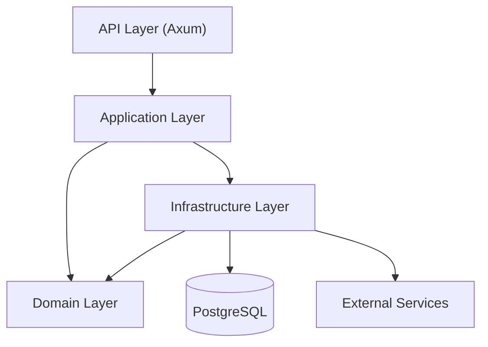

<span id="architecture" />

# 架构

FerrisKey 遵循六边形架构，也称为端口与适配器。业务逻辑位于中间，不了解 HTTP、SQL 或 SMTP。其他所有内容都连接到它上面。这就是保持领域可测试并允许基础设施更改而无需重写规则的原因。

<span id="layers" />

## 层级



<span id="domain-layer" />

### 领域层

纯业务逻辑，不依赖于框架、数据库或传输。每个领域模块的布局方式相同：

- `entities.rs` 用于表示领域概念的不可变值对象
- `ports.rs` 用于领域需要别人实现的特性
- `services.rs` 用于通过这些端口操作实体的逻辑
- `value_objects.rs` 用于用例的输入和输出
- `policies.rs` 用于授权规则，当某个模块有它们时

<span id="application-layer" />

### 应用层

编排。`ApplicationService` 通过依赖注入将每个领域服务连接到具体实现，并且是组装对象图的唯一位置。

<span id="infrastructure-layer" />

### 基础设施层

端口背后的实现：由 SeaORM 和 PostgreSQL 支持的仓库，以及用于 SMTP、Webhook 投递和身份提供者调用的出站集成。它还在身份域、客户端和会话仓库前持有内存缓存（参见 [缓存](/zh-CN/discover/guides/configuration#caching)），并在到达数据库之前对密钥进行封装（参见 [静态密钥](/zh-CN/discover/guides/secrets-at-rest)）。

<span id="api-layer" />

### API 层

使用 Axum 构建的 HTTP 层。每个功能模块都对应一个领域模块，并带有自己的路由器、处理器、验证器和错误类型。OpenAPI 文档根据处理器上的 `utoipa` 属性生成，并在 `/swagger-ui`、`/redoc`、`/rapidoc` 和 `/scalar` 提供服务。

<span id="domain-modules" />

## 领域模块

```text
core/src/domain/
├── authentication/       # OAuth2 / OIDC flows
├── user/                 # User lifecycle and required actions
├── account/              # Self-service account operations
├── account_security/     # Password, MFA and passkey self-service
├── client/               # OAuth2 clients
├── client_registration/  # Dynamic client registration
├── client_metadata/      # Clients identified by a metadata document URL
├── consent/              # Consent to optional client scopes
├── realm/                # Multi-tenant realms and settings
├── credential/           # Passwords, OTP, WebAuthn
├── password_policy/      # Password strength rules
├── role/                 # Bitwise permissions
├── session/              # User sessions
├── jwt/                  # Token issuance and validation
├── crypto/               # Password hashing
├── saml/                 # SAML 2.0 identity provider
├── trident/              # MFA
├── seawatch/             # Audit logging
├── compass/              # Authentication flow recording
├── abyss/                # Identity provider federation
├── aegis/                # Client scopes and protocol mappers
├── organization/         # B2B tenancy
├── email_template/       # Transactional email templates
├── email_verification/   # Email verification flow
├── portal_theme/         # Login portal theming
├── portal_layouts/       # Login portal layouts
├── webhook/              # Event-driven hooks
├── health/               # Liveness and readiness
├── maintenance/          # Maintenance mode
└── common/               # Shared errors, pagination and rate limiters
```

此处的模块要么在 `core` 中实现，要么从 `libs/` 下的一个 crate 重新导出。例如，`consent/` 是 `ferriskey-consent` 的重新导出。

<span id="workspace-crates" />

## 工作区的库

该工作区被划分为 `libs/` 下的专注库，分为两个系列。

功能库包含一个模块的领域逻辑和基础设施逻辑：

```text
libs/
├── ferriskey-domain/           # Shared domain types and ports
├── ferriskey-authz/            # RBAC engine, action catalogue and the tenant authorization domain
├── ferriskey-authz-cedar/      # Cedar engine that evaluates tenant authorization policies
├── ferriskey-security/         # Password hashing, JWT primitives and the secret cipher
├── ferriskey-consent/          # Consent to optional client scopes
├── ferriskey-trident/          # MFA
├── ferriskey-abyss/            # Identity provider federation
├── ferriskey-aegis/            # Scopes and protocol mappers
├── ferriskey-compass/          # Authentication flow tracing
├── ferriskey-saml/             # SAML 2.0
├── ferriskey-seawatch/         # Audit events
├── ferriskey-organization/     # Organizations
├── ferriskey-password-policy/  # Password policies
├── ferriskey-portal-theme/     # Portal theming
├── ferriskey-portal-layouts/   # Portal layouts
├── ferriskey-webhook/          # Webhook delivery
├── ferriskey-mail/             # SMTP transport, email templates and email verification
├── ferriskey-migrate/          # Data migration runner
└── maskass/                    # Redaction of sensitive values
```

`maskass` 是唯一没有 `ferriskey-` 前缀的库，它不依赖其他 FerrisKey 库。它的 `Masked<T>` 包装器保存实际值，但在序列化、打印和调试打印时作为 `***` 表现，这可以将身份提供者的客户端密钥保密，不出现在 API 响应和日志中。`MaskedWith` 添加了部分、邮箱和哈希掩码。

`ferriskey-api-*` crate 承载匹配功能的 HTTP 层：它的路由、处理器和 OpenAPI 路径。构建 `ferriskey-api` 二进制文件的 `api` crate 仅将它们组合成一个路由器和一个 OpenAPI 文档，并启动服务器。`ferriskey-api-core` 保存共享部分：CLI 参数、应用状态、Bearer token 中间件、CORS、请求上下文和错误转换。

<span id="dependency-flow" />

## 依赖流

规则很严格：内部层永远不依赖外部层。

- 域不依赖任何东西
- 应用通过端口依赖于域
- 基础设施实现域的端口
- API 依赖于应用

这意味着你可以将 PostgreSQL 替换为其他存储，将 Axum 替换为不同的 HTTP 框架，或者完全在内存中运行领域测试，而无需触碰业务规则。

<span id="error-propagation" />

## 错误传播

错误通过自动转换向外传播：

1. 领域失败的 `CoreError`：未找到，验证，冲突。
2. 附有状态码的 HTTP 响应的 `ApiError`。
3. 边界处的 `From<CoreError> for ApiError`，因此处理程序可以使用 `?` 并免费获得正确的状态码。
