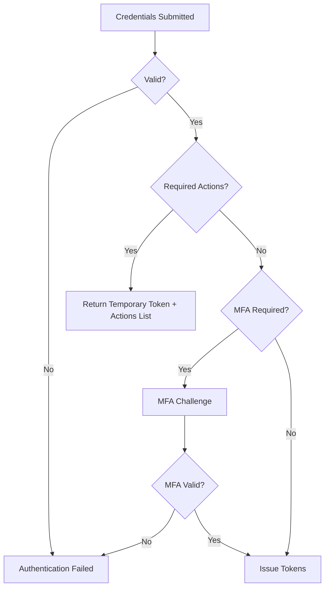

<span id="authentication" />

# 身分認證

FerrisKey 透過兩種協議進行身分認證：

| 協議 | 入口 | 應用程式接收到的內容 |
|---|---|---|
| OAuth 2.0 / OpenID Connect | `/protocol/openid-connect/*` | 存取權杖、重新整理權杖和 ID 權杖 |
| SAML 2.0 | `/protocol/saml` | 一個簽名的 XML 斷言 |

它們僅在邊緣處有所不同。在底層，兩者都經過相同的登入、相同的多因素認證（MFA）、相同的鎖定機制和相同的審計跟蹤。下面的[認證鏈](#authentication-chain)是共享的，這是首先值得理解的部分。

本頁的大部分內容關於OIDC，因為它是預設且功能更豐富的介面。[SAML](#saml-20)有其獨立的章節。

<span id="openid-connect-discovery" />

## OpenID Connect 發現

OpenID Connect 應用需要知道授權伺服器的位置以及它公開了哪些端點。FerrisKey 透過發現端點發布該資訊：

```text
/realms/{realm}/.well-known/openid-configuration
```

例如，如果FerrisKey可在`https://sso.example.com`存取，並且你的身分域是`home`，則發現端點為：

```text
https://sso.example.com/realms/home/.well-known/openid-configuration
```

該端點返回一個 JSON 文件，OIDC 客戶端可以自動讀取。它包括：

| 欄位 | 它告訴應用程式的資訊 |
|---|---|
| `issuer` | 該身分域作為身分提供者的規範 URL |
| `authorization_endpoint` | 瀏覽器用於開始登入的位置 |
| `token_endpoint` | 應用程式用於交換程式碼獲取權杖的位置 |
| `userinfo_endpoint` | 應用程式可以獲取使用者資料資訊的位置 |
| `jwks_uri` | 公開簽名金鑰的位置，以便驗證權杖 |
| `introspection_endpoint`, `revocation_endpoint` | 用於權杖檢查和撤銷的位置 |
| `end_session_endpoint` | RP 發起登出的位置 |
| `device_authorization_endpoint` | 當無瀏覽器裝置啟動裝置流時 |
| `grant_types_supported` | `authorization_code`, `refresh_token`, `client_credentials`, `password`，裝置碼授權和權杖交換授權 |
| `token_endpoint_auth_methods_supported` | `none`, `client_secret_basic`, `client_secret_post` |
| `code_challenge_methods_supported` | `S256` |
| `scopes_supported` | 身分域的客戶端作用域 |
| `backchannel_logout_supported`, `backchannel_logout_session_supported` | 兩者都是`true`。參見[後通道登出](/zh-TW/discover/core-concepts/backchannel-logout) |
| `authorization_response_iss_parameter_supported` | `true`：每個授權響應都攜帶一個 `iss` 引數（RFC 9207） |
| `registration_endpoint`, `client_id_metadata_document_supported` | 僅在身分域啟用動態客戶端註冊或客戶端 ID 後設資料文件時出現。參見 [MCP](/zh-TW/discover/core-concepts/mcp) |

大多數應用程式支援發現，因此很少需要手動貼上端點。提供應用程式發現 URL 或簽發者，它會從 FerrisKey 讀取其餘內容。

查詢 OAuth 2.0 授權伺服器後設資料（RFC 8414）的客戶端可以在 `/.well-known/oauth-authorization-server/realms/{realm}` 處找到它。它攜帶相同的端點、授權和 PKCE 方法，但不包括 userinfo、終結會話和裝置授權端點。在 `SERVER_ROOT_PATH` 後，文件在該字首下提供，也在 `/.well-known/oauth-authorization-server{root_path}/realms/{realm}` 提供，這是 RFC 8414 要求的形式。

:::callout{variant="warning" title="只實現了授權碼流程"}
在 OpenID 配置中，`response_types_supported` 還列出了 `none`、`token`、`id_token` 以及混合組合，例如 `code id_token`。它們都不存在。授權端點不會對 `response_type` 進行操作，並總是以授權碼響應，因此使用 `response_type=code`。RFC 8414 文件僅列出了 `code`。
:::

:::callout{variant="info" title="Issuer 和發現不是相同的設定"}
當應用程式請求籤發者或權威機構時，提供它的域 URL，例如 `https://sso.example.com/realms/home`。當它請求發現端點或 OpenID 配置 URL 時，提供完整的 `/.well-known/openid-configuration` 地址。
:::

:::callout{variant="warning" title="簽發者遵循請求"}
FerrisKey 構建 `issuer`，每個端點 URL 以及來自 `Host` 和 `X-Forwarded-Proto` 請求頭的 `iss` 權杖宣告。在終止 TLS 的反向代理後面，轉發兩者，否則簽發者將顯示為 `http://` 或內部主機名，驗證它的客戶端將拒絕你的權杖。OIDC 文件不讀取 `SERVER_PUBLIC_URL`；SAML 會。
:::

<span id="grant-types" />

## 授權型別

授權型別是 OAuth2 的概念：它表明客戶端如何證明自己代表誰操作。SAML 沒有等效概念，參見 [bindings](#saml-20)。

<span id="authorization-code" />

### 授權碼

對網頁應用程式最安全的流程。使用者被重定向到FerrisKey，在那裡進行認證，然後帶著一個程式碼返回客戶端，客戶端用該程式碼交換權杖。

步驟：
1. 客戶端將使用者重定向到 `/realms/{realm}/protocol/openid-connect/auth`
2. 使用者進行認證（憑據，如果需要則多因素認證）
3. FerrisKey 使用 `code`、`state` 和 `iss` 引數重定向回來
4. 客戶端在權杖端點交換授權碼（伺服器端）
5. FerrisKey返回存取權杖、重新整理權杖和ID權杖

將其用於 Web 應用，以及結合 PKCE 的單頁和移動應用：公共客戶端沒有金鑰，因此程式碼挑戰就是將程式碼與請求它的客戶端繫結的方式。

驗證碼是一次性使用的，其有效期與產生該驗證碼的登入嘗試相同，為10分鐘。第二次出示驗證碼，或在同一時刻重複使用驗證碼，將被拒絕並返回`invalid_grant`，同時撤銷在該登入會話下發放的存取權杖和重新整理權杖。請求引數，包括`prompt`和`max_age`，描述如下[授權請求](#the-authorization-request)。

<span id="password-resource-owner" />

### 密碼（資源所有者）

:::callout{variant="danger" title="已棄用"}
密碼授權已被棄用。它仍然可用，因此現有的整合可以繼續工作，但不要在其上構建新的內容。OAuth 2.1 將移除它，並且它無法與客戶端看不到的任何內容一起工作，包括密碼鑰匙和任何聯合登入。

對於沒有瀏覽器的CLI或其他裝置，請改用[裝置碼授權](#device-code)。對於第一方Web應用程式，請使用帶PKCE的[授權碼](#authorization-code)。
:::

客戶端自行收集憑據並將其提交到權杖端點。更簡單，但更弱：客戶端可以看到使用者的密碼。

步驟：
1. 客戶端將`grant_type=password`、`username`和`password`傳送至權杖端點，同時附上自己的客戶端認證資訊。
2. FerrisKey 驗證憑據
3. 如果賬戶仍然欠一個身分認證步驟（一個必需的操作、一次性密碼挑戰或多因素認證註冊），FerrisKey 會回答 `invalid_grant` 並告訴客戶端使用基於瀏覽器的授權碼流程。此授權從不返回臨時權杖。
4. 否則 FerrisKey 將開啟會話並返回權杖

僅適用於尚未遷移的現有整合。

:::callout{variant="warning" title="需要直接存取授權"}
客戶端需要 `direct_access_grants_enabled` 才能使該流程工作。
:::

<span id="client-credentials" />

### 客戶端憑據

機器對機器。客戶端使用自己的客戶端 ID 和金鑰進行身分認證，不涉及使用者。客戶端必須是金鑰的並且擁有 `service_account_enabled`。

步驟：
1. 客戶端將 `grant_type=client_credentials` 與其憑據一起傳送，作為 HTTP 基本頭部，或作為請求體中的 `client_id` 和 `client_secret`。
2. FerrisKey 驗證客戶端憑據
3. 返回客戶端服務賬戶的存取權杖

沒有重新整理權杖。只有當 `scope` 呼叫 `openid` 時，才會返回 ID 權杖，並且當 `offline_access` 被 `invalid_scope` 拒絕時，沒有會話支援該權杖，因此它沒有 `sid` 宣告。這些請求的數量也是有限制的，詳見 [權杖端點](#the-token-endpoint)。

最適合後臺服務、定時任務和微服務之間的呼叫。

<span id="refresh-token" />

### 重新整理權杖

在不讓使用者重新登入的情況下更新已過期的存取權杖。

步驟：
1. 客戶端使用重新整理權杖傳送 `grant_type=refresh_token`
2. FerrisKey 驗證重新整理權杖
3. 返回新的存取權杖和重新整理權杖

重新整理權杖是一次性使用的。每次重新整理都會消耗你傳送的權杖並返回它的繼承者，新的權杖仍然繫結到同一個會話。如果已使用的權杖再次被使用，或者兩個請求在同一時刻重新整理同一個權杖，FerrisKey 會撤銷整個家族（該登入派生的每一個重新整理權杖）並返回 `invalid_grant`。一旦權杖背後的會話結束或使用者被禁用，相同的錯誤會再次返回。

最適合任何發出重新整理權杖並需要保持會話活躍的流程。

<span id="device-code" />

### 裝置碼

```
urn:ietf:params:oauth:grant-type:device_code
```

適用於任何無法託管瀏覽器或無法信任密碼的情況的流程：CLI、電視應用或無頭裝置。裝置從不直接看到憑據。它向FerrisKey請求一個程式碼，告訴使用者在哪裡輸入，並輪詢直到使用者在自己的瀏覽器中批准，該瀏覽器中多因素認證、通行金鑰和聯合登入都可以正常工作。

這就是 `ferris-ctl login` 的連線方式。

步驟：

1. 裝置向 `/realms/{realm}/protocol/openid-connect/auth/device` 傳送請求。公開客戶端在表單主體中傳遞 `client_id`；機密客戶端則使用 HTTP Basic 進行認證。
2. FerrisKey 返回一個裝置碼、一個簡短的終端使用者程式碼，以及要顯示的驗證 URI。
3. 裝置顯示使用者程式碼和 URI，並開始使用 `grant_type=urn:ietf:params:oauth:grant-type:device_code` 和裝置碼輪詢權杖端點。
4. 使用者在任何瀏覽器中開啟 `/realms/{realm}/device`，輸入程式碼，並透過完整流程進行身分認證，包括多因素認證 (MFA)。
5. 下一次輪詢返回權杖。

在使用者未完成操作時，輪詢返回 RFC 8628 錯誤程式碼 (`authorization_pending`、`slow_down`、`access_denied`、`expired_token`)，因此客戶端可以區分“尚未完成”和“被拒絕”，並相應地退避。

| 端點 | 目的 |
|---|---|
| `POST /realms/{realm_name}/protocol/openid-connect/auth/device` | 啟動流程，獲取程式碼 |
| `GET /realms/{realm_name}/device` | 使用者輸入程式碼的頁面 |
| `POST /realms/{realm_name}/device/verify` | 提交程式碼 |
| `POST /realms/{realm_name}/protocol/openid-connect/token` | 輪詢權杖 |

:::callout{variant="warning" title="客戶端必須允許"}
客戶端需要 `oauth_device_code_grant_enabled`。沒有它，第一次呼叫會被拒絕。
:::

此流程也可以被觀察到：[webhooks](/zh-TW/modules/webhooks/triggers) 會觸發 `auth.device_flow.initiated`、`auth.device_flow.denied` 和 `auth.device_flow.expired`。

<span id="token-exchange" />

### 權杖交換

```
urn:ietf:params:oauth:grant-type:token-exchange
```

RFC 8693 權杖交換允許後端服務將其持有的存取權杖兌換為一個具有更窄作用域、不同受眾或帶有 `act` 宣告的新權杖，該宣告將服務命名為代表使用者行動的方。請求的客戶端必須是機密的、已啟用的、由管理員註冊的，並且具備 `token_exchange_enabled`。若要將新權杖用於另一個客戶端，它還需要針對該客戶端的委託策略，該策略說明是否允許冒充和委託，並限制作用域。結果僅為存取權杖，不包含重新整理權杖和 ID 權杖。

[權杖交換](/zh-TW/discover/core-concepts/token-exchange) 涵蓋請求、策略、新權杖的宣告及錯誤程式碼。

<span id="the-authorization-request" />

## 授權請求

`GET /realms/{realm}/protocol/openid-connect/auth` 啟動每一個瀏覽器流程。FerrisKey 檢查客戶端、重定向 URI 和 PKCE 策略，然後將瀏覽器傳送到登入頁面，或者當瀏覽器已經持有有效的 SSO 會話時直接返回應用程式。

| 引數 | 說明 |
|---|---|
| `response_type` | 傳送 `code`。只存在授權碼流程：該值已儲存但從未使用。 |
| `client_id` | Realm 的一個啟用的 OpenID Connect 客戶端 |
| `redirect_uri` | 必須與客戶端啟用的重定向 URI 匹配，參見 [重定向 URI](/zh-TW/discover/core-concepts/clients#redirect-uris)。 |
| `scope` | 以空格分隔。預設作用域始終適用，只有在指定時才使用可選作用域 |
| `state`, `nonce` | `state` 將在重定向時返回，`nonce` 將被複制到 ID 權杖中。 |
| `code_challenge`, `code_challenge_method` | PKCE。`S256` 是唯一被方法發現廣告所宣傳的方法，也是公共客戶端或具有 `require_pkce` 的客戶端可以使用的唯一方法。 |
| `prompt` | `none`, `login` 或 `consent` |
| `max_age` | 應用程式接受的身分認證的最大年齡，以秒為單位 |
| `resource` | 一個 RFC 8707 資源指示符。它必須是該身分域允許的資源之一，併成為存取權杖的 `aud`。參見 [MCP](/zh-TW/discover/core-concepts/mcp) |

成功響應會將 `code`、`state`（當請求中有時）和 `iss` 重定向給客戶端。

<span id="prompt-and-max_age" />

### Prompt 和 max_age

| 引數 | 效果 |
|---|---|
| `prompt=none` | 從不顯示頁面。瀏覽器的 SSO 會話會響應請求，或者瀏覽器在無可用會話時返回錯誤：`login_required`，在賬戶存在如必需操作等步驟時返回 `interaction_required`，當需要顯示同意螢幕時返回 `consent_required` |
| `prompt=login` | 忽略 SSO 會話，要求使用者重新進行身分認證 |
| `prompt=consent` | 即使已經儲存了決定，也會顯示[同意螢幕](/zh-TW/discover/core-concepts/consent) |
| `select_account` | 被忽略，就像任何 FerrisKey 不知道的值一樣 |
| `max_age=N` | 一個在 N 秒之前認證的 SSO 會話不足夠，使用者需要重新登入 |
| `max_age=0` | 與 `prompt=login` 相同 |

`prompt=none` 不能與另一個值組合：請求將隨 `invalid_request` 一起返回。當 `prompt=login` 或超出的 `max_age` 強制新的登入時，相同的使用者會重新登入到他們已經擁有的會話：`sid` 保持不變，並且會話的有效期重新開始。`auth_time` 對 ID 權杖的宣告是該會話最後一次認證的時間。由授權碼和密碼授權發放的 ID 權杖包含該宣告，由重新整理發放的則不包含。

<span id="when-a-request-is-refused" />

### 當請求被拒絕時

如果客戶端、身分域或重定向 URI 無效，FerrisKey 不會重定向到請求中的地址。瀏覽器會停留在 FerrisKey 登入頁面並顯示錯誤資訊。一旦重定向 URI 被信任，被拒絕的請求將以 `error`、`state` 和 `iss` 查詢引數方式返回：`invalid_request`、`invalid_target`（一個 `resource`，身分域不允許）、`login_required`、`interaction_required` 和 `consent_required`。違反客戶端 PKCE 策略的請求，或針對已禁用客戶端的請求，將返回 JSON 錯誤，而不是重定向。

<span id="the-token-endpoint" />

## 權杖端點

`POST /realms/{realm}/protocol/openid-connect/token` 接受一個 `application/x-www-form-urlencoded` 體，並服務於上述所有授權。

客戶端透過三種方式之一進行認證，如 `token_endpoint_auth_methods_supported` 中列出：

| 方法 | 方式 |
|---|---|
| `none` | 一個公共客戶端在正文中傳送 `client_id` |
| `client_secret_basic` | HTTP 基本認證，`client_id` 作為使用者名稱，secret 作為密碼 |
| `client_secret_post` | `client_id` 和 `client_secret` 在正文中 |

基於斷言的方法，例如 `private_key_jwt`，不被支援。當請求同時攜帶 Basic 頭和正文欄位時，以頭部為準。Basic 憑據按照 RFC 6749 的要求進行表單解碼，因此包含 `+` 或 `%` 的 secret 必須在進行 base64 編碼之前進行百分比編碼。

錯誤遵循 RFC 6749 §5.2：一個包含 `error` 和 `error_description` 的 JSON 主體。`invalid_client` 是一個帶有 `WWW-Authenticate: Basic` 的 `401`；`invalid_request`、`invalid_grant`、`invalid_scope`、`invalid_target`、`unauthorized_client` 和 `unsupported_grant_type` 是 `400`。每個響應，無論是否成功，都包含 `Cache-Control: no-store` 和 `Pragma: no-cache`。

保護端點有兩個限制：

- 在一分鐘內從同一個（IP 地址、身分域、`client_id`）出現 10 次客戶端身分認證失敗後，下一個請求將得到 `429`，伴隨 `temporarily_unavailable` 和 `Retry-After: 60`。
- 超過 `SERVER_TOKEN_MAX_IN_FLIGHT` 的 `client_credentials` 請求會立即處理（預設每個程序使用的 CPU 數量處理 32 個），並得到 `503`，伴隨 `temporarily_unavailable` 和 `Retry-After: 1`。

每個副本都會在記憶體中儲存這兩個限制，因此具有多個副本的部署會針對每個副本執行這些限制。失敗閾值不可配置。客戶端地址是TCP連線的對等方。將`SERVER_TRUST_FORWARDED_FOR`設定為讀取`X-Forwarded-For`，且僅在您控制的代理是唯一進入方式時。請參見[配置](/zh-TW/discover/guides/configuration)。

<span id="the-oidc-endpoints" />

## OIDC端點

這些是整合介面：應用程式、資源伺服器或閘道器與之通訊的內容。所有內容均相對於`/realms/{realm_name}/protocol/openid-connect`。

| 方法 | 路徑 | 目的 |
|---|---|---|
| `GET` | `/auth` | 啟動授權碼流程 |
| `POST` | `/auth/device` | 啟動裝置流程（RFC 8628 §3.1） |
| `POST` | `/token` | 交換授權碼、重新整理權杖、裝置碼或憑據以獲取權杖 |
| `POST` | `/token/introspect` | 權杖檢查（RFC 7662） |
| `GET` `POST` | `/userinfo` | `sub`，以及`name`、`given_name`、`family_name`和`preferred_username`，使用`profile`作用域；`email`和`email_verified`，使用`email`作用域。存取權杖必須攜帶`openid` |
| `POST` | `/revoke` | 撤銷存取權杖或重新整理權杖 (RFC 7009) |
| `GET` `POST` | `/logout` | RP 發起的登出 |
| `GET` | `/jwks.json`, `/certs` | 身分域的公共簽名金鑰 |
| `POST` | `/registrations` | 自助註冊，當身分域允許時 |

<span id="introspection" />

### 內省

`/token/introspect` 使用帶有 `token` 的表單體，以及可選的 `token_type_hint`，並使用 `client_secret_basic` 或 `client_secret_post` 對呼叫者進行身分認證。該身分域中任何啟用的機密客戶端只要提供其金鑰，就可以檢查該身分域中任何權杖的內容：呼叫者不會被檢查角色或權限。公共客戶端會被拒絕，因此請改為根據 `/jwks.json` 驗證 JWT 簽名，這不需要憑據也不需要往返請求。然而，簽名檢查無法檢測撤銷：被撤銷的權杖仍然可以驗證，直到 `exp`。

答案是 RFC 7662 的固定子集：活動權杖的宣告，或者 `{"active": false}`，僅此而已。[權杖](/zh-TW/discover/core-concepts/tokens#validating-a-token) 列出了欄位以及返回非活動狀態的情況，其中包括已撤銷的權杖、已使用的重新整理權杖、ID 權杖以及會話已結束的權杖。

<span id="revocation" />

### 吊銷

`/revoke` 像權杖端點一樣對客戶端進行認證。公共客戶端只傳送其 `client_id`。一旦客戶端透過認證，它總是返回 `200`，無論權杖是有效的、已撤銷的還是不可讀取的，因此答案不會反映權杖的任何資訊。它僅對發給呼叫客戶端的權杖（其 `azp`）執行操作：其他權杖保持不變。撤銷重新整理權杖只能撤銷該權杖本身，而不是權杖的整個系列。

<span id="logout" />

### 登出

`GET` 或 `POST /logout` 會結束使用者會話。它接受 `id_token_hint`、`post_logout_redirect_uri`、`state` 和 `client_id`。

FerrisKey 透過有效 `id_token_hint` 的 `sid` 查詢會話，如果失敗則透過 `FERRISKEY_SSO` cookie 查詢。它會撤銷該會話以及在該會話下發出的所有存取和重新整理權杖（SeaWatch 記錄 `session_revoked`），清除 FerrisKey cookie，並向參與會話的客戶端傳送 [背頻道登出](/zh-TW/discover/core-concepts/backchannel-logout) 通知。

瀏覽器看到的內容取決於重定向：

- 沒有 `post_logout_redirect_uri` 時，答案是空的 `204`。FerrisKey 沒有登出頁面，所以使用者會停留在傳送請求的頁面上。
- 透過一個，答案是一個 `307` 到該 URI，並附加 `state`。URI 必須與客戶端啟用的 [登出後重定向](/zh-TW/discover/core-concepts/clients#sub-resources) 完全相同，一個字元也不能差。客戶端來自 `client_id` 或 `id_token_hint` 的 `azp`；如果都不是，請求會被拒絕。當檢查 URI 時，會話已經不存在，因此被拒絕的重定向不會讓使用者保持登入狀態。

`id_token_hint` 的簽名和簽發者必須驗證透過，但過期的提示仍然被接受。當沒有請求重定向時，無效提示會被忽略；有請求重定向時，則會導致請求失敗。

<span id="keys" />

### 金鑰

`/jwks.json`、它的 `/certs` 雙胞胎以及未註釋的 `/jwks` 別名都返回身分域的公鑰。它們不需要認證，並且是公開的。答案攜帶 `Cache-Control: public, max-age=300`，因此客戶端和代理可以儲存五分鐘。Discovery 會宣傳 `/jwks.json`。

<span id="registration" />

### 註冊

當身分域具有 `user_registration_enabled` 時，`/registrations` 會建立使用者（否則它返回 `403`）。主體需要 `email` 和 `password`，以及 `first_name`、`last_name` 和可選的 `username`；如果沒有使用者名稱，則使用者名稱為電子郵件地址，經修剪並小寫。`201` 響應攜帶 `status`：

| `status` | `data` | 當 |
|---|---|---|
| `authenticated` | 權杖 | 沒有事情可做 |
| `redirect` | `url` | 註冊發生在授權流程內，`url` 會繼續該流程 |
| `pending_action` | `message` 和 `user_id` | 使用者還欠一個步驟，例如電子郵件驗證 |

:::callout{variant="info" title="自己構建登入頁面？"}
門戶本身驅動的端點，包括登入表單、多因素認證挑戰和重置流程，是一個獨立的系列。請參見 [登入操作](/zh-TW/modules/portal/login-actions)。
:::

## SAML 2.0

對於沒有其他功能的應用程式，FerrisKey 充當 SAML 身分提供者：服務提供者傳送 `AuthnRequest`，使用者透過正常的 FerrisKey 登入進行登入，然後 FerrisKey 返回簽名斷言。

<span id="bindings-instead-of-grants" />

### 繫結而不是授權

SAML 沒有授權型別。它有的是繫結，描述請求如何傳遞，而 FerrisKey 在一條路徑上同時提供兩者：

| 方法 | 路徑 | 繫結 |
|---|---|---|
| `GET` | `/realms/{realm_name}/protocol/saml` | HTTP-重定向 |
| `POST` | `/realms/{realm_name}/protocol/saml` | HTTP-POST |
| `GET` | `/realms/{realm_name}/protocol/saml/continue` | 使用者認證後恢復 |
| `GET` | `/realms/{realm_name}/protocol/saml/descriptor` | 要交給服務提供商的 IdP 後設資料 |

該描述符相當於發現文件：將服務提供商指向該 URL，它就能自行獲取實體 ID、SSO 端點和簽名證書。

<span id="a-client-speaks-one-protocol" />

### 客戶端使用一種協議

客戶端攜帶 `protocol`、`openid-connect`（預設）或 `saml`，在建立時設定，之後無法更改，就像機密/公開選擇一樣。從 SAML 遷移到 OIDC 的應用程式會獲得一個新的客戶端，而不是編輯原有客戶端。

SAML 客戶端有兩組自己的集合：

```
GET PUT        /realms/{realm_name}/clients/{client_id}/saml-config
GET POST       /realms/{realm_name}/clients/{client_id}/saml-attribute-mappers
DELETE         /realms/{realm_name}/clients/{client_id}/saml-attribute-mappers/{mapper_id}
```

屬性對映器是 SAML 對 [協議對映器](/zh-TW/modules/aegis/protocol-mappers) 的回答：它們決定哪些使用者資料會出現在斷言中。這兩個系統是獨立的。協議對映器不會影響斷言，屬性對映器也不會影響 JWT。

<span id="what-saml-does-not-get" />

### SAML 沒有獲取的內容

OIDC 表面上沒有 SAML 對應項，這是協議上的差異，而不是缺口：

- 沒有重新整理權杖。斷言就是完整的答案；沒有什麼可以重新整理的。
- 沒有 `userinfo`，就沒有自省。服務提供者瞭解的一切都在它已經持有的斷言中。
- 沒有裝置流，沒有客戶端憑據。兩者都是 OAuth2 的構造。

<span id="one-configuration-requirement" />

### 一個配置要求

IdP 實體 ID 是由 `SERVER_PUBLIC_URL` 和身分域名稱構建的，並且它會簽署到每個斷言中，因此它絕不能更改。基於這個原因，SAML 拒絕從請求中猜測來源：如果沒有 `SERVER_PUBLIC_URL`，SSO 端點和描述符會以 HTTP 500 響應：“此伺服器未配置單點登入。請設定 SERVER_PUBLIC_URL。”

:::callout{variant="warning" title="在啟用 SAML 之前請設定 SERVER_PUBLIC_URL"}
將其設定為瀏覽器和服務提供商實際存取的來源，即 `scheme://host[:port]`。OIDC 不會讀取它，因此已經執行 OIDC 數月的部署仍然可以未設定它。請參見 [配置](/zh-TW/discover/guides/configuration)。
:::

[SAML 2.0](/zh-TW/discover/core-concepts/saml) 包含以下內容：註冊服務提供商、Name ID 格式、屬性對映器參考、完整的流程圖，以及斷言有效性。

<span id="authentication-chain" />

## 認證鏈

兩種協議都執行在相同的鏈上。無論請求是以 OIDC 授權請求還是 SAML `AuthnRequest` 形式到達，使用者與憑據之間發生的事情是相同的：



1. 憑據驗證。使用者名稱和密碼會被驗證。
2. 必需的操作。如果有任何待處理操作（`configure_otp`、`verify_email`、`update_password`、`configure_passkey`），返回的將是一個臨時權杖，而非真實權杖。
3. 多因素認證（MFA）。如果使用者有TOTP憑據，則必須輸入一次性驗證碼。密碼金鑰可以自行登入使用者，並且在密碼之後不會作為第二因素被要求。
4. 權杖簽發。生成存取權杖、重新整理權杖和ID權杖，或者對於SAML請求，構建並簽署斷言。

下游的所有內容也都是共享的。[Compass](/zh-TW/modules/compass/overview) 會記錄 SAML 執行與 OIDC 執行，並將 `saml_authn_request` 和 `saml_assertion` 作為它們自己的步驟記錄，[SeaWatch](/zh-TW/modules/seawatch/overview) 無論使用哪種協議也會記錄相同的 `login_success` 和 `login_failure` 事件。沒有單獨的 SAML 審計追蹤可供查詢。

<span id="auth-sessions" />

## 認證會話

認證會話跟蹤正在進行的登入。它包含：

- 客戶端和身分域上下文
- 重定向 URI 和 OAuth2 引數（`state`、`nonce`、`scope`、`resource`）
- PKCE 程式碼挑戰
- 授權碼（在成功認證後）
- WebAuthn 挑戰資料（如適用）
- 關聯的 Compass 流程（如果啟用了流程引擎）

認證會話是短暫的：未在10分鐘內完成的嘗試會自行過期。

不要與 SSO 會話混淆。SSO 會話是在使用者透過認證後建立的，持續時間與客戶端的重新整理權杖有效期一樣，並且是 `FERRISKEY_SSO` Cookie 和權杖的 `sid` 宣告所指向的內容。[Realms](/zh-TW/discover/core-concepts/realms#sessions-and-the-sso-cookie) 描述了其 Cookie 及有效期。
