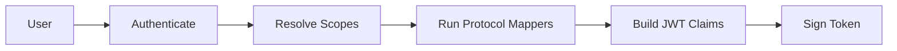

<span id="client-scopes" />

# 客戶端作用域

客戶端作用域決定權杖中包含的內容。它會分組協議對映器，這些對映器是從使用者或客戶端提取資料並將其作為宣告寫入 JWT 的規則。

<span id="scope-types" />

## 作用域型別

| 型別 | 行為 |
|---|---|
| 預設 | 包含在為客戶端發出的每個權杖中 |
| 可選 | 僅在客戶端在 `scope` 引數中請求時包含 |
| 無 | 根本不分配給客戶端 |

同一個作用域可以對於一個客戶端是預設的，對於另一個客戶端是可選的。這由客戶端作用域對映決定，而不是由作用域本身決定。

一個作用域本身也有型別，在建立時選擇為預設或可選。它只在客戶端建立時才起作用：新客戶端會將每個型別為預設的作用域作為預設作用域接收，而不會接收其他作用域。可選作用域從不自動附加，因此需要將它們分配給每個需要它們的客戶端。

<span id="scopes-seeded-by-default" />

## 預設種子作用域

每個身分域都預置了一組標準的 OIDC 作用域。

| 作用域 | 型別 | 它產生的宣告 |
|---|---|---|
| `openid` | 預設 | 自身沒有；將請求標記為 OIDC |
| `profile` | 預設 | `given_name`, `family_name`, `preferred_username` |
| `email` | 預設 | `email`, `email_verified` |
| `organization` | 預設 | `organizations` |
| `roles` | 預設 | `realm_access.roles` |
| `offline_access` | 可選 | 自身沒有 |
| `phone` | 可選 | `phone_number` |
| `address` | 可選 | `address` |


:::callout{variant="info" title="openid 和 offline_access 沒有對映器"}
八個預設作用域中有兩個自身不寫入任何宣告。`openid` 將請求標記為 OIDC，`offline_access` 解鎖重新整理權杖的頒發。兩者都作用於流程，而非負載。對映器為零的作用域不一定配置錯誤。
:::

五個預設作用域會附加到之後你建立的每個客戶端。`offline_access`、`phone` 和 `address` 存在於身分域中，但只有在你將它們分配給客戶端時才能到達客戶端，作為可選作用域。

`organization` 作用域是最新的，也是唯一一個其兩個對映器故意針對同一宣告的作用域：成員對映器貢獻每個組織的 `id`、`name` 和 `alias`，角色對映器貢獻 `roles` 和 `clients.<id>.roles`，兩個對映器深度合併為一個 `organizations` 物件。

<span id="protocol-mappers" />

## 協議對映器

對映器由 `mapper_type` 字串標識。FerrisKey 保留 Keycloak 名稱，因此為 Keycloak 編寫的配置在這裡也能識別。

| `mapper_type` | 它的功能 |
|---|---|
| `oidc-usermodel-property-mapper` | 將內建使用者屬性（使用者名稱、電子郵件、名字）對映到宣告 |
| `oidc-usermodel-attribute-mapper` | 將自定義使用者屬性對映到宣告 |
| `oidc-usermodel-realm-role-mapper` | 將使用者的身分域角色寫入權杖 |
| `oidc-usermodel-client-role-mapper` | 將使用者的客戶端角色寫入權杖 |
| `oidc-group-membership-mapper` | 寫入使用者的組成員資格 |
| `oidc-organization-membership-mapper` | 寫入使用者的組織成員資格 |
| `oidc-organization-detail-mapper` | 寫入活動組織的詳細資訊 |
| `oidc-organization-role-mapper` | 寫入使用者在組織中的角色 |
| `oidc-full-name-mapper` | 將名和姓以空格連線後寫入 `name` 宣告 |
| `oidc-audience-mapper` | 將 `included.client.audience` 的值新增到存取權杖的 `aud` 宣告中 |
| `oidc-hardcoded-claim-mapper` | 將固定值作為宣告新增 |

每個對映器都攜帶一個 JSON `config`。鍵遵循 Keycloak 約定：

```json title="Mapping the username into preferred_username"
{
  "user.attribute": "username",
  "claim.name": "preferred_username",
  "access.token.claim": "true",
  "id.token.claim": "true"
}
```

`claim.name` 支援點分路徑，因此 `realm_access.roles` 會生成巢狀物件，而不是名稱中帶點的扁平鍵。

<span id="managing-scopes" />

## 管理作用域

```
GET    /realms/{realm_name}/client-scopes
POST   /realms/{realm_name}/client-scopes
GET    /realms/{realm_name}/client-scopes/{scope_id}
PATCH  /realms/{realm_name}/client-scopes/{scope_id}
DELETE /realms/{realm_name}/client-scopes/{scope_id}
```

對映器位於其作用域下：

```
POST   /realms/{realm_name}/client-scopes/{scope_id}/protocol-mappers
PATCH  /realms/{realm_name}/client-scopes/{scope_id}/protocol-mappers/{mapper_id}
DELETE /realms/{realm_name}/client-scopes/{scope_id}/protocol-mappers/{mapper_id}
```

<span id="assigning-a-scope-to-a-client" />

### 為客戶端分配作用域

```
GET    /realms/{realm_name}/clients/{client_id}/client-scopes
PUT    /realms/{realm_name}/clients/{client_id}/default-client-scopes/{scope_id}
DELETE /realms/{realm_name}/clients/{client_id}/default-client-scopes/{scope_id}
PUT    /realms/{realm_name}/clients/{client_id}/optional-client-scopes/{scope_id}
DELETE /realms/{realm_name}/clients/{client_id}/optional-client-scopes/{scope_id}
```

預設作用域適用於該客戶端的每個請求。可選作用域僅在請求在其 `scope` 引數中指定時適用。客戶端持有一次作用域，要麼作為預設，要麼作為可選，從不同時擁有兩者。分配客戶端已擁有的作用域會失敗，因此透過先取消分配再重新分配，將作用域從一個列表移動到另一個列表。

讀取需要 `view_client_scopes` 或 `manage_client_scopes`，寫入需要 `manage_client_scopes`，而 `manage_realm` 同時授予兩者。

`POST /realms/{realm_name}/clients/{client_id}/evaluate-scopes` 預覽客戶端當前分配給某個使用者的權限，無需登入。

<span id="optional-scopes-and-consent" />

## 可選作用域和同意

只有在請求指定可選作用域時，才會授予權杖該作用域。對於需要使用者同意的客戶端，使用者也可以決定：同意螢幕會列出請求所要求的可選作用域，權杖只會包含使用者批准的作用域。客戶端在其 `consent_required` 標誌設定時需要使用者同意，並且在其註冊時始終需要同意。FerrisKey 會將每個使用者和客戶端的決定儲存 30 天，在此期間不會再次請求相同的作用域。

[同意](/zh-TW/discover/core-concepts/consent) 頁面覆蓋螢幕、儲存的決定和 `prompt=consent`。

<span id="scopes-for-clients-that-register-themselves" />

## 自注冊客戶端的權限作用域

透過動態註冊、客戶端 ID 後設資料文件，或者匿名方式自注冊的客戶端，可以始終請求 `openid`、`profile`、`email` 和 `roles`。其他任何權限作用域僅在該權限作用域設定了 `dynamic_registration_allowed` 時開放，而所有預設權限作用域上都設定了 `false`。可以在控制檯中透過 **Available to dynamic clients (CIMD, DCR)** 設定，或者在 `POST /realms/{realm_name}/client-scopes` 和 `PATCH /realms/{realm_name}/client-scopes/{scope_id}` 的請求體中設定。權限作用域列表會用 **Dynamic clients** 徽章標記此類權限作用域。

僅當您打算將其宣告交給從未稽核過的應用程式時，才以這種方式公開作用域。有關注冊流程，請參見 [MCP](/zh-TW/discover/core-concepts/mcp)。

<span id="how-scopes-shape-a-token" />

## 作用域如何塑造權杖



1. 使用者針對客戶端進行身分認證。
2. FerrisKey 決定哪些作用域適用：客戶端的預設作用域，以及請求中要求的任何可選作用域。
3. 每個活動作用域上的對映器執行。
4. 它們的輸出成為 JWT 宣告，連同標準宣告一起。
5. 權杖使用身分域金鑰進行簽名。

:::callout{variant="info" title="作用域是一種宣告合同"}
將 scope 視為客戶端與授權伺服器之間的協議：授予我 `profile`，並且我期望使用者的姓名和使用者名稱會在權杖中返回。
:::
