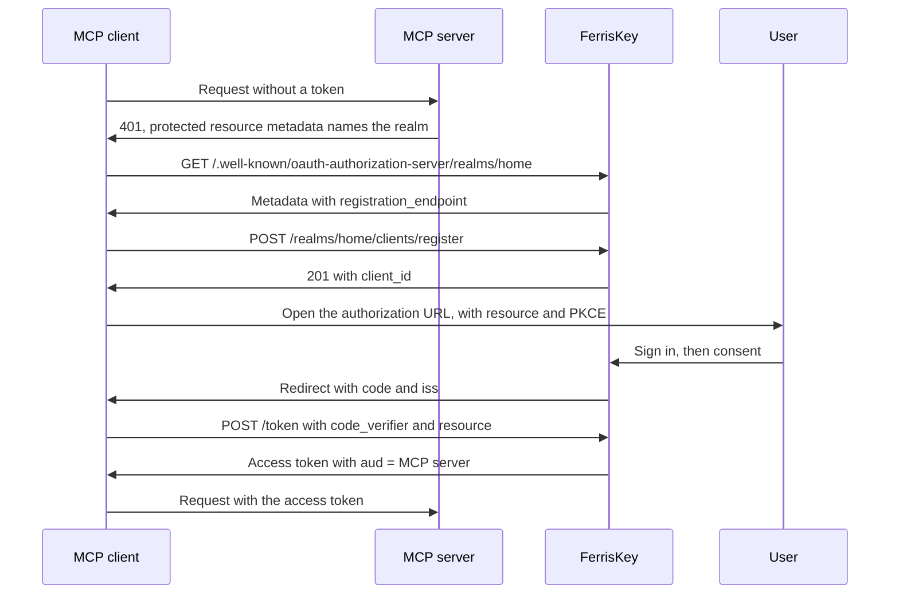

<span id="mcp-and-dynamic-client-registration" />

# MCP 和動態客戶端註冊

MCP 伺服器將登入交給授權伺服器，而一個身分域可以是該伺服器：它釋出 RFC 8414 後設資料，讓它從未見過的客戶端自行註冊，並簽發其受眾為 MCP 伺服器的權杖。

MCP 客戶端，例如編輯器或桌面助手，無法在它將要連線的每個身分域中手動註冊。它要麼動態自行註冊，要麼使用 URL 進行身分標識，以下部分存在正是為此目的。

| 部分 | 標準 | 預設 | 目的 |
|---|---|---|---|
| 授權伺服器後設資料 | RFC 8414 | 始終開啟 | 告訴客戶端端點位置及哪些註冊選項存在 |
| 動態客戶端註冊（DCR） | RFC 7591 | 關閉 | 客戶端使用一個匿名 `POST` 進行自身註冊 |
| 客戶端 ID 後設資料文件 (CIMD) | IETF 草案 | 關閉 | 客戶端使用 `https` URL 作為其 `client_id`，該 URL 提供其描述 |
| 資源指示器 | RFC 8707 | 不允許資源 | `resource` 引數設定權杖的受眾 |

FerrisKey 僅是授權伺服器。指向客戶端的受保護資源後設資料由 MCP 伺服器釋出，而不是由 FerrisKey 釋出。

<span id="settings" />

## 設定

所有內容都位於身分域上。在控制檯中，開啟 **Realm Settings**，然後點選 **MCP** 選項卡，標題為“ MCP / 客戶端註冊”。

| 控制檯標籤 | API 欄位 | 預設 |
|---|---|---|
| 動態客戶端註冊 | `dcr_enabled` | `false` |
| 客戶端 ID 後設資料文件 | `cimd_enabled` | `false` |
| 允許的後設資料文件主機 | `cimd_allowed_hosts` | 空 |
| 允許的資源 | `allowed_resources` | 空 |


相同的欄位透過 `PUT /realms/{realm_name}/settings` 進行處理。每個欄位在主體中都是可選的，省略的欄位保持不變。

```json title="PUT /realms/home/settings"
{
  "dcr_enabled": true,
  "cimd_enabled": true,
  "cimd_allowed_hosts": ["client.example.com"],
  "allowed_resources": ["https://mcp.example.com"]
}
```

透過任何方式建立的客戶端只能請求您為其開啟的作用域。在客戶端作用域上，開啟 **可用於動態客戶端（CIMD、DCR）**（`dynamic_registration_allowed`，預設 `false`）。`openid`、`profile`、`email` 和 `roles` 始終可用。

<span id="authorization-server-metadata" />

## 授權伺服器後設資料

```text
GET /.well-known/oauth-authorization-server/realms/{realm_name}
```

這是用於 `https://sso.example.com/realms/home` 簽發者的 RFC 8414 路徑插入形式。當 API 在 `SERVER_ROOT_PATH` 下執行時，相同的文件也會透過 `{root_path}/.well-known/oauth-authorization-server/realms/{realm_name}` 提供，並且在嚴格形式 `/.well-known/oauth-authorization-server{root_path}/realms/{realm_name}` 下提供。未知域返回 `401`。

```json
{
  "issuer": "https://sso.example.com/realms/home",
  "authorization_endpoint": "https://sso.example.com/realms/home/protocol/openid-connect/auth",
  "token_endpoint": "https://sso.example.com/realms/home/protocol/openid-connect/token",
  "jwks_uri": "https://sso.example.com/realms/home/protocol/openid-connect/jwks.json",
  "revocation_endpoint": "https://sso.example.com/realms/home/protocol/openid-connect/revoke",
  "introspection_endpoint": "https://sso.example.com/realms/home/protocol/openid-connect/token/introspect",
  "scopes_supported": ["address", "email", "offline_access", "openid", "organization", "phone", "profile", "roles"],
  "response_types_supported": ["code"],
  "grant_types_supported": [
    "authorization_code",
    "refresh_token",
    "client_credentials",
    "password",
    "urn:ietf:params:oauth:grant-type:device_code",
    "urn:ietf:params:oauth:grant-type:token-exchange"
  ],
  "code_challenge_methods_supported": ["S256"],
  "token_endpoint_auth_methods_supported": ["none", "client_secret_basic", "client_secret_post"],
  "authorization_response_iss_parameter_supported": true,
  "registration_endpoint": "https://sso.example.com/realms/home/clients/register",
  "client_id_metadata_document_supported": true
}
```

`registration_endpoint`僅在`dcr_enabled`開啟時出現，`client_id_metadata_document_supported`僅在`cimd_enabled`開啟時出現。`scopes_supported`列出了該身分域的客戶端作用域。授權響應中，簽發者為`iss`（RFC 9207），這也是`authorization_response_iss_parameter_supported`公告的。

<span id="dynamic-client-registration" />

## 動態客戶端註冊

```text
POST /realms/{realm_name}/clients/register
```

端點不接受憑據。正文是客戶端後設資料文件：

```json
{
  "client_name": "Reports assistant",
  "redirect_uris": ["http://127.0.0.1:33418/callback"],
  "token_endpoint_auth_method": "none",
  "grant_types": ["authorization_code", "refresh_token"],
  "response_types": ["code"]
}
```

| 欄位 | 統治 |
|---|---|
| `redirect_uris` | 要求，最多1到10條，每條最多2048位元組。每個條目`https`，或在環回主機（`localhost`、`127.0.0.1`、`::1`）上進行`http`。無片段，無憑據 |
| `token_endpoint_auth_method` | `none`（公共客戶端）、`client_secret_basic`（預設客戶端）或`client_secret_post`。後兩種則建立機密客戶端 |
| `grant_types` | 預設為`["authorization_code"]`。必須包含，且可新增`refresh_token` |
| `response_types` | 只有`code` |
| `scope` | 以空格分隔。僅限 `openid`、`profile`、`email`、`roles` 以及標記為動態客戶端的作用域 |
| `client_name` | 最多 128 個字元。預設值為“動態客戶端” |

`grant_types` 和 `response_types` 會被驗證並返回；FerrisKey 不會儲存它們。

成功呼叫會將 `201` 與 `Cache-Control: no-store` 一起返回：

```json
{
  "client_id": "6f0e4c1a-3b5d-4e7f-8a9b-0c1d2e3f4a5b",
  "client_id_issued_at": 1790000000,
  "client_name": "Reports assistant",
  "redirect_uris": ["http://127.0.0.1:33418/callback"],
  "token_endpoint_auth_method": "none",
  "grant_types": ["authorization_code", "refresh_token"],
  "response_types": ["code"],
  "scope": "openid profile email roles"
}
```

保密註冊也會返回 `client_secret`，並將 `client_secret_expires_at` 設定為 `0`。

建立的客戶端已啟用，需要同意，並且直接存取授權、服務賬戶和權杖交換均關閉。公共客戶端需要 PKCE。`openid`、`profile`、`email` 和 `roles` 是預設作用域。請求中的 `scope` 會將其命名的額外作用域新增為預設作用域。如果沒有 `scope`，每個標記為動態客戶端的作用域都會作為可選作用域附加，客戶端可以按名稱請求這些作用域，並且使用者可以在 [同意頁面](/zh-TW/discover/core-concepts/consent) 上批准。沒有管理端點（RFC 7592）：註冊後，客戶端就是您像管理其他客戶端一樣管理的普通客戶端。

<span id="limits-and-errors" />

### 限制和錯誤

| 限制 | 值 |
|---|---|
| 每個 IP 地址的請求 | 每分鐘 10 次 |
| 每個身分域的註冊數量 | 每小時 60 個 |
| 每個身分域的動態客戶端 | 1000 |

請求會計入前兩個，無論它們是否有效。

| 狀態 | `error` | 當 |
|---|---|---|
| `400` | `invalid_redirect_uri` | `redirect_uris` 缺失、為空或超過 10，或某個條目違反上述規則 |
| `400` | `invalid_client_metadata` | 任何其他欄位都會被拒絕，主體不是後設資料文件，或身分域已經擁有 1000 個動態客戶端 |
| `404` | `not_found` | 該身分域已關閉註冊，或身分域不存在 |
| `429` | `too_many_requests` | 觸及了速率限制。答案包含 `Retry-After: 60` |
| `500` | `server_error` | 無法儲存客戶端 |

註冊本質上是匿名的，因此任何可以存取該端點的人都可以建立客戶端，直到達到這些限制。保護使用者的是同意螢幕，每個動態客戶端在每次授權請求時都會經過，並顯示客戶端名稱及其重定向 URI 的主機。如果不需要，省略 `dcr_enabled`。

<span id="client-id-metadata-documents" />

## 客戶端ID後設資料文件

啟用`cimd_enabled`後，客戶端可以跳過註冊，並使用`https` URL作為其`client_id`：

```text
https://client.example.com/oauth/client.json
```

第一次FerrisKey在授權請求中看到該`client_id`時，它會獲取文件，從中建立一個客戶端，並在後續請求中保持同步。URL長度最多為255個字元，必須有除`/`之外的路徑，並且不能包含片段和憑據。

```json
{
  "client_id": "https://client.example.com/oauth/client.json",
  "client_name": "Reports assistant",
  "redirect_uris": ["http://127.0.0.1:33418/callback"],
  "token_endpoint_auth_method": "none"
}
```

| 統治 | 詳情 |
|---|---|
| 文件中的`client_id` | 必須等於它被獲取的URL |
| `redirect_uris` | 1到10個條目，遵循與註冊相同的規則。授權請求的`redirect_uri`必須是其中之一 |
| `token_endpoint_auth_method` | 缺失或`none`。不接受其他內容，因此這些客戶端始終是公共的 |
| 獲取 | `GET` 與 `Accept: application/json`。答案必須是 `200`、`application/json`（或 `+json`），且最多為 5 KiB。不遵循重定向，並且獲取操作在 5 秒後超時。 |
| 網路 | 主機必須解析為公共地址。獲取操作固定到它檢查的地址。 |

客戶端建立為公共客戶端，要求 PKCE 並要求同意。其名稱為 `client_name`，或者在文件沒有名稱時為主機。FerrisKey 將文件快取 5 分鐘，或根據其 `Cache-Control` 頭的 `max-age` 快取最多 24 小時，並且在 `no-store` 或 `no-cache` 下不會快取。獲取失敗將快取 60 秒。

:::callout{variant="warning" title="空的主機列表接受所有主機"}
`cimd_allowed_hosts` 儲存裸主機名，精確匹配且不區分大小寫。儲存時，會拒絕包含方案、路徑、埠或萬用字元的主機名。列表為空時，**任何**主機都被接受。在啟用 `cimd_enabled` 之前請先填寫列表。
:::

限制：每個源地址每分鐘最多觸發 30 次首次解析，並且每個身分域最多持有 1000 個後設資料文件客戶端。被拒絕的文件會導致授權請求因 `401` 和 `Invalid client` 而失敗，並將原因寫入伺服器日誌。如果文件未列出請求的 `redirect_uri`，則瀏覽器會跳轉到登入頁面並顯示錯誤。已經被以其他方式註冊的客戶端使用的 `client_id` 會被拒絕。

`CLIENT_METADATA_ALLOW_PRIVATE_ENDPOINTS` 允許 FerrisKey 透過 `http` 從迴環和私有地址獲取文件。它用於測試。不要在生產環境中設定。

<span id="resource-indicators" />

## 資源指示器

`allowed_resources` 列出了客戶端可能在 `resource` 引數中命名的資源（RFC 8707）。每個條目都是一個絕對的 `https` URL，或者是回送主機上的 `http`，並且不帶片段。資源匹配為精確字串。

當請求命名一個資源時，存取權杖將該資源作為其完整的受眾：`aud` 變為 `["https://mcp.example.com"]`，從而替換權杖原本攜帶的受眾。該引數在以下情況被讀取：

| 其中 | 行為 |
|---|---|
| `GET .../auth` | 不允許的資源會重定向到客戶端並附帶 `error=invalid_target`。允許的資源會在授權請求中被記住 |
| `authorization_code` 授權 | 繼承授權請求的資源。不同的資源為 `invalid_target`。如果請求未命名任何資源，這裡可以提供一個允許的資源 |
| `refresh_token` 授權 | 可以重複該重新整理權杖發出的資源，也可以省略該資源。另一個，或者已經離開`allowed_resources`的，是`invalid_target` |
| `password`與`client_credentials`資助 | 任何資源`allowed_resources` |

不允許的資源`400`回答為`invalid_target`，並回答“請求的資源本身分域不允許使用。”[權杖交換](/zh-TW/discover/core-concepts/token-exchange)授予不收取`resource`。

<span id="resource-owners" />

### 資源所有者

資源可以有所有者：由管理員註冊的機密客戶端。所有者被視為任何存取權杖的當事方，其受眾為其資源，這使得MCP伺服器可以使用[權杖交換](/zh-TW/discover/core-concepts/token-exchange#the-request)作為使用者呼叫下游API。如果沒有所有權，僅為MCP伺服器URL的權杖屬於獲得該權杖的客戶端，交換會被拒絕，`unauthorized_client`。

| 方法 | 端點 | 說明 |
|---|---|---|
| `GET` | `/realms/{realm_name}/resource-owners` | 列出所有者 |
| `PUT` | `/realms/{realm_name}/resource-owners` | 替換整個集合 |

```json title="PUT /realms/home/resource-owners"
{
  "owners": [
    {
      "uri": "https://mcp.example.com",
      "client_id": "0192f7c4-5e1a-7b3e-9d0c-3a6f1b2c4d5e"
    }
  ]
}
```

`client_id` 是客戶端的 UUID。每個 `uri` 必須已存在於 `allowed_resources` 且只出現一次，並且每個客戶端必須是該身分域的機密、管理員註冊客戶端，否則呼叫返回 `400`。兩個呼叫都以相同條目返回 `{"data": [...]}`。控制檯使用每個允許資源旁的選擇器設定所有者（為空時顯示“無所有者”）。只有當資源仍在 `allowed_resources` 中時，所有者才重要。

<span id="a-worked-example" />

## 一個工作示例

`https://mcp.example.com` 的 MCP 伺服器在 `https://sso.example.com` 上信任 `home` 身分域。您已開啟 `dcr_enabled`，將 `https://mcp.example.com` 新增到允許的資源中，並將名為 `mcp:tools` 的作用域標記為對動態客戶端可用。



::::step-group
:::step{title="找到授權伺服器"}
MCP 伺服器用 `401` 回應未經身分認證的請求，並指向其受保護的資源後設資料，該後設資料將 `https://sso.example.com/realms/home` 指定為授權伺服器。FerrisKey 在此步驟中不起作用。然後客戶端從 `https://sso.example.com/.well-known/oauth-authorization-server/realms/home` 閱讀身分域的後設資料，並找到 `registration_endpoint`。
:::

:::step{title="註冊"}
```bash
curl -X POST https://sso.example.com/realms/home/clients/register \
  -H 'Content-Type: application/json' \
  -d '{
    "client_name": "Reports assistant",
    "redirect_uris": ["http://127.0.0.1:33418/callback"],
    "token_endpoint_auth_method": "none"
  }'
```

答案包含 `client_id`，例如 `6f0e4c1a-3b5d-4e7f-8a9b-0c1d2e3f4a5b`。沒有傳送 `scope`，因此 `mcp:tools` 現在是該客戶端的可選作用域。
:::

:::step{title="將使用者傳送以授權"}
客戶端生成 PKCE 驗證器並在瀏覽器中開啟：

```text
https://sso.example.com/realms/home/protocol/openid-connect/auth
  ?response_type=code
  &client_id=6f0e4c1a-3b5d-4e7f-8a9b-0c1d2e3f4a5b
  &redirect_uri=http%3A%2F%2F127.0.0.1%3A33418%2Fcallback
  &scope=openid%20mcp%3Atools
  &state=k3j9x
  &code_challenge=E9Melhoa2OwvFrEMTJguCHaoeK1t8URWbuGJSstw-cM
  &code_challenge_method=S256
  &resource=https%3A%2F%2Fmcp.example.com
```

使用者登入。因為客戶端已註冊自身，所以隨後顯示同意螢幕，顯示“應用程式來自 127.0.0.1”，並在“選擇共享內容”下列出 `mcp:tools`。
:::

:::step{title="接收程式碼"}
使用者點選 **允許** 後，瀏覽器會重定向到客戶端：

```text
http://127.0.0.1:33418/callback?code=Ab3...&state=k3j9x&iss=https%3A%2F%2Fsso.example.com%2Frealms%2Fhome
```

客戶端在使用程式碼前檢查 `iss` 和 `state`。
:::

:::step{title="兌換它"}
```bash
curl -X POST https://sso.example.com/realms/home/protocol/openid-connect/token \
  -d grant_type=authorization_code \
  -d client_id=6f0e4c1a-3b5d-4e7f-8a9b-0c1d2e3f4a5b \
  -d code=Ab3... \
  -d redirect_uri=http://127.0.0.1:33418/callback \
  -d code_verifier=$VERIFIER \
  -d resource=https://mcp.example.com
```

存取權杖返回時繫結到 MCP 伺服器。其有效負載（簡化）：

```json
{
  "iss": "https://sso.example.com/realms/home",
  "sub": "8d1f3c52-0a4e-4d1c-9a57-2f0a1c9e7b11",
  "aud": ["https://mcp.example.com"],
  "azp": "6f0e4c1a-3b5d-4e7f-8a9b-0c1d2e3f4a5b",
  "typ": "Bearer",
  "scope": "openid email mcp:tools profile roles"
}
```
:::

:::step{title="在 MCP 伺服器上驗證它"}
MCP 伺服器將簽名分別與 `jwks_uri`、`iss` 進行檢查，然後檢查 `aud` 是否包含 `https://mcp.example.com`，再檢查所需的權限作用域。為其他資源簽發的權杖會在 `aud` 檢查中失敗。
:::
::::

::::card-group{cols=3}
:::card{label="授權同意" icon="lucide:user-check" href="/zh-TW/discover/core-concepts/consent"}
每個動態客戶端都會經過的介面。
:::
:::card{label="權杖交換" icon="lucide:arrow-left-right" href="/zh-TW/discover/core-concepts/token-exchange"}
MCP 伺服器如何以使用者身分呼叫下游 API。
:::
:::card{label="客戶端作用域" icon="lucide:scan" href="/zh-TW/discover/core-concepts/client-scopes"}
預設和可選的權限作用域，以及動態客戶端的標誌。
:::
::::
