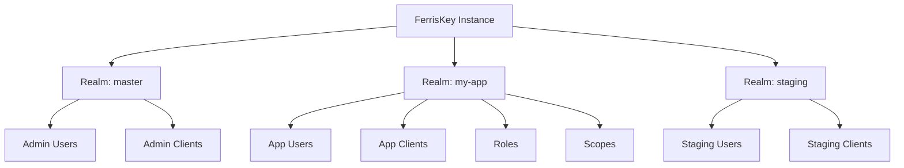

<span id="realms" />

# 身分域

身分域是 FerrisKey 中的頂級隔離邊界。使用者、客戶端、角色、憑據、作用域和會話各自僅屬於一個身分域。身分域使多租戶成為可能：一個 FerrisKey 部署可以為多個獨立的組織提供服務。

<span id="what-a-realm-isolates" />

## 身分域隔離的內容

每個身分域都是一個自包含的身分域：

| 資源 | 它包含的內容 |
|---|---|
| 使用者 | 賬戶、個人資料和憑據 |
| 客戶端 | 註冊用於身分認證的應用程式 |
| 角色 | 權限包和角色對映 |
| 憑據 | 密碼、TOTP 金鑰、WebAuthn 金鑰 |
| 客戶端作用域 | 權杖宣告定義和協議對映器 |
| 會話 | 活躍的使用者會話 |
| 配置 | 權杖生命週期、註冊策略、功能開關 |

不同身分域之間不會洩露資訊。身分域A的使用者無法針對身分域B的客戶端進行身分認證。



<span id="the-master-realm" />

## 主身分域

每個部署都有一個`master`身分域。它在第一次啟動時建立，持有初始管理員使用者，無法刪除，並且是跨身分域管理發生的地方。

:::callout{variant="warning" title="不要將主領域用於應用程式"}
將`master`用於管理。為每個應用程式提供自己的身分域。
:::

<span id="realm-settings" />

## 身分域設定

每個身分域都有自己的設定。它們控制登入的行為、權杖的有效期以及哪些可選功能啟用。使用`GET /realms/{realm_name}`讀取它們，並使用`PUT /realms/{realm_name}/settings`進行更改：如果欄位被省略，其值將保持不變。

<span id="sign-in-and-registration" />

### 登入和註冊

| 設定 | 預設 | 說明 |
|---|---|---|
| `user_registration_enabled` | `false` | 允許自助註冊 |
| `forgot_password_enabled` | `false` | 啟用密碼重置流程 |
| `remember_me_enabled` | `false` | 在登入頁面顯示“記住我”核取方塊。參見[sessions and the SSO cookie](#sessions-and-the-sso-cookie) |
| `magic_link_enabled` | `false` | 透過電子郵件啟用魔法連結登入 |
| `magic_link_ttl` | `15` | 魔法連結有效時間，單位為分鐘 |
| `passkey_enabled` | `false` | 允許使用通行金鑰（WebAuthn）登入 |
| `require_mfa` | `false` | 強制身分域中的每個使用者註冊多因素認證（MFA） |
| `login_aliases` | `[username]` | 在登入時接受的識別符號的有序列表，來源於 `username` 和 `email`。必須非空且無重複。第一個解析出使用者的別名獲勝 |
| `edit_username_enabled` | `false` | 允許使用者更改自己的使用者名稱 |
| `email_verification_enabled` | `false` | 要求使用者驗證其電子郵件 |
| `email_verification_ttl_hours` | `24` | 驗證連結有效時間 |
| `compass_enabled` | `true` | 使用 Compass 記錄認證流程 |

<span id="token-lifetimes" />

### 權杖有效期

| 設定 | 預設 | 說明 |
|---|---|---|
| `default_signing_algorithm` | `RS256` | JWT 簽名演算法 |
| `access_token_lifetime` | `300` | 存取權杖 TTL，單位為秒 |
| `refresh_token_lifetime` | `86400` | 重新整理權杖的 TTL，單位為秒。也是 SSO 會話的生命週期 |
| `id_token_lifetime` | `300` | ID 權杖的 TTL，單位為秒 |
| `temporary_token_lifetime` | `300` | 臨時權杖的 TTL，單位為秒，在所需操作掛起時使用 |

客戶端可以為自身覆蓋每個生命週期。參見 [權杖](/zh-TW/discover/core-concepts/tokens#token-lifetimes)。

<span id="sessions-and-the-sso-cookie" />

### 會話和 SSO cookie

當使用者登入時，FerrisKey 會開啟 SSO 會話並設定 `FERRISKEY_SSO` cookie，這允許使用者在不重新登入的情況下在該身分域的應用程式之間移動。該 cookie 為 HttpOnly，`SameSite=Lax`，作用域為路徑 `/`，並在請求透過 https 進入時標記為 Secure。

預設情況下，它是一個瀏覽器會話 Cookie，會在瀏覽器關閉時消失。啟用 `remember_me_enabled` 後，登入頁面會顯示一個“記住我”核取方塊。當使用者勾選它時，Cookie 變為永續性，其 `Max-Age` 等於會話的剩餘壽命。會話的持續時間取決於使用者透過的客戶端的重新整理權杖有效期：客戶端自定義的覆蓋值，或者域的 `refresh_token_lifetime`。核取方塊僅在設定開啟時出現，否則伺服器會忽略被勾選的核取方塊。

透過 [登出](/zh-TW/discover/core-concepts/authentication#logout) 或撤銷會話，也會撤銷在此會話下籤發的所有權杖。

<span id="lockout" />

### 鎖定

在多次失敗嘗試後，賬戶會在固定時間視窗內被鎖定。

| 設定 | 預設 | 說明 |
|---|---|---|
| `lockout_threshold` | `10` | 賬戶鎖定前的失敗嘗試次數 |
| `lockout_duration_seconds` | `900` | 鎖定持續時間 |

<span id="audit-privacy" />

### 審計隱私

SeaWatch 可以在事件儲存之前剝離或匿名化個人資料。

| 設定 | 預設 | 說明 |
|---|---|---|
| `seawatch_pii_mode` | `off` | `off`、`mask`、`pseudonymise` 之一 |
| `seawatch_pseudo_key` | 未設定 | 在模式為 `pseudonymise` 時使用的 HMAC 金鑰 |

<span id="locales" />

### 語言環境

| 設定 | 預設 | 說明 |
|---|---|---|
| `default_locale` | `en` | 當使用者未表達偏好時使用的語言環境。必須是 `supported_locales` 之一 |
| `supported_locales` | `[en]` | 登入頁面提供的語言環境。絕不會為空 |

語言環境是由兩個字母組成的語言標籤，也可以後跟兩個字母的地區：`en`、`zh-CN`。格式錯誤的標籤、空列表或不在列表中的預設值將被拒絕並顯示 `422`。控制檯和登入頁面會被翻譯為 `en` 和 `zh-CN`。

使用者自己的選擇儲存在使用者上，並透過 `PUT /realms/{realm_name}/users/@me/locale` 設定；傳送 `null` 會清除它。區域設定會選擇控制檯和登入頁面的語言。它不影響電子郵件：每種電子郵件型別都會使用為該身分域配置的模板傳送，無論區域設定如何。

<span id="webhook-retries" />

### Webhook 重試

保持這些未設定，身分域將使用伺服器預設值。

| 設定 | 預設 | 說明 |
|---|---|---|
| `webhook_retry_max_attempts` | 未設定 | 失敗傳送的重試次數 |
| `webhook_retry_base_delay_ms` | 未設定 | 第一次重試前的延遲，單位毫秒 |
| `webhook_retry_max_delay_ms` | 未設定 | 單個回退間隔的上限 |
| `webhook_retry_max_total_delay_ms` | 未設定 | 整個重試序列的上限 |

<span id="consent" />

### 授權同意

每個使用者和客戶端都會儲存一個同意決定，並在 30 天內有效。設定 API 沒有對應持續時間的欄位。[同意](/zh-TW/discover/core-concepts/consent) 頁面說明螢幕何時出現。

<span id="client-registration-and-resources" />

### 客戶端註冊和資源

這些設定允許您未手動註冊的應用程式（例如 MCP 客戶端）存取身分域。每個設定預設都是關閉或為空。[MCP](/zh-TW/discover/core-concepts/mcp) 頁面解釋了流程。

| 設定 | 預設 | 說明 |
|---|---|---|
| `dcr_enabled` | `false` | 允許應用程式以匿名方式向 `POST /realms/{realm_name}/clients/register` 自我註冊。之後 Discovery 會發布 `registration_endpoint`。這些客戶端始終需要使用者同意。 |
| `cimd_enabled` | `false` | 接受 `https` URL 作為 `client_id` 並從中讀取客戶端的後設資料。之後 Discovery 會設定 `client_id_metadata_document_supported`。這些客戶端始終需要使用者同意。 |
| `cimd_allowed_hosts` | `[]` | 客戶端 ID URL 可能指向的主機名，作為不帶方案或路徑的裸名字。為空則接受任何主機。 |
| `allowed_resources` | `[]` | 客戶端可以請求受眾的 RFC 8707 資源指示器：絕對 https URL，或迴環主機上的 http，無片段。為空則不接受任何請求，並且使用 `resource` 的請求將以 `invalid_target` 失敗。 |

<span id="branding-and-email-templates" />

### 品牌和電子郵件模板

| 設定 | 預設 | 說明 |
|---|---|---|
| `reset_password_template_id` | 未設定 | 用於密碼重置郵件的模板 |
| `magic_link_template_id` | 未設定 | 用於魔法連結郵件的模板 |
| `email_verification_template_id` | 未設定 | 用於驗證郵件的模板 |

如果未設定模板ID，FerrisKey會回退到該郵件型別的內建預設模板。

:::callout{variant="info" title="門戶主題未在此處設定"}
某個身分域確實擁有一個活動的門戶主題，但它不是此端點的欄位。使用`POST /realms/{realm_name}/portal/themes/{theme_id}/activate`啟用一個，如[Portal](/zh-TW/modules/portal/overview)中所述。
:::

<span id="reading-settings-from-the-login-page" />

## 從登入頁面讀取設定

```
GET /realms/{name}/login-settings
```

身分域設定中面向登入的子集，門戶使用它來確定提供哪些登入方法：是否開放註冊、是否啟用魔法連結和通行金鑰、接受哪些識別符號和語言環境，以及主題。它不需要身分認證。當你只需要渲染登入頁面時，使用它而不是完整的設定讀取。

<span id="smtp-configuration" />

## SMTP 配置

SMTP 也存在於身分域中，因此同一部署中的兩個身分域可以從不同的提供者和不同的地址傳送郵件。[電子郵件與模板指南](/zh-TW/discover/guides/email)覆蓋了欄位和 API。
