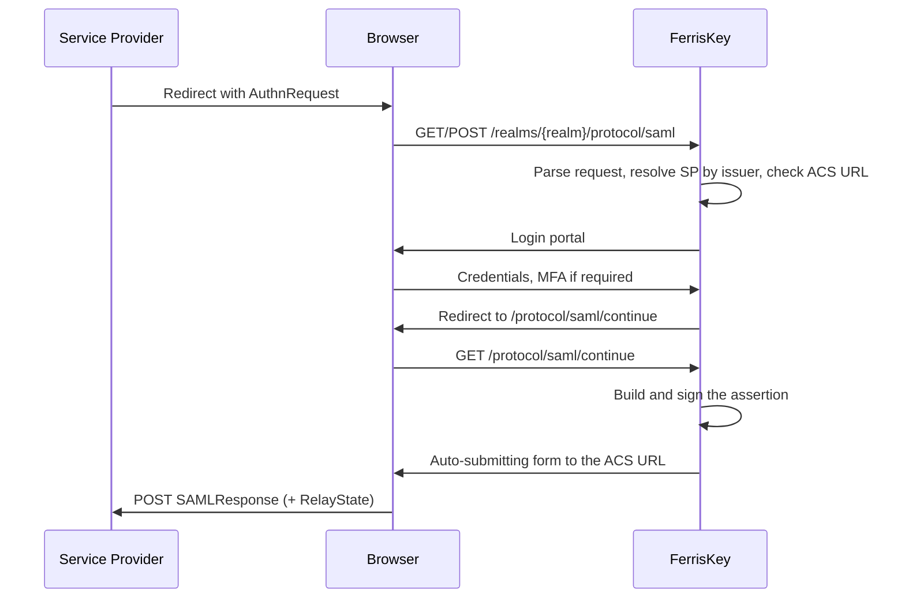

# SAML 2.0

FerrisKey 以身分提供者的身分支援 SAML 2.0。服務提供者向其傳送 `AuthnRequest`，使用者透過常規的 FerrisKey 登入進行登入，然後 FerrisKey 返回一個已簽名的斷言。

這就是讓一個僅支援SAML的應用程式（而且這樣的應用程式很多）進入相同的域、使用相同的使用者和相同的審計跟蹤的方法。

:::callout{variant="info" title="身分提供者，不是中介"}
本頁討論的是 FerrisKey 作為其他應用信任的 IdP。透過外部 SAML 提供者進行登入是相反的方向，由 [Abyss](/zh-TW/modules/abyss/overview) 中的聯合處理，目前尚未釋出。
:::

登入本身並不是 SAML 特有的：SAML 請求執行的 [認證鏈](/zh-TW/discover/core-concepts/authentication#authentication-chain) 與 OIDC 請求相同，具備相同的登入、多因素認證、鎖定和審計事件。唯一不同的是前端入口和響應格式。如果你在決定應用程式應該使用哪種協議，該頁面也將兩種協議並排展示。

<span id="endpoints" />

## 端點

每個端點都是以域為範圍的，位於該域的協議路徑下。

| 方法 | 端點 | 說明 |
|---|---|---|
| `GET` | `/realms/{realm_name}/protocol/saml` | 透過 HTTP-Redirect 繫結的單點登入（SSO） |
| `POST` | `/realms/{realm_name}/protocol/saml` | 透過 HTTP-POST 繫結的單點登入（SSO） |
| `GET` | `/realms/{realm_name}/protocol/saml/continue` | 在使用者完成身分認證後恢復流程 |
| `GET` | `/realms/{realm_name}/protocol/saml/descriptor` | IdP 後設資料，用於提供給服務提供者 |

描述符是大多數服務提供者所需的：將它指向該 URL，或者下載它並上傳 XML，他們就能自己獲取實體 ID、SSO 端點以及簽名證書。

<span id="the-entity-id-and-server_public_url" />

## 實體 ID 和 SERVER_PUBLIC_URL

IdP 實體 ID 由 `SERVER_PUBLIC_URL` 和域名構建：

```
https://sso.example.com/realms/home
```

它簽署在每個斷言中，這意味著它不能更改。請求中的主機名可能每次請求都不同，因此 SAML 從不會從那裡獲取。

:::callout{variant="warning" title="沒有 SERVER_PUBLIC_URL，SAML 無法執行"}
在未設定 `SERVER_PUBLIC_URL` 的情況下，每個格式良好的 SSO 請求和描述符都會返回 HTTP 500 並提示“此伺服器未配置單點登入。請設定 SERVER_PUBLIC_URL。” 將其設定為瀏覽器和服務提供者實際存取的源地址，即 `scheme://host[:port]`。OIDC 不讀取此變數，因此僅提供 OIDC 的部署可能沒有它。參見 [配置](/zh-TW/discover/guides/configuration)。
:::

<span id="registering-a-service-provider" />

## 註冊服務提供者

SAML 服務提供者是攜帶 SAML 配置的 FerrisKey 客戶端。

| 方法 | 端點 | 說明 |
|---|---|---|
| `GET` | `/realms/{realm_name}/clients/{client_id}/saml-config` | 讀取客戶端的 SAML 配置 |
| `PUT` | `/realms/{realm_name}/clients/{client_id}/saml-config` | 建立或替換它 |

| 欄位 | 預設 | 說明 |
|---|---|---|
| `sp_entity_id` | 必填 | 服務提供者的實體 ID。FerrisKey 透過其釋出者解析傳入請求，因此此值必須完全匹配 |
| `acs_url` | 必填 | 斷言消費者服務 URL，用於釋出簽名響應 |
| `name_id_format` | `emailAddress` | 主體識別符號的格式 |
| `sign_assertions` | `true` | 已儲存配置。見下文 |
| `sign_documents` | `false` | 已儲存配置。見下文 |
| `want_authn_requests_signed` | `false` | 保持 `false`。見下文 |

如果 `AuthnRequest` 指向的 ACS URL 與註冊的 URL 不匹配，請求將被拒絕而不是重定向。這是故意為之：請求中未檢查的 ACS URL 是附有斷言的開放重定向。

FerrisKey 會在每個響應中使用身分域的簽名金鑰簽署斷言，無論 `sign_assertions` 如何，它不會簽署響應文件。`sign_assertions` 和 `sign_documents` 會被 API 儲存並返回，但在 0.10.0 版本中發出斷言不會讀取它們。描述符會發布簽名證書。

:::callout{variant="warning" title="不要設定 want_authn_requests_signed"}
FerrisKey 尚未驗證 `AuthnRequest` 的簽名。一個其配置將 `want_authn_requests_signed` 設定為 `true` 的服務提供商，因此每個請求都會被拒絕，並返回 HTTP 400 "此單點登入請求被拒絕"。描述符出於相同原因宣傳 `WantAuthnRequestsSigned="false"`。
:::

<span id="name-id-formats" />

### 名稱 ID 格式

| 值 | URN |
|---|---|
| `emailAddress` | `urn:oasis:names:tc:SAML:1.1:nameid-format:emailAddress` |
| `persistent` | `urn:oasis:names:tc:SAML:2.0:nameid-format:persistent` |
| `transient` | `urn:oasis:names:tc:SAML:2.0:nameid-format:transient` |
| `unspecified` | `urn:oasis:names:tc:SAML:1.1:nameid-format:unspecified` |

編寫配置時，短名稱和完整 URN 都被接受。主體來自使用者：

| 格式 | 主體 |
|---|---|
| `emailAddress` | 電子郵件地址，僅當使用者的 `email_verified` 為 `true` 時 |
| `persistent` | 使用者的 ID |
| `transient` | 登入會話的 ID，每次登入都會改變 |
| `unspecified` | 使用者名稱 |

使用者無法滿足的格式會導致流程失敗：為沒有電子郵件地址或未驗證電子郵件地址的使用者請求 `emailAddress`，會產生錯誤而不是空主體。

<span id="attribute-mappers" />

## 屬性對映器

除了主題之外，服務提供者通常需要屬性。對映器說明哪個使用者欄位在SAML屬性名下被傳出。

| 方法 | 端點 | 說明 |
|---|---|---|
| `GET` | `/realms/{realm_name}/clients/{client_id}/saml-attribute-mappers` | 列出客戶端的對映器 |
| `POST` | `/realms/{realm_name}/clients/{client_id}/saml-attribute-mappers` | 建立對映器 |
| `DELETE` | `/realms/{realm_name}/clients/{client_id}/saml-attribute-mappers/{mapper_id}` | 刪除對映器 |

對映器有一個`name`，一個`name_format`（除非另有說明，否則為`basic`），以及一個`source`。

如果來源沒有使用者值，則不會傳送空值，而是被省略在斷言之外。只有當使用者的`email_verified`為`true`時，`user:email`才有值。

來源寫作帶字首的字串：

| 來源 | 值 |
|---|---|
| 使用者ID | `user:id` |
| 使用者名稱 | `user:username` |
| 電子郵件 | `user:email` |
| 名字 | `user:first_name` |
| 姓氏 | `user:last_name` |
| 自定義使用者屬性 | `attribute:<key>` |

名稱格式：

| 值 | URN |
|---|---|
| `basic` | `urn:oasis:names:tc:SAML:2.0:attrname-format:basic` |
| `uri` | `urn:oasis:names:tc:SAML:2.0:attrname-format:uri` |
| `unspecified` | `urn:oasis:names:tc:SAML:2.0:attrname-format:unspecified` |

```json title="POST .../saml-attribute-mappers"
{
  "name": "email",
  "name_format": "urn:oasis:names:tc:SAML:2.0:attrname-format:basic",
  "source": "user:email"
}
```

<span id="the-flow" />

## 流程



服務提供者傳送的`RelayState`會被完整保留並返回，這就是它能夠恢復使用者存取的頁面的方式。

<span id="assertion-validity" />

## 斷言效度

| 常數 | 值 |
|---|---|
| 斷言壽命 | 300秒 |
| 允許時鐘偏移 | 60秒 |

偏斜視窗存在是因為服務提供商的時鐘不屬於你。如果斷言被拒絕為無效或已過期，首先檢查雙方的NTP。
