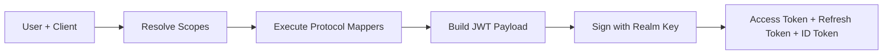

<span id="tokens" />

# 權杖

成功的認證會生成 JSON Web 權杖。每種型別在 OAuth2 和 OIDC 協議中都有其作用。

<span id="token-types" />

## 權杖型別

| 權杖 | `typ` 宣告 | 目的 | 預設有效期 |
|---|---|---|---|
| 存取權杖 | `Bearer` | 對資源伺服器進行 API 請求授權 | 300秒 |
| 重新整理權杖 | `Refresh` | 在不再次詢問使用者的情況下獲取新的存取權杖 | 86400秒 |
| ID 權杖 | `ID` | 根據OIDC，將使用者身分傳遞給客戶端 | 300秒 |
| 臨時權杖 | `Temporary` | 授權完成所需的操作，僅此而已 | 300秒 |

<span id="jwt-structure" />

## JWT結構

每個權杖都是簽名的JWT：頭部、負載、簽名。FerrisKey使用身分域的金鑰透過RS256進行簽名，並在身分域的`jwks.json`端點發布公鑰部分。

<span id="standard-claims" />

### 標準宣告

這些是存取權杖的宣告：

| 宣告 | 說明 |
|---|---|
| `sub` | 主體，使用者的ID。對於`client_credentials`，客戶端服務賬戶的ID |
| `aud` | 受眾，一個列表。參見 [audience](#audience) |
| `azp` | 授權方，請求權杖的客戶端的`client_id` |
| `iss` | 簽發者，身分域URL，例如`https://sso.example.com/realms/home` |
| `typ` | Token型別，`Bearer` 表示存取權杖 |
| `exp` | 過期時間戳 |
| `iat` | 簽發時間戳 |
| `jti` | 唯一權杖識別符號 |
| `scope` | 以空格分隔的授予權限列表 |
| `sid` | OIDC會話ID，本權杖簽發時對應的使用者會話 |

`sid` 在未建立 SSO 會話的流程中不存在，其中包括 `client_credentials`。將缺失的 `sid` 視為“非會話繫結”，而非無效權杖。

重新整理權杖攜帶相同的 `sub`、`iss`、`aud`、`azp`、`scope` 和 `sid`，`typ` 設定為 `Refresh`。在應用中將其視為不透明：只有 FerrisKey 需要讀取它。

<span id="audience" />

### 受眾

存取權杖的 `aud` 宣告是一個列表，取決於權杖的獲取方式：

| 權杖 | `aud` |
|---|---|
| 常規存取權杖 | `["<realm>-realm", "account"]`，例如 `["home-realm", "account"]`，加上客戶端作用域中由 `oidc-audience-mapper` 新增的每個值 |
| 透過 RFC 8707 `resource` 請求 | 僅 `[resource]`。參見 [MCP](/zh-TW/discover/core-concepts/mcp) |
| 由 [權杖交換](/zh-TW/discover/core-concepts/token-exchange) 與 `audience` 返回 | 僅 `[audience]` |

身分域受眾是 FerrisKey 自身管理 API 檢查的物件。它僅在其 `aud` 包含 `<realm>-realm` 且其 `azp` 是由管理員註冊的啟用客戶端時才接受權杖。針對特定資源縮小的權杖、為其他受眾交換的權杖或頒發給自行註冊的客戶端的權杖將在此被拒絕。您自己的資源伺服器應要求其期望的受眾：透過 `oidc-audience-mapper` 新增，或透過 `resource` 請求。

<span id="identity-and-mapper-claims" />

### 身分和對映宣告

身分宣告並未硬編碼到權杖中。每一個宣告，包括 `preferred_username` 和 `email`，都是由附加到[客戶端作用域](/zh-TW/discover/core-concepts/client-scopes)的協議對映器生成的，並且僅在該作用域被授權時生成。對映器 FerrisKey 種子生成：

| 宣告 | 來源 |
|---|---|
| `preferred_username` | `profile` 作用域 |
| `given_name`, `family_name` | `profile` 作用域 |
| `email`, `email_verified` | `email` 作用域 |
| `realm_access.roles` | `roles` 作用域，透過 `oidc-usermodel-realm-role-mapper` |
| `organizations` | `organization` 作用域 |

因為對映器是可配置的，所以具體的宣告集取決於分配給客戶端的作用域。

<span id="id-token-claims" />

### ID 權杖宣告

當授予的作用域包括 `openid` 時，會簽發 ID 權杖。它在一些宣告上與存取權杖不同：

| 宣告 | 說明 |
|---|---|
| `aud` | 客戶端的 `client_id`，作為單個字串而不是列表 |
| `azp` | 相同的 `client_id` |
| `nonce` | 授權請求的 `nonce`（如果有）。使用重新整理權杖簽發的 ID 權杖中不存在 |
| `at_hash` | 存取權杖的 SHA-256 的左半部分，採用 base64url 編碼 |
| `auth_time` | 會話上次認證的時間。存在於授權碼和密碼授權發出的 ID 權杖上，在重新整理發出的 ID 權杖上則不存在 |
| `sid` | 會話 ID。RP 發起的登出從 `id_token_hint` 中讀取它 |

<span id="token-lifetimes" />

## 權杖有效期

生命週期來自兩個來源：

1. 身分域預設值，適用於身分域中的每個客戶端。
2. 客戶端覆蓋設定，被設定時優先。

| 權杖 | 設定（身分域和客戶端） | 身分域預設值 |
|---|---|---|
| 存取權杖 | `access_token_lifetime` | 300秒 |
| 重新整理權杖 | `refresh_token_lifetime` | 86400秒 |
| ID 權杖 | `id_token_lifetime` | 300秒 |
| 臨時權杖 | `temporary_token_lifetime` | 300秒 |

規則：如果客戶端設定了覆蓋，使用它，否則回退到身分域預設值。登入的 SSO 會話的生命週期與適用於該客戶端的重新整理權杖生命週期一樣長，因此使用者可以持續續訂權杖的時間視窗，就是會話存活的時間視窗。

<span id="refresh-tokens-are-single-use" />

## 重新整理權杖是一次性使用的

每次重新整理都會返回一個新的重新整理權杖，並使用掉舊的權杖。出示已使用的權杖，或同時傳送相同的權杖兩次，會撤銷從該登入派生的整個重新整理權杖系列，並返回 `invalid_grant`。客戶端在丟失響應後重試重新整理時，因此無法再重新整理，只能重新登入。在使用新的存取權杖之前請先儲存新的重新整理權杖，並且絕不要並行執行同一權杖的兩次重新整理。參見 [refresh token](/zh-TW/discover/core-concepts/authentication#refresh-token)。

<span id="token-generation-chain" />

## 權杖生成鏈



1. 使用者向客戶端進行身分認證
2. 解析預設作用域（加上任何請求的可選作用域）
3. 每個作用域的協議對映器生成宣告
4. 將宣告組裝到帶有標準宣告的 JWT 有效負載中
5. 該權杖使用身分域的簽名金鑰和演算法進行簽名
6. 返回存取權杖、重新整理權杖和（可選的）ID權杖

<span id="validating-a-token" />

## 驗證權杖

資源伺服器有兩種方式來決定存取權杖是否有效。

在本地，它會將簽名與身分域的 `jwks.json`，然後是 `iss`、`exp` 和它預期的 `aud` 進行檢查。這不需要憑據，也不需要往返請求，但無法檢視吊銷情況：已吊銷的權杖，或會話已結束的權杖，在 `exp` 之前仍然可以驗證。短期存取權杖的有效期可以限制該時間視窗。

透過內省，它會向 FerrisKey 詢問:

```bash
curl -X POST https://sso.example.com/realms/home/protocol/openid-connect/token/introspect \
  -u my-client:my-secret \
  -d "token=eyJhbG..."
```

呼叫者必須是同一身分域的已啟用機密客戶端，並使用 `client_secret_basic` 或 `client_secret_post` 進行身分認證。FerrisKey 不會檢查呼叫者的任何角色或權限，因此任何此類客戶端都可以自我檢查該身分域的任何權杖。請像保管權杖一樣嚴格保管這些金鑰。

一個活動的權杖會返回 RFC 7662 的固定子集：

```json
{
  "active": true,
  "scope": "openid profile email",
  "client_id": "my-client",
  "username": "alice",
  "sub": "8d1f3c52-0a4e-4d1c-9a57-2f0a1c9e7b11",
  "token_type": "Bearer",
  "exp": 1790000300,
  "iat": 1790000000,
  "nbf": 1790000000,
  "aud": "home-realm account",
  "iss": "https://sso.example.com/realms/home",
  "jti": "5b2f8e0c-3f7e-4f64-9a4d-6c1b7d2a9e10",
  "realm": "home"
}
```

`client_id` 是權杖的 `azp`，`aud` 是以空格連線的受眾列表，`realm` 是身分域名稱。權杖不攜帶的欄位，例如當沒有 `preferred_username` 時的 `username`，將被省略。

其他所有情況的回答都完全是 `{"active": false}`：被撤銷或過期的權杖、已使用的重新整理權杖、臨時權杖、ID 權杖、會話已結束的權杖，以及身分域未簽發的權杖。
