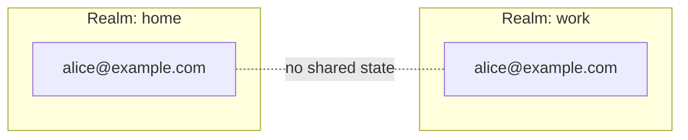
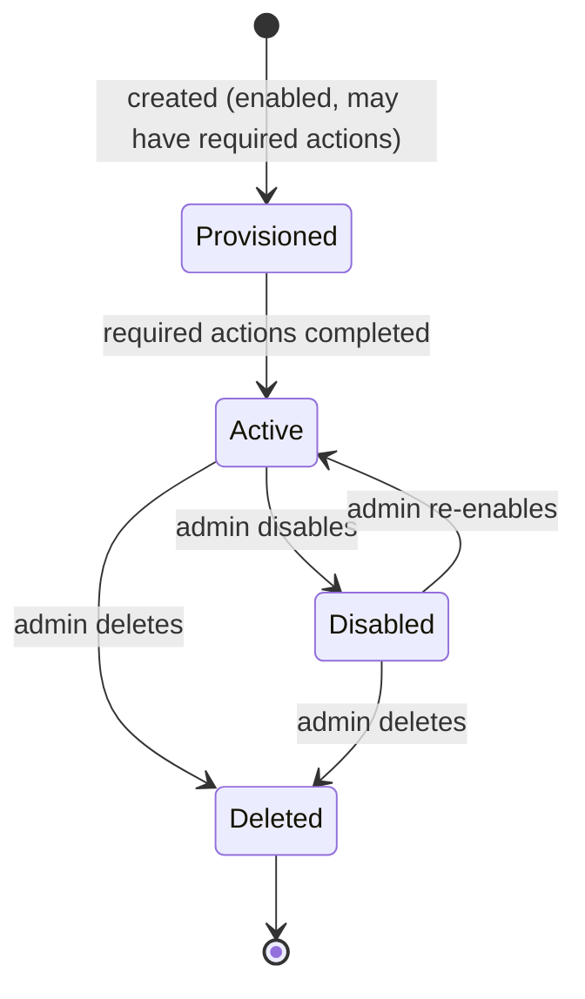
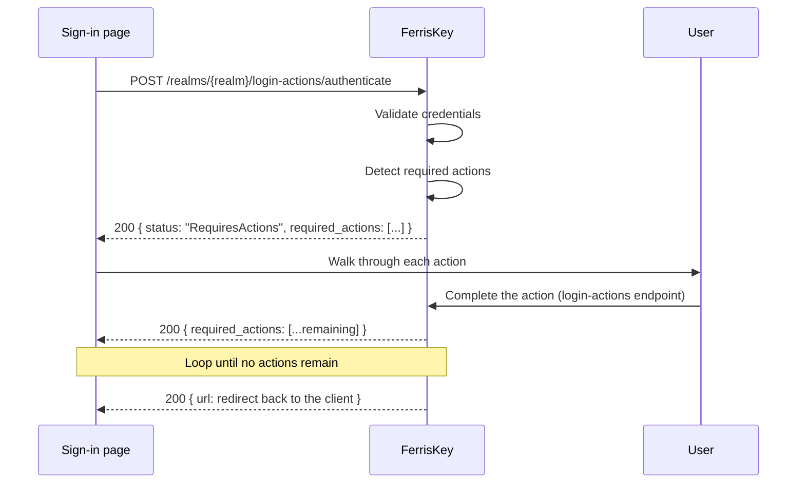

<span id="users" />

# 使用者

使用者代表一個[身分域](/zh-TW/discover/core-concepts/realms)中的身分。使用者透過[客戶端](/zh-TW/discover/core-concepts/clients)進行身分認證，透過[憑據](/zh-TW/discover/core-concepts/credentials)證明自己的身分，獲取[權杖](/zh-TW/discover/core-concepts/tokens)，並透過[角色](/zh-TW/discover/core-concepts/roles)分配獲得授權。

登入、權杖頒發、授權：在執行時，這一切都歸結為使用者。

<span id="anatomy-of-a-user" />

## 使用者結構解析

使用者記錄本身很小。它描述某人的身分；憑據、角色和會話都存在相關物件中。

| 屬性 | 說明 |
|---|---|
| `id` | 穩定識別符號（UUID）。在所有權杖引用主體的地方使用。生成的，除非在建立使用者時你提供一個。 |
| `username` | 身分域內的唯一識別符號。登入名。 |
| `email` | 電子郵件地址。在記錄中為可選項，但如果沒有電子郵件，使用者無法接收重置連結、魔法連結或驗證郵件。 |
| `firstname`, `lastname` | 名和姓。 |
| `email_verified` | 電子郵件是否已確認。 |
| `enabled` | 賬戶是否啟用。被禁用的使用者無法進行身分認證。 |
| `required_actions` | 使用者在登入完成前仍欠的內容。 |
| `locale` | 使用者選擇的語言，或使用 `null` 以遵循身分域預設設定。參見 [本地化](/zh-TW/discover/guides/localization)。 |
| `failed_login_attempts`, `locked_until` | 鎖定狀態。參見 [鎖定](#lockout)。 |
| `federation_provider_id` | 賬戶所屬的使用者聯合提供商（如果有）。 |
| `client_id` | 僅在服務賬戶使用者上設定，將其與所屬客戶端關聯。否則不顯示。 |
| `realm_id` | 該使用者所屬的身分域。 |
| `created_at`, `updated_at` | 時間戳。 |

由管理員 API 返回的示例 JSON 負載：

```json
{
  "id": "0199a4f2-3c1e-7b8a-9f00-1a2b3c4d5e6f",
  "realm_id": "0199a4ee-91d0-7c3a-8e21-5b7f0c2d4a18",
  "username": "alice",
  "firstname": "Alice",
  "lastname": "Martin",
  "email": "alice@example.com",
  "email_verified": true,
  "enabled": true,
  "required_actions": [],
  "created_at": "2026-10-30T20:36:41.347264Z",
  "updated_at": "2026-10-30T20:36:41.347264Z",
  "failed_login_attempts": 0,
  "locked_until": null,
  "locale": null,
  "federation_provider_id": null
}
```

<Callout variant="info" title="識別符號">

使用 `id` 來引用其他資源中的使用者（角色分配、審計日誌、權杖）。`username` 是面向使用者的標識，身分域可以允許使用者自行更改；`id` 永遠不會更改。

</Callout>

<span id="creating-a-user" />

### 建立使用者

```
POST /realms/{realm_name}/users
```

請求體包含 `username`，可選的還有 `email`、`email_verified`、`firstname` 和 `lastname`。新使用者尚無憑據：使用 [reset-password](#credentials) 設定密碼。

請求體還可以包含可選的 `id`。當另一個系統已透過 UUID 識別該使用者，且其權杖的 `sub` 宣告必須匹配時，請提供該值。如果任何身分域中已有使用者使用該 id，請求將失敗，返回 `409` 和失敗原因 `user_id_already_exists`。若未提供 `id`，FerrisKey 將生成一個。

<span id="realm-scoping" />

## 身分域範圍

使用者屬於且僅屬於一個身分域。同一個電子郵件地址可以在多個身分域中存在，但作為完全獨立的賬戶。沒有跨身分域查詢：認證總是在一個身分域內進行。



對於跨多個身分域的同一身分，透過[Abyss](/zh-TW/modules/abyss/overview)模組進行聯合。每個身分域仍保留自己的使用者記錄，並與同一外部提供者關聯。

<span id="user-lifecycle" />

## 使用者生命週期

使用者在建立到刪除的過程中，會經歷少量狀態。



| 狀態 | 含義 |
|---|---|
| 已配置 | 賬戶已存在，但可能仍有待處理的[必需操作](#required-actions)：驗證電子郵件、設定永久密碼、註冊多因素認證。在這些操作完成之前，認證僅會生成臨時權杖。 |
| 活躍 | 身分認證會生成完整的權杖，並應用角色分配。 |
| 已禁用 | `enabled = false`。賬戶被保留，但無法進行身分認證。 |
| 已刪除 | 記錄已被移除。 |

禁用使用者會立即切斷存取。FerrisKey 會結束使用者會話並撤銷他們的重新整理權杖和存取權杖，從那時起其自身的 API 會拒絕這些存取權杖。僅離線檢查 JWT 簽名的 API 會繼續接受存取權杖，直到它過期，預設 300 秒。重新啟用賬戶後，使用者可以再次登入；但它不會恢復被撤銷的會話。

刪除使用者，無論是單個還是批次，都會在記錄消失之前結束會話並撤銷權杖。

<span id="required-actions" />

## 所需操作

必需操作是使用者在獲得完全認證前必須完成的操作。在任何操作待完成時，登入會返回仍需完成的操作，而不是重定向回應用程式。

| 操作 | 何時新增 | 使用者必須執行的操作 |
|---|---|---|
| `verify_email` | 使用者在啟用了電子郵件驗證的身分域中註冊自己，或者管理員分配了該操作 | 點選由 [Trident](/zh-TW/modules/trident/overview) 模組傳送的連結 |
| `update_password` | 管理員將密碼重置為臨時密碼，或分配了該操作 | 設定新密碼 |
| `configure_otp` | 該身分域或使用者的某個角色要求多因素認證（MFA），且使用者尚未擁有 TOTP 憑據。它會等待直到臨時密碼被替換 | 註冊 TOTP 身分認證器 |
| `configure_passkey` | 管理員已分配它，並且使用者至少有一個憑據 | 註冊 WebAuthn 金鑰 |

`configure_otp` 是在每次登入時根據域的 `require_mfa` 設定和使用者的角色計算出來的。它從不儲存在使用者上，因此你不能透過編輯使用者來清除它：註冊一個驗證器或取消要求可以做到這一點。

<span id="how-they-flow" />

### 它們的流程



登入頁面是基於瀏覽器的授權碼流程。權杖端點上的 `password` 授權不會經過這些步驟：它拒絕為仍欠一個的賬戶發放權杖，並告訴客戶端使用瀏覽器流程。

<Callout variant="info" title="臨時權杖">

隨待處理操作一起提供的臨時權杖是一個短期有效的 JWT，以 HTTP-only cookie 形式傳送，僅限於 `/realms/{realm}/login-actions`。它授權存取 required-action 端點，除此之外無其他權限。它無法存取受保護資源或呼叫 userinfo。

</Callout>

<Callout variant="warning" title="順序很重要">

必需操作按照固定順序進行評估，通常是 `verify_email`，然後是 `update_password`，再是 MFA 註冊操作。在響應中讀取 `required_actions` 陣列，而不是在客戶端中硬編碼該順序。

</Callout>

<span id="service-account-users" />

## 服務賬戶使用者

當一個 [客戶端](/zh-TW/discover/core-concepts/clients) 具有 `service_account_enabled` 時，FerrisKey 會建立一個關聯的服務賬戶使用者。它是一個普通的使用者記錄，但具有一些區分特徵：

- `username` 來源於客戶端 (`service-account-<client_id>`)。
- `client_id` 指向擁有該客戶端的來源。
- 它沒有密碼，只透過 `client_credentials` 授權進行身分認證。
- 它可以像任何其他使用者一樣被分配角色和權限。

它存在的目的是為了機器對機器的呼叫可以有一個真實的主體來進行授權決策和審計日誌。

<span id="example" />

### 示例

一個夜間批處理作業由客戶端 `batch-runner` 和 `service_account_enabled = true` 表示。關聯的服務賬戶使用者 `service-account-batch-runner` 被授予 `billing:read` 角色。

```bash
curl -X POST https://sso.example.com/realms/home/protocol/openid-connect/token \
  -d "grant_type=client_credentials" \
  -d "client_id=batch-runner" \
  -d "client_secret=••••••••"
```

生成的存取權杖將 `sub` 設定為服務賬戶使用者的 `id`，並攜帶 `billing:read` 角色。計費 API 可以像對人類使用者一樣授權此呼叫。

有關完整授予，請參見 [身分認證，客戶端憑據](/zh-TW/discover/core-concepts/authentication#client-credentials)。

<span id="administering-a-user" />

## 管理使用者

控制檯將關於一個賬戶的所有內容分為五個選項卡：概覽、憑據、角色對映、組織和屬性。


<span id="listing-users" />

### 列出使用者

```
GET /realms/{realm_name}/users
```

列表是分頁的：`page`、`limit`（1 到 100，預設 20），返回結果為 `{ data, metadata }`。請參見 [分頁列表](/zh-TW/discover/guides/api-listings) 瞭解共享合同。

| 引數 | 它的功能 |
|---|---|
| `search` | 匹配使用者名稱、電子郵件、名字或姓氏中的任意位置，忽略大小寫 |
| `username`, `email`, `firstname`, `lastname` | 匹配該欄位中任意位置，忽略大小寫 |
| `enabled`, `email_verified` | 標誌的精確匹配 |
| `service_account` | `true` 僅保留服務賬戶使用者，`false` 僅保留普通使用者。未設定時兩者都會列出 |
| `role_id` | 保留已分配該角色的使用者 |
| `ids` | 最多包含100個使用者ID的逗號分隔列表 |
| `not_in_group` | 一個組織組ID：保留那些不是該組成員的使用者 |
| `not_in_organization` | 一個組織ID：保留那些不是其成員的使用者 |
| `created_from`, `created_to` | 建立日期的界限，RFC 3339格式並帶偏移量。`created_from`為閉區間，`created_to`為開區間 |
| `order_by` | `username`、`email`、`firstname`、`lastname`、`enabled`、`created_at`（預設值）或`updated_at` |

篩選器以AND方式組合。表中未列出的引數，包括`offset`，將被`400`拒絕，並給出`invalid_query`作為原因。

<span id="credentials" />

### 憑據

```
GET    /realms/{realm_name}/users/{user_id}/credentials
DELETE /realms/{realm_name}/users/{user_id}/credentials/{credential_id}
PUT    /realms/{realm_name}/users/{user_id}/reset-password
POST   /realms/{realm_name}/users/{user_id}/credentials/import
```

讀取將顯示賬戶上註冊的認證方法（密碼、認證器、通行金鑰），但不會顯示金鑰內容。對於密碼，它顯示儲存雜湊的`algorithm`。儲存的密碼不會在任何地方顯示：只能被替換。

重置需要 `value` 和 `temporary` 標誌，控制檯將其顯示為有效性：

| 有效性 | 效果 |
|---|---|
| 臨時 | 使用者必須在下次登入時更改它。設定 `update_password` 所需操作 |
| 永久 | 它將一直有效，直到使用者自行更改 |

新密碼必須符合域的 [密碼策略](/zh-TW/discover/core-concepts/password-policy)。重置會結束使用者的所有會話並撤銷他們的權杖，因此該使用者須使用新密碼重新登入。

<Callout variant="warning" title="刪除憑據是靜默的">

刪除憑據是立即且不可逆的。它不會結束使用者會話，使用者也不會收到通知：他們會在下次登入時發現。

</Callout>

`credentials/import` 是來自另一個 IAM 的雜湊的遷移路徑。參見 [匯出與匯入](/zh-TW/discover/guides/portability#password-hashes)。

<span id="roles" />

### 角色


```
GET    /realms/{realm_name}/users/{user_id}/roles
POST   /realms/{realm_name}/users/{user_id}/roles/{role_id}
DELETE /realms/{realm_name}/users/{user_id}/roles/{role_id}
GET    /realms/{realm_name}/users/{user_id}/permissions
GET    /realms/{realm_name}/users/{user_id}/organizations
```

`permissions` 是解析後的集合，它是賬戶持有的每個角色的並集。當你除錯“為什麼這個使用者可以做那個操作”時，就應該檢視它。`roles` 是分配列表；`permissions` 是結果。

<span id="attributes" />

### 屬性

```
GET    /realms/{realm_name}/users/{user_id}/attributes
PUT    /realms/{realm_name}/users/{user_id}/attributes
DELETE /realms/{realm_name}/users/{user_id}/attributes/{key}
```

自由格式的鍵值後設資料。屬性只能透過活動作用域上的 [協議對映器](/zh-TW/modules/aegis/protocol-mappers#oidc-usermodel-attribute-mapper) 存取權杖：僅儲存一個不會改變任何內容。

<span id="lifecycle-operations" />

### 生命週期操作

```
DELETE /realms/{realm_name}/users/bulk
POST   /realms/{realm_name}/users/{user_id}/unlock
```

`bulk` 一次呼叫可以刪除多個賬戶，並將批次作為批次報告：一個 `user.bulk_deleted` webhook 攜帶 ID 列表，以及一個 `user_deleted` 審計事件，其詳細資訊包含 `user_ids`。兩者都不會為每個賬戶生成一條記錄，因此計算行數的使用者會低估批次刪除的數量。

`unlock` 在其視窗期到期之前清除鎖定。參見 [Lockout](#lockout)。

<span id="identity-provider-links" />

### 身分提供者連結

```
GET    /realms/{realm_name}/users/{user_id}/identity-provider-links
DELETE /realms/{realm_name}/users/{user_id}/identity-provider-links/{link_id}
```

外部身分 [代理](/zh-TW/modules/abyss/providers) 到此賬戶。刪除連結不會刪除賬戶；使用者將無法透過該提供者登入，並且刪除操作會在稽核日誌中引發 `identity_provider_link_removed`。

所需權限：讀取需要 `view_users` 或 `manage_users`，寫入需要 `manage_users`。`manage_realm` 授予兩者權限。

<span id="lockout" />

## 鎖定

在嘗試失敗過多後，賬戶會自動鎖定，由兩個域設定控制：`lockout_threshold`（預設 10 次嘗試）和 `lockout_duration_seconds`（預設 900 秒，即十五分鐘）。

錯誤密碼和多因素認證（MFA）挑戰中的錯誤一次性程式碼都會使計數器增加，因此猜測的一次性密碼（OTP）會像猜測的密碼一樣受到限制。成功登入會重置計數器。在賬戶被鎖定期間，即使輸入正確的密碼或程式碼也會被拒絕。

使用者攜帶狀態：`failed_login_attempts` 和 `locked_until`。賬戶被鎖定後，一旦等待時間過去會自動再次認證，或者如果管理員呼叫 `unlock`，則會立即認證。

失敗嘗試會作為 `login_failure` 記錄在 [SeaWatch](/zh-TW/modules/seawatch/event-types) 中，對應被攻擊的賬戶。SeaWatch 事件不包含 IP 地址，因此類似“一個 IP，四十個賬戶，每個賬戶九次嘗試”的噴射源會顯示在 [Compass](/zh-TW/modules/compass/overview) 中，其流量可以透過 `ip_address` 搜尋。

<span id="sessions" />

## 會話

使用者可以同時持有多個會話，每個瀏覽器、裝置或持有有效重新整理權杖的服務各一個會話。

| 概念 | 有效期 | 它代表的內容 |
|---|---|---|
| 認證會話 | 秒到分鐘 | 正在進行的登入（狀態、隨機數、程式碼、多因素認證挑戰）。一旦發行權杖則丟棄。 |
| 使用者會話 | 小時到天 | 經過認證的會話。由重新整理權杖支援。 |
| 存取權杖 | 分鐘 | 從使用者會話派生的短期持有者權杖。 |

結束使用者會話會撤銷其重新整理權杖，並且FerrisKey自身的API隨後拒絕由其發出的存取權杖。僅在離線檢查簽名的API在權杖過期之前仍然接受它們。[權杖](/zh-TW/discover/core-concepts/tokens) 和 [認證，認證會話](/zh-TW/discover/core-concepts/authentication#auth-sessions) 有詳細資訊。

<span id="listing-and-revoking" />

### 列出和撤銷

```
GET    /realms/{realm_name}/users/{user_id}/sessions
DELETE /realms/{realm_name}/users/{user_id}/sessions/{session_id}
```

該列表是分頁顯示的，幷包括已過期的會話。它會根據 `search`（IP 地址或使用者代理）、`ip_address`、`user_agent`、`persistent` 以及 `created_from` 和 `created_to` 範圍進行過濾，並根據 `last_seen_at`、`expires_at` 或 `created_at` 進行排序。請參閱 [分頁列表](/zh-TW/discover/guides/api-listings)。

<Callout variant="info" title="僅限 API">

這兩者在管理員控制檯中沒有介面：使用者的會話只能透過 API 存取。使用者自己的 [賬戶頁面](/zh-TW/modules/account/overview) 確實有會話標籤，因此使用者可以檢視自己的會話。

</Callout>

會話建立和撤銷都會被稽核，如 `session_created` 和 `session_revoked` 所示。

<span id="security-considerations" />

## 安全注意事項

禁用而不是刪除。禁用會保留稽核歷史和角色分配，並立即終止使用者存取。只有在確認該身分永遠不會返回時才刪除。

要強制密碼輪換，請將密碼重置為臨時密碼。下一次登入將觸發 `update_password` 所需操作。密碼不會自行過期，因為該身分域的 `max_age_days` 未應用；參見 [密碼策略](/zh-TW/discover/core-concepts/password-policy#expiry-is-stored-not-applied)。

要強制 MFA 註冊，請在身分域上設定 `require_mfa`。沒有 TOTP 憑據的現有使用者將在下次登入時獲得 `configure_otp`。

要切斷使用者存取而不禁用賬戶，請使用上述 `DELETE` 結束其會話，或重置其密碼。

在日誌和外部系統中透過 `id` 引用使用者。使用者名稱和電子郵件會變化；ID 不會。

<span id="related-concepts" />

## 相關概念

- [身分域](/zh-TW/discover/core-concepts/realms)：使用者所在的邊界。
- [客戶端](/zh-TW/discover/core-concepts/clients)：使用者透過其進行認證的物件。
- [憑據](/zh-TW/discover/core-concepts/credentials)：使用者證明身分的方式。
- [角色](/zh-TW/discover/core-concepts/roles)：使用者如何獲得授權。
- [權杖](/zh-TW/discover/core-concepts/tokens)：使用者登入後收到的物品。
- [鑑定](/zh-TW/discover/core-concepts/authentication)：把它綁在一起的鏈子。
