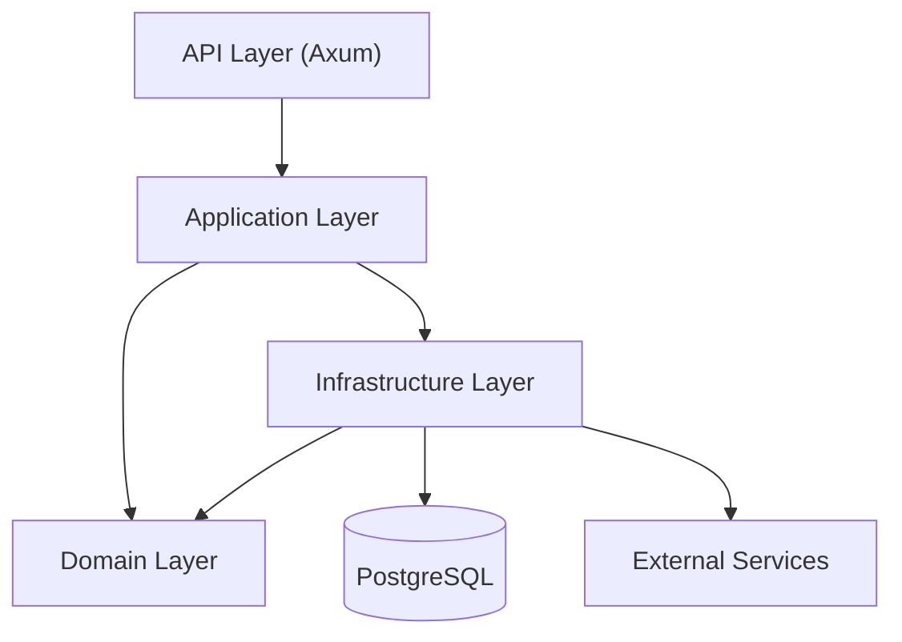

<span id="architecture" />

# 架構

FerrisKey 遵循六邊形架構，也稱為埠與介面卡。業務邏輯位於中間，不瞭解 HTTP、SQL 或 SMTP。其他所有內容都連線到它上面。這就是保持領域可測試並允許基礎設施更改而無需重寫規則的原因。

<span id="layers" />

## 層級



<span id="domain-layer" />

### 領域層

純業務邏輯，不依賴於框架、資料庫或傳輸。每個領域模組的佈局方式相同：

- `entities.rs` 用於表示領域概念的不可變值物件
- `ports.rs` 用於領域需要別人實現的特性
- `services.rs` 用於透過這些埠操作實體的邏輯
- `value_objects.rs` 用於用例的輸入和輸出
- `policies.rs` 用於授權規則，當某個模組有它們時

<span id="application-layer" />

### 應用層

編排。`ApplicationService` 透過依賴注入將每個領域服務連線到具體實現，並且是組裝物件圖的唯一位置。

<span id="infrastructure-layer" />

### 基礎設施層

埠背後的實現：由 SeaORM 和 PostgreSQL 支援的倉庫，以及用於 SMTP、Webhook 投遞和身分提供者呼叫的出站整合。它還在身分域、客戶端和會話倉庫前持有記憶體快取（參見 [快取](/zh-TW/discover/guides/configuration#caching)），並在到達資料庫之前對金鑰進行封裝（參見 [靜態金鑰](/zh-TW/discover/guides/secrets-at-rest)）。

<span id="api-layer" />

### API 層

使用 Axum 構建的 HTTP 層。每個功能模組都對應一個領域模組，並帶有自己的路由器、處理器、驗證器和錯誤型別。OpenAPI 文件根據處理器上的 `utoipa` 屬性生成，並在 `/swagger-ui`、`/redoc`、`/rapidoc` 和 `/scalar` 提供服務。

<span id="domain-modules" />

## 領域模組

```text
core/src/domain/
├── authentication/       # OAuth2 / OIDC flows
├── user/                 # User lifecycle and required actions
├── account/              # Self-service account operations
├── account_security/     # Password, MFA and passkey self-service
├── client/               # OAuth2 clients
├── client_registration/  # Dynamic client registration
├── client_metadata/      # Clients identified by a metadata document URL
├── consent/              # Consent to optional client scopes
├── realm/                # Multi-tenant realms and settings
├── credential/           # Passwords, OTP, WebAuthn
├── password_policy/      # Password strength rules
├── role/                 # Bitwise permissions
├── session/              # User sessions
├── jwt/                  # Token issuance and validation
├── crypto/               # Password hashing
├── saml/                 # SAML 2.0 identity provider
├── trident/              # MFA
├── seawatch/             # Audit logging
├── compass/              # Authentication flow recording
├── abyss/                # Identity provider federation
├── aegis/                # Client scopes and protocol mappers
├── organization/         # B2B tenancy
├── email_template/       # Transactional email templates
├── email_verification/   # Email verification flow
├── portal_theme/         # Login portal theming
├── portal_layouts/       # Login portal layouts
├── webhook/              # Event-driven hooks
├── health/               # Liveness and readiness
├── maintenance/          # Maintenance mode
└── common/               # Shared errors, pagination and rate limiters
```

此處的模組要麼在 `core` 中實現，要麼從 `libs/` 下的一個 crate 重新匯出。例如，`consent/` 是 `ferriskey-consent` 的重新匯出。

<span id="workspace-crates" />

## 工作區的庫

該工作區被劃分為 `libs/` 下的專注庫，分為兩個系列。

功能庫包含一個模組的領域邏輯和基礎設施邏輯：

```text
libs/
├── ferriskey-domain/           # Shared domain types and ports
├── ferriskey-authz/            # RBAC engine, action catalogue and the tenant authorization domain
├── ferriskey-authz-cedar/      # Cedar engine that evaluates tenant authorization policies
├── ferriskey-security/         # Password hashing, JWT primitives and the secret cipher
├── ferriskey-consent/          # Consent to optional client scopes
├── ferriskey-trident/          # MFA
├── ferriskey-abyss/            # Identity provider federation
├── ferriskey-aegis/            # Scopes and protocol mappers
├── ferriskey-compass/          # Authentication flow tracing
├── ferriskey-saml/             # SAML 2.0
├── ferriskey-seawatch/         # Audit events
├── ferriskey-organization/     # Organizations
├── ferriskey-password-policy/  # Password policies
├── ferriskey-portal-theme/     # Portal theming
├── ferriskey-portal-layouts/   # Portal layouts
├── ferriskey-webhook/          # Webhook delivery
├── ferriskey-mail/             # SMTP transport, email templates and email verification
├── ferriskey-migrate/          # Data migration runner
└── maskass/                    # Redaction of sensitive values
```

`maskass` 是唯一沒有 `ferriskey-` 字首的庫，它不依賴其他 FerrisKey 庫。它的 `Masked<T>` 包裝器儲存實際值，但在序列化、列印和除錯列印時作為 `***` 表現，這可以將身分提供者的客戶端金鑰保密，不出現在 API 響應和日誌中。`MaskedWith` 新增了部分、郵箱和雜湊掩碼。

`ferriskey-api-*` crate 承載匹配功能的 HTTP 層：它的路由、處理器和 OpenAPI 路徑。構建 `ferriskey-api` 二進位制檔案的 `api` crate 僅將它們組合成一個路由器和一個 OpenAPI 文件，並啟動伺服器。`ferriskey-api-core` 儲存共享部分：CLI 引數、應用狀態、Bearer token 中介軟體、CORS、請求上下文和錯誤轉換。

<span id="dependency-flow" />

## 依賴流

規則很嚴格：內部層永遠不依賴外部層。

- 域不依賴任何東西
- 應用透過埠依賴於域
- 基礎設施實現域的埠
- API 依賴於應用

這意味著你可以將 PostgreSQL 替換為其他儲存，將 Axum 替換為不同的 HTTP 框架，或者完全在記憶體中執行領域測試，而無需觸碰業務規則。

<span id="error-propagation" />

## 錯誤傳播

錯誤透過自動轉換向外傳播：

1. 領域失敗的 `CoreError`：未找到，驗證，衝突。
2. 附有狀態碼的 HTTP 響應的 `ApiError`。
3. 邊界處的 `From<CoreError> for ApiError`，因此處理程式可以使用 `?` 並免費獲得正確的狀態碼。
