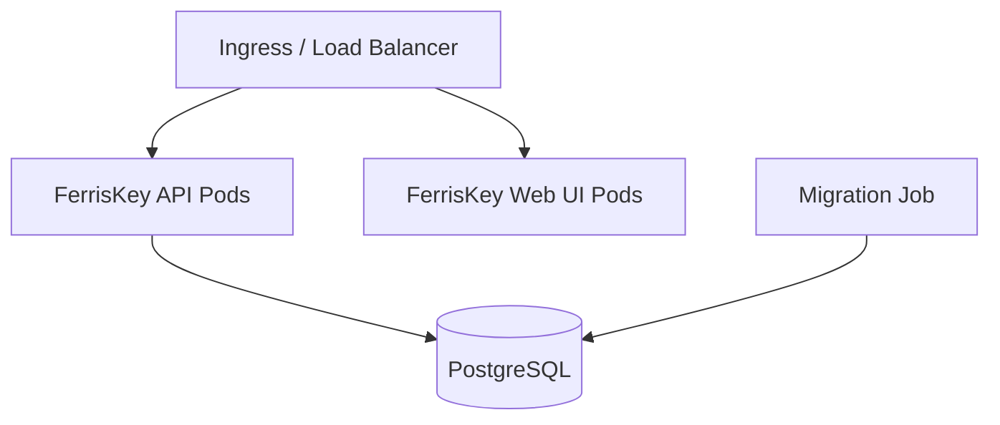

# FerrisKey on Kubernetes

FerrisKey ships a Helm chart and an operator for Kubernetes. Which one fits depends on how you already operate clusters.

::::card-group{cols=3}
:::card{label="Helm chart" icon="lucide:package" href="/en/kubernetes/helm-chart"}
A standard Helm chart with the full Kubernetes surface exposed in its values: probes, security contexts, environment, Ingress or Gateway API routing, a ServiceMonitor.
:::
:::card{label="Operator" icon="lucide:bot" href="/en/kubernetes/operator"}
Declarative management through the `FerrisKeyCluster` custom resource, itself installed with a Helm chart. The pod specs it generates are fixed.
:::
:::card{label="Production guide" icon="lucide:shield" href="/en/kubernetes/production-guide"}
Hardening checklist for production deployments: database TLS, scaling, probes, and what to keep off the public route.
:::
::::

## Architecture on Kubernetes

A deployment is four pieces:

- API pods, handling authentication, token issuance, and administration
- Console pods, serving the React admin interface
- A migration Job that applies pending schema changes when you install or upgrade
- PostgreSQL, managed or self-hosted

The chart bundles a PostgreSQL StatefulSet so a first install works with nothing else in place. It is not meant for production. The operator deploys the API, the console and the migration Job, and expects a database that already exists.

API replicas keep no state of their own, but they cache reads and tell each other about revoked tokens and ended sessions through PostgreSQL notifications. Every replica therefore needs a direct connection to the database. The [production guide](/en/kubernetes/production-guide#scaling-out-and-caches) explains what that rules out.

With an Ingress or HTTPRoute enabled, the chart routes `/` to the console and `/api` (the default `api.server.rootPath`) to the API on one hostname. The operator creates a Service for each and leaves the routing to you.
