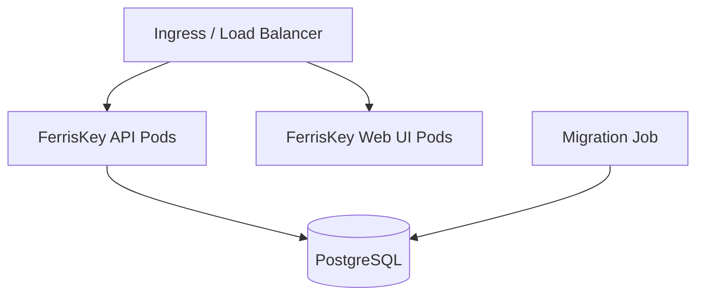

# Kubernetes 上的 FerrisKey

FerrisKey 提供了用于 Kubernetes 的 Helm chart 和 Operator。选择哪一个取决于你当前如何操作集群。

::::card-group{cols=3}
:::card{label="Helm Chart" icon="lucide:package" href="/zh-CN/kubernetes/helm-chart"}
一个标准的 Helm chart，其值中暴露了完整的 Kubernetes 功能：探针、安全上下文、环境变量、Ingress 或 Gateway API 路由、ServiceMonitor。
:::
:::card{label="Operator" icon="lucide:bot" href="/zh-CN/kubernetes/operator"}
通过 `FerrisKeyCluster` 自定义资源进行声明式管理，该资源本身通过 Helm chart 安装。它生成的 pod 规范是固定的。
:::
:::card{label="生产指南" icon="lucide:shield" href="/zh-CN/kubernetes/production-guide"}
生产环境部署的加固清单：数据库 TLS、扩展、探针，以及哪些内容应保持在公共路由之外。
:::
::::

## Kubernetes 架构

一个部署由四个部分组成：

- API Pods，处理身份认证、令牌发行和管理
- 控制台 Pods，提供 React 管理界面
- 迁移作业，在安装或升级时应用待处理的架构更改
- PostgreSQL，可托管或自托管

该 Chart 包含一个 PostgreSQL StatefulSet，因此首次安装时无需其他任何组件即可运行。它不适用于生产环境。Operator 部署 API、控制台和迁移作业，并期望已有数据库存在。

API 副本自身不保存状态，但它们会缓存读取内容，并通过 PostgreSQL 通知告知彼此已撤销的令牌和已结束的会话。因此，每个副本都需要直接连接数据库。[生产指南](/zh-CN/kubernetes/production-guide#scaling-out-and-caches)解释了这排除了什么。

启用 Ingress 或 HTTPRoute 后，Chart会将 `/` 路由到控制台，将 `/api`（默认 `api.server.rootPath`）路由到同一主机名下的 API。操作员为每个创建一个服务，并将路由留给你来处理。
