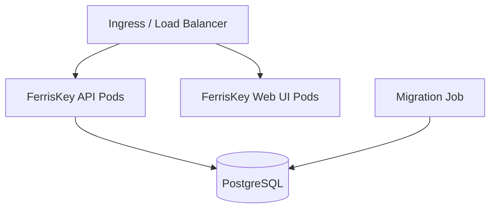

# Kubernetes 上的 FerrisKey

FerrisKey 提供了用於 Kubernetes 的 Helm chart 和 Operator。選擇哪一個取決於你當前如何操作叢集。

::::card-group{cols=3}
:::card{label="Helm Chart" icon="lucide:package" href="/zh-TW/kubernetes/helm-chart"}
一個標準的 Helm chart，其值中暴露了完整的 Kubernetes 功能：探針、安全上下文、環境變數、Ingress 或 Gateway API 路由、ServiceMonitor。
:::
:::card{label="Operator" icon="lucide:bot" href="/zh-TW/kubernetes/operator"}
透過 `FerrisKeyCluster` 自定義資源進行宣告式管理，該資源本身透過 Helm chart 安裝。它生成的 pod 規範是固定的。
:::
:::card{label="生產指南" icon="lucide:shield" href="/zh-TW/kubernetes/production-guide"}
生產環境部署的加固清單：資料庫 TLS、擴充套件、探針，以及哪些內容應保持在公共路由之外。
:::
::::

## Kubernetes 架構

一個部署由四個部分組成：

- API Pods，處理身分認證、權杖發行和管理
- 控制檯 Pods，提供 React 管理介面
- 遷移作業，在安裝或升級時應用待處理的架構更改
- PostgreSQL，可託管或自託管

該 Chart 包含一個 PostgreSQL StatefulSet，因此首次安裝時無需其他任何元件即可執行。它不適用於生產環境。Operator 部署 API、控制檯和遷移作業，並期望已有資料庫存在。

API 副本自身不儲存狀態，但它們會快取讀取內容，並透過 PostgreSQL 通知告知彼此已撤銷的權杖和已結束的會話。因此，每個副本都需要直接連線資料庫。[生產指南](/zh-TW/kubernetes/production-guide#scaling-out-and-caches)解釋了這排除了什麼。

啟用 Ingress 或 HTTPRoute 後，Chart會將 `/` 路由到控制檯，將 `/api`（預設 `api.server.rootPath`）路由到同一主機名下的 API。操作員為每個建立一個服務，並將路由留給你來處理。
