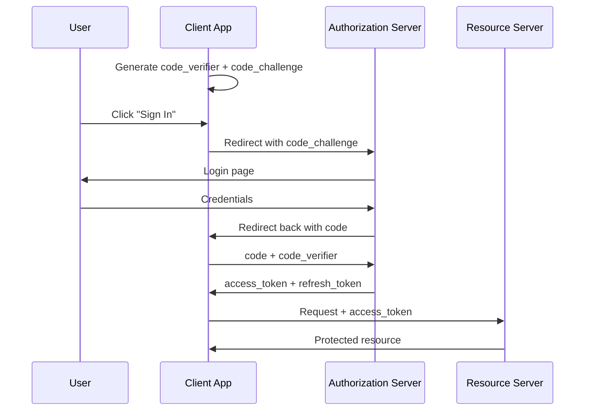

<span id="oauth2-flows" />

# OAuth2 流程

OAuth2 定义了几种授权类型，也称为流程。不同的编排，相同的目标：将访问令牌交到正确的客户端手中。

选择合适的流程归结为两个问题。客户端是谁？它能保守密钥吗？

| 流程 | 使用场景 |
| --- | --- |
| 授权码 + PKCE | 用户在浏览器或移动应用前 |
| 客户端凭据 | 后端服务以自身身份进行认证，无需用户参与 |
| 设备授权 | 设备无法方便地输入密码（电视、命令行界面） |
| 刷新令牌 | 在不打扰用户的情况下刷新访问令牌 |

一些较旧的流程（隐式、资源所有者密码凭据）仍然存在，但你不应该使用它们。OAuth 2.1 彻底移除了它们。

<span id="authorization-code-with-pkce" />

## 带 PKCE 的授权码

最常见的流程。每个登录用户的网页应用、单页应用和移动应用都会使用。

<span id="the-story" />

### 故事

用户访问一个网页应用并点击“登录”。应用将用户发送到FerrisKey，用户登录后，FerrisKey带着一个短代码将用户返回，应用用该代码换取一个令牌。

关键细节：代码会通过用户的浏览器传输，因此会被暴露。PKCE（用于代码交换的证明密钥）使这种暴露无害。

<span id="how-pkce-works" />

### PKCE 的工作原理

在重定向之前，客户端生成一个名为`code_verifier`的随密钥钥，并在授权请求中发送其哈希值（`code_challenge`）。当客户端后来用代码换取令牌时，还必须发送原始的`code_verifier`。服务器检查`hash(code_verifier) == code_challenge`。

拦截代码的攻击者无法使用它：他们还需要 `code_verifier`，而它从未离开客户端。

<span id="the-full-exchange" />

### 完整交换流程



<span id="use-this-flow-when" />

### 在以下情况下使用此流程

- 您有基于浏览器或移动应用程序的真实用户。
- 您希望选择最灵活、最具未来适应性的选项。

<span id="client-credentials" />

## 客户端凭据

用于机器对机器的调用：一个后端服务调用另一个后端服务。没有用户参与。

<span id="the-story-1" />

### 故事

夜间批处理任务需要调用您的计费 API。批处理任务是客户端。它拥有 `client_id` 和 `client_secret`，并直接将它们交换为访问令牌。

```bash
curl -X POST https://auth.example.com/realms/my-app/protocol/openid-connect/token \
  -d "grant_type=client_credentials" \
  -d "client_id=batch-job" \
  -d "client_secret=••••••••"
```

<span id="use-this-flow-when-1" />

### 在以下情况下使用此流程

- 调用者是您控制的服务器。
- 调用者可以安全地存储一个秘钥（私钥、静态凭据）。
- 流程中没有终端用户。

生成的访问令牌代表的是客户端本身，而不是用户。权限与客户端相关，而不是与个人相关。

<span id="device-authorization-flow" />

## 设备授权流程

用于无法轻松显示登录表单或接受输入密码的客户端。智能电视、终端命令行界面（CLI）、物联网设备。

<span id="the-story-2" />

### 故事

你在笔记本电脑上的命令行界面（CLI）登录。CLI无法内联打开浏览器，因此它会显示一个简短代码和一个URL。你在手机上打开该URL，输入代码并登录。CLI在后台轮询。一旦完成，CLI就会获得它的令牌。

```
$ ferriskey login
Open https://auth.example.com/device in your browser
and enter code: WXYZ-1234

(waiting...)
✓ Logged in as alice@example.com
```

<span id="use-this-flow-when-2" />

### 在以下情况下使用此流程

- 设备输入受限（无键盘）或无浏览器。
- 你希望CLI以用户身份进行认证，而无需提示输入密码。

<span id="refresh-token-grant" />

## 刷新令牌授权

在授权码流程之后，客户端会同时收到 `access_token`（短期，有效期为几分钟）和 `refresh_token`（长期）。当访问令牌过期时，客户端使用刷新令牌静默地获取新的令牌，无需重定向用户。

```bash
curl -X POST .../token \
  -d "grant_type=refresh_token" \
  -d "refresh_token=••••••••" \
  -d "client_id=my-frontend"
```

有关这两种令牌类型的区别，请参见 [Tokens](/zh-CN/learn/oauth2/tokens)。

<span id="flows-that-are-out-of-fashion" />

## 已经过时的流程

- **隐式流程**：访问令牌直接返回在 URL 片段中。已被授权码 + PKCE 所取代。
- **资源所有者密码凭据 (ROPC)**：客户端收集用户的密码并转发。这违背了 OAuth2 的初衷。仅适用于迁移脚本。

<span id="in-ferriskey" />

## 在 FerrisKey 中

每个流程对应到您的 FerrisKey 客户端上的一个设置：

::::card-group{cols=2}
:::card{label="入门指南" icon="lucide:rocket" href="/zh-CN/discover/getting-started"}
创建一个客户端，并尝试端到端的授权码流程。
:::
:::card{label="OAuth2 令牌" icon="lucide:key" href="/zh-CN/learn/oauth2/tokens"}
从一次成功的流程中实际获得的东西。
:::
::::
