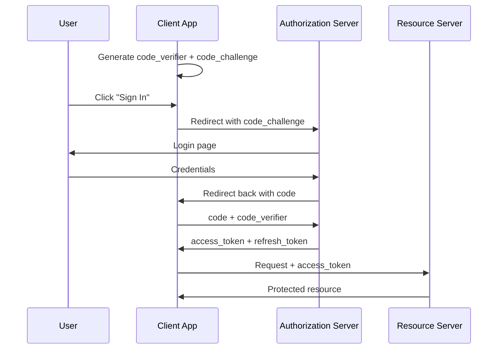

<span id="oauth2-flows" />

# OAuth2 流程

OAuth2 定義了幾種授權型別，也稱為流程。不同的編排，相同的目標：將存取權杖交到正確的客戶端手中。

選擇合適的流程歸結為兩個問題。客戶端是誰？它能保守金鑰嗎？

| 流程 | 使用場景 |
| --- | --- |
| 授權碼 + PKCE | 使用者在瀏覽器或移動應用前 |
| 客戶端憑據 | 後端服務以自身身分進行認證，無需使用者參與 |
| 裝置授權 | 裝置無法方便地輸入密碼（電視、命令列介面） |
| 重新整理權杖 | 在不打擾使用者的情況下重新整理存取權杖 |

一些較舊的流程（隱式、資源所有者密碼憑據）仍然存在，但你不應該使用它們。OAuth 2.1 徹底移除了它們。

<span id="authorization-code-with-pkce" />

## 帶 PKCE 的授權碼

最常見的流程。每個登入使用者的網頁應用、單頁應用和移動應用都會使用。

<span id="the-story" />

### 故事

使用者存取一個網頁應用並點選“登入”。應用將使用者傳送到FerrisKey，使用者登入後，FerrisKey帶著一個短程式碼將使用者返回，應用用該程式碼換取一個權杖。

關鍵細節：程式碼會透過使用者的瀏覽器傳輸，因此會被暴露。PKCE（用於程式碼交換的證明金鑰）使這種暴露無害。

<span id="how-pkce-works" />

### PKCE 的工作原理

在重定向之前，客戶端生成一個名為`code_verifier`的隨金鑰鑰，並在授權請求中傳送其雜湊值（`code_challenge`）。當客戶端後來用程式碼換取權杖時，還必須傳送原始的`code_verifier`。伺服器檢查`hash(code_verifier) == code_challenge`。

攔截程式碼的攻擊者無法使用它：他們還需要 `code_verifier`，而它從未離開客戶端。

<span id="the-full-exchange" />

### 完整交換流程



<span id="use-this-flow-when" />

### 在以下情況下使用此流程

- 您有基於瀏覽器或移動應用程式的真實使用者。
- 您希望選擇最靈活、最具未來適應性的選項。

<span id="client-credentials" />

## 客戶端憑據

用於機器對機器的呼叫：一個後端服務呼叫另一個後端服務。沒有使用者參與。

<span id="the-story-1" />

### 故事

夜間批處理任務需要呼叫您的計費 API。批處理任務是客戶端。它擁有 `client_id` 和 `client_secret`，並直接將它們交換為存取權杖。

```bash
curl -X POST https://auth.example.com/realms/my-app/protocol/openid-connect/token \
  -d "grant_type=client_credentials" \
  -d "client_id=batch-job" \
  -d "client_secret=••••••••"
```

<span id="use-this-flow-when-1" />

### 在以下情況下使用此流程

- 呼叫者是您控制的伺服器。
- 呼叫者可以安全地儲存一個秘鑰（私鑰、靜態憑據）。
- 流程中沒有終端使用者。

生成的存取權杖代表的是客戶端本身，而不是使用者。權限與客戶端相關，而不是與個人相關。

<span id="device-authorization-flow" />

## 裝置授權流程

用於無法輕鬆顯示登入表單或接受輸入密碼的客戶端。智慧電視、終端命令列介面（CLI）、物聯網裝置。

<span id="the-story-2" />

### 故事

你在膝上型電腦上的命令列介面（CLI）登入。CLI無法內聯開啟瀏覽器，因此它會顯示一個簡短程式碼和一個URL。你在手機上開啟該URL，輸入程式碼並登入。CLI在後臺輪詢。一旦完成，CLI就會獲得它的權杖。

```
$ ferriskey login
Open https://auth.example.com/device in your browser
and enter code: WXYZ-1234

(waiting...)
✓ Logged in as alice@example.com
```

<span id="use-this-flow-when-2" />

### 在以下情況下使用此流程

- 裝置輸入受限（無鍵盤）或無瀏覽器。
- 你希望CLI以使用者身分進行認證，而無需提示輸入密碼。

<span id="refresh-token-grant" />

## 重新整理權杖授權

在授權碼流程之後，客戶端會同時收到 `access_token`（短期，有效期為幾分鐘）和 `refresh_token`（長期）。當存取權杖過期時，客戶端使用重新整理權杖靜默地獲取新的權杖，無需重定向使用者。

```bash
curl -X POST .../token \
  -d "grant_type=refresh_token" \
  -d "refresh_token=••••••••" \
  -d "client_id=my-frontend"
```

有關這兩種權杖型別的區別，請參見 [Tokens](/zh-TW/learn/oauth2/tokens)。

<span id="flows-that-are-out-of-fashion" />

## 已經過時的流程

- **隱式流程**：存取權杖直接返回在 URL 片段中。已被授權碼 + PKCE 所取代。
- **資源所有者密碼憑據 (ROPC)**：客戶端收集使用者的密碼並轉發。這違背了 OAuth2 的初衷。僅適用於遷移指令碼。

<span id="in-ferriskey" />

## 在 FerrisKey 中

每個流程對應到您的 FerrisKey 客戶端上的一個設定：

::::card-group{cols=2}
:::card{label="入門指南" icon="lucide:rocket" href="/zh-TW/discover/getting-started"}
建立一個客戶端，並嘗試端到端的授權碼流程。
:::
:::card{label="OAuth2 權杖" icon="lucide:key" href="/zh-TW/learn/oauth2/tokens"}
從一次成功的流程中實際獲得的東西。
:::
::::
