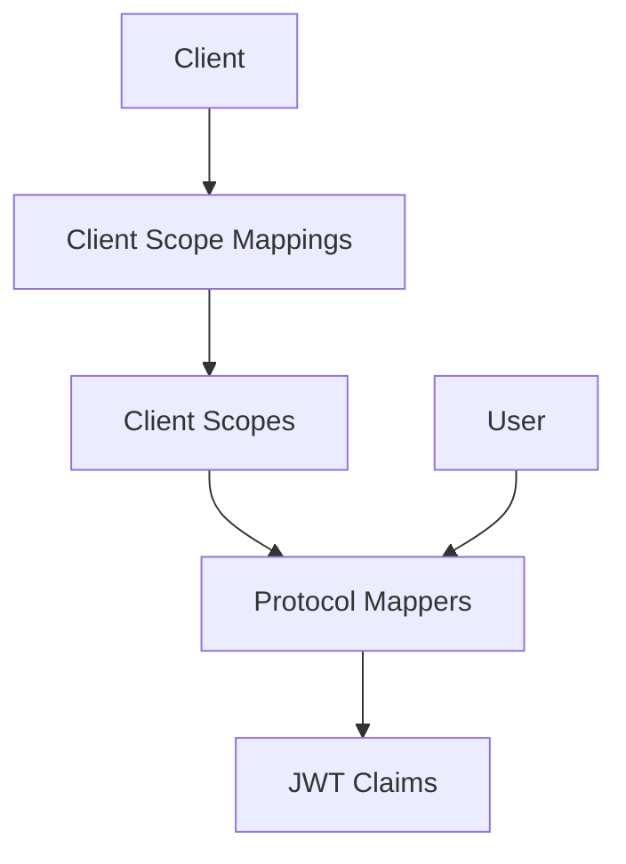

# Aegis: scopes and protocol mappers

Aegis decides what information ends up in a token. It owns client scopes, which are named collections of claims, and protocol mappers, which are the rules that pull data out and write it into the JWT. Together they are the contract between an application and FerrisKey: grant me this scope, and these claims will be in the token.

## Why scopes matter

Without them, every client would get identical claims. With them, a public mobile app gets `sub` and `email` while an internal admin tool gets roles, and neither sees more than it needs.

FerrisKey seeds the standard OIDC scopes into every realm. Anything specific to your business, such as a department, a plan tier or a feature flag, goes in through a protocol mapper on a scope of your own. The [mapper reference](/en/modules/aegis/protocol-mappers) lists the eleven types.

## Architecture

How data moves:

1. A client carries client scope mappings, each linking it to a scope as default or optional.
2. Each scope holds one or more protocol mappers.
3. At token generation, the mappers read from the user and produce claims.
4. The claims are assembled into the token.

## Scope types

| Type | Behavior | When to use |
|---|---|---|
| Default | Included in every token for the clients it is assigned to | Claims the app always needs, like email or roles |
| Optional | Included only when the request asks for it in `scope` | Data the client should have to ask for |
| None | Available in the system but not assigned to any client | Shared scope definitions waiting to be assigned |

## Seeded scopes

Each realm starts with these scopes already configured:

| Scope | Claims | Type |
|---|---|---|
| `openid` | None from a mapper. `sub` is always in the token | Default |
| `profile` | `preferred_username`, `given_name`, `family_name` | Default |
| `email` | `email`, `email_verified` | Default |
| `roles` | `realm_access.roles` | Default |
| `organization` | `organizations`, with each organization's `id`, `name`, `alias` and the roles the user holds in it | Default |
| `address` | `address`, read from the user attribute of that name | Optional |
| `phone` | `phone_number`, read from the user attribute of that name | Optional |
| `offline_access` | None, it carries no mapper | Optional |

Mappers only write ID-token claims when the request's `scope` includes `openid`. The `profile` scope does not carry a `name` claim; add an `oidc-full-name-mapper` to it if a client wants one.

## Real-world patterns

### API gateway with role-based access

Assign the seeded `roles` scope, or create a scope of your own, with an `oidc-usermodel-realm-role-mapper` that writes `realm_access.roles` into the token. Your API gateway reads the roles claim and enforces route-level authorization without calling back to FerrisKey.

### Multi-tenant SaaS

Create a custom scope with an `oidc-hardcoded-claim-mapper` that injects the realm name as a `tenant` claim. Your backend uses it to route requests to the correct tenant database.

### Third-party integrations

Assign only `openid` and `email` as default scopes for third-party clients. They get the minimum data needed. Your first-party clients get `profile`, `roles` and custom scopes as defaults.
