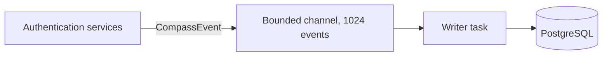

# Architecture

Compass observes authentication without slowing it down. The difficulty is recording step-by-step data during a latency-sensitive login. Compass handles it by taking the database out of the request: the authentication code drops events into an in-memory queue and moves on, and a background task writes them to PostgreSQL.

Compass is best-effort by design. It answers "where do sign-ins get stuck?", not "what happened to this account?". Events can be dropped under load, rows are deleted after 30 days, and a realm can switch it off. Anything that has to survive those three belongs in [SeaWatch](/en/modules/seawatch/overview).

## The FlowRecorder

The `FlowRecorder` is the single entry point. The authentication services hold one and call three methods, none of which waits for the database:

```rust title="FlowRecorder API"
// Open a flow. Returns None when Compass is off for the realm.
fn start_flow(realm, client_id, grant_type, ip_address, user_agent) -> Option<FlowId>

// Record a step on a flow.
fn record_step(flow_id, step_name, outcome)

// Close a flow with its final status.
fn complete_flow(flow_id, status, duration_ms, user_id)
```

`record_step` and `complete_flow` take the `Option<FlowId>` that `start_flow` returned and do nothing when it is `None`. A realm with Compass off therefore never produces a step that points at a flow that was not written.

### The queue



The recorder sends `CompassEvent` values through a Tokio `mpsc` channel to a single writer task. Three kinds of event flow through it:

| Event | What the writer does |
|---|---|
| `FlowStarted` | Inserts the flow row at once |
| `StepRecorded` | Adds the step to the current batch |
| `FlowCompleted` | Adds the final status, `completed_at`, duration and user to the current batch |

Because the writer handles events in order, a flow row is inserted before any of its steps are saved. The authorization session stores the flow id without a foreign key, so a flow that was lost or purged can never block a sign-in.

### The writer batches

After the first event of a cycle, the writer keeps collecting for up to 100 ms, or until the batch holds 256 events, whichever comes first. It then saves every step and every completion of that cycle in one statement. The statement inserts a step only when its flow exists, so a step never points at a missing flow.

Two things follow that you can observe. A step shows up in the API up to a fraction of a second after it happened. And the steps and completions of one cycle succeed or fail together: if the statement fails, the error is logged as `Compass writer: failed to persist a batch` and that batch is lost, with no retry.

### Backpressure and graceful degradation

The channel is bounded at 1024 events. When the writer cannot keep up and the channel is full:

1. `try_send` fails at once.
2. The event is dropped.
3. A warning is logged: `Compass: channel full, dropping event`.
4. Authentication continues normally. Compass never blocks or fails a login.

A dropped step is a hole in a flow. A dropped completion leaves its flow `pending` until the retention sweep marks it `expired`. A missing flow or step means the server was busy, never that the sign-in did not happen.

### Disabled realms

The recorder reads `compass_enabled` from the realm's settings each time a flow starts. A realm with no settings row is treated as enabled. When the setting is `false`, `start_flow` returns `None` before it builds anything: no flow object, no queue entry, no database write. A deployment without a Compass writer behind it uses `FlowRecorder::disabled()`, which holds no channel at all.

## Persistence

Compass reads and writes through two repository traits, implemented with SeaORM on PostgreSQL, following FerrisKey's hexagonal layout (traits in `ports.rs`, implementations in `infrastructure/`).

### `CompassFlowRepository`

| Method | Description |
|---|---|
| `create_flow(flow)` | Insert a flow row |
| `write_batch(steps, completions)` | Insert steps and apply completions, in one statement |
| `list(scope, request)` | One page of flows with their steps, filtered and sorted |
| `get_flow_by_id(flow_id)` | Fetch one flow |
| `purge_old_flows(older_than)` | Delete flows that started before a date, with their steps |
| `expire_stale_flows(started_before)` | Mark `pending` flows that started before a date as `expired` |
| `get_stats(realm_id)` | Counts and average duration for a realm |
| `get_daily_activity_stats(realm_id, filter)` | Per-day counts for a date window |

### `CompassFlowStepRepository`

| Method | Description |
|---|---|
| `get_steps_for_flow(flow_id)` | Fetch all steps of a flow |

## Retention

A retention task runs inside the API server. It ticks once at start-up, which clears whatever piled up while the server was down, and then every hour. Each tick does two things in order:

1. Marks flows that are still `pending` and started more than 12 hours ago as `expired`. A sign-in the user walked away from never completes, so without this step every abandoned login would count as in progress forever.
2. Deletes flows that started more than 30 days ago. Their steps go with them, through `ON DELETE CASCADE`.

Both thresholds are fixed. A failure in either step is logged and the next tick tries again, so a database hiccup never takes the server down.

:::callout{variant="warning"}
The 30-day window is not configurable. To keep flows longer, read them out through the [listing endpoint](/en/modules/compass/querying) before they are deleted.
:::
