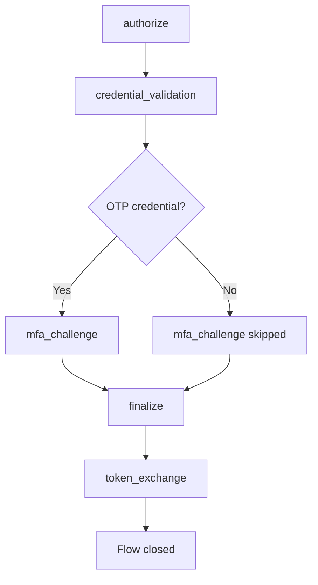

# Compass: authentication flows

Compass records each authentication attempt as a flow: a sequence of named steps, each with its own outcome, duration, and error details. It is how you find out where a sign-in actually went wrong.

## Why

From outside, authentication is one request and one token. Inside, it is redirect validation, credential hashing, an MFA challenge, maybe an external IdP round trip, session creation, and token signing. When it fails, `401` tells you nothing about which of those broke.

With Compass you get this instead:

> Flow `01914b3c-...` for client `my-frontend`, grant `authorization_code`:
> authorize (success) → credential_validation (success, 85 ms) → mfa_challenge (failure, `invalid_otp_code`)

The flow is still `pending` at that point: the user is on the login page and can enter another code.

Each row is one authentication execution: its grant type, its outcome, how many steps it went through and how long it took. A `pending` row is a flow nobody has closed yet: a sign-in in progress, one the user abandoned, or one that failed a check and may still be retried. Twelve hours after it started, a `pending` flow becomes `expired`.

## What gets recorded

With Compass on, an authentication opens a flow and each stage writes a step. The entry points that are traced are:

| Entry point | `grant_type` | Steps |
|---|---|---|
| Browser sign-in with the authorization code flow | `authorization_code` | `authorize`, `credential_validation`, `mfa_challenge`, `finalize`, `token_exchange` |
| Password grant on the token endpoint | `password` | `token_exchange` |
| Client credentials grant, failures only | `credentials` | `token_exchange` |
| RFC 8693 token exchange | `urn:ietf:params:oauth:grant-type:token-exchange` | `subject_token_exchange` |
| SAML sign-in | `saml_sso` | `saml_authn_request`, the sign-in steps, `saml_assertion` |
| Sign-in through an external identity provider | `broker_<alias>`, with the provider alias | `idp_redirect`, `idp_callback`, then `token_exchange` when the client redeems its code |

The refresh token grant is not traced, and neither is a client credentials grant that succeeds: both fire on every renewal and would bury the interesting flows.

## Flow lifecycle

::::step-group
:::step{title="The flow opens"}
When an authentication starts, Compass creates a `CompassFlow` with the realm, client, grant type, IP address and user agent. Its status is `pending`.
:::

:::step{title="Steps are recorded"}
Each stage of the sign-in writes a step with its outcome, duration and error details. Steps are saved in the background: the writer collects them for up to 100 ms and saves them together, so a step appears in the API a moment after it happened.
:::

:::step{title="The flow closes"}
When the sign-in ends, the flow gets its final status, `completed_at`, `duration_ms` and the user. For a browser sign-in this happens at the token step. A wrong password or a wrong code on the login page records a failed step but does not close the flow, because the user can try again on the same page.
:::

:::step{title="Old flows are cleaned up"}
An hourly sweep expires flows that stayed `pending` for 12 hours and deletes flows older than 30 days, with their steps. See [Architecture](/en/modules/compass/architecture#retention).
:::
::::

## Flow structure

A `CompassFlow` holds the whole attempt:

| Field | Type | Description |
|---|---|---|
| `id` | UUIDv7 | Flow identifier, time-ordered |
| `realm_id` | UUID | Realm context |
| `client_id` | string, nullable | The OAuth `client_id` that started the authentication |
| `user_id` | UUID, nullable | The authenticated user. Set when the flow closes, so it is null while the flow is pending, and it stays null on password grant flows |
| `grant_type` | string | See the table above |
| `status` | string | `pending`, `success`, `failure` or `expired` |
| `ip_address` | string, nullable | Source IP address |
| `user_agent` | string, nullable | Client user agent |
| `started_at` | date-time | When the flow began |
| `completed_at` | date-time, nullable | When the flow closed. Null while it is pending |
| `duration_ms` | integer, nullable | Duration of the closing step, in milliseconds |
| `steps` | array | The step records, in the order they started |

`duration_ms` measures the closing step, which for a browser sign-in is the exchange of the authorization code for tokens. It does not include the time the user spent on the login page. For wall-clock time, subtract `started_at` from `completed_at`.

### Flow status values

| Status | Meaning |
|---|---|
| `pending` | Not closed. A sign-in in progress, abandoned, or retryable after a failed credential or code check |
| `success` | Closed by a successful token issue or SAML assertion |
| `failure` | Closed by a failure at the token step, or by a failed SAML, identity provider or token exchange attempt |
| `expired` | Was `pending` for more than 12 hours when the hourly sweep ran |

## Flow steps

Each step records:

| Field | Type | Description |
|---|---|---|
| `id` | UUIDv7 | Step identifier |
| `flow_id` | UUID | Parent flow |
| `step_name` | string | One of the ten step types below |
| `status` | string | `success`, `failure` or `skipped` |
| `duration_ms` | integer, nullable | Step duration in milliseconds. Some steps record none |
| `error_code` | string, nullable | Machine-readable error, on failure |
| `error_message` | string, nullable | Human-readable detail, on some failures |
| `details` | JSON, nullable | Extra data. Only `idp_callback` sets it |
| `started_at` | date-time | When the step began |

### Step types

| Step | Recorded when |
|---|---|
| `authorize` | The authorization request was accepted: client, redirect URI and PKCE checks passed and the login session was created |
| `credential_validation` | The username and password were checked. On failure `error_code` is the name of the internal error, for example `InvalidPassword`, `UserDisabled` or `AccountLocked` |
| `mfa_challenge` | The one-time code was checked, with `invalid_otp_code` as the error on failure. The step is `skipped` when the account has no authenticator |
| `finalize` | The login completed and an authorization code was issued |
| `token_exchange` | The authorization code, or the password of a password grant, was exchanged for tokens. `duration_ms` is the time the exchange took |
| `idp_redirect` | The sign-in came back from an external identity provider, so the user had been redirected to it. No duration |
| `idp_callback` | The code returned by the provider was exchanged at its token endpoint. On success `details.provider` holds the provider alias. On failure `error_message` carries the provider's `error` and `error_description` |
| `saml_authn_request` | The service provider's `AuthnRequest` was parsed and checked. A failure carries an error code and a message |
| `saml_assertion` | The assertion was built and signed for the service provider |
| `subject_token_exchange` | An RFC 8693 exchange. On failure `error_code` is the OAuth error |

### Step status values

| Status | Meaning |
|---|---|
| `success` | The step completed |
| `failure` | The step failed, see `error_code` and `error_message` |
| `skipped` | The step did not apply, for example `mfa_challenge` for an account with no authenticator |

## Configuration

| Setting | Default | Description |
|---|---|---|
| `compass_enabled` | `true` | Record flows for this realm |

Turn it off and authentication behaves the same, minus the recording: no flows, no steps, no database writes. That is worth doing on a realm where you do not need step-level observability.

:::callout{variant="info"}
With `compass_enabled` set to `false`, the recorder returns before it builds a flow. Nothing is queued and nothing is written.
:::
