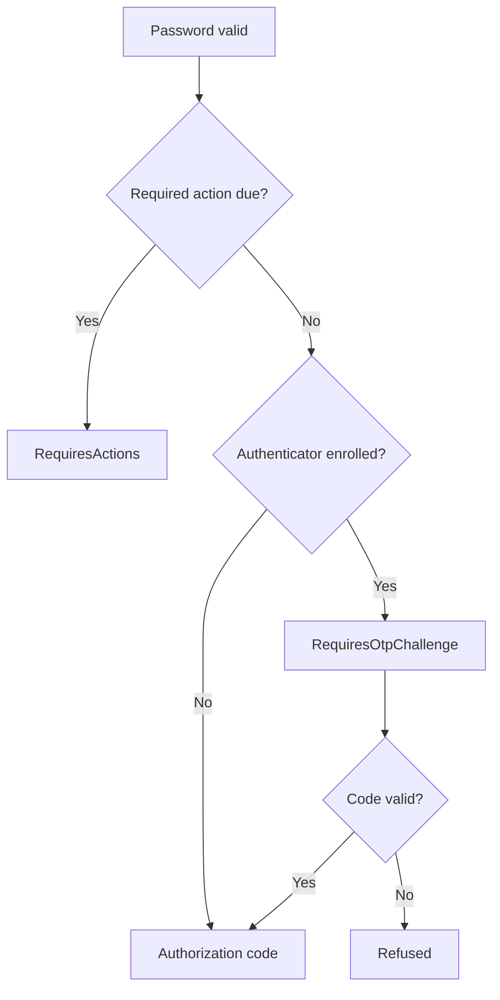

# Trident: multi-factor authentication

Trident covers the steps that can follow a valid password: the one-time-code challenge, the enrolment screens, passkey sign-in, magic links and recovery codes. The four methods do not play the same role, so it helps to know what each one does before you configure any of them.

## Why bother

Credential stuffing and phishing make a password on its own a liability. A second factor means a stolen password is not enough to get in.

Enrolment is enforced through required actions. Set `require_mfa` on the realm, or on a role, and users without an authenticator pick up the `configure_otp` required action on their next sign-in. They have to clear it before the sign-in completes.

## Available methods

::::card-group{cols=2}
:::card{label="TOTP" icon="lucide:clock" href="/en/modules/trident/totp"}
Time-based one-time passwords (RFC 6238). The only second factor FerrisKey challenges for after a password.
:::
:::card{label="WebAuthn" icon="lucide:fingerprint" href="/en/modules/trident/webauthn"}
Passkeys and security keys. A user-verified passkey signs the user in on its own, without a password.
:::
:::card{label="Magic Links" icon="lucide:mail" href="/en/modules/trident/magic-links"}
Passwordless email sign-in, tied to the browser that asked for the link.
:::
:::card{label="Recovery Codes" icon="lucide:file-key" href="/en/modules/trident/recovery-codes"}
One-time backup codes that answer the TOTP challenge when the authenticator is lost.
:::
::::

## Where Trident sits

Between a valid password and the end of the sign-in:

Once the password checks out:

1. FerrisKey applies the account lockout rules.
2. If a required action is due (`configure_otp`, `verify_email`, `update_password` or `configure_passkey`), the response has the status `RequiresActions` and lists the actions in `required_actions`.
3. Otherwise, if the user has an authenticator, the status is `RequiresOtpChallenge`.
4. In both cases the response sets a step token in the `FERRISKEY_LOGIN_ACTION` cookie, and the portal calls the matching [login action](/en/modules/portal/login-actions) with it.
5. When the last step is answered, FerrisKey applies the client's maintenance and consent rules and returns a `url` that carries the authorization code. The client exchanges it for tokens as usual.

A user who owns an authenticator cannot call any login action other than the code challenge and the recovery-code call until the challenge is answered.

<Callout variant="info" title="The step token">

The step token lives for the realm's `temporary_token_lifetime`, 300 seconds by default. It travels in an HttpOnly cookie scoped to `/realms/{realm_name}/login-actions`, and it only authorizes those endpoints. It cannot touch a protected resource.

</Callout>

Passkeys and magic links enter the chain differently. Both start from an identity proved some other way, so they skip the password and go straight to the end of the sign-in, as long as no required action is due. A user-verified passkey also answers the TOTP challenge. A magic link does not, and FerrisKey refuses it for a user who has an authenticator.

## Three ways teams use it

### Mandatory MFA on a SaaS product

Turn on `require_mfa` for the realm. Every user without an authenticator is sent through enrolment at their next sign-in, before they reach the application. To enforce it for part of the population, set `require_mfa` on a role instead: any user who holds that role is covered.

### Passkey-first sign-in

Turn on `passkey_enabled` and give users the `configure_passkey` required action. The sign-in page then offers a passkey button next to the password field, and a user-verified passkey signs in without typing anything. The password stays accepted next to it.

### Optional MFA on a consumer app

Leave `require_mfa` off and let users enrol an authenticator or a passkey from the Security tab of their account page. Available, not enforced.
