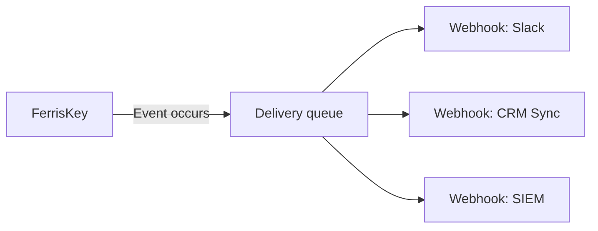

# Webhooks: event-driven integrations

Webhooks push HTTP notifications outward when something happens in FerrisKey. A user is created, a role is assigned, a client is deleted: FerrisKey sends a signed JSON payload to the endpoints you registered.

## Why

FerrisKey owns identity. Your application does not live inside it. Webhooks are the seam between the two.

They keep a CRM, a warehouse or a marketing platform current without anyone polling. They start downstream work, such as a welcome email, a Slack message or a provisioning job, at the moment the event happens. They push security-relevant actions into your alerting. And your application needs to know nothing about FerrisKey's internals to do any of it.

## How it works



::::step-group
:::step{title="Register a webhook"}
Create a webhook with an endpoint URL, optional custom headers, a name and a description. The webhook belongs to one realm. FerrisKey refuses to save an endpoint that is not `https`, that carries credentials in the URL, or that is an IP address or a `localhost` name in a loopback, private or link-local range. A hostname is checked again each time FerrisKey resolves it to deliver. Plain `http` is accepted only towards loopback, and only when the API runs with `WEBHOOK_ALLOW_PRIVATE_ENDPOINTS=true`.
:::

:::step{title="Subscribe to events"}
List the triggers the webhook cares about in `subscribers`, such as `user.created` or `client.deleted`.
:::

:::step{title="Collect the signing secret"}
FerrisKey generates a secret for every webhook and signs each delivery with it. The create response does not return it, and no read ever does. Call `POST /realms/{realm_name}/webhooks/{webhook_id}/secret/rotate` once, or use Generate a new secret in the console, and store what comes back. [Payload format](/en/modules/webhooks/payload#verifying-the-signature) shows how your endpoint uses it.
:::

:::step{title="Events fire"}
When a matching event happens in the realm, FerrisKey records a delivery for each subscribed webhook before it tries to send anything, then POSTs the payload to the endpoint. The action that caused the event does not wait for your endpoint, and does not fail if your endpoint does.
:::
::::

## Webhook structure

Create a webhook with `POST /realms/{realm_name}/webhooks`. Only `endpoint` is required.

```json title="POST /realms/acme/webhooks"
{
  "name": "CRM sync",
  "description": "Keeps HubSpot contacts in step with users",
  "endpoint": "https://api.yourapp.com/webhooks/ferriskey",
  "headers": { "Authorization": "Bearer your-secret-token" },
  "subscribers": ["user.created", "user.updated", "user.deleted"]
}
```

A read returns:

| Field | Description |
|---|---|
| `id` | Unique webhook identifier |
| `endpoint` | Target URL for the HTTP POST |
| `name`, `description` | Optional labels |
| `subscribers` | The subscribed triggers, each with its own `id` and the trigger in `name` |
| `retry_policy` | The retry fields this webhook overrides. See [Deliveries and retries](/en/modules/webhooks/deliveries) |
| `effective_retry_policy` | The retry policy that applies after falling back to the realm and system defaults |
| `triggered_at` | Last time the webhook fired |
| `created_at`, `updated_at` | Timestamps |

`headers` and the secret go in and never come out. A read does not return the header values, and neither does the payload of a `webhook.created` or `webhook.updated` notification.

`PUT` replaces the webhook as a whole: `endpoint` is required every time, and `name`, `description` and `subscribers` are overwritten by what you send, so a webhook updated without `subscribers` ends up subscribed to nothing. `headers` is the exception. Leaving it out keeps the stored set, and sending it replaces the whole set.

The list endpoint is paginated, as described in [API listings](/en/discover/guides/api-listings). It filters on `search` (name or endpoint), `name`, `endpoint`, `triggered`, `has_subscribers`, `secure_endpoint` (`true` keeps `https://` endpoints), `created_from` and `created_to`, and sorts on `name`, `endpoint`, `triggered_at`, `created_at` (the default) or `updated_at`.

## What people wire up

::::card-group{cols=2}
:::card{label="User onboarding" icon="lucide:user-plus"}
On `user.created`, send a welcome email, provision a trial account in your billing system, and notify the sales team in Slack.
:::
:::card{label="Security monitoring" icon="lucide:alert-triangle"}
Forward `auth.reset_password` and `client.maintenance.enabled` events to PagerDuty or Opsgenie for on-call alerting.
:::
:::card{label="Data sync" icon="lucide:refresh-cw"}
On `user.updated` and `user.deleted`, sync changes to your CRM, data warehouse or marketing platform as they happen.
:::
:::card{label="Audit forwarding" icon="lucide:database"}
Forward the triggers you subscribe to into Splunk, Elastic or a custom SIEM for long-term storage and compliance reporting.
:::
::::

## Then watch what actually happens

Wiring a webhook is the easy half. [Deliveries and retries](/en/modules/webhooks/deliveries) covers the other one: every attempt is recorded with the status code it got back, failures retry with exponential backoff and jitter, and a delivery that exhausted its attempts can be replayed by hand once you have fixed the endpoint.

::::card-group{cols=3}
:::card{label="Payload format" icon="lucide:file-json" href="/en/modules/webhooks/payload"}
The envelope, the headers, and how to verify the signature.
:::
:::card{label="Deliveries and retries" icon="lucide:repeat" href="/en/modules/webhooks/deliveries"}
Status codes, error codes, automatic backoff, manual replay, secret rotation.
:::
:::card{label="Triggers" icon="lucide:webhook" href="/en/modules/webhooks/triggers"}
The 38 triggers a webhook can subscribe to, and the 33 FerrisKey raises today.
:::
::::
