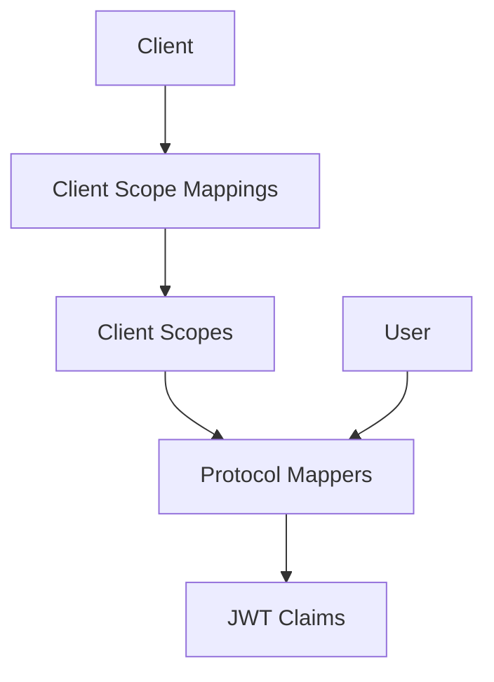

# Aegis：作用域和协议映射器

Aegis 决定哪些信息最终进入令牌。它拥有客户端作用域，即命名的声明集合，以及协议映射器，即将数据提取并写入 JWT 的规则。它们共同构成应用程序与 FerrisKey 之间的合同：授予我此作用域，这些声明将出现在令牌中。

## 为何作用域重要

没有它们，每个客户端都会得到相同的声明。使用它们后，公共移动应用会获得 `sub` 和 `email`，而内部管理工具会获得角色，并且双方都不会看到超出所需的信息。

FerrisKey 将标准 OIDC 作用域植入到每个域中。任何与您的业务相关的特定内容，例如部门、计划等级或功能标志，都通过您自己的作用域上的协议映射器进行输入。 [映射器参考](/zh-CN/modules/aegis/protocol-mappers) 列出了十一种类型。

## 架构

数据传递方式：

1. 客户端携带客户端作用域映射，每个映射将其链接到作为默认或可选的作用域。
2. 每个作用域包含一个或多个协议映射器。
3. 在令牌生成时，映射器读取用户信息并生成声明。
4. 声明被组装到令牌中。

## 作用域类型

| 类型 | 行为 | 使用时机 |
|---|---|---|
| 默认 | 包括在分配给客户端的每个令牌中 | 应用程序总是需要的声明，例如电子邮件或角色 |
| 可选 | 仅在请求中在 `scope` 中要求时包含 | 客户端应当请求的数据 |
| 无 | 系统中可用，但未分配给任何客户端 | 等待分配的共享作用域定义 |

## 预设的作用域

每个身份域从一开始就已配置这些作用域：

| 作用域 | 声明 | 类型 |
|---|---|---|
| `openid` | 没有映射器。`sub` 总是在令牌中 | 默认 |
| `profile` | `preferred_username`, `given_name`, `family_name` | 默认 |
| `email` | `email`, `email_verified` | 默认 |
| `roles` | `realm_access.roles` | 默认 |
| `organization` | `organizations`，以及每个组织的 `id`、`name`、`alias` 和用户在其中拥有的角色 | 默认 |
| `address` | `address`，从该名称的用户属性读取 | 可选 |
| `phone` | `phone_number`，从该名称的用户属性读取 | 可选 |
| `offline_access` | 没有，它不携带任何映射器 | 可选 |

只有当请求的 `scope` 包含 `openid` 时，映射器才会写入 ID-token 声明。`profile` 作用域不携带 `name` 声明；如果客户端需要，可以向其添加 `oidc-full-name-mapper`。

## 现实世界模式

### 带有基于角色访问的 API 网关

分配预设的 `roles` 作用域，或创建你自己的作用域，并带有一个 `oidc-usermodel-realm-role-mapper`，该 `oidc-usermodel-realm-role-mapper` 将 `realm_access.roles` 写入令牌。你的 API 网关读取角色声明并执行路由级别的授权，而无需回调 FerrisKey。

### 多租户 SaaS

创建一个自定义作用域，带有一个 `oidc-hardcoded-claim-mapper`，将 realm 名称注入为 `tenant` 声明。你的后端使用它将请求路由到正确的租户数据库。

### 第三方集成

仅将 `openid` 和 `email` 分配为第三方客户端的默认作用域。他们获取所需的最少数据。您的第一方客户端默认获取 `profile`、`roles` 以及自定义作用域。
