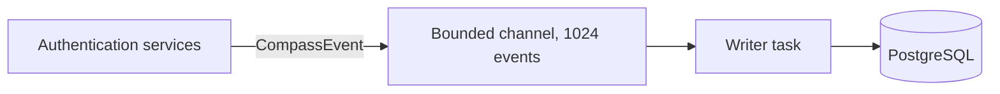

<span id="architecture" />

# 架构

Compass 观察身份认证而不减慢它。困难在于在延迟敏感的登录过程中记录逐步数据。Compass 通过将数据库移出请求来处理此问题：身份认证代码将事件放入内存队列并继续进行，后台任务将它们写入 PostgreSQL。

Compass设计上是尽力而为。它回答的是“登录卡在哪里？”，而不是“这个账号发生了什么？”。事件可以在加载时丢弃，行在30天后删除，服务器也可以关闭。任何必须通过这三个事件存活的都属于[SeaWatch](/zh-CN/modules/seawatch/overview)。

<span id="the-flowrecorder" />

## 流录音器

`FlowRecorder`是唯一的入口点。认证服务持有一个并调用三种方法，这些方法都不等待数据库：

```rust title="FlowRecorder API"
// Open a flow. Returns None when Compass is off for the realm.
fn start_flow(realm, client_id, grant_type, ip_address, user_agent) -> Option<FlowId>

// Record a step on a flow.
fn record_step(flow_id, step_name, outcome)

// Close a flow with its final status.
fn complete_flow(flow_id, status, duration_ms, user_id)
```

`record_step`和`complete_flow`取`start_flow`返回的`Option<FlowId>`，当它被`None`时不做任何操作。因此，Compass关闭的身份域永远不会产生指向未写入流的步骤。

<span id="the-queue" />

### 排队



记录器通过 Tokio `mpsc` 通道将`CompassEvent`值发送给单个写入任务。其中有三种类型的事件流：

| 事件 | 作者的操作 |
|---|---|
| `FlowStarted` | 一次性插入流程行 |
| `StepRecorded` | 将步骤添加到当前批次 |
| `FlowCompleted` | 将最终状态 `completed_at`、持续时间和用户添加到当前批次 |

因为作者按顺序处理事件，所以在保存步骤之前会先插入流程行。授权会话存储流程 ID 而没有外键，因此丢失或清除的流程永远不会阻止登录。

<span id="the-writer-batches" />

### 作者按批次处理

在一个周期的第一个事件之后，作者会继续收集，最长可达 100 毫秒，或者直到批次中包含 256 个事件，以先发生者为准。然后，它会在一条语句中保存该周期的每个步骤和每个完成。该语句仅在流程存在时才插入步骤，因此步骤永远不会指向缺失的流程。

接下来有两件事你可以观察到。步骤会在发生后的一秒的几分之一时间内显示在 API 中。而一个循环的步骤和完成要么一起成功，要么一起失败：如果语句失败，错误会被记录为 `Compass writer: failed to persist a batch`，并且该批次会丢失，不会重试。

<span id="backpressure-and-graceful-degradation" />

### 背压和优雅降级

通道的事件上限为 1024。当写入器跟不上而通道已满时：

1. `try_send` 会立即失败。
2. 事件会被丢弃。
3. 会记录一个警告：`Compass: channel full, dropping event`。
4. 认证会正常继续。指南针从不阻塞或失败登录。

被丢弃的步骤是流程中的一个漏洞。被丢弃的完成会使其流程保持 `pending` 状态，直到保留清理将其标记为 `expired`。缺失的流程或步骤意味着服务器繁忙，绝不是登录未发生。

<span id="disabled-realms" />

### 已禁用的身份域

每次流程开始时，记录器都会从身份域的设置中读取 `compass_enabled`。没有设置行的身份域被视为已启用。当设置为 `false` 时，`start_flow` 会在构建任何内容之前返回 `None`：没有流程对象，没有队列条目，也没有数据库写入。没有 Compass 写入器的部署使用 `FlowRecorder::disabled()`，它完全不持有任何通道。

<span id="persistence" />

## 持久化

Compass 通过两个存储库特性进行读写，这些特性在 PostgreSQL 上通过 SeaORM 实现，遵循 FerrisKey 的六边形布局（特性在 `ports.rs`，实现在 `infrastructure/`）。

### `CompassFlowRepository`

| 方法 | 说明 |
|---|---|
| `create_flow(flow)` | 插入一个流程行 |
| `write_batch(steps, completions)` | 插入步骤并应用完成情况，一条语句完成 |
| `list(scope, request)` | 一页流程及其步骤，已过滤和排序 |
| `get_flow_by_id(flow_id)` | 获取一个流程 |
| `purge_old_flows(older_than)` | 删除在某日期之前开始的流程及其步骤 |
| `expire_stale_flows(started_before)` | 将在某日期之前开始的`pending`流程标记为`expired` |
| `get_stats(realm_id)` | 获取一个身份域的计数和平均持续时间 |
| `get_daily_activity_stats(realm_id, filter)` | 某日期窗口的每日计数 |

### `CompassFlowStepRepository`

| 方法 | 说明 |
|---|---|
| `get_steps_for_flow(flow_id)` | 获取流程的所有步骤 |

<span id="retention" />

## 保留

保留任务在API服务器内运行。它在启动时执行一次，以清除服务器关闭期间积累的内容，然后每小时执行一次。每次执行按顺序完成两件事：

1. 将仍为`pending`且开始超过12小时的流程标记为`expired`。用户离开的登录从未完成，因此如果没有这一步，每个被放弃的登录将永远计为进行中。
2. 删除开始超过30天的流程。其步骤也将一起删除，通过`ON DELETE CASCADE`。

两个阈值都是固定的。任何一步失败都会被记录，下一次周期会再次尝试，因此数据库的小故障从不会使服务器宕机。

:::callout{variant="warning"}
30天窗口不可配置。要保留更长时间的流程，请在它们被删除之前，通过[listing endpoint](/zh-CN/modules/compass/querying)读取出来。
:::
