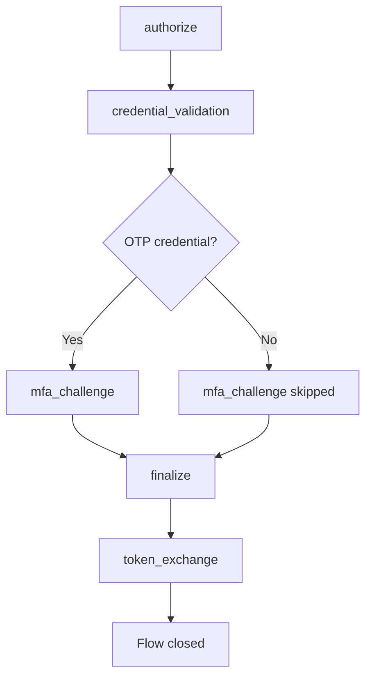

# Compass：认证流程

Compass 将每次认证尝试记录为一个流程：一系列命名步骤，每个步骤都有其结果、持续时间和错误细节。这是你了解登录到底出错在哪一步的方法。

## 原因

从外部看，认证只是一次请求和一个令牌。内部来看，它包括重定向验证、凭据哈希、多因素认证挑战、可能的外部身份提供商往返、会话创建以及令牌签名。当认证失败时，`401` 并不能告诉你到底是哪一步出了问题。

使用 Compass，你会得到如下信息：

> 客户端 `my-frontend`、授权 `authorization_code` 的流程 `01914b3c-...`：
> 授权 (成功) → 凭据验证 (成功，85 毫秒) → 多因素认证挑战 (失败，`invalid_otp_code`)

此时流程仍然是 `pending`：用户还在登录页面，可以输入另一个验证码。

每一行都是一次身份认证执行：其授权类型、结果、经过的步骤数量以及所花费的时间。`pending` 行是一条尚未完成的流程：正在进行的登录、用户放弃的登录，或因检查失败可能仍可重试的登录。在开始十二小时后，`pending` 流程会变为 `expired`。

## 什么被记录

启用 Compass 后，一次身份认证会打开一个流程，并且每个阶段都会记录一个步骤。被追踪的入口点有：

| 入口点 | `grant_type` | 步骤 |
|---|---|---|
| 通过授权码流程的浏览器登录 | `authorization_code` | `authorize`, `credential_validation`, `mfa_challenge`, `finalize`, `token_exchange` |
| 令牌端点的密码授权 | `password` | `token_exchange` |
| 客户端凭据授权，仅失败情况 | `credentials` | `token_exchange` |
| RFC 8693 令牌交换 | `urn:ietf:params:oauth:grant-type:token-exchange` | `subject_token_exchange` |
| SAML 登录 | `saml_sso` | `saml_authn_request`、登录步骤、`saml_assertion` |
| 通过外部身份提供者登录 | `broker_<alias>`，使用了服务商别名 | `idp_redirect`、`idp_callback`，然后`token_exchange`客户端兑换代码 |

刷新令牌授予不会被追踪，成功的客户端凭据授予也不会被追踪：两者都会在每次续期时触发，并且会掩盖有趣的流程。

## 流量生命周期

::::step-group
:::step{title="流动开启"}
当认证开始时，Compass 会创建一个包含身份域、客户端、授权类型、IP 地址和用户代理的 `CompassFlow`。其状态为 `pending`。
:::

:::step{title="步骤会被记录下来"}
登录的每个阶段都会写下一个步骤，包含其结果、持续时间和错误信息。步骤会在后台保存：写入者收集它们最多可达100毫秒并一起保存，因此步骤在完成后不久就会出现在API中。
:::

:::step{title="水流关闭"}
登录结束后，流程会获得最终状态、`completed_at`、`duration_ms`和用户。对于浏览器登录，这发生在令牌步骤。登录页面上的错误密码或代码记录失败步骤，但不会关闭流程，因为用户可以在同一页面重新尝试。
:::

:::step{title="旧流量被清理"}
每小时的扫描会终止`pending` 12小时的流量，删除超过30天的流量及其步骤。参见[架构](/zh-CN/modules/compass/architecture#retention)。
:::
::::

## 流动结构

`CompassFlow`显示整个尝试：

| 字段 | 类型 | 说明 |
|---|---|---|
| `id` | UUIDv7 | 流量标识符，按时间顺序排列 |
| `realm_id` | UUID | 身份域背景 |
| `client_id` | 字符串，可空 | 启动认证的OAuth是`client_id` |
| `user_id` | UUID，可空 | 已认证的用户。在流程关闭时设置，因此在流程进行中它为 null，并且在密码授权流程中它保持为 null |
| `grant_type` | 字符串 | 见上表 |
| `status` | 字符串 | `pending`, `success`, `failure` 或 `expired` |
| `ip_address` | 字符串，可空 | 源 IP 地址 |
| `user_agent` | 字符串，可空 | 客户端用户代理 |
| `started_at` | 日期时间 | 流程开始的时间 |
| `completed_at` | 日期时间，可为空 | 流程关闭的时间。流程进行中为 null |
| `duration_ms` | 整数，可为空 | 关闭步骤的持续时间，单位毫秒 |
| `steps` | 数组 | 步骤记录，按开始顺序 |

`duration_ms` 测量关闭步骤，对于浏览器登录，这是将授权码交换为令牌的过程。它不包括用户在登录页面上花费的时间。对于墙钟时间，请用 `completed_at` 减去 `started_at`。

### 流程状态值

| 状态 | 含义 |
|---|---|
| `pending` | 未关闭。正在进行签到、已放弃或在凭据或代码检查失败后可重试 |
| `success` | 通过成功的令牌颁发或 SAML 断言关闭 |
| `failure` | 在令牌步骤失败，或 SAML、身份提供者或令牌交换尝试失败时关闭 |
| `expired` | 当每小时清理运行时，已作为 `pending` 超过 12 小时 |

## 流程步骤

每个步骤记录：

| 字段 | 类型 | 说明 |
|---|---|---|
| `id` | UUIDv7 | 步骤标识符 |
| `flow_id` | UUID | 父流程 |
| `step_name` | 字符串 | 以下十种步骤类型之一 |
| `status` | 字符串 | `success`, `failure` 或 `skipped` |
| `duration_ms` | 整数，可为空 | 步骤持续时间（毫秒）。某些步骤不记录 |
| `error_code` | 字符串，可空 | 机器可读错误（失败时） |
| `error_message` | 字符串，可空 | 人类可读详细信息（部分失败时） |
| `details` | JSON，可为空 | 额外数据。仅 `idp_callback` 设置它 |
| `started_at` | 日期时间 | 步骤开始时间 |

### 步骤类型

| 步骤 | 记录时间 |
|---|---|
| `authorize` | 授权请求已被接受：客户端、重定向 URI 和 PKCE 检查通过，并且登录会话已创建 |
| `credential_validation` | 用户名和密码已检查。失败时 `error_code` 是内部错误名称，例如 `InvalidPassword`、`UserDisabled` 或 `AccountLocked` |
| `mfa_challenge` | 一次性代码已检查，失败时的错误为 `invalid_otp_code`。账户没有认证器时，该步骤为 `skipped` |
| `finalize` | 登录完成并颁发了授权码 |
| `token_exchange` | 授权码或密码授权的密码已交换为令牌。`duration_ms` 是交换所花费的时间 |
| `idp_redirect` | 来自外部身份提供者的登录返回，因此用户已被重定向到其处。没有持续时间 |
| `idp_callback` | 提供者返回的代码在其令牌端点进行交换。成功时 `details.provider` 保存提供者别名。失败时 `error_message` 包含提供者的 `error` 和 `error_description` |
| `saml_authn_request` | 服务提供者的 `AuthnRequest` 已被解析和检查。失败会返回错误代码和消息 |
| `saml_assertion` | 为服务提供者构建并签署了断言 |
| `subject_token_exchange` | 一次 RFC 8693 交换。失败时 `error_code` 为 OAuth 错误 |

### 步骤状态值

| 状态 | 含义 |
|---|---|
| `success` | 步骤已完成 |
| `failure` | 步骤失败，请参见 `error_code` 和 `error_message` |
| `skipped` | 步骤不适用，例如 `mfa_challenge` 对于没有身份认证器的账户 |

## 配置

| 设置 | 默认 | 说明 |
|---|---|---|
| `compass_enabled` | `true` | 记录此身份域的流程 |

关闭它后，认证行为保持不变，只是没有记录：没有流程、没有步骤、没有数据库写入。在不需要步骤级别可观察性的身份域上，这是值得做的。

:::callout{variant="info"}
将 `compass_enabled` 设置为 `false` 后，录制器在构建流程之前就返回。没有任务排队，也没有写入。
:::
