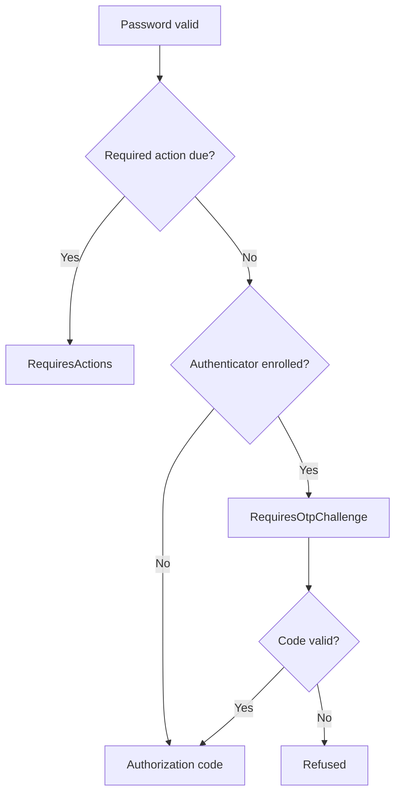

# Trident：多因素身份认证

Trident 覆盖了有效密码之后可能的步骤：一次性代码挑战、注册屏幕、密钥登录、魔法链接和恢复代码。这四种方法的作用不同，因此在配置任何方法之前，了解每种方法的作用是有帮助的。

## 为什么要费心

凭据填充和网络钓鱼使得仅凭密码本身就存在风险。第二因素意味着仅凭偷来的密码无法登录。

注册是通过必需的操作来强制执行的。在身份域或角色上设置 `require_mfa`，未使用认证器的用户将在下次登录时获取 `configure_otp` 必需操作。他们必须在登录完成前完成此操作。

## 可用的方法

::::card-group{cols=2}
:::card{label="TOTP" icon="lucide:clock" href="/zh-CN/modules/trident/totp"}
基于时间的一次性密码（RFC 6238）。这是 FerrisKey 在密码后要求的唯一第二因素。
:::
:::card{label="WebAuthn" icon="lucide:fingerprint" href="/zh-CN/modules/trident/webauthn"}
通行码和安全密钥。用户验证的通行码可以单独完成登录，无需密码。
:::
:::card{label="免密登录链接" icon="lucide:mail" href="/zh-CN/modules/trident/magic-links"}
无密码的电子邮件登录，与请求链接的浏览器绑定。
:::
:::card{label="恢复码" icon="lucide:file-key" href="/zh-CN/modules/trident/recovery-codes"}
一次性备份码，在丢失认证器时用于应对 TOTP 挑战。
:::
::::

## Trident 所在的位置

在有效密码与登录结束之间：

密码验证通过后：

1. FerrisKey 应用账户锁定规则。
2. 如果有需要执行的操作（`configure_otp`、`verify_email`、`update_password` 或 `configure_passkey`），响应状态为 `RequiresActions`，并在 `required_actions` 中列出这些操作。
3. 否则，如果用户拥有身份认证器，状态为 `RequiresOtpChallenge`。
4. 在这两种情况下，响应都会在 `FERRISKEY_LOGIN_ACTION` Cookie 中设置步骤令牌，门户使用该令牌调用匹配的 [登录操作](/zh-CN/modules/portal/login-actions)。
5. 当最后一步完成后，FerrisKey 应用客户端的维护和同意规则，并返回携带授权码的 `url`。客户端按通常方式用它换取令牌。

拥有认证器的用户在回答挑战之前，无法调用除代码挑战和恢复码调用之外的任何登录操作。

<Callout variant="info" title="步骤令牌">

步骤令牌在身份域的 `temporary_token_lifetime` 中有效，默认 300 秒。它通过作用于 `/realms/{realm_name}/login-actions` 的 HttpOnly cookie 传递，并且仅授权那些端点。它不能访问受保护的资源。

</Callout>

密码密钥和魔法链接进入链的方式不同。这两者都从通过其他方式验证的身份开始，因此它们跳过密码，直接进入登录流程的末端，只要没有必须执行的操作。用户验证的密码密钥也会回答 TOTP 挑战。魔法链接则不会，对于拥有认证器的用户，FerrisKey 会拒绝它。

## 团队使用的三种方式

### SaaS 产品上的强制多因素认证 (MFA)

为整个域启用 `require_mfa`。每个没有验证器的用户在下一次登录时都会通过注册流程，然后才能访问应用程序。要在部分人群中强制执行，可改为在角色上设置 `require_mfa`：任何拥有该角色的用户都适用。

### 以密钥为优先的登录

启用 `passkey_enabled` 并给予用户 `configure_passkey` 所需操作。登录页面随后会在密码字段旁提供一个密钥按钮，用户验证过的密钥即可无需输入任何内容直接登录。密码仍然保持可接受状态。

### 在消费者应用上可选的多因素认证（MFA）

保持 `require_mfa` 关闭，让用户可以在账户页面的安全选项卡中注册验证器或密钥。可用，但不强制。
