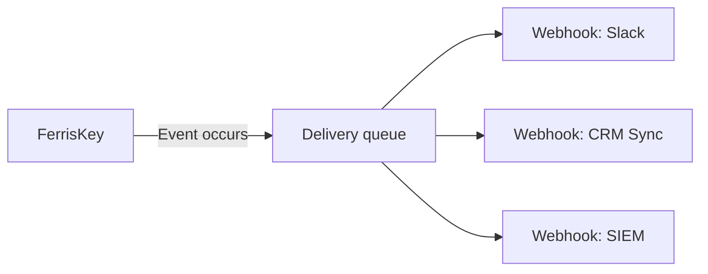

<span id="webhooks-event-driven-integrations" />

# Webhook：事件驱动的集成

当 FerrisKey 中发生某些事件时，Webhook 会向外推送 HTTP 通知。创建用户、分配角色、删除客户端：FerrisKey 会向您注册的端点发送已签名的 JSON 负载。

<span id="why" />

## 原因

FerrisKey 掌握身份。您的应用程序不在其内部运行。Webhook 是两者之间的接口。

他们可以在没有任何人轮询的情况下保持客户关系管理系统、仓库或营销平台的最新状态。他们在事件发生的那一刻启动下游工作，例如发送欢迎邮件、Slack 消息或执行配置作业。他们将与安全相关的操作推送到你的警报系统中。而你的应用程序无需了解 FerrisKey 的内部机制也能完成这些操作。

<span id="how-it-works" />

## 工作原理



::::step-group
:::step{title="注册一个 webhook"}
创建一个具有端点 URL、可选自定义头、名称和描述的 webhook。该 webhook 属于一个身份域。FerrisKey 拒绝保存端点，如果它不是 `https`、如果 URL 中携带凭据、或者如果它是位于环回、私有或链路本地范围内的 IP 地址或 `localhost` 名称。每次 FerrisKey 解析主机名以进行传递时，都会再次检查主机名。普通 `http` 仅被接受用于环回，并且仅在 API 以 `WEBHOOK_ALLOW_PRIVATE_ENDPOINTS=true` 运行时才允许。
:::

:::step{title="订阅事件"}
列出 `subscribers` 中 webhook 所关心的触发器，例如 `user.created` 或 `client.deleted`。
:::

:::step{title="收集签名密钥"}
FerrisKey 为每个 webhook 生成一个密钥并用它对每次投递进行签名。创建响应不会返回它，也没有读取会返回。调用 `POST /realms/{realm_name}/webhooks/{webhook_id}/secret/rotate` 一次，或在控制台中使用“生成新密钥”，并存储返回的内容。[Payload 格式](/zh-CN/modules/webhooks/payload#verifying-the-signature) 显示了你的端点如何使用它。
:::

:::step{title="事件触发"}
当身份域中发生匹配的事件时，FerrisKey 会为每个订阅的 webhook 记录一次投递，然后尝试将 payload POST 到端点。导致事件的操作不会等待你的端点，也不会因为你的端点失败而失败。
:::
::::

<span id="webhook-structure" />

## Webhook 结构

使用 `POST /realms/{realm_name}/webhooks` 创建一个 webhook。仅 `endpoint` 是必需的。

```json title="POST /realms/acme/webhooks"
{
  "name": "CRM sync",
  "description": "Keeps HubSpot contacts in step with users",
  "endpoint": "https://api.yourapp.com/webhooks/ferriskey",
  "headers": { "Authorization": "Bearer your-secret-token" },
  "subscribers": ["user.created", "user.updated", "user.deleted"]
}
```

读取返回：

| 字段 | 说明 |
|---|---|
| `id` | 唯一的 webhook 标识符 |
| `endpoint` | HTTP POST 的目标 URL |
| `name`, `description` | 可选标签 |
| `subscribers` | 已订阅的触发器，每个触发器都有自己的 `id` 和 `name` 中的触发器 |
| `retry_policy` | 此 webhook 覆盖的重试字段。见 [投递和重试](/zh-CN/modules/webhooks/deliveries) |
| `effective_retry_policy` | 在回退到身份域和系统默认值后适用的重试策略 |
| `triggered_at` | Webhook 上次触发的时间 |
| `created_at`, `updated_at` | 时间戳 |

`headers` 和密钥进来后不会再出来。读取不会返回头值，`webhook.created` 或 `webhook.updated` 通知的有效载荷也不会返回头值。

`PUT` 替代整个 webhook：每次都需要 `endpoint`，并且 `name`、`description` 和 `subscribers` 会被你发送的内容覆盖，所以如果更新 webhook 时没有 `subscribers`，最终订阅为空。`headers` 是例外。省略它会保留存储的集合，发送它会替换整个集合。

列表端点是分页的，如 [API 列表](/zh-CN/discover/guides/api-listings) 中所述。它可以根据 `search`（名称或端点）、`name`、`endpoint`、`triggered`、`has_subscribers`、`secure_endpoint`（`true` 保留 `https://` 端点）、`created_from` 和 `created_to` 进行过滤，并可以根据 `name`、`endpoint`、`triggered_at`、`created_at`（默认）或 `updated_at` 进行排序。

<span id="what-people-wire-up" />

## 人们连接的内容

::::card-group{cols=2}
:::card{label="用户入职" icon="lucide:user-plus"}
在 `user.created` 上，发送欢迎电子邮件，在你的计费系统中配置试用账户，并在 Slack 中通知销售团队。
:::
:::card{label="安全监控" icon="lucide:alert-triangle"}
将 `auth.reset_password` 和 `client.maintenance.enabled` 事件转发到 PagerDuty 或 Opsgenie 以进行值班警报。
:::
:::card{label="数据同步" icon="lucide:refresh-cw"}
在 `user.updated` 和 `user.deleted` 上，将更改同步到您的 CRM、数据仓库或营销平台，实时发生。
:::
:::card{label="审计转发" icon="lucide:database"}
将您订阅的触发器转发到 Splunk、Elastic 或自定义 SIEM，以进行长期存储和合规报告。
:::
::::

<span id="then-watch-what-actually-happens" />

## 然后观察实际发生的情况

连接 webhook 是简单的一半。[投递和重试](/zh-CN/modules/webhooks/deliveries) 涵盖了另一半：每次尝试都会记录返回的状态码，失败会以指数退避和抖动方式重试，尝试次数用尽的投递可以在您修复端点后手动重放。

::::card-group{cols=3}
:::card{label="有效载荷格式" icon="lucide:file-json" href="/zh-CN/modules/webhooks/payload"}
信封、页眉以及如何验证签名。
:::
:::card{label="投递与重试" icon="lucide:repeat" href="/zh-CN/modules/webhooks/deliveries"}
状态码、错误码、自动退赛、手动回放、密钥轮换。
:::
:::card{label="触发器" icon="lucide:webhook" href="/zh-CN/modules/webhooks/triggers"}
38个触发点可以认购，FerrisKey今天涨注33个。
:::
::::
