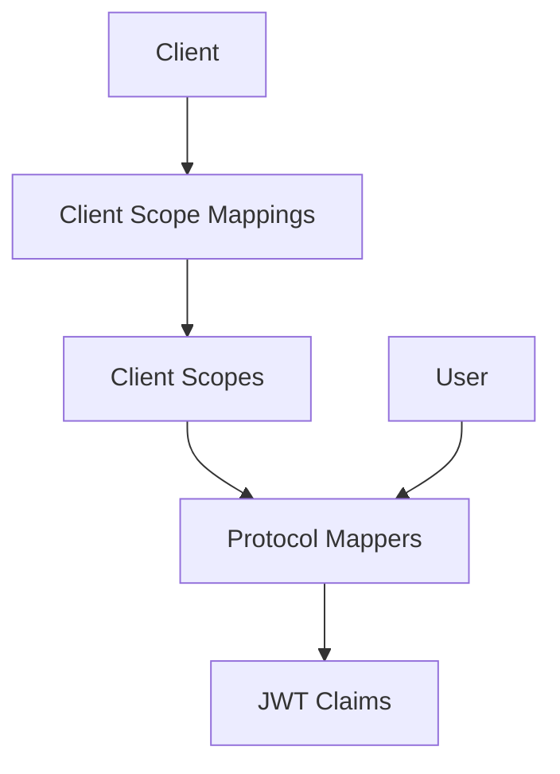

# Aegis：作用域和協議對映器

Aegis 決定哪些資訊最終進入權杖。它擁有客戶端作用域，即命名的宣告集合，以及協議對映器，即將資料提取並寫入 JWT 的規則。它們共同構成應用程式與 FerrisKey 之間的合同：授予我此作用域，這些宣告將出現在權杖中。

## 為何作用域重要

沒有它們，每個客戶端都會得到相同的宣告。使用它們後，公共移動應用會獲得 `sub` 和 `email`，而內部管理工具會獲得角色，並且雙方都不會看到超出所需的資訊。

FerrisKey 將標準 OIDC 作用域植入到每個域中。任何與您的業務相關的特定內容，例如部門、計劃等級或功能標誌，都透過您自己的作用域上的協議對映器進行輸入。 [對映器參考](/zh-TW/modules/aegis/protocol-mappers) 列出了十一種型別。

## 架構

資料傳遞方式：

1. 客戶端攜帶客戶端作用域對映，每個對映將其連結到作為預設或可選的作用域。
2. 每個作用域包含一個或多個協議對映器。
3. 在權杖生成時，對映器讀取使用者資訊並生成宣告。
4. 宣告被組裝到權杖中。

## 作用域型別

| 型別 | 行為 | 使用時機 |
|---|---|---|
| 預設 | 包括在分配給客戶端的每個權杖中 | 應用程式總是需要的宣告，例如電子郵件或角色 |
| 可選 | 僅在請求中在 `scope` 中要求時包含 | 客戶端應當請求的資料 |
| 無 | 系統中可用，但未分配給任何客戶端 | 等待分配的共享作用域定義 |

## 預設的作用域

每個身分域從一開始就已配置這些作用域：

| 作用域 | 宣告 | 型別 |
|---|---|---|
| `openid` | 沒有對映器。`sub` 總是在權杖中 | 預設 |
| `profile` | `preferred_username`, `given_name`, `family_name` | 預設 |
| `email` | `email`, `email_verified` | 預設 |
| `roles` | `realm_access.roles` | 預設 |
| `organization` | `organizations`，以及每個組織的 `id`、`name`、`alias` 和使用者在其中擁有的角色 | 預設 |
| `address` | `address`，從該名稱的使用者屬性讀取 | 可選 |
| `phone` | `phone_number`，從該名稱的使用者屬性讀取 | 可選 |
| `offline_access` | 沒有，它不攜帶任何對映器 | 可選 |

只有當請求的 `scope` 包含 `openid` 時，對映器才會寫入 ID-token 宣告。`profile` 作用域不攜帶 `name` 宣告；如果客戶端需要，可以向其新增 `oidc-full-name-mapper`。

## 現實世界模式

### 帶有基於角色存取的 API 閘道器

分配預設的 `roles` 作用域，或建立你自己的作用域，並帶有一個 `oidc-usermodel-realm-role-mapper`，該 `oidc-usermodel-realm-role-mapper` 將 `realm_access.roles` 寫入權杖。你的 API 閘道器讀取角色宣告並執行路由級別的授權，而無需回撥 FerrisKey。

### 多租戶 SaaS

建立一個自定義作用域，帶有一個 `oidc-hardcoded-claim-mapper`，將 realm 名稱注入為 `tenant` 宣告。你的後端使用它將請求路由到正確的租戶資料庫。

### 第三方整合

僅將 `openid` 和 `email` 分配為第三方客戶端的預設作用域。他們獲取所需的最少資料。您的第一方客戶端預設獲取 `profile`、`roles` 以及自定義作用域。
