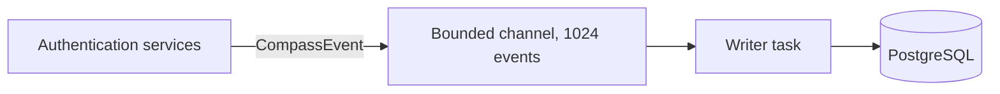

<span id="architecture" />

# 架構

Compass 觀察身分認證而不減慢它。困難在於在延遲敏感的登入過程中記錄逐步資料。Compass 透過將資料庫移出請求來處理此問題：身分認證程式碼將事件放入記憶體佇列並繼續進行，後臺任務將它們寫入 PostgreSQL。

Compass設計上是盡力而為。它回答的是“登入卡在哪裡？”，而不是“這個賬號發生了什麼？”。事件可以在載入時丟棄，行在30天后刪除，伺服器也可以關閉。任何必須透過這三個事件存活的都屬於[SeaWatch](/zh-TW/modules/seawatch/overview)。

<span id="the-flowrecorder" />

## 流錄音器

`FlowRecorder`是唯一的入口點。認證服務持有一個並呼叫三種方法，這些方法都不等待資料庫：

```rust title="FlowRecorder API"
// Open a flow. Returns None when Compass is off for the realm.
fn start_flow(realm, client_id, grant_type, ip_address, user_agent) -> Option<FlowId>

// Record a step on a flow.
fn record_step(flow_id, step_name, outcome)

// Close a flow with its final status.
fn complete_flow(flow_id, status, duration_ms, user_id)
```

`record_step`和`complete_flow`取`start_flow`返回的`Option<FlowId>`，當它被`None`時不做任何操作。因此，Compass關閉的身分域永遠不會產生指向未寫入流的步驟。

<span id="the-queue" />

### 排隊



記錄器透過 Tokio `mpsc` 通道將`CompassEvent`值傳送給單個寫入任務。其中有三種型別的事件流：

| 事件 | 作者的操作 |
|---|---|
| `FlowStarted` | 一次性插入流程行 |
| `StepRecorded` | 將步驟新增到當前批次 |
| `FlowCompleted` | 將最終狀態 `completed_at`、持續時間和使用者新增到當前批次 |

因為作者按順序處理事件，所以在儲存步驟之前會先插入流程行。授權會話儲存流程 ID 而沒有外來鍵，因此丟失或清除的流程永遠不會阻止登入。

<span id="the-writer-batches" />

### 作者按批次處理

在一個週期的第一個事件之後，作者會繼續收集，最長可達 100 毫秒，或者直到批次中包含 256 個事件，以先發生者為準。然後，它會在一條語句中儲存該週期的每個步驟和每個完成。該語句僅在流程存在時才插入步驟，因此步驟永遠不會指向缺失的流程。

接下來有兩件事你可以觀察到。步驟會在發生後的一秒的幾分之一時間內顯示在 API 中。而一個迴圈的步驟和完成要麼一起成功，要麼一起失敗：如果語句失敗，錯誤會被記錄為 `Compass writer: failed to persist a batch`，並且該批次會丟失，不會重試。

<span id="backpressure-and-graceful-degradation" />

### 背壓和優雅降級

通道的事件上限為 1024。當寫入器跟不上而通道已滿時：

1. `try_send` 會立即失敗。
2. 事件會被丟棄。
3. 會記錄一個警告：`Compass: channel full, dropping event`。
4. 認證會正常繼續。指南針從不阻塞或失敗登入。

被丟棄的步驟是流程中的一個漏洞。被丟棄的完成會使其流程保持 `pending` 狀態，直到保留清理將其標記為 `expired`。缺失的流程或步驟意味著伺服器繁忙，絕不是登入未發生。

<span id="disabled-realms" />

### 已禁用的身分域

每次流程開始時，記錄器都會從身分域的設定中讀取 `compass_enabled`。沒有設定行的身分域被視為已啟用。當設定為 `false` 時，`start_flow` 會在構建任何內容之前返回 `None`：沒有流程物件，沒有佇列條目，也沒有資料庫寫入。沒有 Compass 寫入器的部署使用 `FlowRecorder::disabled()`，它完全不持有任何通道。

<span id="persistence" />

## 持久化

Compass 透過兩個儲存庫特性進行讀寫，這些特性在 PostgreSQL 上透過 SeaORM 實現，遵循 FerrisKey 的六邊形佈局（特性在 `ports.rs`，實現在 `infrastructure/`）。

### `CompassFlowRepository`

| 方法 | 說明 |
|---|---|
| `create_flow(flow)` | 插入一個流程行 |
| `write_batch(steps, completions)` | 插入步驟並應用完成情況，一條語句完成 |
| `list(scope, request)` | 一頁流程及其步驟，已過濾和排序 |
| `get_flow_by_id(flow_id)` | 獲取一個流程 |
| `purge_old_flows(older_than)` | 刪除在某日期之前開始的流程及其步驟 |
| `expire_stale_flows(started_before)` | 將在某日期之前開始的`pending`流程標記為`expired` |
| `get_stats(realm_id)` | 獲取一個身分域的計數和平均持續時間 |
| `get_daily_activity_stats(realm_id, filter)` | 某日期視窗的每日計數 |

### `CompassFlowStepRepository`

| 方法 | 說明 |
|---|---|
| `get_steps_for_flow(flow_id)` | 獲取流程的所有步驟 |

<span id="retention" />

## 保留

保留任務在API伺服器內執行。它在啟動時執行一次，以清除伺服器關閉期間積累的內容，然後每小時執行一次。每次執行按順序完成兩件事：

1. 將仍為`pending`且開始超過12小時的流程標記為`expired`。使用者離開的登入從未完成，因此如果沒有這一步，每個被放棄的登入將永遠計為進行中。
2. 刪除開始超過30天的流程。其步驟也將一起刪除，透過`ON DELETE CASCADE`。

兩個閾值都是固定的。任何一步失敗都會被記錄，下一次週期會再次嘗試，因此資料庫的小故障從不會使伺服器宕機。

:::callout{variant="warning"}
30天視窗不可配置。要保留更長時間的流程，請在它們被刪除之前，透過[listing endpoint](/zh-TW/modules/compass/querying)讀取出來。
:::
