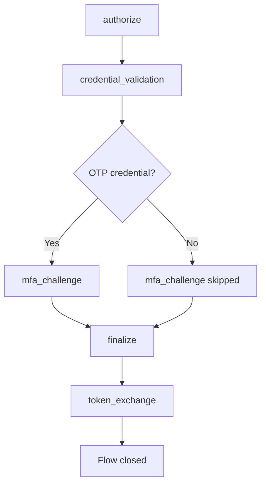

# Compass：認證流程

Compass 將每次認證嘗試記錄為一個流程：一系列命名步驟，每個步驟都有其結果、持續時間和錯誤細節。這是你瞭解登入到底出錯在哪一步的方法。

## 原因

從外部看，認證只是一次請求和一個權杖。內部來看，它包括重定向驗證、憑據雜湊、多因素認證挑戰、可能的外部身分提供商往返、會話建立以及權杖簽名。當認證失敗時，`401` 並不能告訴你到底是哪一步出了問題。

使用 Compass，你會得到如下資訊：

> 客戶端 `my-frontend`、授權 `authorization_code` 的流程 `01914b3c-...`：
> 授權 (成功) → 憑據驗證 (成功，85 毫秒) → 多因素認證挑戰 (失敗，`invalid_otp_code`)

此時流程仍然是 `pending`：使用者還在登入頁面，可以輸入另一個驗證碼。

每一行都是一次身分認證執行：其授權型別、結果、經過的步驟數量以及所花費的時間。`pending` 行是一條尚未完成的流程：正在進行的登入、使用者放棄的登入，或因檢查失敗可能仍可重試的登入。在開始十二小時後，`pending` 流程會變為 `expired`。

## 什麼被記錄

啟用 Compass 後，一次身分認證會開啟一個流程，並且每個階段都會記錄一個步驟。被追蹤的入口點有：

| 入口點 | `grant_type` | 步驟 |
|---|---|---|
| 透過授權碼流程的瀏覽器登入 | `authorization_code` | `authorize`, `credential_validation`, `mfa_challenge`, `finalize`, `token_exchange` |
| 權杖端點的密碼授權 | `password` | `token_exchange` |
| 客戶端憑據授權，僅失敗情況 | `credentials` | `token_exchange` |
| RFC 8693 權杖交換 | `urn:ietf:params:oauth:grant-type:token-exchange` | `subject_token_exchange` |
| SAML 登入 | `saml_sso` | `saml_authn_request`、登入步驟、`saml_assertion` |
| 透過外部身分提供者登入 | `broker_<alias>`，使用了服務商別名 | `idp_redirect`、`idp_callback`，然後`token_exchange`客戶端兌換程式碼 |

重新整理權杖授予不會被追蹤，成功的客戶端憑據授予也不會被追蹤：兩者都會在每次續期時觸發，並且會掩蓋有趣的流程。

## 流量生命週期

::::step-group
:::step{title="流動開啟"}
當認證開始時，Compass 會建立一個包含身分域、客戶端、授權型別、IP 地址和使用者代理的 `CompassFlow`。其狀態為 `pending`。
:::

:::step{title="步驟會被記錄下來"}
登入的每個階段都會寫下一個步驟，包含其結果、持續時間和錯誤資訊。步驟會在後臺儲存：寫入者收集它們最多可達100毫秒並一起儲存，因此步驟在完成後不久就會出現在API中。
:::

:::step{title="水流關閉"}
登入結束後，流程會獲得最終狀態、`completed_at`、`duration_ms`和使用者。對於瀏覽器登入，這發生在權杖步驟。登入頁面上的錯誤密碼或程式碼記錄失敗步驟，但不會關閉流程，因為使用者可以在同一頁面重新嘗試。
:::

:::step{title="舊流量被清理"}
每小時的掃描會終止`pending` 12小時的流量，刪除超過30天的流量及其步驟。參見[架構](/zh-TW/modules/compass/architecture#retention)。
:::
::::

## 流動結構

`CompassFlow`顯示整個嘗試：

| 欄位 | 型別 | 說明 |
|---|---|---|
| `id` | UUIDv7 | 流量識別符號，按時間順序排列 |
| `realm_id` | UUID | 身分域背景 |
| `client_id` | 字串，可空 | 啟動認證的OAuth是`client_id` |
| `user_id` | UUID，可空 | 已認證的使用者。在流程關閉時設定，因此在流程進行中它為 null，並且在密碼授權流程中它保持為 null |
| `grant_type` | 字串 | 見上表 |
| `status` | 字串 | `pending`, `success`, `failure` 或 `expired` |
| `ip_address` | 字串，可空 | 源 IP 地址 |
| `user_agent` | 字串，可空 | 客戶端使用者代理 |
| `started_at` | 日期時間 | 流程開始的時間 |
| `completed_at` | 日期時間，可為空 | 流程關閉的時間。流程進行中為 null |
| `duration_ms` | 整數，可為空 | 關閉步驟的持續時間，單位毫秒 |
| `steps` | 陣列 | 步驟記錄，按開始順序 |

`duration_ms` 測量關閉步驟，對於瀏覽器登入，這是將授權碼交換為權杖的過程。它不包括使用者在登入頁面上花費的時間。對於牆鍾時間，請用 `completed_at` 減去 `started_at`。

### 流程狀態值

| 狀態 | 含義 |
|---|---|
| `pending` | 未關閉。正在進行簽到、已放棄或在憑據或程式碼檢查失敗後可重試 |
| `success` | 透過成功的權杖頒發或 SAML 斷言關閉 |
| `failure` | 在權杖步驟失敗，或 SAML、身分提供者或權杖交換嘗試失敗時關閉 |
| `expired` | 當每小時清理執行時，已作為 `pending` 超過 12 小時 |

## 流程步驟

每個步驟記錄：

| 欄位 | 型別 | 說明 |
|---|---|---|
| `id` | UUIDv7 | 步驟識別符號 |
| `flow_id` | UUID | 父流程 |
| `step_name` | 字串 | 以下十種步驟型別之一 |
| `status` | 字串 | `success`, `failure` 或 `skipped` |
| `duration_ms` | 整數，可為空 | 步驟持續時間（毫秒）。某些步驟不記錄 |
| `error_code` | 字串，可空 | 機器可讀錯誤（失敗時） |
| `error_message` | 字串，可空 | 人類可讀詳細資訊（部分失敗時） |
| `details` | JSON，可為空 | 額外資料。僅 `idp_callback` 設定它 |
| `started_at` | 日期時間 | 步驟開始時間 |

### 步驟型別

| 步驟 | 記錄時間 |
|---|---|
| `authorize` | 授權請求已被接受：客戶端、重定向 URI 和 PKCE 檢查透過，並且登入會話已建立 |
| `credential_validation` | 使用者名稱和密碼已檢查。失敗時 `error_code` 是內部錯誤名稱，例如 `InvalidPassword`、`UserDisabled` 或 `AccountLocked` |
| `mfa_challenge` | 一次性程式碼已檢查，失敗時的錯誤為 `invalid_otp_code`。賬戶沒有認證器時，該步驟為 `skipped` |
| `finalize` | 登入完成並頒發了授權碼 |
| `token_exchange` | 授權碼或密碼授權的密碼已交換為權杖。`duration_ms` 是交換所花費的時間 |
| `idp_redirect` | 來自外部身分提供者的登入返回，因此使用者已被重定向到其處。沒有持續時間 |
| `idp_callback` | 提供者返回的程式碼在其權杖端點進行交換。成功時 `details.provider` 儲存提供者別名。失敗時 `error_message` 包含提供者的 `error` 和 `error_description` |
| `saml_authn_request` | 服務提供者的 `AuthnRequest` 已被解析和檢查。失敗會返回錯誤程式碼和訊息 |
| `saml_assertion` | 為服務提供者構建並簽署了斷言 |
| `subject_token_exchange` | 一次 RFC 8693 交換。失敗時 `error_code` 為 OAuth 錯誤 |

### 步驟狀態值

| 狀態 | 含義 |
|---|---|
| `success` | 步驟已完成 |
| `failure` | 步驟失敗，請參見 `error_code` 和 `error_message` |
| `skipped` | 步驟不適用，例如 `mfa_challenge` 對於沒有身分認證器的賬戶 |

## 配置

| 設定 | 預設 | 說明 |
|---|---|---|
| `compass_enabled` | `true` | 記錄此身分域的流程 |

關閉它後，認證行為保持不變，只是沒有記錄：沒有流程、沒有步驟、沒有資料庫寫入。在不需要步驟級別可觀察性的身分域上，這是值得做的。

:::callout{variant="info"}
將 `compass_enabled` 設定為 `false` 後，錄製器在構建流程之前就返回。沒有任務排隊，也沒有寫入。
:::
