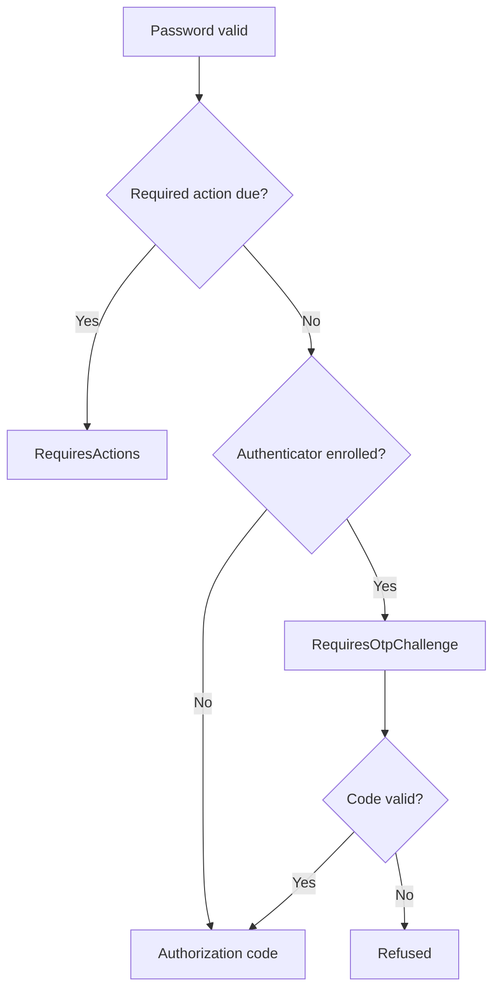

# Trident：多因素身分認證

Trident 覆蓋了有效密碼之後可能的步驟：一次性程式碼挑戰、註冊螢幕、金鑰登入、魔法連結和恢復程式碼。這四種方法的作用不同，因此在配置任何方法之前，瞭解每種方法的作用是有幫助的。

## 為什麼要費心

憑據填充和網路釣魚使得僅憑密碼本身就存在風險。第二因素意味著僅憑偷來的密碼無法登入。

註冊是透過必需的操作來強制執行的。在身分域或角色上設定 `require_mfa`，未使用認證器的使用者將在下次登入時獲取 `configure_otp` 必需操作。他們必須在登入完成前完成此操作。

## 可用的方法

::::card-group{cols=2}
:::card{label="TOTP" icon="lucide:clock" href="/zh-TW/modules/trident/totp"}
基於時間的一次性密碼（RFC 6238）。這是 FerrisKey 在密碼後要求的唯一第二因素。
:::
:::card{label="WebAuthn" icon="lucide:fingerprint" href="/zh-TW/modules/trident/webauthn"}
通行碼和安全金鑰。使用者驗證的通行碼可以單獨完成登入，無需密碼。
:::
:::card{label="免密登入連結" icon="lucide:mail" href="/zh-TW/modules/trident/magic-links"}
無密碼的電子郵件登入，與請求連結的瀏覽器繫結。
:::
:::card{label="恢復碼" icon="lucide:file-key" href="/zh-TW/modules/trident/recovery-codes"}
一次性備份碼，在丟失認證器時用於應對 TOTP 挑戰。
:::
::::

## Trident 所在的位置

在有效密碼與登入結束之間：

密碼驗證透過後：

1. FerrisKey 應用賬戶鎖定規則。
2. 如果有需要執行的操作（`configure_otp`、`verify_email`、`update_password` 或 `configure_passkey`），響應狀態為 `RequiresActions`，並在 `required_actions` 中列出這些操作。
3. 否則，如果使用者擁有身分認證器，狀態為 `RequiresOtpChallenge`。
4. 在這兩種情況下，響應都會在 `FERRISKEY_LOGIN_ACTION` Cookie 中設定步驟權杖，門戶使用該權杖呼叫匹配的 [登入操作](/zh-TW/modules/portal/login-actions)。
5. 當最後一步完成後，FerrisKey 應用客戶端的維護和同意規則，並返回攜帶授權碼的 `url`。客戶端按通常方式用它換取權杖。

擁有認證器的使用者在回答挑戰之前，無法呼叫除程式碼挑戰和恢復碼呼叫之外的任何登入操作。

<Callout variant="info" title="步驟權杖">

步驟權杖在身分域的 `temporary_token_lifetime` 中有效，預設 300 秒。它透過作用於 `/realms/{realm_name}/login-actions` 的 HttpOnly cookie 傳遞，並且僅授權那些端點。它不能存取受保護的資源。

</Callout>

密碼金鑰和魔法連結進入鏈的方式不同。這兩者都從透過其他方式驗證的身分開始，因此它們跳過密碼，直接進入登入流程的末端，只要沒有必須執行的操作。使用者驗證的密碼金鑰也會回答 TOTP 挑戰。魔法連結則不會，對於擁有認證器的使用者，FerrisKey 會拒絕它。

## 團隊使用的三種方式

### SaaS 產品上的強制多因素認證 (MFA)

為整個域啟用 `require_mfa`。每個沒有驗證器的使用者在下一次登入時都會透過註冊流程，然後才能存取應用程式。要在部分人群中強制執行，可改為在角色上設定 `require_mfa`：任何擁有該角色的使用者都適用。

### 以金鑰為優先的登入

啟用 `passkey_enabled` 並給予使用者 `configure_passkey` 所需操作。登入頁面隨後會在密碼欄位旁提供一個金鑰按鈕，使用者驗證過的金鑰即可無需輸入任何內容直接登入。密碼仍然保持可接受狀態。

### 在消費者應用上可選的多因素認證（MFA）

保持 `require_mfa` 關閉，讓使用者可以在賬戶頁面的安全選項卡中註冊驗證器或金鑰。可用，但不強制。
