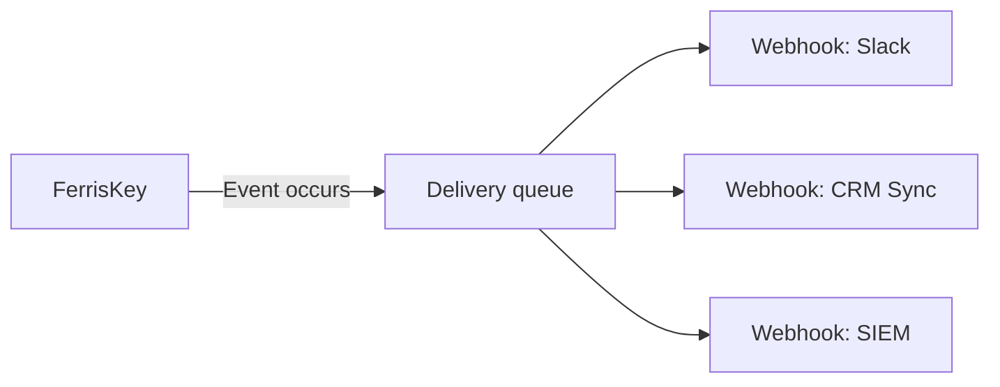

<span id="webhooks-event-driven-integrations" />

# Webhook：事件驅動的整合

當 FerrisKey 中發生某些事件時，Webhook 會向外推送 HTTP 通知。建立使用者、分配角色、刪除客戶端：FerrisKey 會向您註冊的端點傳送已簽名的 JSON 負載。

<span id="why" />

## 原因

FerrisKey 掌握身分。您的應用程式不在其內部執行。Webhook 是兩者之間的介面。

他們可以在沒有任何人輪詢的情況下保持客戶關係管理系統、倉庫或營銷平臺的最新狀態。他們在事件發生的那一刻啟動下游工作，例如傳送歡迎郵件、Slack 訊息或執行配置作業。他們將與安全相關的操作推送到你的警報系統中。而你的應用程式無需瞭解 FerrisKey 的內部機制也能完成這些操作。

<span id="how-it-works" />

## 工作原理



::::step-group
:::step{title="註冊一個 webhook"}
建立一個具有端點 URL、可選自定義頭、名稱和描述的 webhook。該 webhook 屬於一個身分域。FerrisKey 拒絕儲存端點，如果它不是 `https`、如果 URL 中攜帶憑據、或者如果它是位於環回、私有或鏈路本地範圍內的 IP 地址或 `localhost` 名稱。每次 FerrisKey 解析主機名以進行傳遞時，都會再次檢查主機名。普通 `http` 僅被接受用於環回，並且僅在 API 以 `WEBHOOK_ALLOW_PRIVATE_ENDPOINTS=true` 執行時才允許。
:::

:::step{title="訂閱事件"}
列出 `subscribers` 中 webhook 所關心的觸發器，例如 `user.created` 或 `client.deleted`。
:::

:::step{title="收集簽名金鑰"}
FerrisKey 為每個 webhook 生成一個金鑰並用它對每次投遞進行簽名。建立響應不會返回它，也沒有讀取會返回。呼叫 `POST /realms/{realm_name}/webhooks/{webhook_id}/secret/rotate` 一次，或在控制檯中使用“生成新金鑰”，並儲存返回的內容。[Payload 格式](/zh-TW/modules/webhooks/payload#verifying-the-signature) 顯示了你的端點如何使用它。
:::

:::step{title="事件觸發"}
當身分域中發生匹配的事件時，FerrisKey 會為每個訂閱的 webhook 記錄一次投遞，然後嘗試將 payload POST 到端點。導致事件的操作不會等待你的端點，也不會因為你的端點失敗而失敗。
:::
::::

<span id="webhook-structure" />

## Webhook 結構

使用 `POST /realms/{realm_name}/webhooks` 建立一個 webhook。僅 `endpoint` 是必需的。

```json title="POST /realms/acme/webhooks"
{
  "name": "CRM sync",
  "description": "Keeps HubSpot contacts in step with users",
  "endpoint": "https://api.yourapp.com/webhooks/ferriskey",
  "headers": { "Authorization": "Bearer your-secret-token" },
  "subscribers": ["user.created", "user.updated", "user.deleted"]
}
```

讀取返回：

| 欄位 | 說明 |
|---|---|
| `id` | 唯一的 webhook 識別符號 |
| `endpoint` | HTTP POST 的目標 URL |
| `name`, `description` | 可選標籤 |
| `subscribers` | 已訂閱的觸發器，每個觸發器都有自己的 `id` 和 `name` 中的觸發器 |
| `retry_policy` | 此 webhook 覆蓋的重試欄位。見 [投遞和重試](/zh-TW/modules/webhooks/deliveries) |
| `effective_retry_policy` | 在回退到身分域和系統預設值後適用的重試策略 |
| `triggered_at` | Webhook 上次觸發的時間 |
| `created_at`, `updated_at` | 時間戳 |

`headers` 和金鑰進來後不會再出來。讀取不會返回頭值，`webhook.created` 或 `webhook.updated` 通知的有效載荷也不會返回頭值。

`PUT` 替代整個 webhook：每次都需要 `endpoint`，並且 `name`、`description` 和 `subscribers` 會被你傳送的內容覆蓋，所以如果更新 webhook 時沒有 `subscribers`，最終訂閱為空。`headers` 是例外。省略它會保留儲存的集合，傳送它會替換整個集合。

列表端點是分頁的，如 [API 列表](/zh-TW/discover/guides/api-listings) 中所述。它可以根據 `search`（名稱或端點）、`name`、`endpoint`、`triggered`、`has_subscribers`、`secure_endpoint`（`true` 保留 `https://` 端點）、`created_from` 和 `created_to` 進行過濾，並可以根據 `name`、`endpoint`、`triggered_at`、`created_at`（預設）或 `updated_at` 進行排序。

<span id="what-people-wire-up" />

## 人們連線的內容

::::card-group{cols=2}
:::card{label="使用者入職" icon="lucide:user-plus"}
在 `user.created` 上，傳送歡迎電子郵件，在你的計費系統中配置試用賬戶，並在 Slack 中通知銷售團隊。
:::
:::card{label="安全監控" icon="lucide:alert-triangle"}
將 `auth.reset_password` 和 `client.maintenance.enabled` 事件轉發到 PagerDuty 或 Opsgenie 以進行值班警報。
:::
:::card{label="資料同步" icon="lucide:refresh-cw"}
在 `user.updated` 和 `user.deleted` 上，將更改同步到您的 CRM、資料倉儲或營銷平臺，實時發生。
:::
:::card{label="審計轉發" icon="lucide:database"}
將您訂閱的觸發器轉發到 Splunk、Elastic 或自定義 SIEM，以進行長期儲存和合規報告。
:::
::::

<span id="then-watch-what-actually-happens" />

## 然後觀察實際發生的情況

連線 webhook 是簡單的一半。[投遞和重試](/zh-TW/modules/webhooks/deliveries) 涵蓋了另一半：每次嘗試都會記錄返回的狀態碼，失敗會以指數退避和抖動方式重試，嘗試次數用盡的投遞可以在您修復端點後手動重放。

::::card-group{cols=3}
:::card{label="有效載荷格式" icon="lucide:file-json" href="/zh-TW/modules/webhooks/payload"}
信封、頁首以及如何驗證簽名。
:::
:::card{label="投遞與重試" icon="lucide:repeat" href="/zh-TW/modules/webhooks/deliveries"}
狀態碼、錯誤碼、自動退賽、手動回放、金鑰輪換。
:::
:::card{label="觸發器" icon="lucide:webhook" href="/zh-TW/modules/webhooks/triggers"}
38個觸發點可以認購，FerrisKey今天漲注33個。
:::
::::
